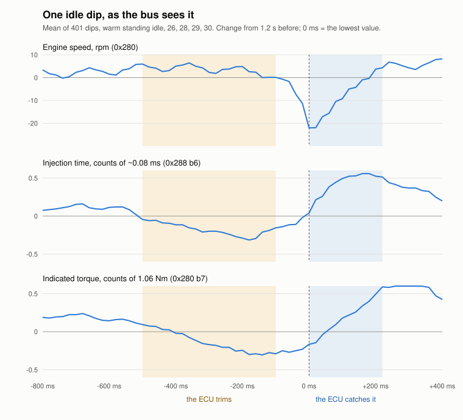

# The idle log — chasing a rough idle and misfires on a VW 2.0 AQY

**A diary of one investigation, kept for the owner looking back and for
anyone with the same engine and the same complaint.** The forums hold many
threads about an AQY that idles unevenly and counts misfires, and most of
them end unresolved (`open.md`, *What the forums say about this idle*). This
one records what was done to the car, what was tested, what changed after —
and, just as much, **what nobody can say for sure a repair achieved**.

It covers the two symptoms that matter here, **S1** (the idle is unsettled)
and **S3** (the ECU counts misfires at idle). Other faults appear only where
they crossed this path. Where things stand **now** is `open.md`; what comes
next is `plan.md`; what was settled against is `refuted.md`; the car's
service record is `vehicle-history.md`. This file is the story between
them, kept current until the idle is fixed — then it stays, as reference.

**How to read it.** One entry per day, or per job where a day held two.
Every entry opens with the same three lines, and a line that would be
empty is left out:

- **Repairs** — what was changed, fitted, adjusted or added on the car;
- **Tests** — what was only tested, read or recorded;
- **Changes after** — what moved afterwards, split into *measured*, *felt*
  (the owner's impression, nothing behind it) and *not known*.

The detail follows, short. Analysis and questions that only re-read
earlier data are not entries: their findings belong to the symptom in
`open.md`. ⚠ **A repair followed by a better idle is not proof that the
repair fixed it** — several were done together, adaptations were reset
along the way, and the instruments changed twice.

*All dates are 2026. Condensed 20/10/2026 (the full version is
`git show d327332:docs/engine-health/idle-log.md`) and restructured
28/10/2026 into the three lines above (the version before is
`git show c3d8760:docs/engine-health/idle-log.md`).*

---

## What is being chased, in one picture

*Added 11/10/2026, at the owner's request.* At a warm standing idle, every
few seconds, **the engine speed falls by twenty-odd rpm in two strokes and
climbs back in about a fifth of a second.** The picture is the average of
four hundred of them, read off the CAN bus (`open.md` S1).

1. **Half a second before**, the idle has crept a few rpm high and the ECU
   takes about one per cent of air and fuel away.
2. **Then one combustion fails or nearly fails**; the crank loses speed over
   two strokes.
3. **The ECU adds fuel, air and advance at once**; the idle is back within
   about five strokes.

**The ECU regulates correctly; the engine has lost the margin** to absorb a
charge one per cent smaller than usual. Where it went is the open question.

---

## The car, the symptoms, and the instruments

**The car.** VW New Beetle, 2.0 l **AQY** (85 kW), ECU `06A 906 018`,
model year 2000, bought in 9/2017 at 126,200 km and driven little since.
**Remapped in 6/2018**, described by the owner as mild; the tuner kept the
original (*owner*, 13/10). The engine warning lamp had been masked by a
previous owner and was restored in 2017.

**S1 — the unsettled idle.** At a standstill the engine speed dips by 20–45
rpm every few seconds and recovers in about a quarter of a second. Felt from
the seat. Roughest cold, calmer as the oil warms, calmest hot *(until
9/10/2026 this said "worst at about 71–85 °C of oil"; that peak was 014's,
not engine speed's)*. A reading without the oil temperature beside it
compares with nothing.

**S3 — misfires counted at idle.** VCDS group **014** field 3:
- a **current count** held about 3 s, not a lifetime total, despite its label;
- it **moves in steps of 12**;
- the label file specifies **0–5**; this car reads 12–120;
- it reads `deaktiv.` below about 20 % load — right at the hot idle;
- **what it counts changes with the air measurement and the adaptations**.
  **A yes/no witness, not a ruler.**

**The instruments.**
- **VCDS**: 014, 003, 055 (learned idle air), 032 (lambda adaptations), knock groups.
- **A CAN capture** (USBtin, listen only, the adapter's timestamps) —
  engine speed once per 180° of crank, one value per firing.
- **`IdleHealth`**, the mean firing-to-firing change of engine speed × 50,
  on the display and recomputed from captures; lower is smoother. **Its 100
  is two recordings on the old parts**: the 60 s warm idle of 11/8 at 85 °C
  of oil (`09`) and the five-minute cold warm-up of 11/9 (`18`), both 106 on
  this scale. And **dips ≥ 20 rpm a minute** (`tools/idledips.py`).
  **Neither reproduces 014** (`docs/firmware/can-decoding.md` question 11).

---

## Before September 2026 — the history

- **1/2018** — fault memory (`photos/vcds-faults-2018-01.png`): **16824 /
  P0440, EVAP**, intermittent; not seen again until 6/11/2026 (below).
- **5/2019** — fault memory (`photos/vcds-faults-2019-05.png`): **P0172 too
  rich, P0300, P0304 cylinder 4**, all intermittent and stored only above a
  2 % misfire rate (`vcds.md`). Not seen again until 24/10/2026. What made
  2019 rich is not known *(this blamed the MAF until 11/10/2026; that MAF
  read near zero in August — `refuted.md` C2)*.
- **12/2017** — fuel filter changed; the old one corroded and leaking, dark
  cloudy fuel in it. **6/2018** — remap. The fuel tank was replaced at some
  unknown point.
- **For years** the idle stumbled and the cold start was poor.
- **6/2026** — new ignition coil, after a misfire under full load (gone since).
- **About 6/2026** (*owner*, recalled 16/10): **every start ran on three
  cylinders** at first, on fuel about three years old (`refuted.md` A14);
  gone with fresh fuel. Which cylinder is not known. Throttle body
  inspected: clean.
- **6/2026** — new fuel pressure regulator (*owner*, 25/10/2026; *this
  said 7/2026 until then*).
- **7/2026** — MAF connector cleaned.
- **Summer 2026** — heater replaced; **battery off more than a week**, every
  adaptation restarted. A secondary-air hose torn off in the work (P0411,
  11/8) and refitted.
- **11/8** — the first captures (`09`, `11`, `12`). Hot idle **43–48** (29
  with the A/C on); at 85 °C of oil 15 dips a minute. *This line also
  carried 032 −4.7 / +1.6 %; the owner's photo dates that reading 10/9,
  not 11/8.*
- **20/8, 7:49** — 032 **−5.5 / 0.0 %**; 001 at the same idle 760 rpm,
  coolant 94.5 °C, regulation +0.8 % (`photos/vcds-001-032-2026-08-20.jpg`,
  found by the owner in the album 25/10). Two months on the oil of 15/6,
  before any of the captures' cold idles.
- **6–9/2026, how the car was used** (*owner*, 25/10): still unregistered,
  so **many short cold runs**: started in the garden and left idling while
  he and his son sat in it, now and then moved a little on the property.
  Next to no road driving between the oil change and September.

**The picture then:** a leaking injector.

---

## 10/9 — the converter replaced

- **Repairs:** the exhaust from the flex pipe back, by a garage.
- **Changes after:**
  - *measured:* 032 **−4.7 / +1.6 %** at 17:49 (`photos/vcds-032-2026-09-10.jpg`)
    — on cells that mostly still held what was learnt on the old exhaust.

The converter of 10/2017 was **completely blocked, cracked outside, one
chamber burned through** — raw fuel burning in it, i.e. misfires. **The
one hard fact of the investigation.**

## 11/9 — a cold start recorded, on the old parts

- **Tests:** a cold start captured (`18_coldstart_z1`), VCDS 014 + 055.

**1.24 s of cranking, first firing at 451 rpm, a fall to 311 rpm, nearly
died.** The dips and the 014 increments were the same events (all seven
beside a dip, p = 0.023); no single cylinder dominated (`refuted.md` A5);
014 up to 36 at the cold idle.

## 17/9 — plugs and leads, compression

- **Repairs:** new plugs and NGK leads, at a garage.
- **Tests:** compression.
- **Changes after:**
  - *felt:* the idle a little calmer (*owner*);
  - *measured:* nothing measured it (`refuted.md` C12).

**Compression 12 bar, even on all four** (`refuted.md` A4). The old plugs
were worn out after about 1,500 km, one visibly worse — which cylinder is
not known.

## 23/9 — new injectors and fuel filter

- **Repairs:** four new Bosch injectors (the same part), a new fuel filter,
  the lines flushed; battery off.
- **Changes after:**
  - *measured:* no codes;
  - *felt:* the idle "not fundamentally different";
  - *not known:* the old injectors were never leak-tested.

Clear petrol throughout. ⚠ **Three of the four sat about 1 mm proud** of
their bores until 1/10: fitted already clipped into the rail, then the rail
pushed down; cylinder 4 was home. An old injector tried alone clicked fully
home in every bore. The manifold-end O-ring is the seal against the intake
(`open.md` H3).

## 24/9 — the MAF replaced

- **Repairs:** the MAF, genuine VW `06A 906 461 A` (afternoon; the 2018
  unit kept).
- **Tests:** a drive on all the new parts in the morning (`19`); 032 before
  and after.
- **Changes after:**
  - *measured:* 032 **−16.4 / −13.3 % → −3.1 / +4.7 %**, the air-to-fuel
    ratio back to August's; standstill dips **down 51–65 %** in every oil
    band; **014 counted more** at the hot idle, five to fifty times more per
    dip (`refuted.md` A11) — the counter, not the engine;
  - *felt:* the morning drive pulled better; the misfires stayed;
  - *not known:* since when the old MAF over-read.

In the morning the air per commanded fuel was up 14–45 % on August: **the
old MAF was over-reading**, about a third high on the hot idle after the
pulls (`refuted.md` C2). **Confident: the rich trim was the MAF.** For
anyone else: do not compare 014 across a MAF change.

The new MAF's connector points forward, as on the 2018 unit; flow direction
right; the harness not clipped in, **left as it is** (*owner's decision*,
3/10).

## 25–27/9 — testing everything cheap

- **Tests:** the table below.

| test | result |
|---|---|
| knock retard (022/023), 026 | none at idle (`refuted.md` A10); cylinder 4 retards at higher speeds (`open.md` S4/S5) |
| secondary-air valve, N112 hoses pulled at idle | valve seals; no change in `IdleHealth` (A8) |
| evaporative purge (070) | OK (A6) |
| coil connector, earths, voltages under load | no gross fault (`open.md` H4) |
| **spray test, warm idle**: front hoses, MAF-to-throttle hose | **no change**; back of the intake, injector seats, throttle joints **not** sprayed |
| loads on at idle (A/C, lights, blower) | **`IdleHealth` 70–80 → 35–50** |
| filler cap off at idle | audibly slightly worse |
| oil at the back of the head, smoke, a possible hiss | new symptoms: the cover gasket (S10, `refuted.md` D5), the hiss (S11) |
| injectors looked at, 27/9 | three of four proud (23/9) |

**The picture at 27/9:** a small unmetered air leak (the proud injector
seats, the back of the intake, the breather). Never proven.

## 1–2/10 — the valve cover, throttle and breather job

- **Repairs:** injectors refitted one by one, all four home (rail at
  10 Nm, cylinder 2's O-ring replaced); new valve cover gasket (⚠ the
  wrong part, 3/10); new upper plenum gasket; new crankcase breather (Febi
  `32452`), a new ring `100690` in the old filler cap; new throttle body
  (Pierburg `7.03703.13.0`); the vacuum elbow replaced by a longer hose;
  the throttle cable's slack taken up; battery off, every adaptation from
  zero.
- **Tests:** leads about 6 kΩ each, injector windings 15.9 Ω each; 098
  *ADP OK* (10.4°, 59.2 %); 054 5.6° at rest, 91.1° on the floor; the
  ignition-on routine still 20 s; a check start standing, part-warm
  (`vcds/vcds-postrepair-checkstart-003-014-055.csv`).
- **Changes after:**
  - *measured:* at the check start the idle as `19`'s (794 against 798
    rpm, air 3.96 against 4.28 g/s); 014 counted 13 twice, then nothing;
    `IdleHealth` 57 at its lowest that evening, every load on, fresh
    adaptations; no leaks, no hiss;
  - *not known:* one job by the owner's decision, **so no improvement can
    be put down to one part**.

**Found:** the old breather **loose on a ring flowed out of shape**
(`refuted.md` A15), the patch on its body original (C15); **six of eight
cover nuts loose by hand** over a gasket gone hard, almost like plastic
(D5); the vacuum elbow hard; the old throttle's idle switch silent, its
idle-stop face **worn 1–2 mm** (`open.md` H8). Sound: both plenum gaskets,
the June throttle gasket, the plenum face, the rear hoses, every injector
connector; no emulsion. The 20 s routine closed S13 (`refuted.md` D7, C16).
A ticking at the timing-belt end went once the belt cover was refitted.

## 3/10 — the cover leaks

- **Tests:** session A — a cold start after 27 h, a warm-up drive, warm and
  hot stops.
- **Changes after** (of 1–2/10):
  - *measured:* **014 still counted**, 16–17 a minute at 57–92 °C of oil;
    engine speed mixed — as rough or rougher in the middle band, smoother
    at the one hot stop (about a minute); the start clean, 0.77 s;
  - *not known:* how much of the counting was the hole below.

**The new cover gasket leaked a stream of oil** at cylinder 4's end, about
20 minutes in, down to the coil (`photos/cover-leak-2026-10-03-*.jpg`);
about 0.5 l topped up. Cover off that night: Elring `325.070` is **a gasket
for another engine** (AZJ, BER, AZG, AEG), with **an open arch leaving a
hole about 1 cm across into the crankcase** where the old one had a solid
ribbed half-moon (`refuted.md` C17, D5). About a litre had run down to the
driveshaft.

## 4/10 — the right gasket, then two sessions

- **Repairs:** the right cover gasket, Elring `915.653` (solid half-moons,
  metal sleeves); the plenum back on; battery off and 098.
- **Tests:** session A on fresh adaptations; the MAF wiggle test; session B
  in the afternoon after a cool-down to 47 °C of oil.
- **Changes after:**
  - *measured:* **the joint stayed dry**; **014 zero at both warm stops of
    session A — the first time ever**; hot `IdleHealth` 60–72, 4.4 dips a
    minute; 032 −0.8 / +2.3 %; **after five minutes of hard driving 014
    counted at every idle**, and in session B again from the start;
  - *felt:* calmer in session A; the belt noise gone (most likely the belt
    rubbing a cover that sat low on the wrong gasket);
  - *not known:* whether the gasket did anything for 014.

The MAF wiggle test found nothing (003 3.06–3.54 g/s against 2.92–4.03
before, 014 already counting): the contact is sound. About 1 l of oil
topped up in all. **Together** (`refuted.md` C19): 014 followed **055's
learned idle air value** — quiet above about −0.93 g/s, counting from −0.95
on, warm or cold.

| change | sure it helped? |
|---|---|
| the MAF, 24/9 | **yes** — the rich trim, and smoother engine speed |
| the job of 1–2/10 | **not shown** — both calm hot stops were on fresh adaptations, and on settled ones the hot idle is back where the MAF left it |
| the right gasket, 4/10 | **for the oil, yes**; for 014 **not shown** |
| plugs, leads, injectors, coil | did not fix the idle; the old injectors probably caused the bad cold start, which is gone. The cold burble came back warm on 4/10 (`open.md` S14) |

**`IdleHealth` against its own 100:**

| state | before the repairs | 24/9, new MAF | 3/10 | 4/10 |
|---|---|---|---|---|
| middle band, ~77–87 °C of oil | **106 (`09`, 11/8)** | 84 | 111 | **98** (A), **107** (B) |
| cold idle, first five minutes | **108 (`18`, 11/9)** | — | — | **121** (A) |
| hot, ~97 °C | 48 (`11`, a 22 s hold) | 92 | — | **72** (A) |

Against its own 100 the idle had not measurably improved.

**The starts measured from the capture** (`tools/idledips.py`;
`docs/firmware/frames.md`, *The start*). ⚠ Only a near-stall or a crank
past 1.2 s counts on its own.

| | stand | coolant | crank to first firing | `StartDip` |
|---|---|---|---|---|
| 11/9 (`18`), old injectors | ~10 h | 16 °C | 1.22 s | 141 rpm, nearly died |
| 24/9 (`19`) | ~19 h | 12 °C | 0.83 s | 118 rpm |
| 25/9 | ~12 h | — | 0.77 s | — (clean) |
| 26/9 | ~10 h | 14 °C | 0.93 s | 74 rpm |
| 3/10, session A | 27 h | 17 °C | 0.77 s | 15 rpm |
| 4/10, session A, after a disconnect and 098 | ~15 h | 15 °C | 1.38 s | 0 rpm |
| 4/10, session B, part-warm | ~2 h | 44 °C | 0.70 s | 0 rpm |

## 9/10 — small leaks sealed, and the first drive on kept adaptations

- **Repairs:** the exhaust joint behind the converter remade with a
  two-bolt sleeve connector and sealant; the dipstick guide renewed; the
  MAF-to-hose clamp changed to an all-metal one.
- **Tests:** the intake smoked, cold; the exhaust smoked, cold; a drive on
  kept adaptations (`30_step2b_z1`, steps 2b and 2c); the brake servo,
  checks a and b.
- **Changes after:**
  - *measured:* **014 counted** on the cold idle, at both warm stops (6.8 a
    minute at 79–85 °C, 11–12 at 94 °C) and home; 055 −1.1 to −1.3; 032
    −2.3 / +5.5 %; the grades no calmer;
  - *felt:* calmer at the first warm stop (*owner*);
  - *not known:* whether the MAF joint leaked before.

The exhaust joint and the dipstick guide were done for comfort and for the
smoke test; nothing is claimed for S1 or S3 (the joint is behind both
probes). **The smoke test**: the back of the intake — plenum, injector
seats, hoses — showed nothing; one stream at the dipstick guide, a faint
wisp once reseated; **smoke at the MAF-to-hose joint** under the owner's
rubber-lined clamp, clean with an all-metal clamp. Cold and stopped, so a
joint that opens only hot is not cleared. The exhaust took hardly any
pressure: H2 neither found nor ruled out. The servo assists and holds
vacuum. Cylinder 4's knock retard stayed with all four injectors home,
clearing the injectors from it (`refuted.md` B7). **A constant sputter
close behind the engine** heard: S15 (`refuted.md` D8).

## 10/10 — new plugs, leads and intake gasket; injectors 1 and 4 cut

- **Repairs:** NGK `RC-VW254` leads and `BKUR6ET-10` plugs (the same plug
  type), a new upper intake gasket.
- **Tests:** a drive (`31_step4_drive_z1`), the brake servo held twice on
  the cold idle, injectors 1 and 4 cut hot (47–73 s each).
- **Changes after:**
  - *measured:* **014 still counts** — 3.6 a minute cold, 9.4 at 81–84 °C,
    6.0 hot; `IdleHealth` hot 77 (against 89), the same mid, cold 120
    (against 95); cylinder 3 the weak one, −15 % of a stroke with 54 %
    of the weak strokes, 4 −3 % with 35 % (`tools/cylscan.py`, 12/11;
    *this read "the dips no longer kept to one slot, 26 % of pairs"
    until then, on a count since withdrawn*); cylinder 4's retard nearly
    gone, on a gentler drive;
  - *not known:* whether the leads did anything — the intake gasket changed
    the same day.

**The old parts:** lead 4's plug end scored inside over plug 4's pitted
terminal; plug 1 almost loose; every old plug end came off far more easily
than the new ones go on (`open.md` H15). **The servo held: no dip** — cleared
(`open.md` H3). **The cuts named no cylinder** (dips by name 1: 0, 2: 7,
3: 11, 4: 2, p = 0.28); afterwards only the cut cylinders' codes stored
(P1237/P1240, P0301/P0304, P0300), cleared. The exhaust joint of 9/10 heard
moving again: S6 reopened.

## 12/10 — the joint shimmed, a new air filter, the idle raised and put back

- **Repairs:** the exhaust joint shimmed (a strip round the 54.2 mm pipe,
  sealant, nothing moves); **a new Bosch air filter** and a crack in the
  airbox ahead of the MAF sealed with putty; in the evening the joint's
  bolts tightened again and **lead 4 reseated**.
- **Tests:** the exhaust photographed from below, cold; the exhaust test
  cold (ten closures); the clutch up and down at idle; the idle speed
  raised in steps and put back (`32_step3_item1_z1`); three original hoses
  looked at.
- **Changes after:**
  - *measured:* **the warm idle calmer than any day before** at the same
    oil — `IdleHealth` 50 and 61 against 77–89 on 9/10 and 10/10; 014 5.3
    rises a minute hot, 40 % of samples (9/10: 8.8, 58 %); 055 −1.18 to
    −1.21; 032 0.0 / +2.3 %; cylinder 3 at −9 to −15 % with 55 % of the
    weak strokes (`cylscan.py`, 12/11; *"the dips kept to one slot again,
    38 %" until then*); the joint not heard (S6 closed, the sputter S15 with it);
  - *not known:* whether the calmer idle is the filter and the airbox, the
    weather or chance.

From below nothing seen at the front joint or 3 and 4's pipes; the blanked
boss behind the front probe is an old probe, leads cut. The exhaust test
cold found nothing: H2 not refuted, a crack may open only hot. **The clutch
makes no difference** (`open.md` H12). The hiss (S11) closed at the owner's
decision. A tick in neutral, cold, pedal up: S16, not pursued.

**The idle speed** (`refuted.md` D9): two minutes at each stage, then back
to 128 (`vcds/vcds-step3-1-back128-014-056.csv`). **No stage quieted 014.**

| channel 01 | specified rpm | `IdleHealth` | dips /min | 014 steps up /min |
|---|---|---|---|---|
| 128 | 780 | 61 | 4.9 | ~9 |
| 130 | 800 | 66 | 2.3 | ~5 |
| 132 | 820 | 68 | 5.1 | ~4 |
| 133 (the ECU's limit) | 830 | 68–70 | 2.6–3.1 | ~5 |

**The three original hoses** (photographed; `refuted.md` A15, C9): the
breather hose `06A 103 493 N` split at its cuff, oily, a black layer about
0.5 cm thick inside; the shroud supply crazed; **the thin hose to the tee by
the runners, `06A 133 374`, cracked at its bend and leaking** — the one at
manifold vacuum. All three to be replaced (*owner's decision*). The intake
hose `1C0 129 684` leaks nowhere.

## 14/10 — the hoses renewed, and the vacuum gauge, cold

- **Repairs:** **a new breather hose** (Gates `EMH118`), **the thin hose to
  the tee** and **the 8 mm hose to the throttle**, new clips.
- **Tests:** a vacuum gauge (MAR-POL `M57673`) on the top of the tee by the
  runners, cold (`33_step3_gauge_cold_z1`) and part-warm
  (`34_step3_gauge_2500_z1`).
- **Changes after:**
  - *measured:* `IdleHealth` about 103 (`33`) and 114 (`34`), cold and
    part-warm; 003's cold air and the cold idle as on earlier days —
    nothing sets the renewed hoses apart, cold;
  - *not known:* the effect warm.

| moment | true vacuum, inHg (±1½) |
|---|---|
| settled idle, ~815 rpm | **about 18–19** — in the green band |
| throttle opening, ~1600–1700 rpm | about 13, a moment |
| steady 2000–2150 rpm | about 20–21½ |
| sharp release from ~2600 rpm | **about 24–25**, back to 19 in ~3 s |

**Steady and normal** (`open.md`, *How the vacuum gauge is read*): no large
leak behind the throttle, no valve that does not seal, as far as a gauge on
the plenum can say; it cannot see a small leak at one runner. **No flick**
at the dips that could be read. The hiss heard again, cold: S11 reopened.

## 15/10 — a can of cleaner, and the gauge warm

- **Repairs:** one can of Liqui Moly *DFI Cleaner* with about 18 l of OMV
  MaxxMotion 100.
- **Tests:** the drive (`35`–`38`), the vacuum gauge warm (`38`), the
  hardest drive yet (~10 min at 5000 rpm).
- **Changes after:**
  - *measured:* 032 −4.7 / +4.7 %; 055 −1.18 g/s; 003 at the warm idle
    3.15 g/s, unchanged; `IdleHealth` 54 at home and 59 over `38`, as calm
    as 12/10; 014 on 25 % of samples at the home idle; after the hard drive
    the display read **23–25 with the A/C and blower on**, the lowest
    yet, and about 80 lights only at home after;
  - *not known:* the can had been in an hour — a before, not an after.

**The gauge warm**: about 19 inHg at idle, 22 steady at 2490 rpm, 22½–23 on
each release; no flick of 0.1 inHg in 78 readable seconds, none at seven
readable dips. **The display's `OilTemp` moved to `raw − 60`** the same
evening; every oil figure since is on it (`docs/firmware/can-decoding.md`
question 10).

## 16/10 — 014 against the A/C

- **Tests:** a brisker drive, then the warm idle with the A/C on and off
  (display, VCDS 014).

`IdleHealth` about 50–70 at oil 99 °C. **A/C on: 014 zero for several
minutes, `IdleHealth` about 70; A/C off: 014 counting, `IdleHealth` barely
moved** (`open.md` S3, *The A/C switches it*).

## 17/10 — the cleaner's tank run down

- **Repairs:** refilled with OMV MaxxMotion 100, no cleaner.
- **Tests:** a brisk motorway drive and a warm stop (display).
- **Changes after** (of 15/10's can):
  - *measured:* `IdleHealth` mostly 70–90 loads off, about 40 at its lowest
    with every load on — **no better** than before the can; `FuelAvg` 10.3
    l/100 km;
  - *felt:* pulled normally.

No second can (`plan.md`, Part 2).

## 18/10 — cylinder 3 out, and a tick

- **Tests:** the fault memory read before the afternoon drive.

**Morning, cold**: on a short gentle drive the engine **ran on three
cylinders for a while**, with a tick at camshaft rate (the owner's video);
the clutch did not change it. **P0303 and P0300 stored** — the ECU's first
named cylinder. Cylinder 3 dropped out again, lamp flashing; after a
restart all four ran and the tick stayed gone. The day after the cleaner's
tank ran out (`refuted.md` D10, S18).

**Afternoon, warm**: P0300 and P0303 twice each, sporadic; cleared. **The
tick came back a few minutes in and stopped by itself**; `IdleHealth` while
it ticked about 120–130, 80–90 without. 014 two bursts under part load,
270 and 351 — nothing above 72 had been logged driving. **Not known**: a
flake of deposit, or a valve or lifter on 3; the owner holds deposits (H13)
the most likely.

## 19–20/10 — the adaptations read, and the look inside

- **Repairs:** injector 4's peeling tape renewed; lead 2 torn on removal.
- **Tests:** VCDS engine off (19/10); a borescope through the ports and the
  plug holes, the plenum off (`plan.md` 6b; `open.md` H13 test 3).

19/10: fault memory **empty** after three drives; **032 −3.1 / +5.5 %, 055
−1.27 g/s**, inside their earlier ranges — an adaptation learnt in the
misfires is not why the idle got worse. Warm idle that day about 100 loads
off, about 50 every load on.

A reading of a cheap screen, not a measurement:

| | 1 | 2 | 3 | 4 |
|---|---|---|---|---|
| inlet port deposit | least | little | **most** | some |
| back of the inlet valve | thin lacquer | thin lacquer | thin lacquer | thin lacquer |
| injector tip | clean | clean | clean | clean |
| plug, firing end | **black, sooted** | lighter, grey | **the cleanest** | **black, sooted** |
| oil on the plug's thread | yes | yes | yes | yes |
| lead's plug end came off | hard | hard, **tore** | **easily** | **easily** |
| exhaust valve | a band at the edge | clean | **deposit come away** | a thin rim |
| piston crown | thin layer | thin layer | **layer breaking up** | **crust at the edge** |
| wet patches on the crown | yes | yes | yes | yes |
| bore | cross-hatch, no scores | the same | the same | the same |

**No valve back coked** — nothing for a walnut clean; valves whole, bores
unscored. **3 and 4 differ from 1 and 2**; only 3 shows deposit come away.
The camera cannot show whether a valve seals.

## The week of 19/10 — the valve cover nuts re-tightened

- **Repairs:** the cover nuts re-tightened, a few hundred km on the new
  gasket (*owner*, reported 26/10). Nothing claimed for the idle.

## 21/10 — VW plugs and leads, a new plenum gasket, and the drive after

- **Repairs:** plugs `101 000 033 AA` (NGK `BKUR6ET-10` in the box, the plug
  of 10/10) and **VW leads `06A 905 409 L`**, routed clear of the plenum's
  brackets (`photos/leads-vw-2026-10-21-*.jpg`); the plenum back on a new
  Elring `271.230`.
- **Tests:** an hour's drive (`40_refit_drive_z1`): a cold start, the
  two-state warm stop, full-throttle pulls, a warm stop at the end; VCDS
  014, 001, 003, 020, 032, 055.
- **Changes after:**
  - *measured:* the warm stop loads off `IdleHealth` 67–79, every load on
    **34–45**, about where it was before 18/10, not better; against every
    settled idle since 24/9 **level with 12–15/10**, and every load on the
    calmest recorded (37, 0.7 dips a minute); cold 94, against 109–137;
    014 at warm idle 2.7 and 4.6 rises a minute (26 % and 43 % of
    samples), a hard zero every load on; **cylinder 3 as weak as before
    the leads**, −14 to −15 % with 64 % of the weak strokes
    (`cylscan.py`, 12/11; *this read "the dips spread over all four, top
    two 58 %, the first capture not keeping to a pair" until then, on a
    count since withdrawn*); 032 −6.3 / +5.5 %, 055 −1.42 to −1.37 g/s; nothing the MAF can
    see changed;
  - *felt:* calmer, with longer quiet stretches, though not always; full
    throttle a touch livelier — nothing measured shows it, nor contradicts
    it;
  - *not known:* one drive.

Every VW plug end went on with the same force, clicked, and sits with no
play; the NGK ends had a slight play at 3 and 4, perhaps 1. Fault memory
empty throughout. Cylinder 4 still retards at full throttle (S4). A
hesitation of about a second after a 1–2 change was **the traction
control** (0x1A0 reading inferred from this one event); not a symptom
(*owner's decision*).

## 23/10 — the first tank of 44K

- **Repairs:** one can of BG 44K into 23.5 l of OMV MaxxMotion 100, at
  154,501 km (`plan.md` 6a).
- **Tests:** a hard motorway run and Prague traffic (display); VCDS
  afterwards, engine off.
- **Changes after:**
  - *measured:* `IdleHealth` in the everyday state 45–50 between jerks,
    70–90 with them; **37 straight after a stretch above 4000 rpm**, the
    lowest yet in that state, back to 50 within a minute; fault memory
    empty; 032 −3.1 / +4.7 %, 055 −1.32 g/s, back where they were before
    21/10;
  - *felt:* new to the owner — after hard driving before, the lowest came
    only after about half a minute;
  - *not known:* whether it is the cleaner, and whether it lasts.

## 24/10 — the second tank of 44K, a bad start, P0172

- **Repairs:** the first tank run down to 0.4–0.7 l; **the second can of
  44K** and 50.88 l of **Orlen Verva 100** at 154,755 km — the first fill of
  another brand since 2017.
- **Tests:** about 340 km in the day, an hour above 4000 rpm; a phone
  recording over injectors and cover, part-warm (`plan.md` 6c), and **the
  injector loom flexed by hand** while it was made, above all the repaired
  wire at injector 4, judged by ear only (*owner*, reported 28/10): no
  change heard; a cold
  capture with injector 4 cut for 30 s (`41`, `plan.md` 6d, VCDS
  014/001/003).
- **Changes after:**
  - *measured:* **no tick, no miss, no lamp** all day; `IdleHealth` 70–80
    part-warm and warm, everyday state — no change; `Power` about 87 kW
    above 5000 rpm; the first tank 9.9 l/100 km off the pump
    (`docs/firmware/fuel-check.md`); in the cold capture `IdleHealth`
    123–131 for the first five minutes, 87–104 from oil 73 °C;
  - *felt:* pulls well, perhaps better (the owner calls it possibly
    placebo);
  - *not known:* whether the strong tank did anything to the idle; what set
    P0172.

**S18 closed** (*owner's decision*; `refuted.md` D10): no tick, no
three-cylinder running and no lamp since the evening of 18/10.

**A bad start in the afternoon**: after about 4 hours parked nose uphill,
the engine **caught and died at once, as if it had no fuel**; the next start
normal. The first in about a month (`open.md` S7).

**The phone recording** (oil 52–58 °C, 810 rpm): one click per firing, all
four alike, at every one of the eight places — **no cylinder's sound stands
out**; injector against injector cannot be told this way.

**The cold capture**: the fault memory before the start held **16556 /
P0172, too rich**, the first since 5/2019; after the cut **17648 / P1240,
injector 4 open circuit**, and no P0304 — 014 counted through the cut
regardless, and counts cold (12 to 72 in the first five minutes). Both
cleared by the owner, so the trims behind P0172 were lost: 032 read 0.0 /
0.0 % after, 055 −1.31 g/s. **Cold, 3 the weak one with 4 beside it**:
3 −16 %, 4 −6 %, the weak strokes 56 % on 3 and 22 % on 4
(`cylscan.py`, 12/11; *this read "the dips: all four alike, 3 31 %"
until then*).

## 25/10 — the regulator's vacuum hose found cracked and renewed

- **Repairs:** the regulator's vacuum hose — first the cracked end cut back
  about 1 cm and the hose turned round; in the evening **a new hose**
  (STARLINE 4 × 8 mm) **with a spring clip at each end**
  (`photos/fpr-vacuum-hose-2026-10-25-*.jpg`; `plan.md` 6e).
- **Tests:** the old hose pulled off at a running idle; VCDS 032/055 before
  the new hose; the first warm idle on it, VCDS 014/001/033 (`plan.md` 6i);
  a drive and a warm stop in the everyday state, VCDS 014/001/032 (`plan.md`
  6j).
- **Changes after:**
  - *measured:* 032 −8.6 / +3.9 % before (the most negative idle value
    on record, perhaps carrying the seconds the hose was off) → **−4.7 /
    +3.9 %** after the first idle → **back to −7.8 / +6.3 %** after the
    drive; **014 still counts warm** on the new hose, more towards the end
    of a long stop; `IdleHealth` loads off about 90, every load on 35–40,
    where it sat warm before; fault memory empty;
  - *felt:* no jerk in the seat at any point; in the calmer stretches the
    engine speed drops a little and holds there (*owner, by ear*);
  - *not known:* a smoother idle; the hose answers part of the rich idle,
    not all of it.

**Found:** the hose's intake end **breaking up**, the wall parted into
layers, a crack from the bore outwards; no clip on it since 6/2026 and
pinched at least once in an intake job — the crack from about September
(*owner*). A split there pushes rich (`open.md` H7), the first part found
that fits 032's shape. **Pulled off at idle for a few seconds**: vacuum on
the intake side, no fuel at the regulator end, `IdleHealth` 70 → about 120.

**The first idle on the new hose**, oil about 80 °C: the lambda regulation
sat at **+6.5 %** for a minute and a half — the ECU giving back fuel the
adaptation had learnt to take away — then fell to −10 % and settled at
about −1 %: **something brought about 3 points of fuel two minutes into a
warm idle**, the canister purge the obvious candidate (*not shown*). The
probe switches 36–50 times a minute, against VW's 20. 014 read 12 on and
off loads off and 0 every load on.

**The drive and warm stop**: 014 12 ten times, 24 twice and 36 once on a
4.7-minute stop at 94–99 °C of coolant, `IdleHealth` 70–80; it also
counted while driving; no step in the regulation like the first idle's.

**The morning's cold start**, after 12 hours on the level, **caught and
died**, the second ran — so 24/10's slope was not needed. S7 reopened
(`open.md`); priming on alternate mornings (`plan.md` 6h).

## 25/10, night — N80 and the regulator, cold

- **Tests:** N80 blown through engine off and felt at a running start; the
  regulator's hose off at the intake end twice for about 40 s (`plan.md`
  6e; VCDS 032, 055, 001, 033).

**N80 passes "really little"** blown through at rest — by 6e's rule a valve
that does not seal — but with the engine running a finger on its port felt
no suction until the pulses came, and no liquid fuel. **With the canister
cut off** (*the tank's line, in truth: the canister was found bypassed
11/11*) **the regulation sat at −0.7 % with 032's −7.8 still in force**: the
fuel behind the negative idle trim does not come through N80, at least
that night. **The regulator's hose off**: the regulation went to −8.6 and
−10.2 % within seconds, +3 to +8.6 % back on — the step the regulator owes
its reference, twice. **So neither N80 nor the regulator's reference is
the source**; H17 and an injector are left (`open.md` H7, H17). N80 not
replaced (*owner's decision*). `IdleHealth` 120–140 cold. Fault memory
empty; 032 −8.6 / +7.8 % after.

## 26/10 — the cold start, plain, and the readings before the oil change

- **Tests:** the cold start not primed (`plan.md` 6h); 032 and 055 engine
  off (`plan.md` 6g's *before*); a phone recording hot, oil 100 °C (`plan.md`
  6c).

**The start**: about 10 hours in the garage, coolant 24 °C; the starter
held about 4 s; **it did not die**. **`StartCrank` 1.22 s, `StartDip`
218 rpm** — the deepest `StartDip` on record: it fired at 1.22 s and fell
back to cranking speed, the catch and die of 24 and 25/10 carried by the
starter (`open.md` S7).

**032 −8.6 / +7.8 %, 055 −1.14 g/s**, fault memory empty
(`photos/vcds-032-055-2026-10-26-before-6a.jpg`).

**The phone recording hot**: one click per firing, all four alike at all
eight places, no cylinder standing out — **hot, no lifter ticks** at
camshaft rate, which the part-warm recording could not say.

## 26/10 — two EPR flushes and the oil change; P0507, P1582

- **Repairs:** at 154,999 km **two cans of EPR**, each 30 minutes at
  1220–1300 rpm with the pedal held by a stick; drained hot after each, a
  Bosch `0 451 103 314` filter between; **VW filter `06A 115 561 B`, a new
  VW drain plug and Total *Quartz 9000 Energy* 5W-40**, about 4 l; at night
  **the battery off for about a minute**.
- **Tests:** the fault memory and 032/055 after each flush; 098 (opened as
  a measuring block, so it did not run); 055 logged as it relearnt
  (`vcds/vcds-step6a-055-relearn-014-055-001.csv`).
- **Changes after:**
  - *measured:* **P0507** (idle above target) after each flush and
    **P1582** (idle adaptation at its limit) after the second — the stick
    holding the speed up for half an hour; **055 −2.10, then −2.78 g/s**,
    outside VW's ±1.50; on the first drive without the stick **P1582 back
    and the engine nearly stalled after a warm start**, twice; the minute's
    disconnect reset 032 to 0.0 / 0.0 but **not 055**; then **055 learnt
    itself back** over warm idling, −2.78 → **−0.90**, and the next three
    starts were clean, lamp off;
  - *felt:* the engine livelier overall, revving more willingly (*owner*,
    28/10, who allows it may be placebo);
  - *not known:* anything for the idle — read on the new oil with 6g's 032
    at about 200 km.

No tick during either flush. The first drain dark, even, no foam, no
emulsion; the second black. The underside oily, the sump's rear the
wettest, before the change too (`open.md`, *Other*). **055 learns only at a
warm standing idle** and holds through driving; **with the A/C on it reads
exactly 0.00** (bits `0101`). 014 counted at every learnt value from −2.8
to −0.97 (19–49 % of the warm idle), with no trend. `IdleHealth` off the
display 55–60 at 62 °C of oil, about 100 warm with the value at about −2.

## 27/10, morning — a primed cold start, and the A/C at a warm stop

- **Repairs:** about 0.4 l of oil topped up at 155,024 km, after the level
  fell overnight as the oil ran back from the head; at the top mark after
  the drive (`plan.md` 6i's first reading).
- **Tests:** the cold start primed four times (`plan.md` 6h); a gentle
  drive and a warm stop in steps of load, A/C on and off (`plan.md` 6k;
  display video, VCDS 014/055/001).

**The start**: 11 hours at 18 °C, primed four times. **Not clean**: it
cranked long, ran and **hesitated for a while**; `StartCrank` 1.18 s,
`StartDip` 0 — the display misses a stumble carried by the held starter.
Before the new injectors priming always made it catch at once (*owner*), so
this is not the rail draining while standing.

**The warm stop**, oil about 88 °C:

| state | `IdleHealth` (video) | 014 | 055 field 3 |
|---|---|---|---|
| everyday | **~70** (59–73) | 12–72 | −1.11 → −1.04 |
| + A/C, first minute | 59 → 45 | 0 | **0.00** (`0101`) |
| + A/C, minutes 2–5 | **35–50** | 0 | 0.00 |
| + A/C, minute 6 | **56 → 75** | 0 | 0.00 |
| + A/C + every load but main beam | **35 → 25** | 0 | 0.00 |
| every load but the A/C and main beam | **54–62**, 37 at the end | 12 ×3, then 0 | −1.04 → −0.77 |

**`0101` is the A/C**: with it on field 3 holds 0.00 and field 2 carries
the correction. The loads calm the idle without the A/C too, and the A/C's
sixth minute was not calm. **On the drive 014 counted on the road**, at
1160–2100 rpm and 25–30 % load, at the jerk the owner feels when the
throttle goes back on: **S12 reopened**. 032 −6.3 / +8.6 %; fault memory
empty.

## 27/10 — the throttle cable slackened, and 055 reset

- **Repairs:** **the throttle cable slackened** — taken up to the stop on
  1–2/10, the top of the pedal's travel no longer felt right; **the battery
  off, both poles, for several hours**; 098 run under basic settings.
- **Tests:** 054 after the cable; 032 and 055 before and after 098; the
  drive home (40 minutes) and the idles after it, VCDS 014/055/003
  (`plan.md` 6l).
- **Changes after:**
  - *measured:* 054 about 5° at rest, 90° on the floor — the plate still
    rests and still opens fully; **after hours off 032 and 055 both at
    0.00**: a disconnect of hours resets 055, a minute does not; 098 *ADP
    OK*, plate 5.6°; **055 relearnt to −1.11 to −1.13 within three
    entries into idle** (about 3 minutes in all) — back where it was;
    032 −6.3 / +6.3 % after the drive; `IdleHealth` about 50 in the
    everyday state, as on 26/10;
  - *not known:* not a repair, and not meant as one.

**055 learns only in the 15–30 s after each entry into idle** — a stop, the
A/C going off, a blip — and holds between; a steady drive teaches it
nothing. Fault memory empty throughout. The 098 *ADP OK* of 26/10 and of
this morning had been read as a measuring block, so no adaptation ran then.

## 27/10, evening — the accelerator pedal greased, and the drive after

- **Repairs:** **the accelerator pedal greased.**
- **Tests:** the plate angle logged against the pedal before and after,
  ignition on, engine off (VCDS 098/060/003 as measuring blocks); a
  15-minute drive and a warm stop in two states (VCDS 014/003/055, two
  display videos).
- **Changes after:**
  - *measured:* off rest the plate now moves **in steps of 0.4–0.5°, the
    sensor's own resolution**, four times out of four, where before it
    jumped 1–4° (5.6 → 8.7 → 10.0°); at the warm stop, oil 100 °C, every
    load off **`IdleHealth` mean 54**, swinging 35–65 in waves of about a
    minute and a half, every load on with the A/C **mean 34**, 26–32 in its
    third minute; 014 counted 12–36 five times on the road at a steady
    2000–2200 rpm and 25 % load, none at a tip-in; 032 −8.6 / +8.6 % —
    back where it was on 26/10; 055 −0.97;
  - *felt:* **the throttle could be fed in smoothly, for the first time
    with this car** — **S12 closed** (`refuted.md` D6);
    the speed wandering at a held pedal (S20) a little better, still
    there (28/10);
  - *not known:* nothing at idle — the pedal is not touched there.

The pedal stuck in the band where the ECU switches from idle to part load.
At the warm stop loads off **014 counted in the calming halves** of the
waves and not in the climbs, about 7 rpm lower and 1° more advance while it
counted — two waves on one stop, so not a finding, but the opposite of 014
counting a rough idle (`open.md` S1, *By ear*). The display's supply 14.1 V
loads off, 12.5 V loads on. *The two `IdleHealth` means are read off the
videos (28/10); the owner's glances had given about 45 and 39.* Fault
memory empty before and after.

## 28/10, morning — the cold start, plain

- **Tests:** the cold start not primed, after about 10 hours (`plan.md`
  6h).

**It ran**: perhaps a slight hesitation in the first second, but **no
fall of the engine speed** as on the mornings before (*owner*).
**`StartCrank` 0.7 s, `StartDip` 0** — as quick as the clean starts of
24/9–4/10 (0.70–0.93 s). The temperature was not given. Three starts now
(26/10 plain, bad; 27/10 primed, hesitant; 28/10 plain, clean) do not
follow the priming, which is against a rail that drained while standing
(`open.md` S7). **The throttle cable does not fit** (*owner*): it was
taken up from the new throttle's fitting on 1–2/10, and the starts were
clean for three weeks after that, until 24/10. *This said the cable,
slackened 27/10, could not be told apart from the battery disconnect.*
The owner's reading: the fuel, or deposits loosening as the cleaner's
tank runs out — not known.

## 28/10, afternoon — after 6 hours outdoors, caught and died

- **Tests:** the start not primed, after about 6 hours parked outdoors on
  the level, about 10 °C outside (*owner*; `plan.md` 6h).

**It caught and died at once**; the starter was not held (*owner*), so
nothing carried it as on 26/10. The second start was clean. **The first:
`StartCrank` 1.41 s, longer than any start above, `StartDip` 254 — saturated,
the engine stopping inside the 2 s — `StartClt` 18 °C. The second: 0.74 s,
0, 18 °C.** Shortly after, coolant and oil 20 °C, the display's supply
14.7 V, `VddConv` 5.00 V. On the level, unlike 24/10's nose uphill.
Like 24/10, an afternoon after a few hours outdoors; the morning's start,
after about 10 hours in the garage, was clean (`open.md` S7).

## 29/10 — the second 44K tank run out; OMV; a start that did not fire

- **Repairs:** 50.16 l of OMV MaxxMotion 100plus at 155,193 km, no cleaner; the Verva and
  44K tank run down to 2.2 l indicated (`vehicle-history.md`).
- **Tests:** the cold start, plain; the four figures before the nozzle
  (`docs/firmware/fuel-check.md`, *The fill of 2026-10-29*); the
  afternoon's start; 032 and 055 at about 200 km on the new oil.
- **Changes after:**
  - *measured:* the afternoon's start `StartCrank` 0.80 s, `StartDip`
    103, `StartClt` 22 °C; **032 −8.6 / +5.5 %, 055 −1.11 g/s**;
    `IdleHealth` 90–130 home from the pump;
  - *felt:* the afternoon's start bad, less than the morning's; the idle
    home very unsettled;
  - *not known:* anything about OMV yet — the lines still held the Verva.

**The start**: **3–4 s of cranking with not one firing**, the key off;
the second caught a little and died; the third ran (*owner*) — the first
start in the investigation that did not fire at all (`open.md` S7).
In the garage at 17 °C, coolant and oil about 25 °C; the morning's start,
before the fill. How long parked and the display's figures not given.

**The tank**: 438 km by the odometer, **11.45 l/100 km off the pump**;
the converter's fuel within 0.6 % of the pump's, its distance 1.2 % over
the odometer (`fuel-check.md`). **The idle at its end no calmer**: about
70 everyday on 27/10, 70–100 on 28/10 (`open.md` S1).

## 30/10 — the first starts on OMV

- **Tests:** the cold start, plain, after about 16 hours in the garage
  (`plan.md` 6h); `IdleHealth` at a warm stop; the afternoon's start,
  plain, after about 4 hours in the garage, about 30 km on OMV; the
  evening's, plain, after about 4 hours more.
- **Changes after:**
  - *measured:* the morning's `StartCrank` 0.77 s, `StartDip` 0,
    `StartClt` 20 °C (oil 24 °C, 17 °C in the garage); `IdleHealth`
    80–100 everyday at 99 °C of oil; the afternoon's `StartCrank` 0.70 s,
    `StartDip` 0, coolant 38 °C and oil 41 °C before it; the evening's
    not read;
  - *felt:* the morning's start nearly clean, a slight hesitation; the
    afternoon's and the evening's clean, as before 24/10 (*owner*; *the morning's said
    "clean" until the afternoon*);
  - *not known:* whether it is the OMV — the morning's lines held only
    about 8 km of it, and the later two came after only a few hours,
    the afternoon's warm.

## 31/10 — the cold start on OMV; S7 closed

- **Tests:** the cold start, plain, after about 12 hours in the garage
  (`plan.md` 6h, its last).
- **Changes after:**
  - *measured:* `StartCrank` about 0.7 s, `StartDip` 0; before it coolant
    22 °C, oil 26 °C, 17 °C in the garage, the battery 12.6 V (album);
  - *felt:* clean (*owner*).

The fourth start on OMV without a fall, and the first cold one with the
lines full of it: S7 closed as the fuel at the owner's decision of 30/10
(`refuted.md` D2), and 6h left the plan.

## 31/10 afternoon — 032 and 055 on OMV

- **Tests:** the start after about 4 hours; 032 and 055 warm after the
  drive (coolant 95 °C, oil 75 °C; album); the fault memory, empty.
- **Changes after:**
  - *measured:* `StartCrank` 1.02 s, `StartDip` 0; **032 −7.8 / +7.0 %,
    055 −1.17 g/s** at 790 rpm, load bits `0000`;
    about 81 km on OMV (the cluster's trip 81.2 km, `TripDist` 82.3 km);
  - *felt:* the start clean (*owner*).

032 where it sat on the Verva after about 81 km on OMV: the split trim
is not the fuel (`open.md` S19). The fifth clean start on OMV.

## 31/10 evening — heat-shield clips; a can of old OMV

- **Repairs:** new clips on the exhaust's sheet-metal heat shields, which
  rattled at certain engine speeds; 5 l, perhaps 6, of OMV MaxxMotion
  100plus from a can filled 8/9, at about 81 km on the tank
  (`vehicle-history.md`).
- **Tests:** the joint behind the converter, by hand: firm; the shields
  loose before the clips; then the underside from right under the
  engine: nothing loose anywhere, a few sheets bent a little; **the
  engine dry of fresh oil, the gearbox leaking**; the manifold rusty, no
  soot marks, no holes, its joint to the head nothing visibly wrong from
  below (*owner*).
- **Changes after:**
  - *felt:* S17's resonance at about 2200 rpm still there, perhaps nearer
    the engine (*owner*);
  - *not known:* how the stored fuel starts.

## 2/11 — the start after 36 hours, the can's fuel in

- **Tests:** the start, plain, after about 36 hours in the garage at
  16 °C (album).
- **Changes after:**
  - *measured:* `StartCrank` 0.80 s, **`StartDip` 78 rpm**, `StartClt`
    18 °C (oil 22 °C), the battery 12.5 V;
  - *felt:* clean, a slight dip heard and taken as normal; nothing near a
    stall (*owner*).

The first dip on OMV, the size of the good month's after long cold stands
(74 and 118 rpm, 26/9 and 24/9); S7 stays closed (`refuted.md` D2).

## 2/11 — the idle on the display, the day before the map

- **Tests:** `IdleHealth` cold and at a warm stop, everyday state.
- **Changes after:**
  - *measured:* cold 110–140; warm, oil about 100 °C, 85–105;
  - *felt:* worse again (*owner*).

The last reading on the remap: the baseline 3/11 is read against
(`open.md` S1).

## 3/11 — the original map written back; the drive home captured

- **Repairs:** **the original map written back** by the tuner who made
  the remap of 6/2018, at 155,357 km; the adaptations reset with it
  (`vehicle-history.md`).
- **Tests:** the drive home captured (`42`, 58 min): a cold idle of
  about 3 min, the drive until warm, five full-throttle pulls to the
  limiter on 014/003/020, a warm stop of about 9 min with throttle
  blips, the stops near home; VCDS 014/055/003 throughout; 032/055
  before and at the end; the fault memory empty before and after.
- **Changes after:**
  - *measured:* `IdleHealth` cold 98 ± 3 (oil 50–61 °C); warm 93 for the
    first 3 min after the motorway, **54 ± 3** settled into the stop,
    63–77 near home; **014 zero all session**, at an idle load of about
    30 %; cylinder 3 at −10 to −18 % with 58 % of the weak strokes
    (`cylscan.py`, 12/11; *"the dips 45 % on one slot" until then*);
    032 −6.3 / +3.1 %, 055
    −1.04 g/s at the end; the idle advance, the full-load advance and
    air, b7 and the overrun cut as on the remap; cylinder 4 retarding
    alone at full load, to 6.0° against 11.2° on the remap; the start
    0.70 s, dip 0, coolant 61 °C;
  - *felt:* the later full-throttle runs stronger than the first
    (*owner*, 3/11) — b7 196–206 against 181–192, on 5–11 % more air at
    the same engine speed and the same advance;
  - *not known:* the idle once 032 has settled; what the map changed,
    until the tuner's files.

The map's own channels did not move, 014 did (`open.md` H14, S3).

## 3/11 evening — the second drive on the original map, to football

- **Tests:** the drive captured (`43`, about 46 min, to football, not home; *owner*; the drive home after it with the MFD in): mostly
  motorway until oil 90 °C, full-throttle pulls on 014/003/020 at oil
  90–99 °C, a warm stop with every load off and **injector 4's
  connector off for 57 s** (the capture; about 30 s as felt at the
  car), at least 3 min of idle untouched after it,
  a stop near home; VCDS 014/055/003 otherwise; the fault memory and
  032/055 read at the end, then cleared by the owner.
- **Changes after:**
  - *measured:* the fault memory empty before every run; after the cut
    P1240 (N33, injector 4, open circuit, sporadic; *this said N34 until 4/11: VW's table gives P1237–P1240 as N30–N33*), P0300, P0304 and **P0303**;
    032 −6.3 / +3.9 % (part load from +3.1), 055 790 rpm, 0.02, −1.32;
    `IdleHealth` at the warm stop, loads off, oil 99 °C: **86 ± 4** the
    first 3 min, 74 the 2 min after the cut, **48 ± 3** the last 5;
    014 there 10 episodes in 200 s before the cut, 9 climbing past 12,
    and **zero the last 2 min**; **cylinder 3 the weak one, −13 % with
    62 % of the weak strokes** (`cylscan.py`, 12/11; *"the cut named
    cylinder 3: 43 % of the dips" until then*); the pulls in 4th short of air (flat at 75–76 g/s
    from 5,000 rpm), b7 155 at 2,400; cylinder 4 retarding alone, to
    4.5°; the start 0.74 s, dip 0, coolant 35 °C;
  - *felt:* **014 counting again at the warm stop** (*owner*, read off
    VCDS); the pulls of this drive weaker (*owner*);
  - *not known:* whether the calm at the end was the cut or the stop
    settling, as `42`'s did by its fifth minute; what limited the air on
    the first pulls (not pursued, *the owner*).

Read in a cloud session the same evening (`plan.md` 5c, done): the
cut on injector 4 names cylinder 3 (`open.md`, *Naming the cylinder*;
S3; H14). *It read "the first capture that names one cylinder since the
VW leads" until 12/11: by `cylscan.py` every capture since 24/9 names 3.*

## 3/11 night — the idle on the display, the drive home from football

- **Tests:** `IdleHealth` at a warm stop, everyday state, the MFD back in.
- **Changes after:**
  - *measured:* **70–95**, oil 101 °C (*owner*).

The first display reading on the original map, 032 relearning since
the clearing after `43`'s cut; a little under the remap's 80–105
(`open.md` S1).

## 4/11 — the idle on the display, queues and a revved stretch

- **Tests:** `IdleHealth` at warm stops, oil about 100 °C, everyday
  state and with the A/C, the blower on full and the rear window heated.
- **Changes after:**
  - *measured:* **90–110** after queuing, until the engine was revved;
    **70–90** after it; **45–50** with the A/C and the rest on, the
    supply at about 12.4 V at times (*owner*);
  - *felt:* the larger dips in the seat at 90–110 (*owner*).

Load and revving both calm it, as on 19/10 and 26/10; read against the
hypotheses on those two patterns alone (`open.md` S1, the ranking's
re-read of 4/11).

## 5/11 — the first `Misfires` after a warm-up, on the display

- **Tests:** `IdleHealth`, `Misfires` and MisfAvg at stops on two short
  morning drives, the engine perhaps never fully warm and never revved
  above 3500 rpm (*owner*), the A/C on at every stop; photos and a
  video in the album; oil not read.
- **Changes after:**
  - *measured:* `IdleHealth` **60–76**; `Misfires` **2** (7:33) and
    **5–10** (9:05); MisfAvg 7.4 and 9.8–11.6; cold the night before
    `Misfires` 18–23, `IdleHealth` 121–146 (*owner*, the album);
  - *felt:* `Misfires` falling as the engine warmed (*owner*).

The A/C's near-zero of the captures (`open.md` S3) not seen; whether the
compressor ran is not known.

## 5/11 evening — the drive home on the display

- **Tests:** `IdleHealth`, `Misfires` and MisfAvg over an hour's drive,
  mostly queues, revved a little at times; the everyday state plus the
  A/C and the blower on 2 throughout; a video at the end, oil 100 °C.
- **Changes after:**
  - *measured:* at the end `IdleHealth` **51–54** (from 60–67 within
    45 s), `Misfires` **3–4**, MisfAvg 8.7 → 8.2; over the drive
    `Misfires` **1–22** (*owner*).

## 5/11 evening — the injector connectors, a first look

- **Repairs:** contact cleaner into injector 4's connector and the loom's
  3-pin connector T3 while they were off (*owner*; not expected to
  change anything).
- **Tests:** which injector connectors can be reached with the upper
  intake on: **1 and 4 only**; from a pin of 4's connector to a pin of the
  loom's 3-pin connector by cylinder 1, about 2 Ω (1.9–3.4, the probe not
  seated firmly; the probes together read 0); the figure did not move with
  the loom flexed at 4; that connector's latch worn, it comes off by
  pulling (*owner*).
- **Changes after:**
  - *measured:* after re-zeroing, injector 1's and 4's contact 1 to the
    same T3 pin **0.001–0.002 Ω** each — the 2 Ω was the probes (*owner*).

The rest of `plan.md` 6m waits for item 8's result. *9/11: the clean left 4's deficit; 6m proposed next for 4. 12/11: that deficit was the crank wheel's alternation; 6m is read for 3 (`open.md` S1, *Every stroke named*).*

## 5/11 night — the lower manifold's gasket from below, the oil level

- **Repairs:** the gasket's bent edge at runner 3 straightened by hand
  (*owner*).
- **Tests:** the lower intake manifold's joint to the head looked at and
  photographed from below; the oil level read and photographed at
  155,546 km (`plan.md` 6i).
- **Changes after:**
  - *measured:* the gasket **torn at runner 4, the tear perhaps into the
    sealing face; bent at 3; whole at 1 and 2** (*owner*); the oil
    **0.5–1 mm under the top mark**, 522 km after the mark (*owner*);
  - *not known:* whether 4's tear reaches the sealing face; whether the oil
    is consumption or the reading.

`open.md` H3 and H18.

## 6/11 — the idle on the display, the day after the small fixes

- **Tests:** `IdleHealth`, `Misfires` and MisfAvg at the end of a drive
  of about 40 minutes with a few queues; the everyday state plus the A/C
  and the blower on 2; oil 98 °C; a photo in the album.
- **Changes after:**
  - *measured:* `IdleHealth` **65**, `Misfires` **18**, MisfAvg **23.0**
    (*owner*);
  - *felt:* the engine behaved the same, as expected (*owner*).

`Misfires` and MisfAvg above 5/11's because the drive had only about 5
minutes of idle in all, hardly any of it warm (*owner*). The first of `plan.md` 8's baseline readings; 5/11's contact cleaner and
gasket edge changed nothing seen.

## 6/11 evening — the engine lamp, P0440; the drive home on the display

- **Tests:** `IdleHealth`, `Misfires` and MisfAvg at a warm stop on the
  drive home, oil 90 °C, the A/C off, the blower on 1; the fault memory,
  032 and 055 read with VCDS that evening, photographed
  (`photos/vcds-faults-2026-11-06.jpg`,
  `photos/vcds-adaptations-2026-11-06.jpg`); the code then cleared by the
  owner by hand.
- **Changes after:**
  - *measured:* **the engine lamp lit, steady**, on the way; **16824 /
    P0440, evaporative emission system, 35-10, sporadic**, the only
    code; **032 −7.0 / +6.3 %**, **055 790 rpm, −0.01, −1.24 g/s**, load
    bits `0000`; `IdleHealth` **73**, `Misfires` **6**, MisfAvg **8.6**
    (*owner*, the album);
  - *felt:* the idle "relatively OK" (*owner*).

The lamp the first the owner has seen in years; the code that of 1/2018.
No fill on 5/11 or 6/11 and no hose touched around N80 in 5/11's work
(*owner*). `open.md` S21 (added at the owner's request), H16, S19.

## 6/11 night — the purge valve N80 out, looked at, refitted

- **Repairs:** the same valve cleaned, its connector's contacts
  included, and refitted (*owner*).
- **Tests:** N80 taken out of its rubber holder and photographed with
  both of its ends and the hose from the canister's side (the album,
  20:01–20:03; `photos/n80-2026-11-06-label.jpg`,
  `photos/n80-2026-11-06-hose-end.jpg`); the canister-side port and
  hose looked into and smelt (*owner*).
- **Changes after:**
  - *measured:* the valve **Bosch `0 280 142 353`, VW `1C0 906 517 A`,
    date code `040`**; **no granules, no dirt, no smell of fuel**; the
    rubber hoses — the same kind as the fuel pressure regulator's — old
    but sound (*owner*); the hose to the T at the throttle left on the
    car; **blown through out of the car, unpowered: not clearly at all
    — at most "really very little"**, and what seemed to pass may have
    been the hose's grooved end; far less than the old perished hoses at
    the intake (*owner*).

The valve on the car is the part 8a was to buy (`plan.md` 8a); the
canister is left. **Not replaced for now** (*the owner's decision*,
6/11): the part is known, and it is bought if P0440 comes back or item
8 changes nothing. `open.md` H16, S21.

## 8/11 — the coldest start on record, and a part fill of Efecta 95

- **Repairs:** 4.76 l of Orlen Efecta 95 on reserve at 155,691 km
  (`vehicle-history.md`).
- **Tests:** the start after about 14 hours outdoors at −2.5 °C, on the
  display (album, 9:58–9:59).
- **Changes after:**
  - *measured:* `StartCrank` **1.47 s**, the longest on record (1.41 on
    the failed start of 31/10), `StartDip` **0**; coolant 2 °C, oil 5 °C,
    the display's supply 12.5 V (*owner*, the album);
  - *felt:* the start a little longer but clean; **for the first second
    or two the valvetrain clattered, then stopped** — the first time
    the owner has heard it (*owner*).

## 8/11 — the idle on the display, after the OMV fill

- **Repairs:** 47.61 l of OMV to the click at 155,707 km, on top of the
  4.76 l of Efecta 95 (`vehicle-history.md`).
- **Tests:** `IdleHealth`, `Misfires` and MisfAvg at home, oil 97 °C, the
  everyday state, about a minute.
- **Changes after:**
  - *measured:* `IdleHealth` **70–75**, `Misfires` **9–12**, MisfAvg
    **12.5** since the start at the pump (*owner*).

The drive mostly gentle on the last of the fuel, a little higher revs
after the fill (*owner*). Part of `plan.md` 8's baseline.

## 9/11 — the hydrogen decarbonisation, captured from home to work

- **Repairs:** a hydrogen decarbonisation at Bez Karbonu, Prague
  (oxyhydrogen, a machine of 800 l/h run at about 60 %): the gas into
  the intake behind the MAF, the engine held at 1,750–2,150 rpm by the
  provider for about an hour, oil 97–106 °C, the last two minutes at
  idle (`vehicle-history.md`; `plan.md` item 8, done).
- **Tests:** one capture from home to work (`44`–`46`) with 014/001/003
  throughout, a warm stop in the everyday state with a 30 s cut on 4
  before the clean (stop 3) and after it (stop 7); 032/055 four times;
  the fault memory at every phase, cleared by the owner at the end;
  S22's tick filmed during the clean and at stop 7 (at idle and about
  1,120 rpm).
- **Changes after:**
  - *measured:* stop 3 `IdleHealth` **90** for five minutes, then **50**;
    stop 7 **57–63** throughout. **Cylinder 3's swell gone at stop 7** —
    its weak strokes 25 → 5 per 1000, 014 1.03 % → 0.12–0.14 % of
    combustions; **3's floor (−9 % after stop 3's cut, −8 to −9 % at
    stop 7) and the settled level kept** (`cylscan.py`, 12/11; *this
    read "its share of the dips 48 % → 23 %, its steady deficit 7–14 % →
    0–3.6 %; 4's deficit (5–8 %) kept" until then*). With the gas flowing at idle,
    **no dips at all** and `IdleHealth` 14–29. The tick unchanged. No
    code but the cut's; 032 −7.8 / +6.3 % unchanged, 055 −1.13 → −1.05;
  - *felt:* more unsettled at the provider straight after the clean,
    014 still counting (*owner*, 11:26); **"a little calmer"** on the way
    on, which he no longer trusts himself to judge (*owner*);
  - *not known:* whether 3's calm start lasts — one stop each side. *Answered 10/11 evening (`47`): it did not, the swell back on 3 a day later.*

Read in a cloud session the same day (`open.md` S1, *The clean of
9/11*; S3); S22, the tick, closed the
same evening as the clean's own sound (`refuted.md` D11). The capture's
cylinders were re-read 12/11 with `tools/cylscan.py`, whose count does
not slip (`open.md`, *Naming the cylinder*).

## 9/11 night — the lambda probes read, before the front probe's swap

- **Tests:** standing outside from a cold start, VCDS 001/033/036 from
  coolant 73 °C (23:47–00:02): the warming idle, then loads off, the A/C,
  loads off, 1,500 rpm for 1 minute, idle — shortened at the owner's
  decision (a housing estate near midnight); 041/032/055 once; the fault
  memory before and after, empty (`plan.md` 8c, the reading before).
- **Changes after:**
  - *measured:* the rear probe sinking towards lean at every idle, below
    0.2 V by the third, back near 0.6 V after 1,500 rpm; not lifted by
    the A/C; heaters 27–31 Ω front, 22–24 Ω rear; 032 −7.8 / +7.0 %, 055
    −1.17 g/s unchanged; `IdleHealth` on the display 130–140 loads off,
    90–100 with the A/C (*owner*);
  - *felt:* the valves' ticking loads off, not with the A/C; a puff into
    the exhaust loads off (*owner*).

Read the same night (`open.md` H11, *The reading before the swap*; S2;
`refuted.md` D11 for the tick, not reopened).

## 10/11 — both lambda probes replaced

- **Repairs:** both probes replaced by the owner in the garage, front
  Bosch `0 258 006 978`, rear `0 258 010 032`, tightened by hand to
  about 50 Nm estimated; the leads below tidied; the plugged spare boss
  left as it was; the battery left connected (`vehicle-history.md`;
  `plan.md` 8c).
- **Tests:** the old probes' tips photographed — **the front's coated in
  a cracked grey-beige layer, the rear's dark and clean**; the
  converter's outlet face seen through the rear probe's boss with the
  borescope: light grey, the cells regular, nothing melted or sooted
  (`photos/converter-outlet-borescope-2026-11-10.jpg`).
- **Changes after:**
  - *measured:* the reading after the swap, the same day (next entry).
    *This said "not known: everything — the reading after the swap is
    next" until it was read.*

Read in a cloud session the same morning (`open.md` H11, *The old
probes seen*).

## 10/11 — the probes read after the swap; the battery disconnected

- **Repairs:** **the battery disconnected** by the owner after parking
  at work, every adaptation to relearn (`plan.md` 8d).
- **Tests:** from a cold start after about 3½ hours standing, the
  garage door open, VCDS 001/033/036 through the phases of 9/11 night
  (the warming idle, loads off, the A/C, loads off, 1,500 rpm for 1
  minute, idle); 041/032/055 once; then the drive on to work, about 29
  minutes, VCDS 014/033/036, and a warm stop at the end in the everyday
  state, the A/C off, oil 101–102 °C; 032/055 and the fault memory
  before, between and at the end (`plan.md` 8c, done).
- **Changes after:**
  - *measured:* **the new rear probe flat at 0.59–0.60 V for 18
    minutes of idle** (9/11: sinking within the first phase), **then in
    one sample the front's swing**, 0.07–0.78 V, until the 1,500 rpm;
    flat again at the last idle and for the first 1½ minutes of the warm
    stop, spells of the swing after; on the road 0.51–0.59 V in the
    steadier minutes; `IdleHealth` loads off **112–140**, the A/C
    **66–75**, the warm stop **48–90**, `Misfires` 3–7 there (*owner*);
    014 0.24 % of combustions at the stop; **032 −7.8 / +7.0 → −6.3 /
    +5.5 %** over the drive, 055 −1.06 → −1.18 g/s; heaters 26.8 /
    21.7 Ω, on; no code;
  - *not known:* where 032 settles from zero on the new probes
    (`plan.md` 8d) — *read that evening: back to −6.3 % within 37
    minutes (below)*.

Read in a cloud session the same day (`open.md` H11, *The reading after
the swap*): the old probes carried most of the lean mean, the idle was
as rough without it. The radiator fan not heard at the rear probe's
switch, 11:54 (*owner*). VCDS dropped at the start; the log continues in
its `-2` file.

## 10/11 evening — the relearn drive after the battery disconnect

- **Repairs:** **098 run by the owner** on reconnecting the battery;
  **P0137 cleared by the owner** at the end, which resets 032.
- **Tests:** 032/055 and the fault memory before the start (all zero,
  empty); **the drive home from work captured** (`47`, the MFD out)
  with VCDS 014 032 036 throughout; queues, the A/C twice, a brisk
  stretch, a warm stop of about 10 minutes in the everyday state with
  the hazard lights on as well (*owner*), the
  A/C off, no cut; the fault memory, 032/055, 030/033/036 and 041 at
  the stop; then **034, 046 and 037 under basic settings by the owner**
  (`48`, photographed), the fault memory again (`plan.md` 8d, done).
- **Changes after:**
  - *measured:* **032 0.0 / 0.0 → −6.3 / +6.3 % within 37 minutes**,
    −3.9 / +7.0 at the end; 055 0.00 → −0.91 g/s; `IdleHealth` at the
    queue stops 49–92, the warm stop 52–84 a minute for 8 minutes,
    **then 36–45 for four** (17:38–17:42); 014 0.15–0.24 %; **cylinder
    3 with 73 % of the weak strokes again**, its deficit falling in one
    step from −22 to −9 % at 17:38 (`cylscan.py`, 12/11; *"3 leading
    the dips again, 41 %" until then*); **the rear probe's signal falling
    under load from 16:57 and 0.000 V at full load from 17:29, P0137
    sporadic**; at the stop the front probe switching 0.06–0.73 V, the
    rear 0.03–0.14 V, heaters 25.5 / 22.9 Ω; 034, 046, 037 OK, the rear
    probe back at 0.535–0.575 V by 17:48; the fault memory empty at
    17:50;
  - *felt:* in the queue at 100–102 °C of oil the seat jerks "as always
    when the idle is unsettled" (*owner*);
  - *not known:* what made the calm of 17:38–17:42 — it began before
    the clear of P0137 (17:40:05–17:41:44, VCDS's 0x200 on the bus) and
    the basic settings (from 17:41:44 on the bus); what failed on the
    rear probe's signal (`plan.md` 8e).

Read in a cloud session the same evening (`open.md` H11, *The relearn
drive*; S19; S23, added at the owner's request): the split is not the
old probes'; the idle and 3's lead as before the clean.

## 10/11 night — the probes' harness found damaged and taped

- **Repairs:** the rear probe's heater lead and the front probe's signal
  earth, each cracked on the harness side inside the black box under the
  car, wrapped in PVC tape, then the whole bundle wrapped so it cannot
  move or be pressed, Tesa fabric tape over all of it; the probes'
  spare lead left outside the box (*owner*).
- **Tests:** the connectors and leads looked at under the box; which
  wire meets which of the probe's own (*owner*, photographs).
- **Changes after:**
  - *not known:* whether S23 comes back and where 032 relearns — the
    drives after read it (`plan.md` 8f).

Found that evening (`open.md` S23, *Found at the harness*); the leads
had been tucked into the box with the harness that morning.

## 11/11 evening — the charcoal canister found bypassed

- **Repairs:** the rubber elbow that joined the two lines cut off;
  **the canister plumbed back** — the line to N80 (the thin one with the
  red mark) to the canister's wider port, the line from the filler neck's
  valve to its narrower one, as the lines reach (*owner*; which port VW
  meant for which was not found; the two top ports pass freely into
  each other, so the canister works either way, *reasoned*), each
  with a new rubber piece, eased on with a heat gun; the tank's line,
  set crooked by years joined, bent back with heat; **a clip on every
  end**, and the tank's line tied above the joint so the rubber does not
  carry its bend (*owner*; the album, 19:21–20:02).
- **Tests:** the right rear wheel and the wheel arch liner off; the
  canister and its hoses looked at and photographed (the album,
  17:02–17:27); the valve at the top of the filler neck taken out and
  blown through; the line to the engine blown through with N80 on it
  and off it (*owner*).
- **Changes after:**
  - *measured:* **the line from the tank joined straight to the line to
    N80** through a rubber elbow with a worm clamp; **the canister's
    port open, nothing on it**; dried white runs on its side (*owner*,
    the album);
  - *measured:* **the valve at the filler neck, VW `1C0 201 756`** (the
    last digit not clear; the album, 17:45:43): **by mouth nothing
    passes either way unless it is moved** (*owner*); the line to the
    engine: with N80 on it nothing, or hardly; off at N80 it passes,
    not easily (a long line under the car) — **not blocked**; the
    canister has its vent to the air at the bottom (*owner*);
  - *measured, later that evening:* the valve **passes held as it sits
    on the car**; upside down nothing passes unless it is shaken — a
    gravity valve, working (*owner*; the first try had it upside down);
    **the canister passes**: in at either top port, out at the other,
    and with that one closed out at the vent, a little harder (*owner*);
    with both top ports closed nothing passes from the vent; the line
    across its top the mould's, not a crack (the album, 18:55); the
    canister out, **`1HM 201 801 B`**, nothing rattling, dry inside to
    the borescope (*owner*);
  - *not known:* who bypassed the canister and when — not in the
    owner's time.

What 25/10 and 6/11 called the canister's side of N80 was the tank's
line. `open.md` S21, H16; the summer overpressure at the filler cap reported
the same afternoon. The canister goes back, plumbed in (`plan.md` 8j).

## 11/11 just after midnight — the first start after the harness was taped

- **Repairs:** the battery back in, **098 run, OK** (*owner*).
- **Tests:** a cold start and a few minutes' idle, VCDS 030/033/036
  logged (`vcds/vcds-harness-taped-cold-030-033-036.csv`); 032/055 read
  once; the MFD watched.
- **Changes after:**
  - *measured:* the rear probe healthy-shaped after warming (0.535–0.575
    V flat), then 0.31–0.61 V with the front's swing, never zero; the
    front switching normally; 032 0.0 / 0.0, 055 −1.12 / 0.00 g/s;
    `IdleHealth` 64 at 1–2 minutes, `Misfires` 1 (*owner*, the MFD);
  - *not known:* whether S23 stays away on a hot drive.

Read the same night (`open.md` S23, *The first start after the tape*).

## 11/11 night — the first drive on the canister (8k)

- **Repairs:** none; P0137 (sporadic) found before the drive and
  cleared by the owner, which reset 032.
- **Tests:** VCDS 032 055 014 for 1½ minutes before the clear, then over
  the whole drive, 21:23–22:29 (`vcds/vcds-step8k-precold-*`,
  `vcds/vcds-step8k-drive-*`); at the last stop 001 033 014 and 001 036
  014 (`vcds/vcds-step8k-warmstop-*`); 032/055 at the end
  (`vcds/vcds-step8k-end-adaptations-032-055.csv`); the MFD at every
  stop; the engine bay recorded at the first warm stop (the album).
- **Changes after:**
  - *measured:* 032 −7.0 / +7.0 % before the clear; **from zero to
    −3.9 / +2.3 % at the drive's end, −3.1 / +2.3 after the last stop**;
    `IdleHealth` (the everyday state) 80 → 100–119 → 70–89 after the
    motorway (oil 102 °C), 35–50 with every load and the A/C, near home
    90–110 → 25–40 at 100 °C of oil and coolant; 014 zero through the
    last four minutes logged; **the rear probe 0.000 V at the last stop**;
    G62 cycling 99–106.5 °C there; **after the drive P0137 present and
    P0118 (G62) sporadic** (*owner* for the MFD figures);
  - *felt:* a tick once per cycle at the first warm stop, as during the
    clean but quieter; the idle calming and dropping a little in speed
    every so often, taken by the owner for the radiator fan; the MFD's
    coolant up to about 110 °C and once down from about 107 to 90 within
    seconds (*owner*);
  - *not known:* how far the canister and how far G62 made the calm last
    stop.

`open.md` S21, *The first drive on the canister*; S22 reopened; S23,
*Back, and steady*; S24 added. **Both codes cleared by the owner after
the session** (032/055 read first, 22:49), to see which comes back.

## 12/11 just after midnight — G62 cleaned, the old rear probe back

- **Repairs:** **G62's connector and the sensor's socket cleaned of old
  oil**, the sensor out and back with its O-ring and clip; **the old rear
  probe refitted** in place of the new one (*owner*; the album
  23:55–00:29).
- **Tests:** the coolant's level looked at; both rear probes measured
  cold with a multimeter.
- **Changes after:**
  - *measured:* the coolant's level fine; oil standing round G62's pins;
    the new rear probe's heater 8.3 Ω, the old one's 9.2 Ω, every other
    pair and every pin to the body open on both (*owner*);
  - *not known:* whether P0118 and P0137 come back on the next hot drive.

`open.md` S23, *Both rear probes measured cold*; S24, *Found*.

## 12/11 night — the drive on the old rear probe and the cleaned G62

- **Repairs:** none; P0300 and P0303 cleared by the owner after the stop.
- **Tests:** VCDS 032 036 001 over a 52-minute drive with a brisk
  motorway stretch (`vcds/vcds-step8n-drive-*`), 014 001 036 at the warm
  stop near home (`vcds-step8n-stop-014-001-036.csv`), 032/055 at the end
  (`vcds-step8n-end-adaptations-032-055.csv`); G62 looked at three times
  for a leak; the MFD at every stop.
- **Changes after:**
  - *measured:* **no P0137, no P0118**; the old rear probe 0.575 V at a
    warm idle, zero only on the overrun; G62 39–100.5 °C, no step; 032
    from zero to **−5.5 / +2.3 %**; **P0300 and P0303 stored, 35-00**;
    the limiter once (6,280 rpm); at the stop near home 014 +12 six times
    in 7.7 minutes; `IdleHealth` (the everyday state) 80–90 at 92–95 °C,
    70–90 after the motorway, near home 90–120 → 34–50 (*owner*);
  - *felt:* G62 dry throughout; the idle rougher than the night before
    until the long stop settled (*owner*);
  - *not known:* when P0303 was set, and whether the limiter set it.

The new rear probe goes back to the seller (`open.md` S23); S24's oil
was the fault, one drive; S3, *P0300 and P0303*.

## 12/11 — the captured warm drive on the canister (item 6)

- **Tests:** a 50-minute capture with the MFD out (`49`), VCDS 014 020
  033 over the drive and the first four minutes of the stop, 014 032 036
  for the rest (`vcds/vcds-step6w-*`); 032/055 before and after; the
  fault memory before, between and after; five full-throttle pulls to
  6,000–6,320 rpm; a warm stop of 18 minutes, oil 102 °C, the everyday
  state with the seat heater off until about 11:31, **no injector cut**.
- **Changes after:**
  - *measured:* the stop began rough — `IdleHealth` 76–89 for four
    minutes, **cylinder 3 swelling to −23 % of a stroke**, 014 at 0.69 %
    of combustions, 37 of its 40 rises on 3 — **then 3 stepped to −6 to
    −8 % at 11:19:30 with no cut, no load and no throttle**, and the
    stop held **30–44** for the last fourteen minutes, 014 silent but for
    one count on 4 at the end; the small dips there on all four
    (`cylscan.py`; `open.md` S1, *The first captured stop on the
    canister*); 032 −14.8 / +2.3 → **−7.0 / +8.6 %**, 055 −0.84 →
    −0.98 g/s; 020: cylinder 4 in 47 % of the full-load samples above
    3,000 rpm, to 12.7° there and 14.2° on a tip-in, 2 in 14 % to 6.0°
    near the limiter (S4); no fault code; the engine lamp lit only for
    its check before the start;
  - *felt:* frequent small shudders in the seat at 35–40 (*owner*; S1,
    his ruling the same day);
  - *not known:* whether the canister keeps the floor longer — fourteen
    minutes here with no second swell, one stop; settled it was no calmer
    than `44` and `48` before the canister (H16).
