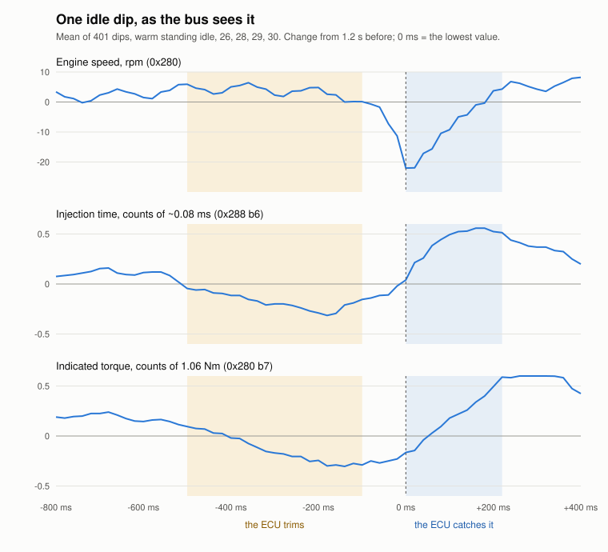

# Engine health — what is still wrong, and how to find out why

**The working document for one open investigation into the engine itself.**
It holds only what is **unresolved**: the symptoms still present, the
hypotheses still standing, and the test that would confirm or kill each one.
It has an end date. When every symptom below is either fixed or shown to be
normal for this engine, the file is deleted.

| file | what is in it |
|---|---|
| **this one** | symptoms → hypotheses → tests. Short on purpose |
| `refuted.md` | every hypothesis **settled against** and every symptom closed, with what settled it. Read it before proposing something |
| `vcds.md` | the VCDS blocks read on this car, their specifications, and how to record them |
| `vehicle-history.md` | the service record: parts, dates, distances. **Stays when this investigation closes** |
| `idle-log.md` | **the diary of the idle investigation**: what was done and measured at each stage. **Stays** |
| `plan.md` | **the planned fixes, in order**. Emptied as the work is done |

**The full text this file was condensed from on 20/10/2026** — every
alignment, every table session by session, every argument and its
corrections — is in git: `git show d327332:docs/engine-health/open.md`.
The dated log before it: `git show 7c69883:docs/engine-health.md`.
Nothing in the tree depends on either.

**Rules for this file.** A hypothesis that is refuted, or a symptom that
closes, moves to `refuted.md` in the same commit and leaves this file. A
new measurement goes into the evidence of the symptom and of every
hypothesis it touches, not into a dated section. Owner reports are marked
*owner*; general engine knowledge *general*; an inference *reasoned*.
**Every new observation of the owner's is checked against the symptom
list, and the owner decides** whether it is a symptom. When the symptom
list changes, every fit table gains or loses the column in the same commit
and the ranked list is re-read.

⚠ **Nothing here changes a constant in `src/`.** `IdleHealth` and the start
bytes on 0x604 are one of the instruments (`docs/firmware/frames.md`).

---

## Where it stands — 28 October 2026

**Closed**, in `refuted.md` §D: S6 the exhaust joint behind the
converter, S8 the top end, S9 the rich trim, S10 the oil leak at the back
of the head, S12 the jerk on tip-in (a sticking pedal, 27/10), S13 the
throttle's routine, S15 the sputter, S18 cylinder 3 out with a tick
(24/10); H9 (crankcase ventilation, A15) and H10 (when 014 counts, C19).

**Open:**

- **The idle — S1 (unsettled) and S3 (014 counts at idle).** Every part in
  the fuel and ignition path has been replaced and both remain. Warm,
  loads off, the idle reads about 55–70 (27/10: 54), level with its best
  days of 12–15/10 and not past them; **cold it has come down since
  21/10**. The dips sat two thirds on 3 and 4 until the VW leads, **on
  all four alike since** (`40`, `41`; *The dips keep to one slot*) — the
  first of S1's three closing marks.
- **Around the idle:** S2 (an occasional puff), S14 (bangs on an
  unblipped downshift), S11 (a hiss at the back, perhaps the throttle's
  own air).
- **The cylinder 4 knock window: S4, S5** — its own cluster, not in
  `plan.md` (*owner's decision*, 9/10).
- **S7, the cold start** — caught and died 24 and 25/10, carried by the
  starter 26/10, hesitant primed 27/10, **clean plain 28/10**. The starts
  do not follow the priming, which is against a rail draining while
  standing; flooding and the fuel stay. Priming dropped (28/10).
- **S19, P0172 and the split trim** — the code once (24/10), not back on
  any reading since; **032's idle cell at −7.8 to −8.6 % and its
  part-load cell at +6.3 to +8.6 %** since 25/10, on the new regulator
  hose and, on 27/10, on the new oil. Fits H19 (the MAF against the map)
  and H17; 6e cleared N80 and the regulator's reference as its source.
- **S20, the speed wandering at a constant pedal** (since 1–2/10, on the
  road) — **a little better since the cable was slackened and the pedal
  greased (27/10), still there** (*owner*, 28/10). Not the idle.
- **Not pursued:** S16 (a tick on the gearbox side), S17 (a resonance at
  ~2200 rpm).

**Ranked (28/10, agreed with the owner):** **H14, H19, H13, H7, H2, H1**,
then H0, H8, H3, H15, H4, the timing belt, H16, H17, H18, H11, H12 (*The
idle's candidates, ranked*). The remap and the MAF read against it lead,
and share one test; what acts on one or two cylinders (H3, H15, H4) went
down when the dips spread over all four.

**Next** (`plan.md`): the second 44K tank driven out on the new oil,
read off the display; **032 after about 200 km on the new oil** (6g);
every cold start, plain (6h); the oil level every 500 km (6i); then
**the original map at the tuner on 3/11** (5a); his two files come
with it and are compared afterwards.

---

## The symptoms

### S1. Unsettled idle — engine speed fluctuates

**What is seen.** Every few seconds the idle dips by 20–45 rpm and recovers in
about a quarter of a second. It feels restless from the driver's seat too:
**the larger dips, about 15 rpm and over by the owner's guess, are felt as a
slight jerk in the seat** and heard, and between jerks `IdleHealth` holds
lower (*owner*, 23/10/2026: about 50 between, higher with each).
**On the new regulator hose, 25/10, no jerk was felt** with `IdleHealth`
about 90 loads off and 120–130 straight after a start and after the loads
went off (*owner*) — so a high grade did not come from felt jerks that
time. One idle, oil about 80 °C; whether the grade's make-up changed
(more small steps, fewer deep dips) needs a capture.
**By ear, 25/10 evening** (*owner*, warm, the everyday state): **in the
calmer stretches the engine speed drops a little and holds there**. Not
shown by VCDS, whose 40 rpm steps put the stretches with 014 counting and
without at the same 760–800 (`idle-log.md`); a capture's quarter-rpm
0x280 would show it. It sits beside *What comes before a dip*: a dip
follows the idle overshooting a little.
**By feel, 25/10** (*owner*): the idle felt calmer all day, on the new
regulator hose and the second 44K tank; he says so himself before the
data. 6j's 014 agrees in kind: its episodes stayed at 12 (below).

**How it is measured.** `IdleHealth` on 0x604 grades one firing against the
next (100 = the engine before the repair, lower is smoother). Offline,
`tools/idledips.py --roughness` gives the same grade from a capture.
**Every idle figure in these files is on the `IdleHealth` scale**
(*owner's decision*, 12/10): the mean step in rpm × 50. A capture's figure
is a mean over a window, the display's a running filter of the same
quantity. **A reading without the oil temperature beside it compares with
nothing**, and a session on **fresh adaptations** (after a battery
disconnect) reads calmer on every ruler and is no test of a repair
(`refuted.md` C19).

**What one dip is worth.** Engine speed on 0x280 is recomputed once per 180°
of crank, one power stroke (`docs/firmware/can-decoding.md` trap 5), so a dip
is one cylinder's stroke. A stroke that gives nothing costs an estimated
33–57 rpm; the deepest dips are 37–46, the typical one 20–22 — a partial
burn. **The dip is the failed combustion itself**, and the recovery is the
idle governor.

**Every session since the repairs, like with like** (standing idle, 30 s
windows, 93–111 °C of oil, heavy-load windows left out; mean ± standard
error):

| date | capture | adaptations | what changed | `IdleHealth` |
|---|---|---|---|---|
| 24/9 | `19`/`20` | fresh | new injectors, old MAF | 113 ± 5 |
| 24/9 | `24` | fresh | **new MAF** | 91 ± 6 |
| 3/10 | `26` | fresh | the valve cover job | 61–68 (few windows) |
| 4/10 A | `28` | fresh | the right cover gasket | 72–74 |
| 4/10 B | `29` | settled | | 89 |
| 9/10 | `30` | settled | dipstick, MAF clamp | 83–89 |
| 10/10 | `31` | settled | **new NGK leads and plugs** | 77 ± 4 |
| 12/10 | `32` | settled | lead 4 re-seated, airbox sealed | **63 ± 1** |
| 15/10 | `37`, `38` | settled | the cleaner in | **59–61** |
| 18/10 eve | `39` | settled | after the episodes of 18/10 (`refuted.md` D10) | 78 ± 4 |
| 19/10 | display | settled | | about 100 loads off |
| 21/10 | `40` | settled | **VW plugs and leads, new plenum gasket** | 67 ± 2 |
| 23/10 | display | settled | the first 44K tank, ~70 km in, after a hard motorway run | 45–50 between jerks, 70–90 with them, **never above 100** warm; *fan on 1, one seat heater on 1, lights* (*owner*) |
| 23/10 eve | display | settled | home through Prague traffic, much idling, unsettled throughout; the last stretch held at higher revs in a low gear | **37** straight after, the lowest yet in this state, then slowly back to 50 within about a minute and above it after another; *fan on 1, one seat heater on 1, lights* (*owner*) |
| 24/10 eve | display | settled | the second 44K tank, Orlen Verva 100, after ~340 km in the day with about an hour above 4000 rpm; 3–5 min of warm idle | **70–80**, everyday state (*owner*) |
| 25/10 | display | settled, 032 relearning | **the regulator's vacuum hose renewed**; oil about 80 °C, not 93+ | **about 90** loads off, **35–40** loads on (lowest 35); **no jerk felt** (*owner*) |
| 25/10 eve | display | settled | the new hose, a drive later; oil 96 °C | **70–80**, everyday state; **50–60** at a light before, same state (*owner*) |
| 26/10 | display | settled | warmed in a jam, gently, under 3000 rpm; then one brisker stretch, revs held up in 2nd downhill on engine braking | **80–100** all through the warm-up, **still at 92 °C** of oil; **60–70** after the brisker stretch; everyday state (*owner*) |
| 27/10 | display, video | settled | `plan.md` 6k: a gentle drive to about 88 °C of oil, the A/C against the loads (`idle-log.md`) | **~70** everyday state; **35–50** the A/C alone; **54–62** every load but the A/C; **25–35** both |
| 27/10 eve | display, video | settled (055 reset that afternoon, relearnt to −1.17) | the pedal greased; oil changed 26/10; the second 44K tank about four-fifths used; oil 100 °C | **54** loads off (mean; **35–65** in waves of about 1½ min); **34** every load on with the A/C (26–42, still falling) — **the first stop with loads off within 25 of loads on** (condition 2 below), one stop |

**The trend over every capture** (28/10, at the owner's question; every
standing idle settled 30 s and more, graded as `tools/afterpull.py`'s
`idle_runs()` grades, the display's filter replayed beside it;
loads off is b7 ≤ 25 at 93 °C of oil and over):

| | warm, loads off: stop means | middle band, ~77–88 °C |
|---|---|---|
| 11/8 (`09`, `11`) | 48, one 22 s hold | 106 |
| 24/9 (`24`, new MAF) | 88, 92 | 84 |
| 3–10/10 (`26`–`31`) | 67–103, most 75–95 | 90–111 |
| 12–15/10 (`32`, `37`, `38`) | **48–75**, most 55–66 | 93 |
| 18/10 (`39`) | 68–96 | — |
| 21/10 (`40`) | 61–67 | 75 |
| 24/10 (`41`) | — | 87–104, warmed at idle |
| 27/10 (display) | 54 | — |

**Before October there is no trend to read**: two days of captures, and
the one hot figure of August is a 22 s hold. **Warm, the idle stepped
down once**, from about 75–95 to about 50–70, **between 10 and 12/10**
(the leads, lead 4 re-seated), rose for 17–19/10 and came back; 27/10
is level with its best, not past it. **Cold it has come down**, and that
is the clearer change (below, *Temperature*).

**The outside air is not in this trend** (*the owner's question*, 28/10:
August was hot, late October about 10 °C — is the idle the same and only
the weather cooler?). Not on the bus (`docs/firmware/can-decoding.md`,
*What is NOT on the bus*); the intake air is in VCDS 004/006, logged once
(4/10). Against the weather as the whole (*reasoned*): the calmest hot
figure is August's, the hottest month; the warm idle moved **in a step**
between 10 and 12/10 and went up again 17–19/10, not gradually as the
autumn cooled; and the cold drop of 21/10 came on a start at 24 °C of oil,
warmer than the others. A small share cannot be ruled out. **From 28/10
the outside temperature is written beside each reading** (`plan.md`,
standing items), and the daily temperatures of the capture days are to be
looked up once a weather archive answers (refused for its daily limit,
28/10).

**The MAF is the one change that showed at once** (24/9: the dips halved).
The calmest settled idles, 12/10 and 15/10, came in the days after the new
leads and lead 4's re-seat; the idle has worsened since (*Why the idle got
worse*, below).

**What is not known: the healthy target.** Every recording is of this engine
with the fault present, and **none will be**: a CAN capture of another car
needs its cluster harness tapped behind the vent, which no owner will allow
(*owner*, 21/10).

**When S1 closes** (*decided*, 20/10; the owner closes it), read over several
drives at 95–100 °C of oil: **(1) the dips no longer keep to a pair** —
`cutscan.py --shares`, pooled since the last repair, consistent with all four
alike; it needs no target, so it is the strongest mark — **met since the VW
leads** (`40`, `41`), to be held over more drives; **(2) load is no
longer needed** — loads-off `IdleHealth` within about 25 of loads-on (19/10:
about 100 against 50); **(3) at least the best level shown**, loads off about
50–60 (12/10, 15/10). Short of all three, the owner may close it as
*acceptable, cause known*.

**Load smooths it.** Every consumer at idle — A/C, lights, blower, heated
glass — makes the ECU open up the air, and the idle calms (26/9: 35–50 loads
on against 70–80 off, *owner*). The supply voltage is 1.25 V *lower* then,
so it is the charge, not the volts. **Since the cleaner, the partial loads
hardly matter** (*owner*, 19/10): lights and blower alone make little
difference, everything on together still calms it. **The first measured
pair**, 19/10, oil 101 °C: loads off mostly about 100, every load on mostly
about 50 — twice what one pair can show by chance. Read as (*reasoned*):
**one or more cylinders run at the edge of stable combustion at the idle's
charge**, and anything that takes a little charge away tips them over.
**A second reading, from 26/10** (*the owner's hypothesis*, not tested):
**with the A/C and every load on, the ECU sets its learnt idle air aside.**
In the relearning log of 26/10
(`test/fixtures/vcds/vcds-step6a-055-relearn-014-055-001.csv`,
`idle-log.md`) 055's learnt value read **exactly 0.00 whenever its load
bits read `0101`** — the A/C and all-loads stretches — and came back the
moment they returned to `0000`. That learnt value is what 014's counting
follows in `refuted.md` C19, negative on this engine since September.
So "every load on" may calm the idle not by the load at all but by
taking the learnt value out of play; and **since the cleaner the partial
loads hardly matter while everything on together does** — and
everything on is the one state with the A/C in it. **What would test
it**: at a warm stop, a minute of the everyday state with the A/C alone
against a minute of every load but the A/C, `IdleHealth` and 055 field 3
read in each; and a log of 055 with 014 across such a switch. ⚠ Which of
the bits is the A/C was not separated, and whether the ECU uses another
learnt value with the A/C on, or none, is not known. **Ross-Tech's list
of groups 050–059** describes a variant of 055 *"with separation for rear
window defroster/A/C readiness"* (searched 26/10): **a separate learnt
value for that state** would read 0.00 too if the disconnect of 26/10
reset it and it had not relearnt yet. So the 0.00 may be a second learnt
value at zero rather than none. **Read it at the next A/C stop**: field 3
staying at 0.00 over minutes of A/C idle says none or not shown; moving
away from 0 says a learnt value of its own.
**Read at the A/C stop of 27/10** (the done `plan.md` 6k, `idle-log.md`; oil about
90 °C, warm; `vcds/vcds-step6k-2-014-055-001.csv`): **`0101` is the A/C** —
every load but the A/C left the bits at `0000`. **Field 3 held 0.00 for
eight minutes of A/C idle and a drive**, never moving, while field 2, the
live correction, went to about −1.0 g/s, the learnt value's size: **with
the A/C on the ECU sets the learnt value aside and corrects live**, and
no second learnt value showed. `IdleHealth` off the owner's video, the
everyday state about **70**; **the A/C alone 35–50** from its second
minute, 014 silent; **every load but the A/C about 57**, the learnt
value *not* set aside but walking from −1.04 to −0.77 while it ran, and
37 at its end; **both together 25–35**. ⚠ Against the learnt value alone:
in the A/C's sixth minute, field 3 still at 0.00, the grade climbed back
to 56–75. **Read as** (*reasoned*, one stop): both act — the A/C's calm
is the larger and the quicker, and the loads calm the idle without the
learnt value set aside, as it moves towards zero. Neither of `plan.md`'s
clean outcomes; neighbouring 2-minute windows differ by 4–18.

**Temperature.** Roughest cold, calmer as the oil warms, calmest hot, in every
session since 24/9. Every engine idles roughest cold (*general*), so this
says nothing about the fault on its own. The roughest reading yet, ~186, came
cold on the dampest, foggiest morning (26/9, *owner*).

**The cold idle has come down since 21/10** (*the owner's observation*,
28/10: over 100 now only after a start, about 130 at the coldest, nothing
near 200; checked against every capture with a cold start, the same day).
The display's highest in the first idle after a start, and the stop's
mean:

| start | oil at the start | first idle: mean / display's highest | the idle after it, 23–39 °C |
|---|---|---|---|
| 11/9 (`18`) | 21 °C | 108 / 157 | — |
| 24/9 (`19`) | 17 °C | 111 / 179 | 134 / 160 |
| 26/9 (display) | cold | ~186 (*owner*) | |
| 3/10 (`25`), fresh adaptations | 21 °C | 127 / **196** | 161 / **196** |
| 4/10 (`27`), fresh adaptations | 19 °C | 112 / 185 | 160 / 181 |
| 9/10 (`30`) | 17 °C | 107 / 148 | 114 / 140 |
| 10/10 (`31`) | 18 °C | 105 / 165 | 147 / 184 |
| 12/10 (`32`) | 15 °C | 121 / 178 | |
| 14/10 (`33`) | 20 °C | 103 / 150 | |
| **21/10 (`40`)** | 24 °C | **77 / 90** | **118 / 145** |
| 24/10 (6e, display) | cold, under 70 °C | 120–140 (*owner*) | |
| since (display) | | about 130 at the coldest (*owner*) | |

`35` (15/10) is left out: it started with every load on. **The first
capture that reads low cold is 21/10's**, the first drive on the VW plugs
and leads and the new plenum gasket, **two days before the first 44K
tank** — so the cold drop is not the cleaner's, whatever else it may be.
⚠ One capture: 21/10 started at 24 °C of oil, warmer than the 15–21 °C
of the others, and the display since is the owner's glances. A cold
capture from about 15–20 °C would settle it.

**But warm oil alone does not bring the calm idle; driving does** (26/10,
*the owner's observation, checked against the captures*). On 26/10 a
gentle warm-up in a jam, under 3000 rpm, held `IdleHealth` at 80–100 up
to 92 °C of oil; it fell to 60–70 only after one brisker stretch (table
above). The captures agree in kind (`tools/afterpull.py`'s `idle_runs()`,
graded per minute, 26/10): **warmed at idle, the grade stops at about
90–110** — `41` ~120 → ~90 over 52–82 °C, `32` 139 → ~95 over 46–78 °C,
`25`+`26` ~110 at 82–91 °C after a warm-up that never held 3000 rpm —
and **every calm warm idle came after a drive**. **What the drive needs is
not high revs**: `26` read 67 at 96 °C after a drive home under
3000 rpm, `35` 38–55 at 91–94 °C after one that touched 3292; and high
revs do not reliably calm it (`19` 57 → 104–143 after 6000 rpm, before
the cleaner — *After high revs*, below). ⚠ **Not separated**: no capture
warms past 92 °C at idle alone, so a few degrees more oil and the drive
itself always came together. The owner's reading (*hypothesis*): the
chambers carry something — deposit, oil, moisture — that a working drive
clears and an idle does not (H13, H17, H18). Settled by a warm-up to 95 °C at idle alone,
or by a gentle warm drive straight into an idle.

**What comes before a dip** (`tools/dipcontext.py`, 852 warm dips,
10/10). **The ECU has trimmed the charge just before a dip** — injection time
0.33 and indicated torque 0.35 counts lower 0.4–0.1 s before, about 1 %, and
engine speed a few rpm higher: the idle overshoots a little, the governor
takes a little air or advance away, and a weak cylinder fails in the next
cycles. A dip follows a trim down 1.6–3.5 times as often as a trim up. ⚠ An
average, under one count; no single dip shows it. The figure `dip-profile.svg`
beside this file shows one dip stroke by stroke.

**What VCDS saw just before a dip** (11/10, `dipcontext.py --vcds`): on two
sessions the lambda correction was about 0.8 % lower just before a dip than in
quiet idle — the loop on its lean swing. **Not reproduced on 12/10** (`32`,
001 alone, the session built for it): a direction one session failed to
repeat.

**After high revs** (*owner*, 23/10 evening, the first 44K tank,
display, the everyday state): straight after a stretch held at high revs,
`IdleHealth` **37**, the lowest yet in that state, then **slowly back to 50
within about a minute and above it after another**; stretches of plain idle
without revving go back to 70–80. **New to him**, though he watches the
display and drives hard most days now: after hard driving before, the
lowest came only after about half a minute. **The captures agree that it is
new** (`tools/afterpull.py`, 23/10): engine speed held above 4000 rpm at
any load — sustained revs, a light foot in second as often as full
throttle (*the owner's correction*) — in the five minutes before a warm
stop, the grade in bins from the moment the idle settles. Without a
cleaner the idle after high revs **starts rough and calms over 1–3
minutes** — `30` 98 → 56 (33 s above 4000), `40` 100 → 54 (30 s), `39`
87 → 69, `28` 92 → 70; the one capture with a cleaner in the tank and high
revs before a stop, `37` (Liqui Moly, 15/10), **starts calm and rises** —
57, 44, then 60, and 64, 54, 77, 76 at the next stop. One capture, two
short stops, against a bin-to-bin scatter of ±20 in a single idle; **no
capture on a 44K tank yet**, and none holds more than 18 s above 4000 at a
stretch, far less than the owner drives now.
Read as (*reasoned*), if it is the cleaner: what the cleaner has loosened
and not yet removed (H13) costs combustion at idle on the cylinders that
carry it, and the heat and gas flow of high revs clear or dry it for a
while — flakes under 3's exhaust seat blown out (*the owner's reading*), or
softened deposit that soaks up fuel at a cool idle and is dried hot.

**Why the idle got worse** (19/10, *reasoned*; display readings, loads off or
lights only, warm): 50–61 on 12/10, ~54 on 15/10, 70–90 on 17/10, 80–90 on
18/10 afternoon, ~100 on 19/10; with every load on it has hardly moved (~40–50).
**The rise began about 16–17/10, with the cleaner and the hard driving**, not
with the episodes of 18/10 (`refuted.md` D10); it is worse only at a small charge; and `39`, the first
capture after them, has its dips more concentrated on the pair than any pool
before (top two 77 %). **Not an adaptation**: 032 −3.1/+5.5 %, 055 −1.27 g/s,
both inside their history (19/10). The candidates: deposit loosened by the
cleaner and not yet burnt off (H13), and **a relief after the leads' re-seat
of 10–12/10 wearing off** (H15, *The idle against every time the leads were
handled*). **It passed**: 67 on 21/10 (`40`), 54 on 27/10 (display), loads
off, warm.

### S2. An occasional puff from the exhaust

*Owner*, at idle, long-standing — before the exhaust work, the injectors and
the MAF. Much weaker than S14's bangs, and in the owner's reading the same
thing smaller: **a misfire's unburnt charge going off in the exhaust**. On
12/10 he heard the puffs **come with the dips** (by ear, not aligned with a
recording). It outlived the resealed joint behind the converter (S6, closed).
**Heard again 26/10** (*owner*), at the warming idle between the two EPR
flushes, on the fresh oil with what EPR was left in it, and recorded by
phone (48 s). Read from the sound (the exhaust note at twice the firing
rate, 65.7 Hz; idle about 990 rpm): **no single stroke stands out** —
of about 1600, none above 1.45× the median pulse — but **four moments,
at about 0:03, 0:12, 0:24 and 0:37, where the exhaust note weakens by
about 20 % and the speed dips about 15–20 rpm for half a second**
(averaged over 0.25 s, so the true dip is deeper), the size of an S1 dip.
**Whether those four are the puffs he hears is not yet confirmed**; if
they are, S2 and S1 are aligned on a recording for the first time.

### S3. Misfires counted by the ECU at idle

**VCDS group 014**, 12–120 against VW's 0–5, on every drive since it was
first logged. No fault code is stored (the ECU stores P0300 only above 2 %
over 1000 revolutions, `vcds.md`); **it once did**: P0304 and P0172 in an
old scan of 5/2019 (`vehicle-history.md`).

**When S3 closes** (*decided*, 20/10): 014 reads **0** at a warm idle with
loads off, oil 95–100 °C, for 3–5 minutes, **on three sessions on different
days**. The counter steps in twelves, so zero is the only reading inside
the specification. *This also asked for one session straight after a hard
drive* (20/10), dropped 23/10 at the owner's decision: what that rested
on, 014 counting only after the hard drive of 4/10, was an adaptation
completing rather than load (`refuted.md` C19).

- **Only at idle, and that is the car.** Detection sees a misfire more easily
  under load and switches off below about 20 % load (measured over every 014
  log). Driving with detection `aktivováno`, new counts start once per ~250
  samples, against several a minute standing. **But not never: on 27/10
  (6k's drive) two episodes on the road climbed 12 → 36 and 12 → 48**, at
  1900–2100 rpm and 25–26 % load, and four more counted 12 (once 24) at
  1160–1920 rpm and 25–30 % load, all just above the cut-off. **After the
  pedal was greased (27/10 evening, `vcds-pedal-drive-2-014-003-055.csv`)
  they went on with no tip-in at all**: five episodes of 12–36 at a steady
  2000–2200 rpm and 25 % load, throttle about 10°, while the jerk the owner
  had tied to them was gone (`refuted.md` D6) — so they are not the
  pedal's. ⚠ With detection `deaktiv.` the field
  reads 13, 15, 16, 18 at each lift — not steps of 12, so not misfires. The C4 full-load lamp lit on
  this map, so detection under load was not off — **unless the remap dulled
  it** (H14 route 6).
- **The events are the S1 dips** (`tools/s3align.py`, eleven sessions,
  16/10): half of 014's rises sit on a dip in the 1.5 s before, against 22 %
  by chance; a third of the dips get a rise. Over minutes the two part:
  **whether it counts is decided by the load and the learned idle air**
  (`refuted.md` C19), not by how rough the idle is. **The A/C switches it**
  (*owner*, 16/10): A/C on, 014 at zero for minutes with `IdleHealth` ~70; A/C
  off, it counts and the grade barely moves.
- **Three properties to keep in mind** (`refuted.md` A11, A12): steps of 12;
  off below ~20 % load; its sensitivity per dip moved five- to fiftyfold with
  the MAF. **So 014 is a yes/no witness, not a ruler.** Compare across time
  with engine speed or `IdleHealth`.
- **Session A, 3/10**, and **Session A after step 1b, 4/10**: the first warm
  stops ever with 014 at zero — on fresh adaptations — then counting again
  after five minutes of hard driving. **Session B, 4/10**: counting again,
  055's learned value at −1.0 to −1.2. **Steps 2b and 2c, 9/10**: the first
  session on kept adaptations, counting at every stop. Read together: the
  learned idle air (C19).
- **The drive after the new leads, 10/10** (`31`): 014 at about 9/10's
  rates — better hot, worse cold, no direction. The leads did not fix S3.
- **The new regulator hose, 25/10** (`plan.md` 6i, 6j): on 6i 014 counted
  loads off at 80 °C of oil and read 0 loads on; **a drive later, at
  96 °C of oil in the everyday state, it counted at 12 ten times in
  4.7 minutes, 24 and 36 near the end**, and 0 through a 34 s stop at a
  light (`idle-log.md`). The hose did not fix S3.
- **How far an episode climbs** (25/10): the counter's floor is 12, so
  how often it counts says less than whether an episode stops at 12 or
  climbs to 24, 36 and more. Warm idles, coolant ≥ 88 °C: **6j 2 of 16
  episodes climbed (12 %)**, 6i 2 of 9; 12/10 25 of 47, 15/10 10 of 31
  and 12 of 41, 18/10 24 of 37, 21/10 8 of 20. 6j against the four
  before the hose, pooled: one-sided p ≈ 0.06, episodes of one stop not
  independent, and 6j in the everyday state. **How often it counts did
  not change** — about two episodes a minute, as 15/10 and 21/10. The
  hose and the second 44K tank (24/10) cannot be told apart here.
- **014 against `IdleHealth`, re-read in stretches** (25/10,
  `tools/s3align.py --windows`; `docs/firmware/open.md` 11, *Re-read in
  stretches*): **no `IdleHealth` below which 014 is silent at an
  ordinary load** on settled adaptations — a plateau to about 80, more
  above. On fresh adaptations (to 4/10) it did fall silent below about
  70, and loads on (014's load above 28 %) silence it at any grade.
- **The clearing of 24/10 reset 032 to 0.0 / 0.0 and left 055 at −1.31
  g/s** (`idle-log.md`), read once: on this ECU the clearing did not
  restart the learned idle air that C19 ties 014 to, so 6i and 6j count
  on settled idle air. Whether it restarts the crank-wheel adaptation is
  not known (`vcds.md`).

### S4. Knock retard on cylinder 4, and only cylinder 4

Groups 022/023 and 020: cylinders 1–3 read zero in almost every sample;
cylinder 4 retards in steps up to 13.5 °CA, mostly on a tip-in after a coast
or gearchange and on hard pulls, **never at idle**. Within VW's 0–15 °CA while
driving. 9/10: still cylinder 4 alone with all injectors seated (`refuted.md`
B7); 10/10, the first drive on new leads: almost none (3 samples); 12/10:
back, smaller, on a harder drive. *Reasoned*: an arc at lead 4's plug end is
broadband noise in 4's own window (H15), as is real knock from the crust on
4's crown (`idle-log.md`, 19–20/10).

### S5. Cylinder 4 reads high in group 026 (knock sensor voltage)

With no load at all, standing in neutral, cylinder 4 reads 20–70 % above
cylinder 1 from about 1400–2700 rpm up; above ~3350 rpm the excess moves to
cylinder 1. So **not knock** — knock needs cylinder pressure. At idle all four
sit on the floor. 1 and 4 reading twice 2 and 3 is explained without a fault
(`refuted.md` B2). ⚠ 026 includes the ECU's amplifier factor, and 1 and 4 are
probably on different sensors.

### S7. The first start dies at once — reopened 25/10

*Reopened by the owner, 25/10, under the rule `refuted.md` D2 left: "another
→ S7 reopens".* **The engine catches and dies at once, as if it had no fuel;
the next start runs normally** (*owner*). **24/10**, afternoon, after about
4 hours parked outdoors nose uphill (`idle-log.md`); **25/10**, the cold start
of the morning **after about 12 hours on the level, in the garage**, "the
first start always dies" (*owner*). Neither captured. **26/10**, after
about 10 hours in the garage at about 12 °C (*owner's estimate*), not
primed: **the starter held until it caught, about 4 s by the owner's
count**, and it did not die. Off the display: **`StartCrank` 1.22 s,
`StartDip` 218 rpm, `StartClt` 24 °C** — the deepest `StartDip` on
record, against 15–118 on the clean starts of 24/9–3/10 and 141 on
11/9's near-stall on the old injectors (`idle-log.md`, 4/10, *The starts
measured from the capture*). Read as (*reasoned*): it fired at 1.22 s
and fell back about to cranking speed within 2 s — the same catch and
die, with the starter still turning to carry it. **The slope is not
needed**, so it says nothing either way, and the pickup running dry on a
hill is out. **27/10, primed** (four times rather than twice, *owner*),
after about 11 hours in the garage at 18 °C: it ran, **`StartCrank`
1.18 s, `StartDip` 0, `StartClt` 24 °C** — no fall after the catch,
against 218 unprimed the day before. **Not a clean start** (*owner*):
he held the starter longer again, it turned well past the 1.18 s
before it ran, and it hesitated for a while. The display does not see
that: `StartCrank` stops at the first 0x280 at 400 rpm and `StartDip`
looks only 2 s past it, so a first firing that lifts the speed while
the held starter carries the engine through a stumble reads short and
dip-free (*reasoned*, `docs/firmware/frames.md`). **Against pressure
lost while standing as the whole** (*owner*): before the new injectors
priming always cured it, the engine catching at once without a
hesitation, and today it did not. So primed still hesitates, which is
the "both die" branch below: flooding or the fuel rather than a rail
that drained. **28/10, plain**, after about 10 hours: it ran, perhaps a
slight hesitation in the first second but no fall (*owner*), **`StartCrank`
0.7 s, `StartDip` 0**. Three starts that do not follow the priming: **against the rail
draining while standing**; flooding or the fuel stay. **Not the throttle
cable** (*owner*): taken up since the throttle's fitting on 1–2/10, with
three weeks of clean starts after it; *this said the cable, slackened
27/10, stood beside them*. The owner's reading: the fuel, or deposits
loosening as the 44K tank runs out.
Closed on 26/9 after the new injectors (`refuted.md` D2): 14 captured
starts, all clean.

**What changed before it**: **the fill of 24/10**, the first tank of Orlen
Verva 100 since 2017, with the second can of BG 44K — **both bad starts
came after it**, and none in about a month before. The fault memory was
cleared the night of 24/10, resetting 032. The regulator's vacuum hose was
cut back and turned on 25/10 (H7), **before** that morning's start
(*owner*). The cutting cannot be both starts' cause, since 24/10's came
before it; the crack itself was there for both (below).

**How it reads** (*general*): caught, then died, then a clean second start
is what **a rail that lost its pressure while standing** does — the pump
refills it on the first attempt (H7: the pump's non-return valve, an
injector, the regulator; VW: at least 2.0 bar ten minutes after switching
off, `vcds.md`). **A cylinder flooded while standing** reads the same to the
driver (H7's dripping injector, H16's vapour). A fuel that starts
differently cold is the third, from the timing alone. **The cracked
regulator hose, the owner's reading** (25/10): too much fuel pressure at
the first idle, and the engine floods. *This said "does not fit", true
only of the cranking itself.* **For** (*reasoned*): the moment it catches,
vacuum forms; a hose that does not carry it leaves the rail high, and
cold the engine runs open loop, so nothing takes the extra fuel out in
those first seconds. **Against**: the crack is from about September and
the starts were clean for a month until 24/10. Whether this ECU applies
032's learnt idle value in open loop too, so that the clearing of 24/10
night took away a correction the start relied on, is not known. **Not the
hose**: the start of 26/10 was bad on the new one. **A second reading
since 6e** (25/10 night): N80 passes a little air without power (H16), so
vapour while standing is a cause with a found part behind it; the valve
is **not replaced** (*the owner's decision*, 25/10: it helps neither the
idle nor the trim).

**Read off the display**: `StartCrank` and `StartDip` on 0x604
(`docs/firmware/frames.md`) for every cold start, failed or not, plain
(`plan.md` 6h). **The priming test is over** (*the owner's decision*,
28/10): primed and plain alike were good or bad, so a rail draining while
standing is not the whole; what is left is flooding or the fuel, read
by the starts as the 44K tank runs out and at the next fill of another
brand.

### S11. A hiss at the back of the engine at a warm idle

*Owner*, from 26/9. It outlived the new breather and cover gasket. Closed
12/10 and **reopened 14/10** (*owner*): heard again, roughly **on the right
side, near the throttle or the hose from the MAF to it**, only with his head
by the hoses. Moving the hose and covering places by hand changed nothing.
**His own reading: it may be normal** — idle air past the nearly shut plate
under manifold vacuum (*general*). Kept open with that note; no test planned.
If it is a leak: behind the throttle it is H3, ahead of the probe H2.

### S14. Bangs from the exhaust on a downshift without a blip

*Owner*, 4/10: on a downshift **without a throttle blip** a series of small
bangs, 1–2 s after the clutch comes up; with a blip almost never; warm. Gone
9–14/10, **back on 15/10, quieter** (*owner*), with the joint behind the
converter tight — so that joint fed or carried it at most. Read as
(*reasoned*): the engine dragged up on a shut throttle is fuelled at its
thinnest charge; a charge that fails to fire goes out as fuel and air and
burns when the fuel cut pumps plain air in after it — **a misfire where 014
is blind**. The ECU cuts the injectors 0.8–1.6 s after the lift
(`coastscan.py`). **The owner's to watch, not in `plan.md`** (*owner's
decision*, 4/10): worked on only if it outlives S1/S3.

### S16. A tick in neutral, cold, with the clutch pedal up

*Owner*, 12/10: a regular tick at a cold idle in neutral, **gone with the
pedal down** — the gearbox side. **Not pursued** (*owner's decision*): the
idle graded the same pedal up and down (H12). Out of the fit tables.

### S17. A new exhaust sound, from a new place

*Owner*, 15/10: only at about 2200 rpm, **like a resonance**, perhaps the
remade joint behind the converter, perhaps nearer the engine. A sound tied to
one engine speed is a part vibrating, not a leak (*general*), so it bears on
no hypothesis about the idle. Out of the fit tables until placed.

### S19. P0172 stored, too rich — with one start that died at once

**16556 / P0172, bank 1 too rich, 35-00, not marked sporadic** (P1240 beside it was), found in the fault memory before
the cold capture on the night of 24/10 (`idle-log.md`), **the first since
5/2019** (`vehicle-history.md`), and set some time after the last empty
reading. The same window holds **the one bad start of that afternoon**:
after about 4 hours parked nose uphill the engine caught and died at once,
the next start normal (`idle-log.md`, 24/10). **The two are suspected to be
one event** (*owner's decision*, 24/10): a flooded start reads the same to
the driver as a starved one, and an injector or regulator that lets fuel
into a cylinder while the car stands would give both (*reasoned*). The
trims behind it were lost to the clearing before 032 was read
(`CLAUDE.md`). Also in the
window: the first tank of Orlen Verva 100 and two 170 km drives held at
5000 rpm. **It cannot be dated more closely** (28/10): this ECU's fault
memory carries a code and its status only, no mileage, time or freeze
frame (`photos/vcds-faults-2026-10-26-after-flush2.jpg`), so the window is
everything between the empty reading of 23/10 and the night of 24/10 —
and it **opens before the fill**, with the drive out on the old tank (OMV
and the first 44K) run down to 0.4–0.7 l. Before the window nothing points
at it: 032 −3.1 to −6.3 % (19–23/10), the live regulation at a warm idle
centred on 0 with no excursion past −5.5 % (21/10, VCDS 001). **What sets it is not
known**: VW's manual gives 032 a range of −10 to +10 % (`vcds.md`), which
is the specification, not the code's condition, and the label file holds
none. **It is not the idle cell reaching −10 as VCDS shows it**: on 25/10
night, with the regulator's hose off, the idle cell went to **−12.5 %**
for about 40 s (`vcds/vcds-step6e-cold-2-001-032-033.csv`) and the fault
memory was empty afterwards. The part-load cell is positive, the other way,
and has been on every reading since the new MAF (24/9): +1.6 to +5.5 %
up to 23/10, +6.3 to +8.6 % since 25/10. *This said "since 25/10", which
held only for the higher values (the owner, 28/10).*

**Not settled that the start set it** (*reasoned*): a start that dies at
once runs on a cold probe, open loop, and cannot itself trip a trim fault;
what would link the two is **one cause** that puts in too much fuel, seen
once at the start and once later in closed loop. **Read by what followed:**
032's idle trim well negative at the next reading, or P0172 back with no bad
start, says a standing cause rather than a one-off — **and the idle trim
has been −7.8 to −8.6 % on every settled reading since (25–27/10)**,
while P0172 has not come back: a standing cause, below the code's
threshold; P0172 back after
fills only would point at the purge path (*general*: a canister flooded by a
brim-full fill), which 070 found sound on 27/9 (`refuted.md` A6) but not
since — and 070 shows that the valve opens, not that it seals (H16).
The 001 of 24/10 night, with the stored adaptation still in force, read
**+15 to +22 %** while warming and about **−3 to +1 %** warm — adding fuel
cold, near zero warm, which a hard rich fault would not show; weak, since
it is the trim on top of an adaptation not read. **The misfires make it
stronger, not weaker** (*reasoned*, as `refuted.md` A7): an unburnt charge
carries oxygen to the probe and reads lean, so with 014 counting the
mixture is if anything richer than the trims say. And **it all but rules
out a meaningful intake leak** (A7): that would have pushed the other
way.

### S20. Engine speed wanders at a constant pedal

*Added 26/10 at the owner's request.* **During the first EPR flush**
(`plan.md` 6a), standing in neutral, the pedal held by a stick of wood:
the speed swung a little at first, held about 1250, then rose slowly to
about 1300 by itself, and **"it just fluctuates"** (*owner*). **His
9 s video** of it, read from its sound (the firing rate in the clicks
above 3 kHz, 1 s windows): **1266–1294 rpm for 4 s, then a step down to
1215–1241** for the rest, ±10–15 rpm within each. **Over the flush**
(*owner*, off the display): mostly swinging **1250–1300**, now and then
settling at about **1230**; **the stick does not move at all**. **A 3-minute
recording** at about minute 22–25 of the flush, read the same way (1 s
windows): median **1260**, mostly 1240–1290, swinging 10–20 rpm over
seconds; **once a lower, calmer stretch of about 28 s at 1195–1222**,
entered by a drop of about 45 rpm within 2 s and left by a rise, and
one shorter dip to about 1205. **Two states, then: lower and calm,
higher and swinging** — the video's 1266–1294 → 1215–1241 the same
pattern. What switches between them is not known; an on/off load such as
the radiator fan, or the purge valve's cycles (H16), would give a step at
a held plate (*reasoned*); the sound shows no fan switching clearly.
**The flush's part is weak since** (*owner*, 26/10, in the second
flush): setting the stick so that it did not move turned out hard, and
the swing may have been the stick after all; set again, it sits at
1250–1300. **And the ECU was in it** (*reasoned*): **P0507** set in the
first flush and **055's learnt value went to −2.10 g/s**, so the ECU took
the held engine for an idle running high and worked its idle control
against it; with the plate near its stop, a controller pushing against a
held pedal could itself give a speed that swings and steps. **So S20
rests on the road observation**, not on the flush.
**Also on the road**
(*owner*): hard to hold the engine speed steady, **noticed since the job
of 1–2/10**, which fitted **the new throttle** (Pierburg `7.03703.13.0`)
and **took up the throttle cable's slack** (`idle-log.md`, *1–2/10 — the valve
cover, throttle and breather job*); the same job renewed the cover gasket, the
plenum gasket and the breather.

**Not S1.** S1 is dips at idle with the idle governor in charge; this is
above idle with the pedal held. **The pedal works the throttle by a
cable** (*owner*, 26/10, off the car; *this said the pedal was a sensor
and the ECU moved the throttle — wrong*), so with the pedal held the plate
is held, and what wanders is the engine's torque at that plate, or the
plate itself through the cable and the idle stop. ⚠ **Soft**: it was
seen with EPR, a solvent, in the oil. The stick is not it (*owner*: it
does not move).

**The captures show no change with the new throttle at part throttle**
(26/10). Every stretch of at least 2 s with 0x280 b5 not moving by one
count, above 15 km/h, in one gear, oil above 80 °C; the rpm's scatter
about its straight-line trend in each: **1500–2500 rpm, part throttle,
5.3 rpm on the old throttle (`19`, `24`, 84 stretches) against 4.1 on
the new (`26`–`40`, 137)**; 2500–3500 4.3 against 4.2. Only full
throttle above 3500 rpm reads higher on the new, 9.0 against 5.9 — pulls,
far more and harder after 2/10, not a held speed. ⚠ What this cannot
see: a wander slower than a few seconds, which on the road the gradient
hides, and a standing hold above idle, which no capture since 2/10
holds. *An ad-hoc script, not kept.* A capture tells them apart:
0x280 b5 is the throttle, so stretches where it holds still show whether
the speed wanders anyway.
The slow rise to 1300 reads as the oil thinned by EPR and still warming,
less friction at the same throttle (*reasoned*); the swings and the step
do not.

**Since 27/10 the cable is slackened and the pedal greased** (S12 closed
on the pedal, `refuted.md` D6): a pedal that stuck in small jumps near the
start of its travel holds a plate unsteadily too, so S20 may have been
the pedal. **It outlived them, a little better** (*owner*, 28/10): the
pedal was part of it at most.

### Other — not symptoms, but they touch this file

**Oil temperature.** 0x420's `OilTemp` is `raw − 60` °C (`docs/firmware/can-decoding.md`
question 10, closed 23/10). A bias moves both sides of every comparison alike.

**The remap.** The ECU was remapped in 6/2018, "mild", the tuner finding
nothing at the top. Written down as H14 (16/10). Not written back on 22/10 (*owner*,
20/10); **booked for 3/11**, the tuner's original and remap taken on the day and compared afterwards,
privately, never in this repository (`plan.md` 5a).

**The brake pedal is soft and long** (*owner*, 9/10): hydraulics, not the
servo and not the engine — a matter for a garage.

**Oil on the underside, the sump's rear the wettest** (*owner*, 26/10,
looking from below during the oil change; `photos/sump-oil-2026-10-26-*.jpg`):
an oily film over the sump towards the back, along its flange and on the
bracket behind it; the gearbox casing drier. **It was there before the
change** (*owner*), though nobody had looked from below; **whether it is
what ran down from the cover joint on 3/10 (S10, closed) or a leak of its
own is not known.** Not pursued for now (*owner's decision*, 26/10). **It
bears on `plan.md` 6i**: a leak lowers the dipstick level as burning
does, so a falling level is read against it, and the underside is wiped
clean after the change so that fresh oil there shows.

---

## How the symptoms relate — what is measured

| pair | link | evidence |
|---|---|---|
| S1 ↔ S3 | **the same events, but 014 is switched** | half of 014's rises sit on a dip; whether it counts follows load and the learned idle air, not the grade (S3) |
| S1 ↔ oil temperature | **strong** | roughest cold, calmest hot, every session |
| S1 ↔ load | **strong** | every load on calms it (S1) |
| S2 ↔ S3 | **likely** | the owner heard the puffs come with the dips (12/10); never aligned |
| S14 ↔ S2 | **likely one mechanism** (*owner*) | a misfire's charge burning in the exhaust, loud when the fuel cut adds air |
| S14 ↔ S3 | **possible** | 014 is blind on the overrun, so it cannot be aligned |
| S4 ↔ S5 | **very likely one thing** | same window, same speeds; S5 needs no combustion |
| S4/S5 ↔ S1/S3 | **none measured** | no retard and no 026 signal at idle; the dips sat on 3 and 4 until the VW leads (all four alike since), and lead 4's end was the loosest (H15) |
| S19 ↔ the bad start of 24/10 | **suspected one event** (*owner*) | same window, both what a cylinder flooded while standing gives (S19) |
| S7 ↔ S19 | **same window** | both after the fill of 24/10; the 24/10 start is in both |
| S11 ↔ S1 | **untested** | if the hiss is a leak, H3 or H2; the owner reads it as the throttle's own air |

**Two clusters**: **the idle** (S1, S2, S3, S14) and **the cylinder 4
window** (S4, S5). S11 sits beside the idle, unplaced.

---

## The open hypotheses

Each lists what it explains, what speaks against it, and the test that
settles it. ✔ fits, ~ fits weakly, ✘ does not fit, — says nothing.

**The columns are the open symptoms that bear on the engine**: S1, S2, S3,
S4, S5, S7 (reopened 25/10), S11, S14, S19, S20 (added 26/10). Left out: S16 (the gearbox side, shown not to touch
the idle) and S17 (a resonance, not placed); S12 closed again on
27/10 (`refuted.md` D6) and its column went with it; the closed ones are in
`refuted.md` §D.

### H0. The idle is normal for this engine — and there is no fault to find

| S1 | S2 | S3 | S4 | S5 | S7 | S11 | S14 | S19 | S20 |
|---|---|---|---|---|---|---|---|---|---|
| ~ | ~ | ✘ | — | ~ | ✘ | — | ✘ | ✘ | ~ |

- **Against:** 014 reads 12–120 against VW's 0–5; the old converter burned
  through; the dips sit on 3 and 4, the cylinder of the 2019 P0304 and of the
  noisy knock window; the one cylinder the ECU has named, 18/10, is 3 (`refuted.md` D10); the inside of 3 and 4 is worse.
- **For:** no code is stored (2 % threshold: *under 2 %*, not *healthy*).

**Test:** ~~a USBtin capture of a healthy AQY~~ — **not obtainable**
(*owner*, 21/10): the bus is reached only at the cluster harness behind the
vent, and no owner will have a splice made there. What remains needs only the
diagnostic port: **VCDS on 014 at a warm idle of a healthy AQY**, 3–5 min,
loads off — whether a sound engine of this family also counts above VW's
0–5. It compares only on the same ECU (Motronic M5.9.2), and says nothing
of the grade or of the pair.

### H1. A lifter or valve on one cylinder (valvetrain)

A hydraulic lifter that bleeds down, or a valve that seats late or not quite,
on one or two cylinders. *General.* The AQY's lifters are hydraulic bucket
tappets (*hydrostely*), fed from the head's gallery through a small hole
each; inside, a plunger and a check ball hold an oil column that takes up
the lash. They fail two ways (*general*): **one that does not fill** (a
narrowed feed, air, wear) leaves lash, ticks, and opens its valve late and
short, worst hot at idle; **one whose plunger or ball sticks** with varnish
or debris holds its valve a hair open, which costs compression and misses
at a small charge and is covered by load — the case this hypothesis is
about. The valve is closed by its spring; the lifter only removes the gap.

| S1 | S2 | S3 | S4 | S5 | S7 | S11 | S14 | S19 | S20 |
|---|---|---|---|---|---|---|---|---|---|
| ✔ | ✔ | ✔ | ✔ | ✔ | — | — | ~ | — | — |

- **For:** a valve that seals worse at low cylinder pressure misfires at a
  small charge and is covered by load; the tick once per cycle of 18/10 (`refuted.md` D10); one forum
  AQY case of a sticking bucket tappet (pkw-forum.de, 2003) and one of valves
  not sealing (forum.vwgolf.pl t=522030).
  **The oil before 6/2026** (*owner*, 23/10; `vehicle-history.md`): about
  three years in the engine, nearly one of them standing outdoors,
  condensed water under the filler cap at the change — the conditions in
  which oil forms varnish and acids (*general*), and varnish is what
  sticks a plunger or a check ball. **The old oil came out really black,
  and no flush was run** (*owner*, 24/10). Weak: it says the means was
  there, not that a lifter took it up — black is what a detergent oil
  holding soot looks like after three years (*general*), and the top end
  seen with the cover off on 1/10 carried only a thin golden-brown film,
  no sludge on the cam or the caps (`refuted.md`, the head gasket entry).
- **Against:** compression **13 bar in 2018 and 12 bar even on all four in
  2026** (`vehicle-history.md`) — no cylinder losing; the vacuum gauge
  steady cold and warm, no flick (H3); no ticking before 18/10, and **none on any
  drive since, through 24/10** (`refuted.md` D10) — a lifter that hung
  should not fade, and this did; the idle is never worst hot, where a thin-oil lifter
  should be; **the phone recording of 24/10, part-warm** (oil 52–58 °C):
  one click per firing, all four alike, over every injector and over the
  cover at each cylinder — no once-per-cycle sound over any lifter
  (`idle-log.md`, 24/10), and **the same hot, 26/10** (oil 100 °C): no
  once-per-cycle sound above the noise floor at any of the eight places
  (`idle-log.md`, 26/10); the valves looked whole on 19–20/10 (which says nothing of
  sealing); 18/10 is explained by 3's flaked deposit without it.

**Tests:** a phone recording over each injector and each lifter, **done part-warm 24/10 and hot 26/10, nothing** (the screwdriver by ear dropped 24/10); **the two EPR flushes**, done 26/10 (`idle-log.md`), which clean the
feed passages and the plungers' varnish — alongside BG 44K, so an
improvement would not tell H1 from H13; no tick since; a warm leak-down (**not to be
done**, *owner's decision*, 20/10); the lifters pressed down with the cover
off. 18/10 coming back, cold, would reopen it (`refuted.md` D10).

### H2. A leak ahead of the front lambda probe (manifold, its joint to the head, the probe boss)

At idle the exhaust pulses dip below atmospheric and a crack draws air in.
*General.* The zone is only the **original manifold, its gasket to the head
and the probe's boss**: the probe sits on the manifold (`vehicle-history.md`).

| S1 | S2 | S3 | S4 | S5 | S7 | S11 | S14 | S19 | S20 |
|---|---|---|---|---|---|---|---|---|---|
| ~ | ✔ | ~ | ✘ | ✘ | — | ✔ | ✔ | ✘ | ~ |

- **For:** the puff (S2), the hiss (S11), air for S14's bangs; a 26-year-old
  manifold that has lived through years of misfires.
- **Against:** air outside the cylinder does not stop one firing, and cannot
  pick a cylinder; no ticking, no exhaust smell (*owner*); just before a dip
  the probe read a little *rich*, not lean; the cold tailpipe test found
  nothing (12/10) and the cold exhaust smoke test nothing (9/10, the exhaust
  would hardly take pressure).

**Test:** the tailpipe test **warm** (`plan.md` item 7). A found leak means a
new manifold.

### H3. A small unmetered air leak at one intake runner

Air past the MAF leans one cylinder at idle, where air flow is smallest.
*General.* **The only candidate that predicts *load helps* directly.**

| S1 | S2 | S3 | S4 | S5 | S7 | S11 | S14 | S19 | S20 |
|---|---|---|---|---|---|---|---|---|---|
| ✔ | ~ | ✔ | ~ | ✘ | — | ~ | ✔ | ✘ | — |

- **For:** the regime; S14 at the thinnest charge; a leak at one runner acts
  on one cylinder, and 3 and 4 are neighbours on the lower manifold.
- **Against:** a large leak is refuted (`refuted.md` A7): idle air 3.1–3.5 g/s
  against VW's leak mark of 2.0, 055 inside ±1.5, 032's idle cell negative.
  **The intake smoked tight cold** (9/10) after the dipstick guide and the
  MAF clamp were put right; **the vacuum gauge** on the tee by the runners
  steady at 18–19 inHg cold and warm, higher at 2500, no flick (14–15/10) — a
  gauge on the common plenum cannot see a leak at one runner. The lower
  gasket looked alike at all four (*owner*, 20/10). The crankcase gas enters
  the common intake, so it cannot pick out 3 and 4 (*owner*).
- **Parts renewed in its name:** the upper plenum gasket (each time it came
  off), the breather and its hoses (12/10), the throttle and its gasket (2/10),
  the injectors re-seated (1/10).

**Test: none without dismantling.** Brake cleaner at each runner's head
joint and injector seat was the plan, and it **cannot be done in place**
(*owner*, 24/10): no room past the coil at 4, the runners of 2 and 3 out of
reach. What is left is the plenum and the lower manifold off, **the lower
gasket renewed** and the injector O-rings looked at — a repair that tests
by its result.

### H4. Weak spark from what feeds the parts (earth, wiring, coil feed)

**Much weakened, kept last of the electrical side.** Measured clean: the
coil's ground and supply for a gross fault, the engine's earth under load,
the charging; the battery is new (8/2026). **The idle is better with the loads
on, when the coil's supply sits 1.25 V lower** — a spark limited by supply
would go the other way. The dips sat on 3 and 4 until the VW leads, on separate leads and on
**different coil outputs** (1+4, 2+3), so neither the coil nor its feed can
pick them. **What is left**: the injector loom where it reaches 3 and 4,
shared by the two, taped and oily — its wires at 4 whole outwardly (*owner*,
19/10; tape renewed). The plug-end side moved to H15.

| S1 | S2 | S3 | S4 | S5 | S7 | S11 | S14 | S19 | S20 |
|---|---|---|---|---|---|---|---|---|---|
| ~ | ~ | ~ | ~ | ~ | ~ | — | ~ | ✘ | — |

**Tests:** the injector loom flexed at 3 and 4 at a warm idle — **done by
the owner on 24/10, part-warm, during the first phone recording, above all
the repaired wire at injector 4, judged by ear only: no change heard**
(reported 28/10). Weaker than the planned
read (dips per minute in a capture), which was dropped with it. What
is left: VCDS 004 (the ECM's supply) beside 014.
VW's TSB 01-08-27 (the coil's ground wire, US sister engines) is the joint to
look at first if the spark side ever comes back.

### H5. Something in cylinder 4's knock window that is not combustion (S4, S5)

The ECU books anything at cylinder 4's crank angle to cylinder 4: G66, its
torque or connector; a loose ancillary part buzzing in a speed band; **an arc
at lead 4's plug end** (H15). Injector 4's click is settled against (B7).

| S1 | S2 | S3 | S4 | S5 | S7 | S11 | S14 | S19 | S20 |
|---|---|---|---|---|---|---|---|---|---|
| — | — | — | ✔ | ✔ | — | — | — | — | — |

**Tests** — not scheduled (*owner's decision*, 9/10): G66's torque and
connector; a look for a loose bracket at ~3000 rpm in neutral; after the VW
leads, the neutral 026 holds and a 020 drive against
`vcds/vcds-step2c-020-026-003.csv`.

### H6. Knock control relearning after the battery disconnects

Explains how S4 changed between logs, not S5. **Test:** 020 + 026 after a few
hundred km without a disconnect.

### H7. Fuel delivery at idle: rail pressure, one injector

| S1 | S2 | S3 | S4 | S5 | S7 | S11 | S14 | S19 | S20 |
|---|---|---|---|---|---|---|---|---|---|
| ~ | ~ | ~ | — | — | ✔ | — | ~ | ✔ | ~ |

- **Against:** four new injectors and a new filter changed nothing in S1; the
  trims near zero; full-load pulls reach ~85 kW, where a weak pump shows first;
  the regulator (6/2026, 3 bar) dry at its hose, **no fuel and no smell at
  the hose's end when it came off on 25/10** (*owner*) — against a leaking
  diaphragm, not against one that does not answer its reference; injector tips clean on the
  borescope (19–20/10).
- **A plug washed clean by fuel** (a forum extract on the AEG/AQY, 20/10:
  *"#3 was much cleaner … replaced #3 injector as it was washing that plug"*):
  plug 3 is the cleanest here too. Weak, for the reasons above; a reason not
  to read plug soot as combustion quality.
- **For, since 24/10: S19.** A dripping injector or a regulator that does
  not hold gives a rich code and a start that floods after standing; the
  only hypothesis that predicts both. Every lean-side one (H2, H3, H4,
  H15: unburnt air reaches the probe) predicts P0171 or nothing, not
  P0172. **Since 24/10 not the only one**: a purge valve that does not
  seal predicts both as well (H16), and its test is cheaper.

- **The regulator's vacuum reference** (*the owner's question*, 25/10).
  The regulator holds the rail a fixed 3 bar above the intake through a
  hose to a narrow tube on the intake; the old hose was well perished when
  he replaced it in 6/2026, so crumbs of it could sit in that tube. **A
  blocked or open reference leaves the rail at the no-vacuum pressure at
  idle**, VW's 3.0 bar instead of 2.5 (`vcds.md`): about half a bar more
  across the injectors, roughly 8 % more fuel at idle and less and less as
  the throttle opens and the vacuum falls (*reasoned*: flow goes with the
  square root of the pressure across the injector). **That is the shape of
  this car's 032**, low at idle and normal at part load, and VW's "fuel
  pressure too high". Only a full blockage or a leak does it; a partly
  blocked tube only slows the response. **Tested 25/10 night** (6e,
  `idle-log.md`), cold, the hose off at the intake end twice: **the
  regulation went to −8.6 and −10.2 % within seconds** and came back
  when it went on, **no fuel at the hose** — the regulator answers its
  reference and its diaphragm holds (`refuted.md` C20). **Not tested**:
  its base pressure, the pump's non-return valve and the injectors, which
  only a gauge reads.
- **Found 25/10** (*owner*; `photos/fpr-vacuum-hose-2026-10-25-end.jpg`,
  `-side.jpg`): that hose's **intake end is breaking up** — on the photo
  the wall has come apart into layers with voids between them and a crack
  runs from the bore outwards *(this said "split" until the photo)*, after
  the many times it came off with the intake work, **no clip on it since
  6/2026**, and **at least once left on when the intake came off, so it
  was stretched and pinched** — the likely start of the crack, **from
  about September** (*owner*, 25/10; *this said "left off at least once"
  until he corrected it*). It blows through freely. The timing fits 032:
  low at idle at every reading since 24/9, the first after the MAF. **A split at the joint
  pushes rich, not lean** (*reasoned*): the narrow tube on the intake
  limits what the split can let into the engine, while the hose behind it
  fills from outside, so the regulator sees less vacuum than the intake
  has and holds the rail higher. How much depends on the split against the
  tube, unmeasured. **The first part found on the car that fits the shape
  of 032 and VW's "fuel pressure too high"**; its weight is not known.
  **Its own figure, 25/10**: 032 relearnt from zero since 24/10's
  clearing, about 10 km of driving on it, **−8.6 / +3.9 %** — **the most
  negative idle value on record** (before: −6.3), the part load positive
  as always (`photos/vcds-032-055-2026-10-25-before-new-fpr-hose.jpg`;
  055 −1.25 g/s; fault memory empty). **Read after a few seconds of idle
  with the old hose pulled off**, so it may carry them (*the owner*,
  25/10; *reasoned*: a fraction of a point at 6i's relearning rate, and
  the open hose pushes both ways — `idle-log.md`). **Replaced the same evening** with
  clips at both ends; 032 after some drives says the rest.
  **The first idle on the new hose, the same afternoon**: the live
  regulation **+6.5 % loads off for the first minute and a half**, and
  032's idle cell already **−4.7** from −8.6 — **the hose was carrying
  fuel**, so the rich idle trim is at least partly answered. **Partly**:
  two minutes in, the regulation fell to −10 % and settled near zero, the
  engine wanting about −5 % in all (idle cell plus regulation, an
  approximation) against about −2 % before — **about 3 points of fuel
  arriving on their own at a warm idle**, which fits the purge starting
  (H16; *reasoned*) — left unmeasured by the owner's decision (25/10), and
  6e's cold start showed no such step (`idle-log.md`). `IdleHealth` loads off **about 90
  at 80 °C of oil**, where it has sat before: the roughness is not shown to
  have gone with it (`idle-log.md`).
  **A drive later, the same evening (6j): 032 −7.8 / +6.3 %** — the idle
  cell back to about where it stood on the cracked hose, the part load
  higher than ever. So the rich idle trim is **not** answered by the hose;
  what it answered on 6i's first minute and a half did not last a drive
  (`idle-log.md`).
  **Its size, then** (25/10, *reasoned*): from −8.6 on the cracked hose
  to −7.8 a drive later on the new one is under a point, against the
  roughly 8 % a fully open or blocked reference would give — and the −8.6
  was read with the old hose already off for a few seconds. **The hose
  was at most a small share of the extra fuel**; the rest comes from
  elsewhere (H16, H17, or the regulator or an injector itself). **Since
  6e** (25/10 night) not H16 and not the regulator's reference: with the
  canister cut off the regulation sat near zero on top of −7.8 (H16), and
  the regulator answered its hose. Left: **H17, or an injector** — a
  regulator holding a high base pressure would scale the fuel alike at
  every load, not take it away at idle alone (*reasoned*).

**Tests:** a rail pressure gauge (**not bought**, *owner's decision*, 10/10;
VW's figures, if one is: 2.5 bar at idle, 3.0 with the regulator's hose
off, **2.0 bar or more ten minutes after switching off**, the last being
S19's question — `vcds.md`);
swap injector 3 with another if the cylinder stays named.

### H8. Idle air control and the throttle body

| S1 | S2 | S3 | S4 | S5 | S7 | S11 | S14 | S19 | S20 |
|---|---|---|---|---|---|---|---|---|---|
| ~ | — | ~ | — | — | ~ | — | — | — | ✔ |

**For: S20, by its timing** (*owner*, 26/10): the speed has been hard
to hold at a steady pedal since the job of 1–2/10, which fitted this
throttle and took up its cable's slack. Not measured; a capture with the
throttle held still would show whether the plate or the engine moves.

**Against:** a dip is one firing that fails and recovers in a quarter of a
second, not a hunting loop; the plate angle in every VCDS log is steady and
the misfires do not ride on it (27/9); the potentiometer track has no dead
spot or dropout on the bus; the throttle is **new since 2/10** (Pierburg
`7.03703.13.0`) and the idle fault outlived it; it acts on all four. Kept
because it is in the idle air path, not because anything points here.

**The owner's hypothesis, 26/10: the idle regulation itself.** 055's
learnt value has been negative on this engine since September, so the
ECU idles it on less air than its base model; **less air is a smaller
charge, and a smaller charge is nearer the edge S1 reads the idle at**
(*Load smooths it*) — more air, from a load or from the learnt value set
aside (S1, *A second reading*), calms it (*reasoned*). **For**: on 26/10
`IdleHealth` off the display fell as the value relearnt from −2.78 to
−0.90 (`idle-log.md`); 014's counting follows the value in `refuted.md`
C19; S20 dates from this throttle (*owner*). **Against**: in the same
log **014 counted about as often at −1.0 as at −2.8** (no trend,
`idle-log.md`); the display readings were single figures across changing
temperature, loads and time, with no `IdleHealth` in the VCDS log to set
against the value; and a dip is one failed firing (S1), which a
regulator can bring nearer but not cause.
**The A/C stop of 27/10** (6k; S1, *A second reading*): **for** — the A/C
sets the learnt value aside and the idle calmed at once, 014 silent for
eight minutes, and with every other load on the grade improved as the
learnt value walked from −1.04 to −0.77; **against** — in the A/C's sixth
minute, the learnt value still aside, the grade climbed back to 56–75.
One stop; it supports the regulation narrowing the margin, not as the
whole.

**The sum of 055's two fields does not move** (27/10, re-read over
every VCDS log with 055 and 014). Field 2 (the live regulator) plus
field 3 (the learnt value) sits at **−0.9 to −1.35 g/s at every warm
idle on record**, whether field 3 was 0.00 (2/10, 4/10 after 098),
−1.2 (settled) or −2.78 (26/10, when field 2 stood at +1.46). After a
reset the live field carries the whole correction at once and hands it
to the learnt one over **two to three minutes of warm idle**; the
learnt value always ends at about −1.1 to −1.3. On 27/10 the A/C did
the same bookkeeping: **everyday −1.07, A/C −0.98, A/C with the loads
−1.10** — the learnt value set aside, the correction the same.
So **zeroing 055 does not give the warm idle more air** beyond its
first minutes (*measured*, VCDS 003 on 4/10: 3.1–3.3 g/s and a plate at
2.6–2.8° in the quiet phase after the reset, as on settled sessions),
and 6k's calm with the A/C is the A/C's load, not the value set aside.
The one state that moved the sum was every load but the A/C: −0.69,
the ECU giving more air than its model. Against the regulation half of
H8 as "less air"; the −1.1 reads as what this engine needs at a warm
idle (`refuted.md` C19).

**Do 055 and 032 belong together?** (*the owner's question*, 26/10): the
ECU takes away both air (055) and fuel (032's idle cell). *Reasoned*, not
measured: **not through one cause**. Air the MAF did not see would push
055 negative but 032 *positive* (lean); extra fuel — vapour from the
breather or N80, fuel in the oil — pushes 032 negative, but the lambda
loop brings the mixture back to λ = 1, which leaves the idle's torque and
so 055 where they were. And both are answers, not causes: undone, the
idle would run rich and fast, not better. **The exception was 26/10**,
when 055's −2.78 was learnt wrong against the stick, and undoing it did
help.

**Tests, both already in the plan**: **6g** — 032 relearns from zero
after the disconnect of 26/10 while 055 sits at −0.90; 032's idle cell
back near −8 with 055 unmoved says the two are independent and the rich
idle has its own source (H7, H16, H17). **5a** — the ECU comes back from
the tuner on zeroed adaptations; the drive home, captured with VCDS on
014, 055 and 003, gives `IdleHealth` second by second against the
learnt value as it walks down from zero, which 26/10 could not.

### H11. Both lambda probes shifted alike

*Added 10/10 at the owner's request, as a weak hypothesis written down so
that it is not argued again.* The probes are from 10/2017, the one part of
the mixture control not changed.

| S1 | S2 | S3 | S4 | S5 | S7 | S11 | S14 | S19 | S20 |
|---|---|---|---|---|---|---|---|---|---|
| ~ | ~ | ~ | — | — | — | — | ~ | ~ | ~ |

**Against:** 032 + 033 near zero on a new MAF and new injectors bound a hidden
shift to a few per cent, and with the wrong sign (the ECU takes fuel out); a
shift small enough to hide is too small to misfire. **Test:** a four-gas
analyser at the emissions station, warm idle and 2500 rpm. *Not in
`plan.md`.*

### H12. Driveline play read as misfires

| S1 | S2 | S3 | S4 | S5 | S7 | S11 | S14 | S19 | S20 |
|---|---|---|---|---|---|---|---|---|---|
| ~ | ✘ | ~ | ~ | ~ | — | — | ✘ | — | — |

**Against:** the MAF swap halved the dips; play repeats every 360°, the pairs
1+4 and 2+3, while the dips sit on 3 and 4, 180° apart; the puffs come with
the dips, and play makes no unburnt charge. **The clutch minutes** (12/10):
pedal up no rougher than down — not the gearbox side (S16). The crank
pulley's damper fine by eye.

*Until 27/10 evening S12 counted for this hypothesis; it turned out to be
a sticking pedal (`refuted.md` D6).*

### H13. Deposits after years of gentle driving — inlet valves, chambers, ring lands

*Added 15/10 at the owner's request.* The engine seldom saw more than
3000 rpm for at least nine years (*owner*). Gentle use builds deposits where
hard use burns them off (*general*).

| S1 | S2 | S3 | S4 | S5 | S7 | S11 | S14 | S19 | S20 |
|---|---|---|---|---|---|---|---|---|---|
| ✔ | ~ | ✔ | ~ | — | ~ | — | ~ | ~ | — |

- **The look inside, 19–20/10** (H13 test 3, `idle-log.md`): **no inlet valve
  back is coked** — thin lacquer on all four, so no walnut clean; **the
  chambers carry it** — thin layers on every crown, a crust on 4's bowl edge,
  and **on 3 a layer breaking up, crown and exhaust valve alike**. Ports and
  chambers rank **3 > 4 > 2 > 1**, the pair the dips sit on.
- **Consequence more than cause** (*the owner's reasoning*, 20/10): every
  cause put forward for deposits acts on all four alike, and 3 and 4 are
  worse — so their extra deposit reads as **years of poorer combustion on 3
  and 4**, from something that touches those two only (H15). Once there, the
  deposit adds to it: a flake under a seat (18/10, `refuted.md` D10), heat and compression for
  knock on 4 (S4).
- **With a cleaner in, the idle after high revs starts calm and worsens
  over minutes; without one, the reverse** (S1, *After high revs*): one capture and one display evening, so far.
- **18/10 has not come back** in six days of hard driving, a strong 44K
  tank among them (`refuted.md` D10) — what a flake that burnt off does.
  Weak: one episode, and its absence.
- **Against:** a detergent premium fuel since 2017; compression even;
  **the strong first 44K tank changed nothing** (23–24/10, *owner*): about
  450 km on it, hours above 4000 rpm, and `IdleHealth` at the warm stops
  70–80 as before (S1, the table). The owner now expects the cleaner to do
  nothing for the idle (24/10).

**Tests:** the cleaner and hard driving (a tank from 15/10, done; two tanks of
BG 44K, the second from 24/10 and still being driven, `plan.md` 6a; the
EPR flushes and fresh oil, done 26/10).

### H14. The remap of 6/2018 — the idle's ignition, or its margin

*Added 16/10 at the owner's request.* A map acts on all four alike, so at most
it narrows the margin until the weakest two show. Fuel at a warm idle is pulled
back by the lambda loop and would show in 032, which reads small.

| S1 | S2 | S3 | S4 | S5 | S7 | S11 | S14 | S19 | S20 |
|---|---|---|---|---|---|---|---|---|---|
| ~ | ~ | ~ | ~ | ✘ | ~ | — | ~ | ~ | ~ |

**Where a remap could reach the idle**: the idle's base advance (the governor's
fast actuator); its cold corrections; **the misfire detection's own
thresholds** — **route 6**: dulled under load, so that misfires everywhere are
counted only at idle; the overrun fuel cut (S14); knock control under load
(S4). **The idle advance** (`tools/idleadvance.py`, 17/10): medians 1.5–3.8°
BTDC since 24/9, inside VW's 0–12°, **not aggressive**; on 11/8, on the same
map, after TDC most of the time — so that shift is not the map's.

**Against it as the source of the rich idle trim** (25/10, *reasoned*):
032's idle cell has read anywhere from **0.0 (12/10) to −8.6 (25/10)** on
this one map (H16 has the readings). A map does not change between
drives, so it cannot be what moves the trim from day to day; at most it is
a constant offset underneath, which only the files' diff can show.

**The ECU** (`vcds.md`): Bosch M5.9.2, hardware `0261206327`, software
`1037352075` V04, 256 KB flash. No map definition is public.

**Tests:** (1) **the tuner's two files compared** (they come on 3/11 with the map, *owner*, 28/10): the diff
— how many bytes, in how many blocks; tables found by shape, written as a
guess where it is one; **the idle cells of the ignition map against the
measured idle advance**; whether the detection's thresholds were touched.
(2) **The original map** afterwards (`plan.md` 5a), read on the idle advance,
the overrun cut, 014 against `IdleHealth`, 014 under load (15 counts in about
4,300 `aktivováno` samples on the remap), and 020 on a pull; one held pull in
4th to re-check the torque scale (`docs/firmware/can-decoding.md` question 8).

### H15. The aftermarket leads (and plugs) — NGK plug ends that grip loosely, on 3 and 4 above all

*Added 17/10 at the owner's request; retitled 20/10* (it read *a set that fits
all four slightly wrong*). **The claim**: not one bad lead but **the NGK
design's fit on these plugs** — every set on the car since at least 12/2022
has been NGK (the invoice; `vehicle-history.md`), and the owner believes all
of them since 2018 were. A genuine VW set has never been on the car in his
time.

| S1 | S2 | S3 | S4 | S5 | S7 | S11 | S14 | S19 | S20 |
|---|---|---|---|---|---|---|---|---|---|
| ✔ | ✔ | ✔ | ~ | ~ | ~ | — | ✔ | ✘ | — |

**What it rests on:**

- **The plug ends of 3 and 4 came off far more easily** (*owner*, 19–20/10):
  by grip **2 > 1 > 3 ≈ 4**, 2 the tightest this time and on 10/10, 3 and 4
  almost without force. Oil was on all four threads, so oil does not explain
  it. The NGK ends click like rubber, with only a faint metallic click
  (*owner*). Lead 4 felt the least firm on 10/10, 12/10 and 15/10; re-seated
  on 12/10 it held better, "though not as a lead should", and was loose again
  by 19/10 (*owner*).
- **The old plug 4's terminal burnt black and pitted** (1/10), and the old
  lead 4's insert scored, its terminal set back (10/10) — what arcing at a
  loose end leaves.
- **The deposits on 3 and 4 need a cause of their own** (H13): the coil cannot
  pick them (outputs 1+4, 2+3), nor the crankcase gas (common intake); the
  plug ends are the only evidence of one.
- **Forum and search** (leads, not sources): one AQY owner cured by going back
  to "thick VW originals" (forum.vwgolf.pl t=522030); `06A 905 409 L`, the set
  ordered, a later revision of the factory `F`, thicker, with extra silicone
  by the intake (a vwvortex AEG write-up, not confirmed in a catalogue); a
  Beetle 2.0's Bosch plug end that arced and burnt out (newbeetle.org).

**Why it can still be wrong** (*general* and this car's):

- **The idle-versus-load argument holds only against a voltage fault.** At
  idle the manifold sits at about 0.35–0.4 bar absolute (the gauge's 18–19
  inHg), so the gap needs few kV but the thin, cool, diluted charge is hard to
  light: what it needs is spark **energy and duration**. Under load the gap
  needs tens of kV and the dense charge lights from almost any spark. So **a
  voltage fault** (cracked insulation, a damp boot) shows under load and in
  the damp; **an energy fault** (a loose contact, high resistance) at idle
  and cold. A loose end is the second kind.
- **The pattern outlived three NGK sets** — which H15 survives only as the
  design's fit, not a bad lead. Why the design would fail on 3 and 4 and not
  on 1 and 2 is not known.
- **The plug soot does not follow the pair**: 1 and 4 sooted, 2 lighter, 3 the
  cleanest (*owner's reading*, 20/10).
- **A once-per-cycle sound on the NGK set, none on the VW one** (*reasoned*,
  24/10, from two phone recordings): the gauge clip of 14/10 carries a
  strong component once every 720° (7.7 % of the level, steady across its
  two halves) besides an eight-per-cycle one; the recording of 24/10, on the
  VW leads, has neither — only one click per firing, all four alike. An
  arcing plug end clicks once per cycle (S18's reading). **Not a
  comparison**: other place, 924 against 810 rpm, a clip of 10 s.

**The idle against every time the leads were handled** (the like-with-like
table in S1): the calmest settled idles, **12/10 and 15/10, came in the days
after the new set and lead 4's re-seat**, and it worsened from there — the
shape of a fresh grip working loose, and also of the cleaner and the
episodes, on the same days. A hint, not a test.

**The relief after each plug change, and how long it lasts.** *The owner's
reading*: new plugs help while good, and the poor combustion spoils them (the
12/2022 set came out eroded at ~1,500 km). *The second* (*reasoned*): every
plug change re-seats the leads, and a fresh end grips, then works loose.
**They are told apart by how long a relief lasts.**

**Test:** **the VW set `06A 905 409 L` with VW plugs `101 000 033 AA`**,
21/10, **the only change on the car** (`plan.md` 6b): at the refit, for each
cylinder the force each end takes and whether it clicks metal or rubber; the
first drive captured from the laptop, with the two states at its warm idle;
then more drives. Read against 19/10 (loads off ~100, on ~50) and 12–15/10
(~60):

- **calmer, the dips off 3 and 4 (towards a quarter each), 014 counting less,
  lasting weeks** → it was here; the ends are checked by hand after a few
  drives;
- **calmer for a few days, then back**, as after 10/10 → the relief was the
  seating, not the design: H3 next;
- **the same** → H15 refuted, and H4's spark side with it.

**Fitted 21/10/2026** (*owner*). **The VW plug is the same NGK
`BKUR6ET-10` as the set of 10/10** — its box says so — so the plugs are
only new, not different, and **the leads are the one real change**. The VW
leads are much stiffer than the NGK
set, and **each VW plug end carries a small rubber ring inside**, where it
seats on the plug; the NGK ends have none. A difference in exactly the
part H15 is about, seen before any drive; what it does to the grip is the
refit's measurement, not this.
**The refit** (*owner*, 21/10): every VW end on with about the same
force, an audible click, and **no play at all**, where the NGK ends had a
slight play on 3 and 4, perhaps 1 — the cylinders whose dips and deposits
stand out. The leads routed clear of the plenum, 3's above all.

**The least it predicts** (*owner*): the idle back at least where it was
before the episodes, loads off about 70–90 at 95–100 °C.

**Read 21/10 (`40`, one drive): not the main cause** (*owner*, 21/10).
Loads off 67 ± 2 hot, **level with 12–15/10 and not better**; 014 next to
15/10; loads on and cold the calmest recorded. The least it predicted is
met, the *calmer* is not. **One thing is not yet read the same way**: the
dips spread out, top two 58 % at p 0.77 — the first capture since 11/8
where the pair does not show; but 157 dips, one drive, and `24` read
p 0.4 once before. **`41` (24/10) spread too** (55 %, p 0.77). **The upper plenum gasket was renewed the same day**, so
the leads were not the only change. **Kept, demoted**, for a share: if the
captures after item 6 keep the dips spread, the leads took the pair away
and left the level — a part, not the whole (*More than one at once*); if the
pair comes back, H15 goes to `refuted.md`.

### H16. The purge valve N80 does not seal — fuel vapour into the intake

*Added 24/10 at the owner's request.* For **the rich idle trim and S19**,
not for the idle itself. 032's idle cell has read at or below zero in
every reading since the MAF was replaced on 24/9 (−3.1, −0.8, −2.3, 0.0,
−4.7, −3.1, −6.3, −3.1 %, `idle-log.md`; the 0.0 / 0.0 of 24/10 is the
clearing's reset), while the part-load cell reads +2 to +6 %.
**Somewhere a fixed amount of fuel joins the charge that the ECU did not
meter**, and a fixed amount shows most where the air is least, at idle
(*reasoned*). Nothing in these files has said where it comes from.

**How the system works** (*general*, not from this ECU's documentation):
the tank vents into a charcoal canister; N80 sits between the canister and
the intake and is **closed without power**. The ECU pulses it open only in
closed-loop lambda control, warm, so that the probe sees what the vapour
does and the injection is corrected. A pause after the start, then pulses,
is the valve working as designed (the owner saw exactly that, 25–27/9).
A healthy engine purges at idle too, at a small rate. **A valve that does
not seal** passes vapour all the time, cold and in open loop, on the
overrun and **while the car stands**, when vapour from the canister can
settle in the intake and flood the first start.

| S1 | S2 | S3 | S4 | S5 | S7 | S11 | S14 | S19 | S20 |
|---|---|---|---|---|---|---|---|---|---|
| ~ | — | — | — | — | ✔ | — | ~ | ✔ | ~ |

- **For: S19.** A rich code and a start that dies at once after four hours
  standing, in a window that holds a fill, is the textbook picture of a
  leaking purge valve (*general*). **H7 is no longer the only hypothesis
  that predicts both.**
- **For: the idle trim** negative at idle, positive at part load — the
  shape of a fixed fuel flow rather than a scale error.
- **For: the history.** P0440, EVAP, stored in 1/2018 and never repaired
  (`vehicle-history.md`). **And VW lists it**: among the causes of a low
  idle learnt value in 032, *"the activated charcoal filter solenoid
  valve permanently open"* (`vcds.md`, block 032). *(This bullet first
  read the "filler cap off at idle" of 25–27/9 as the fuel tank's; in
  these files the filler cap is the oil filler, so that test bears on
  the crankcase, H17 — the oil filler, confirmed by the owner 25/10.)*
- **Against: what block 070 found** (`refuted.md` A6): TEV OK, lambda
  deviation 0.0 %. A test that commands the valve open and reads the
  response says the valve **opens**; it cannot say that the valve **seals**
  without power (*reasoned*; exactly what that block looks for is not in the
  label summary, `vcds.md`). 0.0 % says only that the canister had nothing to
  give at that moment. So 070 refutes a dead valve, not a leaking one.
- **Against: S1 and S3.** A dip is one firing that fails and recovers in
  about a quarter of a second (S1); vapour comes through the common plenum
  to all four alike as a slow, even flow that the lambda loop follows, so
  it cannot make one firing in hundreds fail and the next succeed. **The
  dips sat on 3 and 4 for weeks** (*The dips keep to one slot*), which a
  common-plenum source cannot pick. And the size: a trim of a few per cent
  rich is far from any rich misfire limit — slightly rich burns more
  readily, not less (*general*). Load smoothing the idle (S1) fits it, but
  fits almost everything that adds charge. S14 is ~ only because a leaking
  valve feeds vapour into the intake during the overrun fuel cut, where the
  vacuum is highest (*reasoned*).

**The owner's variant** (24/10): **each pulse a slug of fuel**, from a
canister flooded with liquid that the charcoal no longer holds, and now and
then a slug that burns badly. That answers the first *Against* above in
part: pulses are not an even flow, and a slug reaches whichever intake
strokes are open at that moment, so it *could* fail one firing and not the
next (*reasoned*). What speaks against it: **on 27/9, with the idle
already rough, 070 opened the valve and lambda moved 0.0 %** (`refuted.md`
A6) — a flooded canister would have sent the probe rich at once; and the
weeks on 3 and 4 would need the purge port to sit nearer their runners,
which nobody has looked at. A canister flooded since 27/9 is not
excluded: a tank filled past the first click, or the car parked nose
uphill on a full tank, can push liquid into it (*general*). **The first
does not happen here**: the owner always stops at the first click
(25/10), the fill of 24/10 included; the slope stays. *This said the hose would be closed off at N80 at a warm idle with
`IdleHealth` read off the display; dropped by the owner, 25/10* (`plan.md`
6e): liquid fuel at the hose when the pulses come is what the variant
leaves to look for.

**Tested 25/10 night** (`plan.md` 6e, `idle-log.md`): engine off, a blow
through N80 towards the intake **passed, "but really little"**
(*owner*); on the cold start **no suction** at its tank-side port, then
the pulses, **no liquid fuel**. **What it leaves:**

- **Not the rich idle trim.** With the port closed by the finger the
  canister had no way in, and the regulation still sat at −0.7 % on top
  of 032's −7.8: the engine wanted the same fuel taken away with N80 out
  of the circuit (*reasoned*; the learnt value applied cold is
  *general*). The trim's first *For* above is answered against —
  **cold**; a warm idle with the canister cut off was not run.
- **The owner's slug variant: no liquid**, on a day after a fill.
- **Still possible: S7 and S19.** A valve that passes air without power
  passes vapour while the car stands, which no running test sees; the
  leak is small, and whether it is enough to flood a start is not
  known. **The valve is not replaced** (*the owner's decision*, 25/10):
  a part that helps neither the idle nor the trim is not worth fitting
  for the starts alone. 6h's priming reads S7 without it: primed starts
  that still die say flooding, which keeps N80 among the causes.

### H17. Fuel in the oil, boiled off through the crankcase ventilation

*Added 25/10, from the owner's question* (does the extra fuel at idle
belong with the idle and with S19?) *and VW's own list.* **VW's
evaluation of block 032 for this engine puts it first**: *low learnt
values at idling with part load normal — possible oil dilution*, which
goes away after a motorway drive or an oil change (`vcds.md`, block 032).
That is exactly this car's 032 (H16 has the readings).

**The mechanism** (*general*): fuel washes past the rings while the
engine runs rich and cold, collects in the oil, and **boils off once the
oil is hot**, into the crankcase ventilation and the intake, as fuel the
MAF never saw. The ECU takes it away at idle, where it is the largest
share. **Mazda's Service Alert SA-026/18** (5/2018, NHTSA's file) gives
the pattern: many short trips, the oil level rising, **then a longer trip
fully warm and P0172**, from the fuel boiling off at once; GM's PIP5647A
(4/2020) the same picture with trims near −20 % and the cure an oil
change. ⚠ **Both are about direct injection**, and Mazda says outright
that on a port-injected engine, which the AQY is, fuel is unlikely to
reach the cylinder walls. **Both also have the oil level rising**, which
here it has not (below). They show the mechanism; for this engine the
only source is VW's own list.

| S1 | S2 | S3 | S4 | S5 | S7 | S11 | S14 | S19 | S20 |
|---|---|---|---|---|---|---|---|---|---|
| ~ | — | — | — | — | — | — | — | ✔ | ~ |

- **For: S19, the code.** Since 24/9 this engine has stood through cold
  idles for minutes at a time, session after session, for the captures
  — open loop, rich, the regime that puts fuel in the oil (*general*).
  P0172 then set in the window holding **two 170 km drives with 5000 rpm
  held** and oil to 110 °C. The oil is from 6/2026, after a change three
  years apart (`vehicle-history.md`).
- **For: the idle trim**, low at idle and normal-to-positive at part
  load: VW's own wording for it.
- **The shape predates the captures' cold idles** (*the owner's photos*,
  found 25/10): 032 **−5.5 / 0.0 %** on 20/8 and **−4.7 / +1.6 %** on
  10/9 (`idle-log.md`, *Before September 2026*), two to three months on
  the oil of 15/6. The captures' sessions did not create it. **But the
  summer was the same regime** (*owner*, 25/10): the car unregistered,
  started cold in the garden again and again and left idling with people
  sitting in it, moved only a little on the property — short cold runs
  and next to no road driving, the use that puts fuel in the oil and
  never gets it hot long enough to boil it off (*general*). So the fresh
  oil of 15/6 had all summer to take fuel up before the first reading.
  August had the old injectors, the old MAF and the regulator's old hose,
  so it cannot be compared with the −8.6 of 25/10 in size, only in shape.
- **Against: the dipstick** (*owner*, 24/10): the level where it was at
  the last top-up, about 1 mm over the upper mark. Fuel collecting in the
  oil raises the level (*general*), and it has not risen that far can be
  read; a millimetre is the stick's resolution, so a small dilution is not
  excluded. **The smell, 25/10**: "of engine, not plainly of petrol"
  (*owner*, by nose, not a chemical test) — weak, since a few per cent of
  dilution is not reliably smelt, least of all on cold oil (*general*);
  the same as September's dipstick (`refuted.md` C2).
- **The level may balance** (*the owner's point*, 25/10): fuel coming in
  and oil being burnt at the same time leave the stick where it was, and
  an older engine that never needs topping up between changes is the
  exception rather than the rule. **Worn or stuck rings would do both**
  (*general*): blow-by carries fuel down past them, and an oil-control
  ring that does not scrape leaves oil to burn; valve-stem seals are the
  other usual way oil is burnt. So the unchanged level weakens H17 less
  than it reads. **Against the rings**: 12 bar on all four
  (`refuted.md` A4), and the sooted plugs of 20/10 were dry black, not
  oily. The **wet patches on all four crowns** (`idle-log.md`, 19–20/10)
  cannot be told apart from fuel or condensed water on a cheap screen
  with the engine stopped. **How much oil it burns is not known**: the
  top-ups since 6/2026 include the litre lost at the cover joint (3/10).
  **No blue smoke seen, ever** (*owner*, 26/10): against burning oil in
  any quantity, by the rings or the stem seals (H18). Weak: a small
  consumption is not visible by eye (*general*).
- **Against: the bad start of 24/10.** Fuel in the oil does not flood a
  start after standing (*reasoned*); if P0172 and that start are one event
  (*owner's decision*, S19), H16 and H7 explain both and H17 only the code.
  Two causes in one window are not excluded.
- **S1 ~, through a mechanism and not the size.** The ECU's correction is
  the same for all four cylinders; vapour from the breather need not
  reach all four alike, so the cylinders that get less of it end up lean
  by about the trim, a few per cent (*reasoned*). A cylinder at the edge
  of stable combustion (S1, *Load smooths it*) could be tipped by that.
  **Against it**: the idle is roughest cold, when there is little to boil
  off, and it was rough for years, through oil changes. **The change of
  6/2026**, three-year-old black oil out, **brought nothing the owner
  noticed in the idle** (*owner*, 25/10) — weak, since that was on the
  old parts with no `IdleHealth` and no 032 read either side. The same
  holds for H16's vapour.
- **How fuel would reach the oil on a port-injected engine**
  (*general*): cold, part of the injected fuel stays liquid on the port
  walls and the cold cylinder walls, and some of it is scraped past the
  rings; **a misfire** sends a whole unburnt charge into the cylinder,
  some of it down past the rings with the blow-by; a **dripping
  injector** after switching off wets one cylinder directly (H7); worn
  rings or stuck ring lands (H13) let more of all of it by. This car has
  the first two in quantity: long cold idles for the captures, and 014
  counting at them.
- **The owner's loop** (25/10): whatever first made it misfire — the old
  probe, plugs, leads, coil, injectors — put fuel in the oil, and the fuel
  coming back through the breather now keeps combustion poor, so the fault
  outlives every part that started it. **What it predicts after the flush
  and fresh oil (`plan.md` 6a): 032's idle cell near zero, and the *warm*
  idle calmer** — warm, because the fuel boils off only from hot oil; the
  cold idle should not move. **Against it**: the oil level has not risen;
  the change of 6/2026 moved nothing he noticed; compression is 12 bar on
  all four (`refuted.md` A4), so the rings seal; and a trim of a few per
  cent is what is left to act on. ⚠ **The flush cannot name it alone**:
  EPR also cleans the rings (H13), so a calmer warm idle after 6a would be
  H17 *or* H13; only 032 belongs to H17 alone.

**Tests:** the dipstick, read 24/10 (above), and **its level on the new
oil** (`plan.md` 6i); *a laboratory analysis of the old oil with fuel
dilution was planned and dropped, 26/10 (the owner's decision): not
taken*; **032 before the
oil change and again on the new oil** after a couple of hundred km, with
no clearing between unless 032 is read first. A trim that moves to zero
on fresh oil is VW's own confirmation; one that stays points at H19 (the
MAF against the map) or an injector, since 6e cleared N80 and the
regulator's reference. **The first reading on the new oil**: 27/10
evening, a day after the change, **−8.6 %**, relearnt from 0.0 after the
disconnect of that afternoon — against H17; 6g's reading at about 200 km
is still to come.

### H18. Oil past the valve-stem seals, drawn in at idle

*Added 26/10 at the owner's request*, from his reading of 26/10 (S1,
*Temperature*): the warm idle stays at 90–110 through a gentle warm-up
and calms only after a drive in which the engine works, and stays calm
for the next 15–20 minutes of idling. **The mechanism** (*general*;
owners' forums, not a manufacturer): a worn or hardened stem seal lets
oil run down the valve guide, and the intake's vacuum, highest at idle,
draws it into the cylinder, where it costs combustion; under load the
vacuum falls, the flow stops, and what collected burns away.

| S1 | S2 | S3 | S4 | S5 | S7 | S11 | S14 | S19 | S20 |
|---|---|---|---|---|---|---|---|---|---|
| ~ | — | ~ | — | — | — | — | — | — | — |

- **For: the shape of 26/10**, worse after idling and gentle driving,
  calmer after work, the calm lasting — what oil collecting at a small
  charge and burnt off under load would give (*reasoned*).
- **For: all four alike.** The seals age together, and since the VW
  leads the dips sit on all four alike (*The dips keep to one slot*).
- **For, weakly: what the screen showed** on 19–20/10 (`idle-log.md`):
  a thin lacquer on the back of every inlet valve and wet patches on
  every crown. Oil from the guide would leave both, but so would the
  breather's oil mist, fuel or condensed water; a cheap screen with the
  engine stopped cannot tell them apart.
- **Against: no blue smoke seen**, ever (*owner*, 26/10), and the plugs of
  20/10 dry black, not oily. The oil on every plug's thread is from the
  cover side and says nothing about the chamber.
- **Against: 26/10 itself.** The calm came after engine braking downhill,
  when the vacuum is at its highest and a leaking seal passes the most;
  the drive's load after it would have to burn off more than the coast
  drew in.
- **Against: the dipstick** (H17): no loss can be read between top-ups.
  **How much oil it burns is not known** (H17).
- **S3 ~** for the same reason as S1: misfires at idle, on all four.

**Tests:** **the oil consumption on the fresh oil** after `plan.md` 6a,
read on the dipstick from a photographed level (`plan.md` 6i), which separates this from H17 —
oil burnt lowers the level, fuel in the oil raises it, and both together
hide each other (H17, *The level may balance*); **the plugs** at the next
change, for oily deposit on the firing end. A compression or leak-down
test does not reach the seals.

---

### H19. The MAF's curve against the remap — a split trim

*Added 28/10 at the owner's request.* **The shape of 032 since the new
MAF**: the idle cell negative, the part-load cell positive, on every
reading since 24/9 (S19). The idle cell is additive, a fixed amount per
injection that weighs most where the injections are short; the
part-load cell is multiplicative, a share of every injection (*general*,
`vcds.md`). So: **a fixed amount of fuel too much at a small flow, a
share too little at a larger one**. One part that gives both is **a MAF
whose curve does not match what the map expects** — reading a little
high at idle flows and low further up (*reasoned*). **The remap of 6/2018
was made with the 2018 MAF in the car**; the genuine VW one fitted 24/9
need not read like it, and the tuner may have scaled the MAF curve
(H14). The rest of 032's causes give one side only: a leak makes the
idle cell positive, a fixed fuel flow (H16, H17) the idle cell negative
alone, a low pressure (H7) the part-load cell positive alone.

| S1 | S2 | S3 | S4 | S5 | S7 | S11 | S14 | S19 | S20 |
|---|---|---|---|---|---|---|---|---|---|
| ~ | — | ~ | — | — | ~ | — | — | ✔ | — |

- **S1 ~ and S3 ~: the MAF reaches the idle beyond the mixture** (*the
  owner's question*, 28/10). The loop holds a warm idle at λ = 1 whatever
  the MAF reads, but **the dips halved when the MAF was changed** (13–19 a
  minute on the 2018 one, 6–14 on every capture since; `refuted.md` C2),
  with nothing else visible about a dip changing. C2's two routes, both
  *reasoned*: the load computed from the MAF feeds the idle governor's
  torque model and the misfire thresholds (014 counted differently after
  the swap, A11); and the loop's swing is a share of the fuel the MAF
  asks for, so a base read wrong makes the same swing larger in real
  fuel. A map made for the 2018 MAF would leave the new one still read
  off what the map expects — the same routes, smaller. **Against as the
  whole**: the idle was rough in August on the 2018 MAF reading normal,
  and for years before; the swap halved the dips and fixed nothing. And
  the idle advance moved between 11/8 and the morning of 24/9, on the same
  MAF (H14), so that is not this.
- **For: the timing.** The part-load cell was 0.0 (20/8) and +1.6 %
  (10/9) on the 2018 MAF and has been +1.6 to +5.5 % since the new one,
  +6.3 to +8.6 % since 25/10.
- **For: the old MAF did not read like the new one** (`refuted.md` C2).
  Air per revolution in VCDS 003, at the same engine speed and plate
  angle (median, g/s per 1000 rpm; `vcds-postfix-drive-003-014.csv`
  against 10–27/10):

  | | idle | 2000–2500 rpm, plate 6–10° | 2000–2500 rpm, plate 10–15° |
  |---|---|---|---|
  | 2018 MAF, 11/8 | 4.5–4.6 | 2.9–3.5 | — |
  | 2018 MAF, 24/9, the first half of the drive | 4.6 | 3.2 | 5.0 |
  | 2018 MAF, 24/9, the second half, hot | **5.8** | **4.1** | **5.2** |
  | new MAF, 10–27/10 | 4.1–4.6 | 3.1–3.4 | 4.5–4.7 |

  Hot on 24/9 it read high **everywhere, by about a quarter to a third at
  idle and at light part load, less at a wider plate**; on 11/8 and early
  on 24/9 near the new one. ⚠ Soft across 2/10: the throttle body changed
  then, so the same plate angle need not pass the same air, and the
  states (loads, oil) are not matched.
- **Against: one part cannot be told from two** in 032 alone — a fixed
  fuel flow at idle (H16, H17) with a lean part load from elsewhere gives
  the same shape. 6e cleared N80 and the regulator's reference as the
  source of the idle side (H7, H16), which leaves H17 and the MAF.
- **S7 ~**: open loop at a cold start, nothing corrects a MAF that reads
  high at a cranking flow (*reasoned*); the starts were clean for a month
  on this MAF, so at most a contributor.

**Tests:** **the stock map of 3/11** — 032 resets with it and relearns on
the original calibration: a split that closes says the map and the MAF
disagreed; one that comes back says the MAF itself, or the fuel (H17, the
fill). **032 on the new oil** (`plan.md` 6g) for H17 before that.

---

## Naming the cylinder

The bus carries no cylinder identification and 014 has no per-cylinder
counter. Two things name cylinders: the **injector cuts** (one connector off
at a warm idle; `plan.md` 5a), which mark their slot through a long run, and
the fault codes they leave. **10/10** (`31`): cuts of 1, 4, 4, 1.

**The leads' order on the coil** (*owner-read off the car, 1/10/2026*):
**1, 4, 2, 3, clockwise from the top tower** — 1 and 4 side by side, 2 and 3
side by side, the two pairs the coil fires together in the firing order
1-3-4-2. Which tower the coil itself calls which cylinder is not read.
*Dropped by the condensation of 20/10 and put back 21/10, when the leads
were changed.*

### One cylinder or two

`cutscan.py --shares` fits the shares of the four firing slots to every run of
three or more dips, each run's phase unknown; **bridged runs** keep the phase
across held values (`cutscan.HOLD_SPLIT` = 1.75 stroke-times, read off the
cuts), so a run lasts minutes. **One run of 430 s spans all four cuts of
10/10** and names every slot: outside the cuts the dips fall **42 % on
cylinder 4, 31 % on 3**, 14 % on 2, 12 % on 1. Pooled over `09`–`38` (2,435
dips): **two neighbours in the firing order carry two thirds** (0.37 and 0.30;
the other two 0.16 each); all four alike is far worse a fit, one cylinder
worse still, the two on one coil output the worst. Only `31` is named; the
others show the same two-neighbour shape unnamed.

### The dips keep to one slot

**By capture** (`cutscan.py --shares`, bridged runs; top two = the two
largest shares):

| capture | dips | top two | p (all alike) |
|---|---|---|---|
| `09` (11/8) | 18 | 72 % | 0.008 |
| `19` (24/9) | 257 | 67 % | 4×10⁻⁵ |
| `24` (24/9) | 154 | 62 % | 0.4 |
| `26`–`30` (3–9/10) | 89–262 | 66–77 % | 10⁻¹–10⁻⁶ |
| `31` (10/10) | 201 | 69 % | 4×10⁻⁵ |
| `32` (12/10) | 388 | **59 %** | 0.004 |
| `35`–`38` (15/10) | 13–228 | 62–84 % | 0.08–1 |
| `39` (18/10) | 70 | **77 %** | 0.0009 |
| **pooled `09`–`38`** | **2,435** | **67 %** | **10⁻³³** |
| `40` (21/10), the first after the VW plugs and leads | 157 | **58 %** | **0.77** |
| `41` (24/10), cold, one cut on 4 | 124 | **55 %** | **0.77** |
| **pooled `40`–`41`** | **281** | **56 %** | **0.56** |

**Named by cylinder** (`--name`, `41`, the run spanning the cut, 137
dips): **1: 24 %, 3: 31 %, 4: 20 %, 2: 25 %** — all four alike, cold. Two
captures since the VW plugs and leads now say the same, against every one
before them: what acts on one or two cylinders (H3 at one runner, H4, H15's
ends on 3 and 4) loses its ground, what acts on all four (H14, H8, H1 in
general, H0) gains (`idle-log.md`, 24/10 night).

The pair was already there on 11/8, on the 2022 leads and the old injectors.
`--pairs` is kept for history only: pairs within a run are not independent.
**After every captured session** the shares are reported to the owner, alone
and pooled since the last repair (`CLAUDE.md`).

---

## What the forums say about this idle

Searched 27/9, 9/10 and 20/10, in German, Polish, Czech and English (forums
and search extracts; leads, not sources). **The finding is the pattern:
almost nobody reports a fix.** Every AQY thread with this picture that could
be read to its end stops unresolved after the same parts list this car has
been through. What was reported as fixed: a new battery, a new Bosch coil, a
new lambda probe, **original VW leads instead of aftermarket ones**, rings
and a head going-over, a sticking bucket tappet, the timing belt a tooth out.
Most of these are already done here; the belt is not.

**P0172 and a negative idle trim on this engine** (searched 25/10, the
same languages): **no AQY thread with a reported fix.** The general
lists agree with VW's (`vcds.md`, block 032): a leaking injector, fuel
pressure too high, a purge valve stuck open, the MAF, the probe, **and
fuel in the oil** — Mazda SA-026/18 and GM PIP5647A, both for
direct-injection engines and both with the oil level rising (H17). New Beetle forum leads, unread to their end (the
pages refuse automated reading): the short vacuum hose to the fuel
pressure regulator, N80. Overfilling the tank past the first click is
named as a way to flood the canister (*general*; H16).

**The idle air regulation, 055 and P1582** (searched 26/10, English and
German, for H8): **no source gives typical values of 055's learnt value
on this engine, and none relates it to 014** — the one specification is
still VW's own, −1.50 to +1.50 g/s and negative on a run-in engine
(`vcds.md`), which every reading here except the stick's has kept inside.
A German overview gives 055 in per cent for other ECUs, so the g/s scale
is this ECU's label file and not general. **P1582 on an AQY**, in one
motor-talk thread read only in search extracts: a cracked vacuum hose to
the brake servo, unmetered air, with the additive lambda learnt value
high (the opposite sign of this car's 032), cured with the hose and the
adaptations reset. The general P1582 lists name air leaks, the injectors,
the fuel pressure regulator, the throttle and oil dilution. Throttle
cleaning and a relearn are the usual advice; one AQY extract says the
stutter got *worse* after a relearn. **One more AQY thread with this
picture** (golf4.de, 2012, read in full): a warm idle that stutters now
and then, dipping from 800 to 760 rpm only in the stutter, driving fine,
the probe, plugs, leads, coil, coolant sender and MAF replaced and the
throttle cleaned and adapted — **unresolved**, like the rest.

**Pictures of the inside of this engine family** (searched 21/10, the same
languages): **none found** that would compare — no borescope or head-off
photo set of an AQY, AEG, APK or AZJ with its mileage. The one general
reading that bears on it is ExxonMobil's borescope guide for gas engines
(*A Basic Guide to Borescopic Inspection*, §3): some crown deposit is
normal and *"should be evenly distributed. Uneven deposit distribution is a
sign for non-homogeneous thermal dissipation"* — the amount on this
engine is not judged against anything, its **unevenness, 3 > 4 > 2 > 1**,
is the finding (H13).

---

## The idle's candidates, ranked

**A judgement, not a measurement**, for S1, S2, S3 and S14. Re-read after
every test and whenever the symptom list changes; the history of each re-read
is in git.

| rank | hypothesis | why here | what settles it |
|---|---|---|---|
| 1 | **H14** the remap | the one control change never undone; narrows the margin on all four until the weakest show; **first since 24/10: the dips on all four alike on `40` and `41`**, the picture it predicts | the files, then the original map (3/11) |
| 2 | **H19** the MAF's curve against the remap | **up 28/10 from 14** (*agreed with the owner*): the one repair that shows on engine speed, the MAF of 24/9, halved the dips with nothing else about them changing (`refuted.md` C2); a map made for the 2018 MAF would leave the new one read off what it expects; reads 032's split as well (S19); not the whole, the idle was rough in August on a normal-reading MAF | the stock map (3/11), with H14 |
| 3 | **H13** deposits | 3 > 4 > 2 > 1 inside; 3's deposit coming away and 18/10 not back (`refuted.md` D10); the rise to ~100 and back to 67 follows the cleaner and the hard driving, not the parts; **demoted 24/10 from first: its own test, the strong 44K tank and ~450 hard km, moved nothing**, and the deposit reads as a consequence (H13) | the second 44K tank (`plan.md` 6a), driving |
| 4 | **H7** fuel delivery | never gauged; **demoted 25/10 night from second**: the regulator answers its reference (`refuted.md` C20), a high base pressure does not fit 032's positive part load, and one injector does not fit dips on all four alike, so what is left of it is mostly for the starts; plug 3 the cleanest; **S19 fits it** (24/10), shared since with H16; one code so far | a rail gauge, an injector swap |
| 5 | **H2** a leak ahead of the probe | S2, S11, S14's air; cannot pick a cylinder | the warm tailpipe test |
| 6 | **H1** valve or lifter | **down 26/10 from third**: 18/10's tick, a seat that nearly closes — on 3 one with deposit on it (H13); weakened 24/10, the tick did not come back; **the hot phone recording of 26/10 found no lifter** | the EPR flushes (6a) |
| 7 | **H0** normal for this engine | no healthy AQY recorded; 014 far above VW's 0–5 against it | 014 on a healthy AQY, VCDS only; a capture is not obtainable |
| 8 | **H8** throttle and idle control | **down 27/10 from third** (*agreed with the owner*): 055's two fields sum to the same correction at every warm idle, so a reset or the A/C gives no more air and the regulation half has no mechanism (H8); what is left is S20, a little better since the cable and the pedal (27/10) and still there; before that **up 26/10 from seventh**: S20 dates from this throttle (*owner*); 014's counting follows 055's learnt value (`refuted.md` C19), and 26/10 showed a wrong learnt value spoiling the idle and the starts; the owner's hypothesis that the regulation itself narrows the margin (H8); all four alike | 055 against `IdleHealth` from zeroed adaptations (`plan.md` 5a); 6k (27/10) showed the A/C's calm with the learnt value aside, but not as the whole |
| 9 | **H3** a leak at one runner | the only one that predicts *load helps* directly; the lower gasket never renewed; **demoted 24/10: it acts on one runner, and the dips no longer keep to 3 and 4** (`40`, `41`) | no test in place (the brake cleaner cannot reach, 24/10); the lower manifold off and its gasket renewed |
| 10 | **H15** the leads' plug ends | demoted 21/10: VW leads level with the best on NGK; the dips spread on `40` | whether the shares stay spread after item 6 |
| 11 | **H4** the injector loom at 3 and 4 | shared by the two, old and taped; demoted 24/10 with H3, for the same reason; **flexed part-warm by the owner on 24/10, by ear, no change** | VCDS 004 beside 014 |
| 12 | **the timing belt a tooth out** | belt from 10/2017; a forum fix | its marks; even compression and the full plateau argue against |
| 13 | **H16** the purge valve leaking | here for S7 and S19 only: an even flow to all four cannot fail one firing in hundreds; **6e: no liquid, so no slug, and not the trim's source** (H16); it passes a little air at rest; not replaced (*owner*, 25/10) | the cold starts, primed and plain (`plan.md` 6h) |
| 14 | **H17** fuel in the oil | VW's first cause for this car's 032; the oil level has not risen; here for the trim and S19's code, not the idle: roughest cold, when there is nothing to boil off | 032 on the new oil (`plan.md` 6g) |
| 15 | **H18** oil past the stem seals | added 26/10: worse after idling, calm after a working drive; all four alike; **no blue smoke ever**, plugs dry | the oil level on the fresh oil (`plan.md` 6i) |
| 16 | **H11** both probes shifted | 2017 probes | a four-gas analyser |
| 17 | **H12** driveline play | — | done: the clutch minutes cleared it |

**Re-read 25/10 with S7 reopened**: the order stands, since the ranking is
for the idle and S7 is a start; S7 sits with S19 on H7 and H16, and H7's
place at 2 is the firmer for it.

**Re-read 25/10 night, after 6e** (*agreed with the owner*): **H7 from 2
to 4**, below H13 and H1. Its regulator answers its reference
(`refuted.md` C20); a high base pressure would take fuel away at every
load alike, against 032's positive part load (*reasoned*); and one bad
injector would put the dips on its cylinder, while since the VW leads
they sit on all four alike. What is left of H7 — the rail's holding
pressure, a dripping injector — is mostly for S7 and S19. H16 keeps its
place for the starts alone. **For the rich idle trim**, which this table does
not rank, H17 and an injector are what is left (H7).

**Re-read 26/10, after the oil change** (*agreed with the owner*): **H8
from 7 to 3** — S20 dates from this throttle, 014 follows 055's learnt
value (C19), the stick's wrong learnt value spoilt the idle and the starts
and its relearning calmed them, and the owner's hypothesis that the
regulation narrows the margin; against it, 014 did not trend with the
value in the relearning log. **H1 from 3 to 6** — the hot recording found
no lifter, and the tick of 18/10 has not come back in eight days. **H7,
H2 and H0 keep their substance**; H0 moves from 6 to 7.

**Re-read 26/10 with S20 added** (speed wandering at a constant pedal):
the order stands, since the ranking is for the idle and S20 is not the
idle. S20 fits H8 by its timing (since the new throttle and the cable's
slack taken up, 1–2/10, *owner*), weakly what moves the mixture at a held
plate (H2, H7, H11, H14, H16, H17) and H0.

**Re-read 26/10 with H18 added** (oil past the stem seals): the order
above it stands. H18 enters below H17: it reads the shape of 26/10 but
has no blue smoke, no oily plug and no falling level behind it, and its
test comes with the fresh oil of 6a.

**Re-read 27/10 with S12 reopened and after 6k**: the order stands. S12
is not the idle; it fits H12 first, and a tip-in misfire weakly what
weakens a firing at a small charge (H1, H4, H7, H8, H13, H14, H15). 6k
gave H8 support without settling it (H8), and the table ranks it third
already.

**Re-read 28/10 with H19 added** (the MAF's curve against the remap):
the order above it stands, since the ranking is for the idle and H19
is for the trim. **For the rich idle trim** it joins H17 as what is
left, and it is the one that also reads the positive part-load cell; the
stock map of 3/11 is its test (*agreed with the owner*). **The same day, from 14 to 2**
(*agreed with the owner*): the MAF reaches the idle beyond the mixture,
through the load and the loop's swing, and the halved dips of 24/9 are
the one measurement behind any repair (H19). It shares H14's test; H13
and everything below move down one.

**Re-read 27/10 evening with S12 closed again** (a sticking pedal,
`refuted.md` D6): the order stands. S12 was never an idle symptom and
H12 lost only the road support it gave; the 014 counts at steady road
load that outlived it sit under S3 and speak to the same weak-firing
hypotheses as before.

**Re-read 27/10 after the sum of 055's fields** (*agreed with the
owner*): **H8 from 3 to 7**, below H0. Field 2 + field 3 is −0.9 to
−1.35 at every warm idle whatever the learnt value, and 4/10's quiet
014 came at the same air, plate and advance as the counting sessions
(H8; `refuted.md` C19), so neither a reset nor the A/C idles the engine
on more air, and "the regulation narrows the margin" has nothing to act
through. What keeps it on the list: S20, which the cable slackened on
27/10 may answer, and the idle air path itself. H7, H2, H1 and H0 move
up one each.

**More than one at once** (*the owner's point*, 12/10): each repair may help
only in part; a partial improvement is read as a share, not a miss.

### How the vacuum gauge is read

*General*, the classic readings; read the needle against itself. Read on
14–15/10 (H3): **steady at idle, a little higher at 2500** — no valve fault or
large leak the gauge can see.

| the needle | reading |
|---|---|
| steady at idle, rises a little at 2500 | no valve fault, no large leak |
| an occasional sharp flick at idle, gone at 2500 | the misfires themselves; names nothing |
| a regular flick every cycle | one valve that never seals |
| low and steady at idle, normal at 2500 | air in behind the throttle (H3) |
| low at idle and at 2500 alike | a late cam, or an exhaust restriction |
| a fast flutter, worse at 2500 | weak valve springs or worn guides |
| slow wandering at idle | mixture or idle control hunting (H8, H7) |

---

## The plan

**The order of work is `plan.md`**: the idle first, a repair at a
time, readings only where they decide the next step, as little idling as
possible. The tests above are reference, not a schedule.

**A higher idle was tried, 12/10, and does not help**: raised to 830 rpm
specified (VW's procedure, login 01283), 014 kept counting and `IdleHealth`
rose slightly; put back the same day (`refuted.md` D9).
