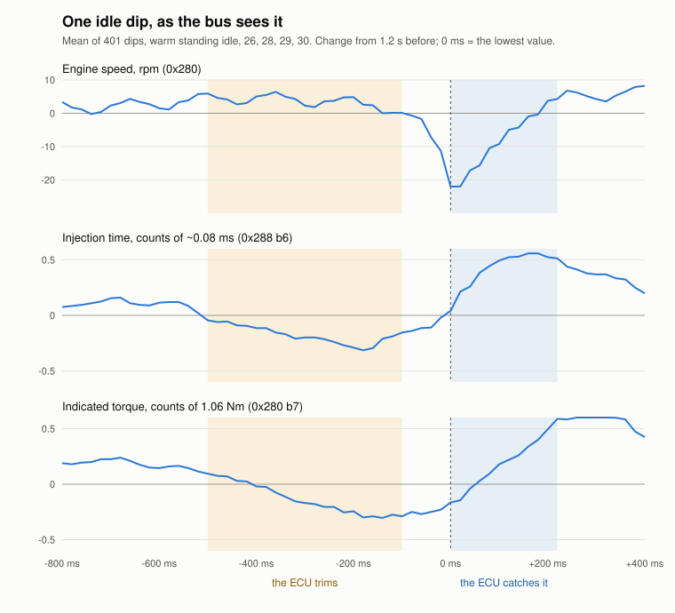

# Engine health — what is still wrong, and how to find out why

**The working document for one open investigation into the engine itself.**
It holds only what is **unresolved**: the symptoms still present, the
hypotheses still standing, and the test that would confirm or kill each one.
It has an end date. When every symptom below is either fixed or shown to be
normal for this engine, the file is deleted.

| file | what is in it |
|---|---|
| **this one** | symptoms → hypotheses → tests. Short on purpose |
| `refuted.md` | every hypothesis **settled against** and every symptom closed, with what settled it. Read it before proposing something |
| `vcds.md` | the VCDS blocks read on this car, their specifications, and how to record them |
| `vehicle-history.md` | the service record: parts, dates, distances. **Stays when this investigation closes** |
| `idle-log.md` | **the diary of the idle investigation**: what was done and measured at each stage. **Stays** |
| `plan.md` | **the planned fixes, in order**. Emptied as the work is done |

**The full text this file was condensed from on 20/10/2026** — every
alignment, every table session by session, every argument and its
corrections — is in git: `git show d327332:docs/engine-health/open.md`.
The dated log before it: `git show 7c69883:docs/engine-health.md`.
Nothing in the tree depends on either.

**Rules for this file.** A hypothesis that is refuted, or a symptom that
closes, moves to `refuted.md` in the same commit and leaves this file. A
new measurement goes into the evidence of the symptom and of every
hypothesis it touches, not into a dated section. Owner reports are marked
*owner*; general engine knowledge *general*; an inference *reasoned*.
**Every new observation of the owner's is checked against the symptom
list, and the owner decides** whether it is a symptom. When the symptom
list changes, every fit table gains or loses the column in the same commit
and the ranked list is re-read.

⚠ **Nothing here changes a constant in `src/`.** `IdleHealth` and the start
bytes on 0x604 are one of the instruments (`docs/firmware/frames.md`).

---

## Where it stands — 10 November 2026 (evening)

**Closed**, in `refuted.md` §D: S6 the exhaust joint behind the
converter, S8 the top end, S9 the rich trim, S10 the oil leak at the back
of the head, S13 the
throttle's routine, S15 the sputter, S18 cylinder 3 out with a tick
(24/10), **S22 the tick heard during the hydrogen clean (9/11 evening:
the clean's own sound, D11)**, **S7 the cold start (31/10: the fuel — four clean starts on
OMV after six bad of eight on the Verva)**; H9 (crankcase ventilation,
A15), H10 (when 014 counts, C19) and **H15 (the NGK plug ends, C24,
4/11)**.

**The original map has been in the ECU since 3/11** (`plan.md` 5a), the
adaptations reset with it; the drive home was captured (`42`) and read
the same day, and **the tuner's two files compared**: **the remap
changed five tables, only at high speed and the highest load** — less
fuel, more advance — and nothing at idle (H14). The drive agrees: the
idle advance, the overrun cut, the full-load advance, air and b7 read as
on the remap; **014 read zero**, which the files say is not the map's
(S3). **The second drive (`43`, 5b, 3/11 evening, to football)
was read in a cloud session the same day**: the cut on injector 4
**names cylinder 3** for 43 % of the dips (*The dips keep to one
slot*), 014 counts again, and the first full-throttle pulls ran short
of air (H14).

**The hydrogen clean of 9/11 is done** (`plan.md` item 8; captured
`44`–`46`, read the same day in a cloud session; S1, *The clean of
9/11*). **Stop 3 before it** began as `42` and `43` did — `IdleHealth`
about 90 for five minutes, **cylinder 3 giving 7–14 % of a stroke
less, 014 at 1.03 % of combustions, the most of any warm stop on
record** — and settled after its cut to about 50, 3 near the others,
014 near zero. **Stop 7 after it** read about 60 from its first minute
to its last: **no rough start, 3 level with 1, 014 at 0.12–0.14 %, and
the dips on all four alike** (25 % on 3 against 48 % at stop 3), **but
not below stop 3's settled level**; 4's steady deficit (5–8 %) and 2's
strength are as before. **With the provider's gas flowing at idle the
idle had no dips at all** (8,700 strokes, `IdleHealth` 14–29); S22's
tick, heard during the clean, was closed that evening as the clean's own
sound (`refuted.md` D11). One stop each side.

**The probes read before the swap, 9/11 night** (`plan.md` 8c, standing,
shortened at the owner's decision; H11, *The reading before the swap*):
**at every idle the rear probe sinks towards lean over the minutes**,
below 0.2 V by the third, and is back near 0.6 V after 1,500 rpm; the
A/C did not lift it in the log, though the display calmed with it
(130–140 loads off, 90–100 with the A/C); both heaters inside their
specification, 032/055 unchanged, no code. **Read 10/11** (H11, *What
the rear probe can and cannot say*): **a lean mean behind the front
probe at idle, its size not read, from one of four causes** — the
front probe reading rich, hydrogen from unequal cylinders, **air drawn
in between the probes (H2, widened to that zone 10/11)**, or a lean
bias the rear loop does not trim at idle. **Both probes replaced
10/11** (*the owner's decision*; no analyser): **the old front probe's
tip coated in a cracked grey-beige layer, the rear's clean** (H11, *The
old probes seen*); the swap rules out the old probes, not the other
three, and the reading after decides by H11's five marks. S22's tick heard again at
that idle loads off, not with the A/C — added to D11 at the owner's
decision, not reopened.

**The reading after the swap, 10/11** (`plan.md` 8c, done; H11, *The
reading after the swap*), standing as on 9/11 night and then a drive of
about 29 minutes with 014 033 036: **the new rear probe held flat at
0.59–0.60 V through 18 minutes of idle** — loads off, the A/C, loads off
— where the old one had sunk within the first phase, **then switched
in one sample to the front's swing** (0.07–0.78 V) until the 1,500 rpm;
flat again at the last idle and for the first 1½ minutes of the warm
stop. **The idle did not change**: loads off 112–140 (9/11: 130–140),
the A/C 66–75 (90–100), the warm stop at the end 48–90, `Misfires` 3–7,
014 0.24 % of combustions there. 032 −7.8 / +7.0 → **−6.3 / +5.5 %**
over the drive; heaters, 055 and the fault memory fine. **Read**: the
old probes carried most of the lean mean, **but the idle was as rough
without it** — H11's mark 2 met, marks 3 and 4 failed at the first stop.
**The battery was disconnected after parking at work** (*the owner*), so
032 relearns from zero on the new probes: on the old ones it was back
at −6.3 % after one drive both times it was reset (H11, *The relearn
after the battery disconnect*).

**The relearn drive, 10/11 evening** (`plan.md` 8d, done; captured
`47`–`48`, read in a cloud session the same evening; H11, *The relearn
drive*): **032 from zero to −6.3 / +6.3 % within 37 minutes**, −3.9 /
+7.0 at the end — **the split back on new probes in one drive, so not
the old probes'** (mark 1 failed; S19). **The idle as before**: queue
stops 49–92, the warm stop at the end 52–84 a minute, 014 0.15–0.24 %;
**cylinder 3 leads the dips again, 41 %** (28 % the day after the
clean, p 0.015) — **the clean's effect on 3 lasted a day** (*The dips
keep to one slot*). **New, S23** (*the owner's decision*): **the new
rear probe's signal fell under load from 16:57 and read 0.000 V at full
load from 17:29, P0137 sporadic** — the lead, the connector or the part,
not the gas; normal again at the basic settings after it (034, 046, 037
all OK). **Unexplained: the last four minutes of the warm stop,
17:38–17:42, read 36–45, the calmest warm idle captured outside the
provider's gas**, 3 with no named dip — at a plain idle, before both the
clear of P0137 and the basic settings (the bus marks them from 17:41:44),
so neither made it (H11, *The relearn drive*).

**Open:**

- **The idle — S1 (unsettled) and S3 (014 counts at idle).** Every part in
  the fuel and ignition path has been replaced and both remain. Warm, in
  the everyday state, **about 70 on 27/10, level with its best days of
  12–15/10, back up to 80–105 from 28/10 to 2/11** on the display, on the
  Verva and on OMV alike; **on the original map, 3/11 (`42`, fresh
  adaptations): 93 for the first three minutes of a stop straight after
  the motorway, then 54 ± 3, and 63–77 at the stops on the way home**;
  cold 98 ± 3 at 50–61 °C of oil, against 110–140 on the display the day
  before. **014 read zero all session**, at an idle load of about 30 %
  (S3). **On `43`, one drive later, loads off: 86 for the first 3
  minutes of the warm stop, 48 ± 3 for its last five** — the best level
  shown loads off, one stop; **014 counting again** at 26.5 % load, then
  zero for the last 2 minutes (S3). **On the display the same night**,
  the drive home: **70–95** at 101 °C of oil, everyday state (*owner*).
  **4/11, display**: **90–110** in queues until the engine was revved,
  the larger dips felt, **70–90** after; **45–50** with the A/C, the
  blower full and the rear window (*owner*). **5/11, display, the A/C
  on**: **60–76**, and the first warm `Misfires`, **2–10** (S3); **the
  drive home, 100 °C of oil, the A/C on**: **51–54**, `Misfires` 3–4 at
  the end, 1–22 over the hour (S3). **6/11, display**, the first reading
  after 5/11's contact cleaner and straightened gasket edge, at the end
  of a 40-minute drive with queues, oil 98 °C, **the A/C on, the blower
  on 2**: **65**, `Misfires` **18**, MisfAvg **23.0**, the
  misfire figures higher on only about 5 minutes of idle, hardly any of
  it warm; **the engine behaved the same** (*owner*; S3). **The drive
  home the same day**, oil 90 °C, **the A/C off, the blower on 1**:
  **73**, `Misfires` **6**, MisfAvg **8.6**, the idle "relatively OK" —
  and the engine lamp, P0440 (S21) (*owner*, the album). **8/11**, home
  after the OMV fill, oil 97 °C, the everyday state, about a minute:
  **70–75**, `Misfires` **9–12**, MisfAvg **12.5** since the start at the
  pump; most of the drive gentle on the last of the fuel, a little
  higher revs after the fill (*owner*). **9/11, the clean's day**
  (`44`–`46`, the everyday state, A/C off, oil 101–103 °C): **stop 3
  before it 90 then 50**, **stop 7 after it 57–63** (S1, *The clean of
  9/11*); felt **"a little calmer" after it**, which he says he no
  longer trusts himself (*owner*), and more unsettled at the provider
  straight after the clean (*owner*, 11:26). **10/11, after both
  probes** (H11, *The reading after the swap*): standing, loads off
  **112–140**, the A/C **66–75**; the warm stop after a drive of 29
  minutes, the everyday state, A/C off, oil 101–102 °C: **48–90**,
  `Misfires` 3–7 — no change. **10/11 evening** (`47`, the relearn
  drive, 032 relearning from zero): queue stops **49–92**, the warm
  stop at the end **52–84** a minute for 8 minutes, **then 36–45 for
  four**, before the clear and the tests (unexplained; H11, *The
  relearn drive*).
  The dips sat two thirds on 3 and 4
  until the VW leads, **on all four alike** on `40` and `41`, **on `42`
  one slot again, 45 %**, and **on `43` named: 43 % on cylinder 3**
  (p 0.004; *The dips keep to one slot*), with P0303 after the cut;
  **on `44`, before the clean, 48 % on 3; on `46`, after it, all four
  alike** (p 0.01 that 3's share fell by chance). **Named by the
  strongest slot (9/11 evening), 3 led the warm dips in every period
  since 24/9, `40` included (55 %); `46` is the first capture with no
  leader**; **`47`, a day later, 3 leads again, 41 %** (*The dips keep
  to one slot*, *Every capture named by its strongest slot*).
- **Around the idle:** S2 (an occasional puff), S14 (bangs on an
  unblipped downshift), S11 (a hiss at the back, perhaps the throttle's
  own air).
- **The cylinder 4 knock window: S4, S5** — its own cluster, not in
  `plan.md` (*owner's decision*, 9/10). **On the original map cylinder 4
  still retards alone**, as often as on the remap and about half as far
  (S4).
- **S19, P0172 and the split trim** — the code once (24/10), not back on
  any reading since; **032's idle cell at −6.3 to −8.6 % and its
  part-load cell at +5.5 to +8.6 %** from 25/10 on the remap. **On the
  original map, one drive after the reset: −6.3 / +3.1 %, two:
  −6.3 / +3.9 %, settled on 6/11: −7.0 / +6.3 %** — neither cell is the
  map's (S19). **On the new probes, 10/11: −7.8 / +7.0 → −6.3 / +5.5 %
  in one drive, then reset by the battery disconnect; relearnt from
  zero on 10/11 evening to −6.3 / +6.3 within 37 minutes, −3.9 / +7.0
  at the end** — the split is not the old probes' (S19); reset again by
  the clear of P0137 (`plan.md` 8f).
- **S21, P0440 and the engine lamp, steady** (6/11, added at the
  owner's request): the evaporative system, the code of 1/2018 back; no
  fill and no hose touched before it; cleared by the owner (H16). Not
  the idle.
- **S12, a sudden jerk at a crawl and on moving off** (reopened 10/11
  night at the owner's request; not the pedal): not on the bus at a
  crawl; 014 counted single misfires in moving-offs on 10/11.
- **S23, the new rear probe's signal falling to zero under load**
  (10/11 evening, added at the owner's request): P0137 sporadic,
  cleared; normal again minutes later. The lead, the connector or the
  part (`plan.md` 8e). Not the idle.
- **S20, the speed wandering at a constant pedal** (since 1–2/10, on the
  road) — **a little better since the cable was slackened and the pedal
  greased (27/10), still there** (*owner*, 28/10). Not the idle.
- **Not pursued:** S16 (a tick on the gearbox side), S17 (a resonance at
  ~2200 rpm; **not the exhaust's heat shields** — still there after their
  new clips, 31/10 — perhaps nearer the engine).

**Ranked (10/11 evening, agreed with the owner, after the relearn drive):**
**H13, H3, H4, H1, H7** (the clean took 3's excess, for a day; what acts
on 4 alone next), then **the timing belt a tooth out** (up 9/11 evening
from ninth, for the dips' dilution), **H11** (down 10/11 evening from
third, its marks failed on the relearn drive), **H21** (the probes'
wiring, added 10/11 evening at the owner's request: S23 in full, S19's
idle cell perhaps, the idle hardly), H2 (widened 10/11 to the zone
between the probes, not moved), H0, H8, **H16** (the purge valve: up to
seventh after P0440, S21, back to tenth the same night — the valve
hardly leaks and its pulses do not line up with the dips), **H20**
(coolant into 3, added 4/11, weak), H18, H12 (*The idle's candidates, ranked*; every
fit table re-read 4/11). **H15 refuted 4/11** (`refuted.md` C24).
**H14 and H19 left it on 3/11**: the tuner's files
show the remap touched only the corner of highest load, and neither the
idle nor the MAF's curve (`refuted.md` C22, C23). **After `43`
(cylinder 3 named) deposits and a valve on 3 lead, H7 fourth.** **Read
4/11 on the load and revving patterns alone**: H13 with H1's exhaust seat
on 3 the one reading that fits both; H3 the load only; the order stands.
**Re-read 5/11 on the dips' anatomy** (S1, *How many strokes make a
dip*): one dip in five is two firings in a row, warm on `43` those lean
to 3 as well; the order stands. **The fresh look at the data, 5/11** (S1,
S3): 014 counts misfires per 200 revolutions and partly silences itself
under load; a steady pattern over the cylinders, 3 and 4 weak and 2
strong, is about a third of `IdleHealth` (S1, *A steady pattern over the cylinders*); re-ranked
on it with the owner: **H3 second, H1 third, H4 fifth**. **Re-read
10/11 midday, after the reading after the swap: the order kept until
the owner decides after the relearn drive (8d); proposed, H11 from third to seventh** (its idle form
has lost its link — the lean mean went with the old probes, the
roughness stayed; *The idle's candidates, ranked*). **Re-read 10/11
evening, after the relearn drive, agreed with the owner**: H11 from
third to seventh, its marks 1, 3, 4 and 5 failed; **H21 added eighth**,
the probes' wiring; H13's "the clean took 3's excess" weakened, 3
leading again a day later (*The idle's candidates, ranked*).

**Next** (`plan.md`; *the owner*, 10/11): **8e at the next cold
engine — the new probes' tightness, the rear probe's lead and both
probes' sockets on the harness side** (S23, H21); **8g, the probes'
loom flexed with the ignition on, engine off, 033/036 logged**, with 8e
at a laptop session; **8h, the loads against the sensors' voltages**,
VCDS at a warm idle, at a laptop session; **8f, 032 at every VCDS session** until both cells
have held for three drives (reset again by the clear of P0137); then
the MFD in (item 6) and the oil level every 500 km (6i); **item 6's
warm stops on the display with a word on what came before each**;
**8b, a second captured warm stop with a cut on 4 on another day** —
its question, whether 3's rough start stays gone, answered without a
cut on `47` (it came back), so the cut now only confirms the naming;
**6m's injector circuits** for 4's kept deficit;
**the purge valve N80 only if P0440 comes back** (H16, S21, 8a); item
9's tests (the stethoscope, the coolant's CO₂ test, a warm leak-down)
by what those show.

---

## The symptoms

### S1. Unsettled idle — engine speed fluctuates

**What is seen.** Every few seconds the idle dips by 20–45 rpm and recovers in
about a quarter of a second. It feels restless from the driver's seat too:
**the larger dips, about 15 rpm and over by the owner's guess, are felt as a
slight jerk in the seat** and heard, and between jerks `IdleHealth` holds
lower (*owner*, 23/10/2026: about 50 between, higher with each).
**On the new regulator hose, 25/10, no jerk was felt** with `IdleHealth`
about 90 loads off and 120–130 straight after a start and after the loads
went off (*owner*) — so a high grade did not come from felt jerks that
time. One idle, oil about 80 °C; whether the grade's make-up changed
(more small steps, fewer deep dips) needs a capture.
**By ear, 25/10 evening** (*owner*, warm, the everyday state): **in the
calmer stretches the engine speed drops a little and holds there**. Not
shown by VCDS, whose 40 rpm steps put the stretches with 014 counting and
without at the same 760–800 (`idle-log.md`); a capture's quarter-rpm
0x280 would show it. It sits beside *What comes before a dip*: a dip
follows the idle overshooting a little.
**By feel, 25/10** (*owner*): the idle felt calmer all day, on the new
regulator hose and the second 44K tank; he says so himself before the
data. 6j's 014 agrees in kind: its episodes stayed at 12 (below).

**How it is measured.** `IdleHealth` on 0x604 grades one firing against the
next (100 = the engine before the repair, lower is smoother). Offline,
`tools/idledips.py --roughness` gives the same grade from a capture.
**Every idle figure in these files is on the `IdleHealth` scale**
(*owner's decision*, 12/10): the mean step in rpm × 50. A capture's figure
is a mean over a window, the display's a running filter of the same
quantity. **A reading without the oil temperature beside it compares with
nothing**. **Fresh adaptations** (after a battery disconnect) were held
to read calmer on every ruler; **014 does not** — it counted on 27/10's
reset as on settled drives, and only 4/10 A was quiet (`refuted.md` C19,
2/11) — and `IdleHealth` on fresh ones (3/10 61–68, 4/10 A 72–74, 27/10
about 50) sits inside the settled range, so it is not shown either way.

**What one dip is worth.** Engine speed on 0x280 is recomputed once per 180°
of crank, one power stroke (`docs/firmware/can-decoding.md` trap 5), so a dip
is one cylinder's stroke. A stroke that gives nothing costs an estimated
33–57 rpm; the deepest dips are 37–46, the typical one 20–22 — a partial
burn. **The dip is the failed combustion itself**, and the recovery is the
idle governor. **About three dips in four are one weak stroke, one in five
two in a row** (*How many strokes make a dip*, below).

**Every session since the repairs, like with like** (standing idle, 30 s
windows, 93–111 °C of oil, heavy-load windows left out; mean ± standard
error):

| date | capture | adaptations | what changed | `IdleHealth` |
|---|---|---|---|---|
| 24/9 | `19`/`20` | fresh | new injectors, old MAF | 113 ± 5 |
| 24/9 | `24` | fresh | **new MAF** | 91 ± 6 |
| 3/10 | `26` | fresh | the valve cover job | 61–68 (few windows) |
| 4/10 A | `28` | fresh | the right cover gasket | 72–74 |
| 4/10 B | `29` | settled | | 89 |
| 9/10 | `30` | settled | dipstick, MAF clamp | 83–89 |
| 10/10 | `31` | settled | **new NGK leads and plugs** | 77 ± 4 |
| 12/10 | `32` | settled | lead 4 re-seated, airbox sealed | **63 ± 1** |
| 15/10 | `37`, `38` | settled | the cleaner in | **59–61** |
| 18/10 eve | `39` | settled | after the episodes of 18/10 (`refuted.md` D10) | 78 ± 4 |
| 19/10 | display | settled | | about 100 loads off |
| 21/10 | `40` | settled | **VW plugs and leads, new plenum gasket** | 67 ± 2 |
| 23/10 | display | settled | the first 44K tank, ~70 km in, after a hard motorway run | 45–50 between jerks, 70–90 with them, **never above 100** warm; *fan on 1, one seat heater on 1, lights* (*owner*) |
| 23/10 eve | display | settled | home through Prague traffic, much idling, unsettled throughout; the last stretch held at higher revs in a low gear | **37** straight after, the lowest yet in this state, then slowly back to 50 within about a minute and above it after another; *fan on 1, one seat heater on 1, lights* (*owner*) |
| 24/10 eve | display | settled | the second 44K tank, Orlen Verva 100, after ~340 km in the day with about an hour above 4000 rpm; 3–5 min of warm idle | **70–80**, everyday state (*owner*) |
| 25/10 | display | settled, 032 relearning | **the regulator's vacuum hose renewed**; oil about 80 °C, not 93+ | **about 90** loads off, **35–40** loads on (lowest 35); **no jerk felt** (*owner*) |
| 25/10 eve | display | settled | the new hose, a drive later; oil 96 °C | **70–80**, everyday state; **50–60** at a light before, same state (*owner*) |
| 26/10 | display | settled | warmed in a jam, gently, under 3000 rpm; then one brisker stretch, revs held up in 2nd downhill on engine braking | **80–100** all through the warm-up, **still at 92 °C** of oil; **60–70** after the brisker stretch; everyday state (*owner*) |
| 27/10 | display, video | settled | `plan.md` 6k: a gentle drive to about 88 °C of oil, the A/C against the loads (`idle-log.md`) | **~70** everyday state; **35–50** the A/C alone; **54–62** every load but the A/C; **25–35** both |
| 27/10 eve | display, video | settled (055 reset that afternoon, relearnt to −1.17) | the pedal greased; oil changed 26/10; the second 44K tank about four-fifths used; oil 100 °C | **54** loads off (mean; **35–65** in waves of about 1½ min); **34** every load on with the A/C (26–42, still falling) — **the first stop with loads off within 25 of loads on** (condition 2 below), one stop |
| 28/10 | display | settled | the last of the Verva tank, 13 l in the morning to 5 l; oil 95–100 °C | **70–100 most of the time, down to 47 at moments**, everyday state; **felt worse** (*owner*), and the figures agree: above 27/10's ~70 in the same state, lower being calmer |
| 29/10 | display | settled | home from the pump, 5 km driven gently, oil 87 °C; the Verva still in the lines | **90–130, very unsettled**, everyday state (*owner*) |
| 30/10 | display | settled | the first warm drive on OMV; oil 99 °C | **80–100**, everyday state (*owner*) |
| 2/11 | display | settled | OMV, about 85 km in, the can's 5–6 l added 31/10; the day before the map; oil about 100 °C | **85–105**, everyday state; **felt worse again** (*owner*); cold **110–140** |
| 3/11 | `42` | fresh (reset with the map) | **the original map**; the drive home from the tuner, motorway to 186 km/h, then a stop of about 9 min with throttle blips, oil 103–105 °C; b7 25–29 at idle | **71 ± 3** over every warm window (41–100): **93 ± 2** for the first 3 min after the motorway, **54 ± 3** from the fifth minute (41–67), 63 ± 3 and 77 ± 4 at the two stops near home; cold **98 ± 3** at 50–61 °C of oil |
| 3/11 eve | `43` | one drive after the reset (032 −6.3 / +3.9) | the original map, the second drive: mostly motorway to 90 °C of oil, full-throttle pulls, then a warm stop of 11 min **loads off** (b7 21) with a 57 s cut on injector 4, oil 99–100 °C | **86 ± 4** the first 3 min; 74 the 2 min after the cut; **48 ± 3** from then to engine off (5 min, windows 30–67) — `42`'s shape, settling about the sixth minute; cold 129 over only 26 s settled, oil about 47 °C |
| 3/11 night | display | relearning (032 cleared after `43`'s cut) | the original map, the drive home from football, MFD in | **70–95**, oil 101 °C, everyday state (*owner*) — the first display reading on the original map, a little under the remap's 80–105 of 28/10–2/11 |
| 4/11 | display | relearning | the original map; mostly slow driving and queues, then the engine revved; oil about 100 °C | **90–110** until the engine was revved, **the larger dips felt in the seat**; **70–90** after it; everyday state. **45–50** with the A/C and the blower on full and the rear window heated (no main beam, no seat heaters), still falling; the supply down to about 12.4 V at times with everything on (*owner*) |
| 5/11 | display, photos and a video | relearning | the original map; stops on two short morning drives, the engine perhaps never fully warm and never revved above 3500 rpm, which always leaves it a little worse (*owner*); **the A/C on at every stop** (*owner*); oil not read | **60–76** with the A/C; `Misfires` **2** at 7:33, **5–10** at 9:05; MisfAvg 7.4 and 9.8–11.6 (the start's mean, its cold part in it) — the first warm readings of `Misfires`; cold the night before 18–23 (*owner*, the album) |
| 5/11 eve | display, a video | relearning | the drive home, an hour, mostly queues, revved a little at times; the everyday state plus **the A/C and the blower on 2** throughout; oil 100 °C at the end (*owner*) | **51–54** settling from 60–67 in the last 45 s, still the A/C on; `Misfires` **3–4** there, **1–22** over the drive (*owner*); MisfAvg 8.7 → 8.2 |
| 6/11 | display, a photo | relearning | the first reading after 5/11's contact cleaner (injector 4, T3) and runner 3's gasket edge straightened; about 40 min with a few queues; the everyday state plus **the A/C and the blower on 2**; oil 98 °C (*owner*) | **65** with the A/C; `Misfires` **18**, MisfAvg **23.0** at the end, higher because **only about 5 min of idle in the drive, hardly any warm**; **the engine behaved the same** (*owner*, the album 9:29) |
| 6/11 eve | display, a photo | relearning | the drive home; oil 90 °C; **the A/C off, the blower on 1** (*owner*); **the engine lamp came on** on the way, P0440 (S21) | **73**; `Misfires` **6**, MisfAvg **8.6**; the idle "relatively OK" (*owner*, the album 16:40) |
| 8/11 | display | relearning | home after the OMV fill (about 10 % Efecta 95 in the tank), mostly gentle on the last of the fuel, a little higher revs after the fill; oil 97 °C; the everyday state, about a minute (*owner*) | **70–75**; `Misfires` **9–12**, MisfAvg **12.5** since the start at the pump (*owner*) |
| 9/11 | `44` | relearning (032 −7.8 / +6.3) | stop 3 **before the hydrogen clean**, after about 50 min of driving with a motorway stretch; the everyday state, the A/C off; 30 s cut on 4; oil 103 °C | **90** the 5 min up to the cut (76–107), **50** the 5 min after it (37–64); 014 1.03 % then 0.02 % of combustions (S1, *The clean of 9/11*) |
| 9/11 | `44`, `45` | relearning | **the provider's gas flowing at idle**: 10:19–10:22 with the A/C and the blower on 4, and the clean's last 2 min with the blower on 4 and the heater full; oil 97–106 °C | **20** and **14–29**, **no dip at all** in 8,700 strokes (S1, *The clean of 9/11*) |
| 9/11 | `46` | relearning | **straight after the clean**, the hose off with the engine running, oil 104 °C; then stop 7 after a motorway run, the everyday state, the A/C off, a 30 s cut on 4, oil 101 °C | **60** straight after; **57** the 3½ min up to stop 7's cut, **63** the 6 min after it; 014 0.12–0.14 %; at work after the short drive on, 93 → 54–79 over 4 min |
| 10/11 | display, VCDS | kept (032 −7.8 / +7.0) | **the first idle on both new probes** (H11, *The reading after the swap*): a cold start standing, then loads off, the A/C, loads off, 1,500 rpm, idle; coolant 78–99 °C, oil 54 °C at the start of loads off | **120–140, then 112–120** loads off; **70, then 66–75** with the A/C; 98–120 loads off; 70–99 after 1,500 rpm; `Misfires` 13–14, 3–4, 8–12, 7 → 5 (*owner*) — as on 9/11 night with the old probes (130–140, 90–100) |
| 10/11 | display, VCDS 014 | 032 −6.3 / +5.5 after it | the drive on to work, about 29 min; a warm stop at the end, the everyday state, the A/C off, oil 101–102 °C | **60–70, 55, 70, 50–55, 48, then 80–90**; `Misfires` 7, 5, 3 (*owner*); 014 0.24 % of combustions |
| 10/11 eve | `47`, VCDS 014 032 036 | **relearning from zero** (the battery off; −6.3 / +6.3 by 16:58, −3.9 / +7.0 at the end) | `plan.md` 8d, the drive home from work; queue stops 16:51–17:17 in the everyday state, oil 99–103 °C; one with the A/C | **63, 91, 82, 92, 63, 49, 55, 71** loads off; **52** with the A/C; 014 0.24 % over the stops; cold at 44–46 °C of oil with 032 at zero 91–104 (H11, *The relearn drive*) |
| 10/11 eve | `47`, `48` | −3.9 / +7.0 (reset by the clear of P0137, 17:40:05–17:41:44, after the calm began) | the warm stop after a brisk stretch, the everyday state **plus the hazard lights from arrival** (*owner*), the A/C off, **no cut**, oil 102–104 °C; **the rear probe reading zero** (S23) | **59, 57, 52, 54, 65, 66, 84, 70** a minute for 8 min (014 0.15 %); **then 45, 43, 38, 39, 36 — the calmest warm idle captured outside the provider's gas** (the display touched 37 once, 23/10 evening), 3 with no named dip, to the revs for 034 at 17:42:50; 40–66 in the basic settings after (H11, *The relearn drive*) |

**The dips themselves on the original map** (3/11, `42` against `24`–`40`;
standing idles settled 30 s and more, oil 93 °C and over, dips against the
one-second median): **about 17–20 a minute of 15 rpm and over**, as `32`,
`37`, `40` (16) and above `38`'s loads-off 9; **of 30 and over 0–0.4 a
minute**, as `32`–`40` (0.2–0.7); **none of 40 and over in 11 minutes**,
where `40` had one in 20 and `37` one in 7 — too few to tell apart; the
deepest 37.8 against 41–59 on `37`–`40`; the median dip 17.2 rpm as
everywhere. **One thing reads differently**: the spread of engine speed
inside a stop, **8.5 rpm** standard deviation against 9.8–13.9 on `24`–`40`
(only `38`'s single stops as low) — less slow wander, not fewer
stumbles; one drive. The idle speed (794–796 rpm) and 0x280's load byte
(21) as before. Cold (oil 40–70 °C, loads on): 22 dips a minute, 0.7 of
30 and over, against `32`'s 38–40 and 1.6–2.1.

**The clean of 9/11** (`plan.md` item 8, done; `44`–`46` and their
014/001/003 logs; read 9/11 in a cloud session; `idledips --roughness
--windows 30`, `cutscan.py --shares --name`, `dipshape.py --name`, and
*ad-hoc scripts, not kept*, for the steady pattern, the named dips
followed across the stroke count's slips (below) and 014 per stop).
Both stops in the everyday state with the A/C off, oil 101–103 °C,
each after a motorway run, each with a 30 s cut on 4:

| | stop 3, before (`44`) | stop 7, after (`46`) |
|---|---|---|
| `IdleHealth`, up to the cut | **90** (76–107, 5 min) | **57** (48–65, 3½ min) |
| `IdleHealth`, after the cut | **50** (37–64, 5 min) | **63** (57–76, 6 min) |
| the same with the steady pattern taken out | 45, then 33 | 40, then 41 |
| cylinder 3's steady deficit, % of a stroke | **7–14**, rising to the cut; then 0–2.5 | **0–3.6** throughout |
| cylinder 4's | 2–6; then 5–7 | 2–10, mostly 5–8 |
| cylinder 2, % more than the mean | 13–15; then 7–10 | 9–13 |
| dips per 1000 strokes | 4.8, then 2.7 | 2.6, 2.6 |
| the dips named, 3's share | **29 of 60, 48 %** (p 8×10⁻⁵ against all alike) | **8 of 35, 23 %** (1: 9, 4: 7, 2: 11) |
| 014, % of combustions | **1.03** (to 132 in one window), then 0.02 | 0.12, then 0.14 (to 36) |

- **Stop 3 began as `42` and `43` began**: rough for about five
  minutes, then calm. **The rough part is cylinder 3's steady deficit
  and 3's dips**: 13 of the 14 strokes that lost 19 rpm or more in its
  first five minutes were on 3, and 014 counted up to eleven misfires
  in a window of 200 revolutions — **the highest stop on record**
  (S3). **`43` re-read the same way**: 3 gave 4–10 % less in its rough
  first five minutes (69–97) and about nothing in its calm end — its
  settling was this (*A steady pattern over the cylinders*).
- **Stop 7 had no rough start**: about 60 from the first window, 3
  within 0–3.6 % of the others throughout, the dips on all four alike
  (`cutscan --shares`, 106 dips: exactly a quarter each, p 1; `40`
  and `41` were the last with no slot leading), 014 low.
  **3's share of the dips fell from 48 % to 23 % (p 0.01)**.
- **But stop 7 was not calmer than stop 3's settled half**: 57–63
  against 50, the rest after the pattern 40 against 33, the dips 2.6
  against 2.7 a thousand. **4's steady deficit (5–8 %) and 2's strength
  stayed as they were**, as on `31` and `43`.
- **Around it, the same capture**: **straight after the clean**, the
  hose off with the engine running, oil 104 °C: about 60, and **3 still
  6–7 % short for the first 2½ minutes**, 3 % for the next five (named
  as at work, below); 014 counted (*owner*: more unsettled there, 11:26). **At work**, after a
  short drive on from stop 7: 93 → 54–79 over four minutes, its rough
  first minute **on 4 (10–12 %), not 3** (*reasoned*: named by taking
  the strongest slot for 2, as at both cuts; no cut in that run).
- **The day after** (10/11 evening, `47`; H11, *The four calm minutes
  read closely*): **the dips back at 5.6 per 1000 strokes at the queue
  stops and 7.8 at the warm stop**, against 1.7–3.8 at every warm stop
  of 9/11 after the clean, and **3 leading them again**. The provider
  said the clean's effect shows over a few hundred km (*owner*, 10/11);
  one day reads the other way, the coming weeks' stops decide.
- **With the provider's gas flowing at idle the idle had no dips at
  all.** Twice: 10:19–10:22, the hose fitted with the engine running,
  the A/C and the blower on 4 — **`IdleHealth` about 20, 0 dips in
  4,877 strokes against 0.9 a thousand in the same state before it**
  (4.4 expected, p 0.01); and the clean's last two minutes at idle, the
  blower on 4 and the heater full — **14–29, 0 dips in 3,815**. The
  lowest grades on record. With it the throttle closed (3.0° → 1.3–2.2°),
  the MAF fell (3.1 → 2.4–2.8 g/s) and the lambda correction stayed near zero or
  went negative (−0.6 to −4.3 % in 20 s means): **what came in burns, and the ECU took
  air and fuel away for it** (*reasoned*; whether the machine ran before
  its noted start, 10:23:40, is not recorded, and nothing else explains
  a closing throttle with fuel taken away). **When the calm came — the gas,
  not the air** (9/11 evening, *the owner's question*: had it come the
  moment the hose went on, unmetered plain air would be what calms it,
  pointing at fuel to spare that 032's idle cell already shows; had it
  come with the machine, it is the gas). The 001/003 log in 20 s steps
  against the capture: **10:16:48–10:18:48**, idle with the A/C, the hose
  not yet in: MAF 3.31–3.39 g/s, throttle 2.9–3.0°, lambda −2.5 to +0.5 %,
  `IdleHealth` 43–62. **10:19:08, the intake opened for the hose**:
  **lambda jumps to +4.7 % for one window** — air the MAF did not see,
  the ECU adding fuel for it — and `IdleHealth` reads 42, about where it
  was. **From 10:19:28 lambda is back at −0.6 to +1.6 % and stays there**,
  while the MAF keeps falling (3.04 → 2.78 g/s) and the throttle closing
  (2.7 → 2.2°) **over three minutes**, and `IdleHealth` falls step by
  step, **31, 25, 22, 23, 18, 23, 18, 14, 14**, no dip at all. **The end
  is a step**: at the clean's last idle (11:19:28–11:21:08) MAF 2.44–2.60,
  throttle 1.3–1.8°, `IdleHealth` 19–31; **at 11:21:28 the MAF rises to
  2.75, the throttle opens to 2.4° and within 20 s `IdleHealth` is 61**,
  then 55–76 with dips again once the hose is off. *Reasoned*: **plain
  unmetered air** would hold lambda positive for as long as it came in —
  the MAF under-reading by about 15 % asks about 15 % more fuel — and
  would not let the throttle close; it showed for 20 s, with no calm.
  **What came after is balanced in itself** (lambda near zero while the
  MAF fell by a sixth): **oxyhydrogen**, hydrogen and oxygen in the
  ratio that burns them, carrying energy so the governor took air away
  — **its rise over three minutes is the machine coming up** (cells
  warming; the noted start, 10:23:40, is then the provider's full
  setting or the owner's note, not the first gas), **and its end a
  step**. So **the calm is the gas burning with the charge, not air the
  MAF missed**: a better-burning charge, not fuel to spare. ⚠ The A/C
  was on in the first stretch, the blower on 4 and the heater full in
  the second; the 20 s of plain air are one window.
  **The gas idle taken apart** (9/11 evening, *the owner's question*:
  does it weaken this file's reading of the engine, and does it point
  elsewhere; 30 s windows, the steady pattern fitted as in *A steady
  pattern over the cylinders*, named by taking the strongest slot for 2;
  *ad-hoc script, not kept*):

  | stretch | grade | with the pattern out | the pattern, rms % of a stroke | its slots, sorted | steps ≤ −8 rpm per 1000 |
  |---|---|---|---|---|---|
  | the wait, A/C on 4, no gas | 40–50 | 25–28 | 4.7–5.8 | −8 … +6 | 15–22 |
  | **the gas rising, A/C on 4** | **22** | **9** | **4.5** | −7 … +4.5 | **1.4** |
  | **the gas, the clean's end, blower 4** | **29** | **11** | **5.5** | −9 … +4.6 | **8** |
  | straight after, the hose off | 60 | 38 | 5.9 | −9 … +6 | 34 |
  | stop 3 before its cut / after it | 89 / 49 | 45 / 33 | 8.6 / 5.2 | −14 … +9 / −8 … +6 | 67 / 28 |
  | stop 7 before its cut / after it | 60 / 64 | 41 / 41 | 5.5 / 5.9 | −9 … +6 / −9 … +7 | 36 / 39 |

  **The gas took the random part and left the steady one.** The
  weak strokes and the dips went (steps of −8 rpm and more from 15–39 a
  thousand to 1–8), and the grade with the pattern out fell to 9–11, a
  third of the best stop; **the steady difference between the
  cylinders stayed exactly as it was** — 2 about 8 % strong, 4 about
  5 % weak, the same size and shape with the gas as without, at the
  provider and at stops 3 and 7 — **in one unbroken run from before
  the gas into it (10:16–10:22), 4 stays the weak slot (+4.4 to +7.1 %
  before, +4.9 to +5.8 % with the gas) while the grade falls from 49–54
  to 18–23**. The advance hardly moved (3.1° before,
  2.6–4.9° with it). **Read** (*reasoned*):
  - **This file's reading holds and sharpens.** The dips are strokes at
    the edge of stable burning (*What one dip is worth*); a quicker,
    more easily lit charge (*general*: hydrogen's ignition energy about
    a tenth of petrol's, its flame several times faster, and it
    tolerates dilution far better; a few per cent of it is known to
    cut an engine's cycle-to-cycle variation sharply) takes them away
    **even on a smaller air charge** (load 25 % against 30). So *"anything
    that takes a little charge away tips them over"* (*Load smooths
    it*) is better put as **how easily the charge lights and burns**,
    of which its size is one part. At a closed throttle the cylinder
    keeps much of its own exhaust (*general*: residual gas is largest at
    idle and falls as the manifold pressure rises), which slows and
    scatters the burn — **a load lowers that dilution, which is why a
    load calms it, and the gas tolerates it**, which is why the gas
    calmed it more than any load. Not new physics: the same edge, with
    the reason it is an edge named.
  - **Two separate things, then**: **the dips** — a burn that fails
    now and then, cured by a better charge (the clean's effect on 3 was
    on this part: 3's rough start and 014's storm); and **the steady
    pattern** — 4 giving less and 2 more every cycle, which neither the
    clean nor the gas touched, so **a difference in what each cylinder
    gets, not in how well it burns**: its share of air or fuel, or of
    compression. That fits what acts on 4 alone and on quantity — **H3**
    (runner 4's torn gasket: less charge or a leaner one), **H4/H7**
    (less fuel into 4), **H1's inlet seat on 4** — and not what acts on
    ignition (H4's spark side, plug gaps): those would have been rescued
    by the gas like the dips were.
  - **What it points at more now**: for the dips, **anything that
    raises the residual gas or slows the burn at idle on all four** —
    a valve that does not quite close on the exhaust side (H1, H13's
    seat), deposit (H13), and **the cam's timing against the crank**:
    a belt a tooth out moves every valve event, the overlap with them,
    against the piston (one camshaft: the overlap's length stays) and with it the
    exhaust kept at idle, with compression even and the full-load
    power nearly intact (*general*) — the one candidate this reading
    lifts that sits low in the ranking (ninth; its marks are cheap to
    check). And **H0**, an AQY that idles near its dilution limit by
    design, is not weakened: every engine is calmer on hydrogen.
  - ⚠ The gas idles are two stretches of 3 and 2½ minutes, with the
    A/C on in one and the blower on 4 in the other; the pattern named
    by its strongest slot, as at work.
 Straight after, the hose
  off: 60 and 2.6 dips a thousand again. **Read** (*reasoned*): a
  faster-burning, more easily lit charge (*general*: hydrogen's wide
  limits and quick flame) **cures the weak strokes outright, even on a
  smaller air charge** — **the failure is in the burn, lighting or
  spreading**, not a mechanical event; it fits every cause that leaves a
  charge hard to light or slow to burn (H13's deposit, H3's lean runner,
  H4's spark, H7's fuel), and not a part that taps or a stroke that
  loses its charge outright. It does not name which.
- **014 was `deaktiv.` through the whole clean** (load about 19 % at
  1,750–2,150 rpm): it saw nothing there.
- **The fault memory** read at every phase (`vcds/vcds-step8-faults.txt`):
  empty at the start; after stop 3's cut **P1240 (injector 4, open,
  sporadic), P0300, P0304** — the cut's own — and nothing more after
  the clean or stop 7's cut; cleared by the owner at work after 032/055
  (032 −7.8 / +6.3 % at every read, 055 −1.13 before the clean and
  −1.05 after).

**What it leaves** (*reasoned*; *plan.md*'s reading, Part 2 *Step 3*):
**3's excess** — its share of the dips, its steady deficit, the rough
first minutes and 014's storm — **was not there after the clean**, which
is the H13 branch for 3 (the deposit that `43` and the borescope put on 3
was what made 3 the worst). **4's deficit and the settled level were
kept**: the clean took the part that came and went with the minutes, not
the floor; 4 has a cause of its own — H3 at runner 4 (its gasket edge
torn, 5/11), H4 in 4's circuit, H1's inlet seat on 4. ⚠ **One stop each
side, and the rough start is the thing that varies most between stops**:
stop 3's own second half read like stop 7, and straight after the clean
3 was still short. **What would settle it**: a second captured warm stop
with a cut on 4, on another day, after a similar run — a rough start on
3 again says the clean did not take it.

**The trend over every capture** (28/10, at the owner's question; every
standing idle settled 30 s and more, graded as `tools/afterpull.py`'s
`idle_runs()` grades, the display's filter replayed beside it;
loads off is b7 ≤ 25 at 93 °C of oil and over):

| | warm, loads off: stop means | middle band, ~77–88 °C |
|---|---|---|
| 11/8 (`09`, `11`) | 48, one 22 s hold | 106 |
| 24/9 (`24`, new MAF) | 88, 92 | 84 |
| 3–10/10 (`26`–`31`) | 67–103, most 75–95 | 90–111 |
| 12–15/10 (`32`, `37`, `38`) | **48–75**, most 55–66 | 93 |
| 18/10 (`39`) | 68–96 | — |
| 21/10 (`40`) | 61–67 | 75 |
| 24/10 (`41`) | — | 87–104, warmed at idle |
| 27/10 (display) | 54 | — |
| 3/11 (`42`, the original map, fresh adaptations) | 93 → 54 over one stop, 63 and 77 near home | — |

**Against the tank's level** (*the owner's question*, 28/10: the Verva
tank run down to about 5 l): the level off 0x320 in each capture
(`tools/replay.py`), beside the warm stops above — 50 l on 24/9 (88, 92);
29→23 l on 3–10/10 (most 75–95); **22 l on 12/10 (63)**; 36→35 l on 15/10
(48–75); 51 l on 18/10 (68–96); 43→40 l on 21/10 (61–67). **No relation**:
the calmest and the roughest both sit at about 22–29 l and at 35–51 l, and
every change of level came with a repair. The display gives no more (28/10:
70–100 at 13→5 l, oil 95–100 °C).

**Before October there is no trend to read**: two days of captures, and
the one hot figure of August is a 22 s hold. **Warm, the idle stepped
down once**, from about 75–95 to about 50–70, **between 10 and 12/10**
(the leads, lead 4 re-seated), rose for 17–19/10 and came back; 27/10
is level with its best, not past it, and **from 28/10 it is back at
about 80–105** on the display (to 2/11), the end of the Verva and the
OMV alike — so not the fuel. **On the original map (3/11, `42`)**
54 ± 3 settled into a stop and 63–77 near home, on fresh adaptations:
back inside the 50–70 band, one drive. **Cold it has come down**, and
that is the clearer change (below, *Temperature*).

**The outside air is not in this trend** (*the owner's question*, 28/10:
August was hot, late October about 10 °C — is the idle the same and only
the weather cooler?). Not on the bus (`docs/firmware/can-decoding.md`,
*What is NOT on the bus*); the intake air is in VCDS 004/006, logged once
(4/10). Against the weather as the whole (*reasoned*): the calmest hot
figure is August's, the hottest month; the warm idle moved **in a step**
between 10 and 12/10 and went up again 17–19/10, not gradually as the
autumn cooled; and the cold drop of 21/10 came on a start at 24 °C of oil,
warmer than the others. **Measured against the weather, 28/10**: the
air temperature of each capture day, 07–19 local, from the SYNOP reports of
Praha-Ruzyně (WMO 11518, via OGIMET), against every warm loads-off stop
(oil ≥ 93 °C, b7 ≤ 25, settled 30 s and more; `tools/afterpull.py`'s
`idle_runs()`):

| day | air, mean (min–max) | stops | `IdleHealth`, each stop |
|---|---|---|---|
| 24/9 (`24`) | 12.6 (10.4–15.1) | 2 | 88, 92 |
| 3/10 (`26`) | 16.0 (11.1–21.2) | 1 | 67 |
| 4/10 (`28`, `29`) | 15.0 (6.0–19.3) | 5 | 72, 80, 77, 95, 93 |
| 9/10 (`30`) | 9.7 (6.0–12.2) | 5 | 93, 75, 77, 82, 75 |
| 10/10 (`31`) | 11.6 (10.3–12.6) | 3 | 78, 89, 103 |
| 12/10 (`32`) | 9.7 (5.4–12.9) | 4 | 72, 48, 59, 66 |
| 15/10 (`36`–`38`) | 11.0 (4.8–15.3) | 6 | 66, 55, 69, 75, 58, 58 |
| 18/10 (`39`) | 10.1 (7.9–11.9) | 3 | 68, 81, 96 |
| 21/10 (`40`) | 10.8 (4.9–13.9) | 3 | 61, 67, 66 |
| 27/10 (display), evening | about 7 | 1 | 54 |

**No relation**: the day means against the day's mean grade correlate at
r = 0.13 (nine days), and days of the same air differ by 20 — 9/10 and
12/10 both 9.7 °C, 80 against 61; the warmest October day, 3/10, is among
the calm ones. Within September–October the weather does not explain the
trend. ⚠ Day temperatures, not the moment of the stop, and the intake air
under the bonnet at a warm idle is set more by the engine than by the
weather. **Not recorded with each reading** (*the owner's decision*,
28/10): with no relation found it is not worth his time; the weather
archive can be asked again if a question ever needs it.

**The MAF is the one change that showed at once** (24/9: the dips halved).
The calmest settled idles, 12/10 and 15/10, came in the days after the new
leads and lead 4's re-seat; the idle has worsened since (*Why the idle got
worse*, below).

**What is not known: the healthy target.** Every recording is of this engine
with the fault present, and **none will be**: a CAN capture of another car
needs its cluster harness tapped behind the vent, which no owner will allow
(*owner*, 21/10).

**When S1 closes** (*decided*, 20/10; the owner closes it), read over several
drives at 95–100 °C of oil: **(1) the dips no longer keep to a pair** —
`cutscan.py --shares`, pooled since the last repair, consistent with all four
alike; it needs no target, so it is the strongest mark — **met since the VW
leads** (`40`, `41`), to be held over more drives; **(2) load is no
longer needed** — loads-off `IdleHealth` within about 25 of loads-on (19/10:
about 100 against 50); **(3) at least the best level shown**, loads off about
50–60 (12/10, 15/10). Short of all three, the owner may close it as
*acceptable, cause known*. **Since 28/10 the warm stops are read in the
everyday state only** (`plan.md`, *the owner's decision*); **the marks
stay as they are and the closing itself is read loads off** — for S1 and
S3 alike — **and probably on the overrun as well** (*the owner's
decision*, 28/10): the downshift without a blip, where the load reads
about 10 % (VCDS 014, field 2) and the bangs of S14 come, is the thinnest charge and so the
strictest test (*owner*). **Read by ear, not by 014** (*owner*): on the overrun 014's
misfire recognition reads `deaktiv.` — in every 014 log in
`test/fixtures/vcds/`, every row above 1300 rpm with the load under 20 %
reads it, none `aktivováno` (counted 28/10) — so the counter cannot move
there.

**Load smooths it.** Every consumer at idle — A/C, lights, blower, heated
glass — makes the ECU open up the air, and the idle calms (26/9: 35–50 loads
on against 70–80 off, *owner*). The supply voltage is 1.25 V *lower* then,
so it is the charge, not the volts. **Since the cleaner, the partial loads
hardly matter** (*owner*, 19/10): lights and blower alone make little
difference, everything on together still calms it. **The first measured
pair**, 19/10, oil 101 °C: loads off mostly about 100, every load on mostly
about 50 — twice what one pair can show by chance. **Again 4/11**
(display, oil about 100 °C, *owner*): 90–110 in the everyday state
against **45–50** with the A/C, the blower on full and the rear window
heated, while the supply fell to about 12.4 V at times — the calmest
idle on the lowest supply. **Read beside the higher idle of 12/10**
(`refuted.md` D9; *reasoned*): a load raises the charge of every stroke
at the same engine speed, and helps; 830 rpm raised the speed on about
the same charge a stroke, and did not. **So what fails answers to the
charge a stroke and the cylinder's pressure, not to the air flow or the
speed** — and a weak spark would go the other way twice over: a higher
cylinder pressure asks more voltage to break down the gap, and the
supply is lower (*general*). Read as (*reasoned*):
**one or more cylinders run at the edge of stable combustion at the idle's
charge**, and anything that takes a little charge away tips them over.
**A second reading, from 26/10** (*the owner's hypothesis*, not tested):
**with the A/C and every load on, the ECU sets its learnt idle air aside.**
In the relearning log of 26/10
(`test/fixtures/vcds/vcds-step6a-055-relearn-014-055-001.csv`,
`idle-log.md`) 055's learnt value read **exactly 0.00 whenever its load
bits read `0101`** — the A/C and all-loads stretches — and came back the
moment they returned to `0000`. That learnt value was once read as what
switches 014's counting (`refuted.md` C19, refuted 2/11), negative on this
engine since September.
So "every load on" may calm the idle not by the load at all but by
taking the learnt value out of play; and **since the cleaner the partial
loads hardly matter while everything on together does** — and
everything on is the one state with the A/C in it. **What would test
it**: at a warm stop, a minute of the everyday state with the A/C alone
against a minute of every load but the A/C, `IdleHealth` and 055 field 3
read in each; and a log of 055 with 014 across such a switch. ⚠ Which of
the bits is the A/C was not separated, and whether the ECU uses another
learnt value with the A/C on, or none, is not known. **Ross-Tech's list
of groups 050–059** describes a variant of 055 *"with separation for rear
window defroster/A/C readiness"* (searched 26/10): **a separate learnt
value for that state** would read 0.00 too if the disconnect of 26/10
reset it and it had not relearnt yet. So the 0.00 may be a second learnt
value at zero rather than none. **Read it at the next A/C stop**: field 3
staying at 0.00 over minutes of A/C idle says none or not shown; moving
away from 0 says a learnt value of its own.
**Read at the A/C stop of 27/10** (the done `plan.md` 6k, `idle-log.md`; oil about
90 °C, warm; `vcds/vcds-step6k-2-014-055-001.csv`): **`0101` is the A/C** —
every load but the A/C left the bits at `0000`. **Field 3 held 0.00 for
eight minutes of A/C idle and a drive**, never moving, while field 2, the
live correction, went to about −1.0 g/s, the learnt value's size: **with
the A/C on the ECU sets the learnt value aside and corrects live**, and
no second learnt value showed. `IdleHealth` off the owner's video, the
everyday state about **70**; **the A/C alone 35–50** from its second
minute, 014 silent; **every load but the A/C about 57**, the learnt
value *not* set aside but walking from −1.04 to −0.77 while it ran, and
37 at its end; **both together 25–35**. ⚠ Against the learnt value alone:
in the A/C's sixth minute, field 3 still at 0.00, the grade climbed back
to 56–75. **Read as** (*reasoned*, one stop): both act — the A/C's calm
is the larger and the quicker, and the loads calm the idle without the
learnt value set aside, as it moves towards zero. Neither of `plan.md`'s
clean outcomes; neighbouring 2-minute windows differ by 4–18.

**Temperature.** Roughest cold, calmer as the oil warms, calmest hot, in every
session since 24/9. Every engine idles roughest cold (*general*), so this
says nothing about the fault on its own. The roughest reading yet, ~186, came
cold on the dampest, foggiest morning (26/9, *owner*).

**The cold idle has come down since 21/10** (*the owner's observation*,
28/10: over 100 now only after a start, about 130 at the coldest, nothing
near 200; checked against every capture with a cold start, the same day).
The display's highest in the first idle after a start, and the stop's
mean:

| start | oil at the start | first idle: mean / display's highest | the idle after it, 23–39 °C |
|---|---|---|---|
| 11/9 (`18`) | 21 °C | 108 / 157 | — |
| 24/9 (`19`) | 17 °C | 111 / 179 | 134 / 160 |
| 26/9 (display) | cold | ~186 (*owner*) | |
| 3/10 (`25`), fresh adaptations | 21 °C | 127 / **196** | 161 / **196** |
| 4/10 (`27`), fresh adaptations | 19 °C | 112 / 185 | 160 / 181 |
| 9/10 (`30`) | 17 °C | 107 / 148 | 114 / 140 |
| 10/10 (`31`) | 18 °C | 105 / 165 | 147 / 184 |
| 12/10 (`32`) | 15 °C | 121 / 178 | |
| 14/10 (`33`) | 20 °C | 103 / 150 | |
| **21/10 (`40`)** | 24 °C | **77 / 90** | **118 / 145** |
| 24/10 (6e, display) | cold, under 70 °C | 120–140 (*owner*) | |
| since (display) | | about 130 at the coldest (*owner*) | |
| 2/11 (display) | 22 °C | 110–140 (*owner*) | |

`35` (15/10) is left out: it started with every load on. **The first
capture that reads low cold is 21/10's**, the first drive on the VW plugs
and leads and the new plenum gasket, **two days before the first 44K
tank** — so the cold drop is not the cleaner's, whatever else it may be.
⚠ One capture: 21/10 started at 24 °C of oil, warmer than the 15–21 °C
of the others, and the display since is the owner's glances. A cold
capture from about 15–20 °C would settle it.

**But warm oil alone does not bring the calm idle; driving does** (26/10,
*the owner's observation, checked against the captures*). On 26/10 a
gentle warm-up in a jam, under 3000 rpm, held `IdleHealth` at 80–100 up
to 92 °C of oil; it fell to 60–70 only after one brisker stretch (table
above). **The same again 4/11** (display, *owner*): mostly slow driving
and queues at about 100 °C of oil held **90–110**, with the larger dips
felt in the seat, until the engine was revved; **70–90** after it. The
captures agree in kind (`tools/afterpull.py`'s `idle_runs()`,
graded per minute, 26/10): **warmed at idle, the grade stops at about
90–110** — `41` ~120 → ~90 over 52–82 °C, `32` 139 → ~95 over 46–78 °C,
`25`+`26` ~110 at 82–91 °C after a warm-up that never held 3000 rpm —
and **every calm warm idle came after a drive**. **What the drive needs is
not high revs**: `26` read 67 at 96 °C after a drive home under
3000 rpm, `35` 38–55 at 91–94 °C after one that touched 3292; and high
revs do not reliably calm it (`19` 57 → 104–143 after 6000 rpm, before
the cleaner — *After high revs*, below). ⚠ **Not separated**: no capture
warms past 92 °C at idle alone, so a few degrees more oil and the drive
itself always came together. The owner's reading (*hypothesis*): the
chambers carry something — deposit, oil, moisture — that a working drive
clears and an idle does not (H13, H18; H17 refuted, `refuted.md` C21). Settled by a warm-up to 95 °C at idle alone,
or by a gentle warm drive straight into an idle.

**What comes before a dip** (`tools/dipcontext.py`, 852 warm dips,
10/10). **The ECU has trimmed the charge just before a dip** — injection time
0.33 and indicated torque 0.35 counts lower 0.4–0.1 s before, about 1 %, and
engine speed a few rpm higher: the idle overshoots a little, the governor
takes a little air or advance away, and a weak cylinder fails in the next
cycles. A dip follows a trim down 1.6–3.5 times as often as a trim up. ⚠ An
average, under one count; no single dip shows it. The figure `dip-profile.svg`
beside this file shows one dip stroke by stroke.

**The dips ride a swing of the idle loop at about 0.8 Hz** (5/11, the
same fresh look). Engine speed at idle oscillates with a period of
1.2–1.4 s, and the same line stands in b7 and in the injection time.
Intervals of 1.0–1.25 s between dips come 2.1 times as often as by
chance, so about one dip in ten is an echo of the one before; averaged
over 1,093 dips the ECU trims injection and b7 down **twice, 1.6 s and
0.4 s before**, and speed has a trough 1.2 s before and after. Over
seconds the dips are otherwise random; **over minutes they come and go**:
nine dip-free stretches longer than 64 s against 0.3 expected, with no
regular period. Within warm loads-off stops neither the grade nor the dip
rate follows oil (80–105 °C), b7, idle speed, time since the start or the
stop's length. *Reasoned*: a ringing loop decides when a marginal
cylinder fails — combustion at its edge, not an electrical fault, which
would not care about the loop's phase.

**What VCDS saw just before a dip** (11/10, `dipcontext.py --vcds`): on two
sessions the lambda correction was about 0.8 % lower just before a dip than in
quiet idle — the loop on its lean swing. **Not reproduced on 12/10** (`32`,
001 alone, the session built for it): a direction one session failed to
repeat.

**How many strokes make a dip** (`tools/dipshape.py`, 5/11, *at the
owner's question*; every warm `_z1` idle, oil ≥ 80 °C, cuts left out,
1,870 dips). A dead stroke is **one step**, not two: on the cuts the dead
slot reads one step of −23 to −29 rpm and the next windows +12 to +18 and
+7 to +11. So counting the strokes that lose more than 8 rpm inside a dip
— **each against its own cylinder's median step**, since the idle carries
a steady pattern over the cylinders (*A steady pattern over the
cylinders*, below) that otherwise names most weak strokes for the low
slot — separates **one weak firing (75 %) from two in a row (22 %) and
three or more (3 %)**; two in a row are always **two different
cylinders**, the next in the firing order. *The figures of the first
reading that day were taken on raw steps (64 / 32 / 4 %, and "15 of 17"
clusters on 3 below) and are superseded.*
- **Deeper dips are more often clusters**: 20–25 rpm 85 % single, 25–30
  69 %, 30–40 53 %; at 40 rpm and more 29 %, but those are mostly slow
  sags (the largest step a fifth of the drop: a load, the regulator), not
  runs of failed firings. ⚠ Requiring 20 rpm favours clusters by
  construction (two steps of −12 make a dip, one does not).
- **Weak firings come together, about 3½ times as often as by chance**:
  3.2 % of all steps lose more than 8 rpm against their cylinder's median,
  10.9 % of those straight after one that did.
- **Not changed by any repair**: by period the single share is 73–78 %
  and the follow-on 2.3–5.7 × chance throughout, while the dips per 1000
  strokes fell from 9.8 (`19`/`20`/`24`) to 4.9–5.8 (`40`–`43`). **The
  repairs took dips of both kinds away alike**, and the depth
  distribution kept its shape (Kolmogorov–Smirnov before against after
  12/10: D 0.04, p 0.54).
- **Cold, more clusters**: below 40 °C of oil 60 % single (833 dips)
  against 75 % warm, at the same depths.
- **Warm, cylinder 3 leads the single dips, and less clearly the
  clusters** (`43`, named, `--name --order 4`): of 58 single-stroke dips
  **24 on 3**, 11–12 on each of the others; of 12 pairs of consecutive
  weak strokes **9 have 3 in them**, 1 then 3 five times, 3 then 4 four
  (chance 6 of 12, p 0.07). Cold (`41`) both spread over all four (singles
  20–25 each, pairs 8–16 on every neighbour). One named capture.

**A steady pattern over the cylinders, apart from the dips** (5/11, the
owner's request for a fresh look at the data; scripts not kept, the
reading is described here). The step from one firing to the next carries
a **period-4 component of 3–6 rpm** (0.2–0.9 with the steps shuffled): a
steady difference in what each cylinder gives, present with no dip at
all. **It is about a third of `IdleHealth`**: over 318 warm loads-off
windows of 30 s from 19 captures the grade averages 78, and 51 with each
window's four slot means taken out. It is independent of the dips (rank
correlation 0.21 with dips per 1000 strokes, 0.02 with what is left) and
**moves over minutes**: in `31` it rose from 1.0 to 5.8 rpm and took the
grade from 71 to 110 with the dips unchanged; in `43`'s stop the settling
from 86–114 to 31–55 was mostly this pattern fading. The A/C's load
(`40`) calms the rest and leaves the pattern as large as loads off. The
display's swings inside one stop (27/10, *waves of about 1½ min*) are
more likely the radiator fan (below, *The radiator fan's cycle*). *This
said "can be this alone" until 6/11.*

**The radiator fan's cycle** (6/11, *at the owner's question about the
waves*; every warm settled stop of 4 minutes and more without an
injector cut, nine stops in seven captures, 77 minutes; `IdleHealth`
rebuilt every 2 s over 10 s; *an ad-hoc script, not kept*). **At every
warm stop the coolant (0x288) climbs to 100.5 °C and falls to 92–97 °C
again, a cycle of 74–90 s on most stops** (to 170 on a few) — the fan
switching on and off (*reasoned*; the switch points are not on the
bus). **The engine's torque (0x280 b7) rises 12–18 s before the coolant
turns down**, and **`IdleHealth` falls with it**: averaged over the
nine stops, the correlation with the coolant's fall 12–18 s later is
**+0.40 for b7 and −0.36 for `IdleHealth`**, against about ±0.06 for
the same series shifted at random (some 6 standard deviations). The
fan's load comes first and the coolant answers later, as a fan's would.
Split crudely by the coolant's slope, `IdleHealth` is about 6 % lower
while it falls. **Read** (*reasoned*): the waves are mainly the fan, one
more load that smooths the idle (*Load smooths it*), not a cause inside
the engine; a reading at a warm stop catches the fan on or off by
chance, which is part of the display's spread. **Named by the cuts** (the dead-stroke shape
fitted to the ordinary idle): `31` (10/10, warm) 1 −2.1, 3 +3.1, 4 +4.1,
2 −6.0 % of a stroke short; `43` (3/11, warm) 1 −0.9, 3 +3.5, 4 +3.0,
2 −5.6 %; `41` (cold) near nothing. **Warm, 3 and 4 give the least and
2 the most**, on two days three weeks and a change of leads and map
apart. ⚠ The pattern's phase holds for minutes, then drifts or jumps:
either the stroke count slips across missing 0x280 frames (about 6 % are
missing) or the weak cylinder really changes, so a name far from a cut
is uncertain. This is what `refuted.md` A5 saw as slot means of 3.5–5.9
rpm "with no consistent outlier"; with the cuts naming the slots it is
consistent.
**The slips are the stroke count's, not the cylinders'** (9/11, the
clean's captures; *ad-hoc script, not kept*). Followed window by window
from the cut, the pattern keeps its shape and jumps by one or two
strokes at a time (the shifted pattern correlates 0.9–1.0 with the
cut's), so the bridged run's count slips while the cylinders stay put.
**Named only next to the cut, the pattern is larger than the figures
above**, which were averaged across slips: `43` 3 +8, 4 +7, 1 −1,
2 −14 % (90 s each side of the cut). **`cutscan.py --name` keeps the
cut's phase for the whole run**, so far from a cut it names some dips
two slots off: `44` 22 of 60 on 3 at the fixed phase, 29 followed;
`46` 10 of 40 and 8 of 35; **`43` 28 of 65 and 25 of 61, so its
naming of 3 holds**. The tool itself is not changed.

**The idle speed target** (0x288 b5, decoded 10/11 at the owner's
request, `docs/firmware/can-decoding.md`, *The bus byte by byte*; *the
owner's question*: does the target follow anything, did it come down
with the hydrogen, and is a lower idle a calmer one — his feeling).
Over every capture with a time base, 30 s windows of settled idle,
coolant 85 °C and over (434 windows; *ad-hoc script, not kept*):
- **The target is fixed warm: 780 rpm in 410 of 434 windows**; the
  other 24 are `32`'s idle-adaptation steps (800, 820, 830 rpm). Cold
  it starts at 900 and steps down to 780 as the coolant warms (`18`,
  `41`, `47`). **It did not move on the gas of 9/11**, nor at any warm
  stop since August — so it carries nothing about the idle's quality.
- **The engine sits 15–18 rpm above it** at every warm idle (794–798
  rpm, every capture), the governor's own offset.
- **The actual speed does not tell a calm idle from a rough one**:
  loads off, A/C off, the 343 windows at 785–805 rpm show no relation
  between speed and `IdleHealth` (r 0.07; medians 70–71 in every 5-rpm
  band); the few above 805 rpm were rougher, 84–93, too few to say.
  **The gas idle**: 788–797 rpm in the clean's last two minutes (one of
  the lowest), but 796–805 with the gas and the A/C at the provider —
  at 14–27 either way.
- **Raising the target leaves the grade where it was**: `32`'s steps
  put the engine at 798, 819, 835 and 848 rpm and `IdleHealth` read 66,
  66, 66 and 67 (`refuted.md` D9, measured the same way).
- **Read** (*reasoned*): **a lower idle is not by itself a calmer one**
  on this engine; what the owner feels as calmer at a lower speed is
  more likely a different shake at a different frequency than a
  different combustion. Not a symptom, not a test.

**After high revs** (*owner*, 23/10 evening, the first 44K tank,
display, the everyday state): straight after a stretch held at high revs,
`IdleHealth` **37**, the lowest yet in that state, then **slowly back to 50
within about a minute and above it after another**; stretches of plain idle
without revving go back to 70–80. **New to him**, though he watches the
display and drives hard most days now: after hard driving before, the
lowest came only after about half a minute. **The captures agree that it is
new** (`tools/afterpull.py`, 23/10): engine speed held above 4000 rpm at
any load — sustained revs, a light foot in second as often as full
throttle (*the owner's correction*) — in the five minutes before a warm
stop, the grade in bins from the moment the idle settles. Without a
cleaner the idle after high revs **starts rough and calms over 1–3
minutes** — `30` 98 → 56 (33 s above 4000), `40` 100 → 54 (30 s), `39`
87 → 69, `28` 92 → 70; the one capture with a cleaner in the tank and high
revs before a stop, `37` (Liqui Moly, 15/10), **starts calm and rises** —
57, 44, then 60, and 64, 54, 77, 76 at the next stop. One capture, two
short stops, against a bin-to-bin scatter of ±20 in a single idle; **no
capture after high revs on a 44K tank** (the tanks ended 29/10), and none holds more than 18 s above 4000 at a
stretch, far less than the owner drives now.
Read as (*reasoned*), if it is the cleaner: what the cleaner has loosened
and not yet removed (H13) costs combustion at idle on the cylinders that
carry it, and the heat and gas flow of high revs clear or dry it for a
while — flakes under 3's exhaust seat blown out (*the owner's reading*), or
softened deposit that soaks up fuel at a cool idle and is dried hot.

**Why the idle got worse** (19/10, *reasoned*; display readings, loads off or
lights only, warm): 50–61 on 12/10, ~54 on 15/10, 70–90 on 17/10, 80–90 on
18/10 afternoon, ~100 on 19/10; with every load on it has hardly moved (~40–50).
**The rise began about 16–17/10, with the cleaner and the hard driving**, not
with the episodes of 18/10 (`refuted.md` D10); it is worse only at a small charge; and `39`, the first
capture after them, has its dips more concentrated on the pair than any pool
before (top two 77 %). **Not an adaptation**: 032 −3.1/+5.5 %, 055 −1.27 g/s,
both inside their history (19/10). The candidates: deposit loosened by the
cleaner and not yet burnt off (H13), and **a relief after the leads' re-seat
of 10–12/10 wearing off** (`refuted.md` C24, *The idle against every time the leads were
handled*). **It passed**: 67 on 21/10 (`40`), 54 on 27/10 (display), loads
off, warm.

### S2. An occasional puff from the exhaust

*Owner*, at idle, long-standing — before the exhaust work, the injectors and
the MAF. Much weaker than S14's bangs, and in the owner's reading the same
thing smaller: **a misfire's unburnt charge going off in the exhaust**. On
12/10 he heard the puffs **come with the dips** (by ear, not aligned with a
recording). It outlived the resealed joint behind the converter (S6, closed).
**Heard again 26/10** (*owner*), at the warming idle between the two EPR
flushes, on the fresh oil with what EPR was left in it, and recorded by
phone (48 s). Read from the sound (the exhaust note at twice the firing
rate, 65.7 Hz; idle about 990 rpm): **no single stroke stands out** —
of about 1600, none above 1.45× the median pulse — but **four moments,
at about 0:03, 0:12, 0:24 and 0:37, where the exhaust note weakens by
about 20 % and the speed dips about 15–20 rpm for half a second**
(averaged over 0.25 s, so the true dip is deeper), the size of an S1 dip.
**Whether those four are the puffs he hears is not yet confirmed**; if
they are, S2 and S1 are aligned on a recording for the first time.
**Heard again 9/11 night** (*owner*), standing at a warm idle with every
load off (coolant 92–96 °C, the reading before `plan.md` 8c's swap),
`IdleHealth` about 130 on the display; no capture, so not aligned.

### S3. Misfires counted by the ECU at idle

**VCDS group 014**, 12–120 against VW's 0–5, on every drive since it was
first logged. No fault code is stored (the ECU stores P0300 only above 2 %
over 1000 revolutions, `vcds.md`); **it once did**: P0304 and P0172 in an
old scan of 5/2019 (`vehicle-history.md`).

**When S3 closes** (*decided*, 20/10): 014 reads **0** at a warm idle with
loads off, oil 95–100 °C, for 3–5 minutes, **on three sessions on different
days**. The counter steps in twelves, so zero is the only reading inside
the specification. *This also asked for one session straight after a hard
drive* (20/10), dropped 23/10 at the owner's decision: what that rested
on, 014 counting only after the hard drive of 4/10, was an adaptation
completing rather than load (`refuted.md` C19).

- **Only at idle, and that is the car.** Detection sees a misfire more easily
  under load and switches off below about 20 % load (measured over every 014
  log). Driving with detection `aktivováno`, new counts start once per ~250
  samples, against several a minute standing. **But not never: on 27/10
  (6k's drive) two episodes on the road climbed 12 → 36 and 12 → 48**, at
  1900–2100 rpm and 25–26 % load, and four more counted 12 (once 24) at
  1160–1920 rpm and 25–30 % load, all just above the cut-off. **After the
  pedal was greased (27/10 evening, `vcds-pedal-drive-2-014-003-055.csv`)
  they went on with no tip-in at all**: five episodes of 12–36 at a steady
  2000–2200 rpm and 25 % load, throttle about 10°, while the jerk the owner
  had tied to them was gone (`refuted.md` D6) — so they are not the
  pedal's. With detection `deaktiv.` the field
  reads 13, 15, 16, 18 at each lift: **counted misfires after all**, one
  each, at a weight that grows with load and engine speed, caught in the
  sample where detection switches off (5/11, *What the number is*; this
  said "not steps of 12, so not misfires" until then). The C4 full-load lamp lit on
  this map, so detection under load was not off — **unless the remap dulled
  it** (H14 route 6).
- **The events are the S1 dips** (`tools/s3align.py`, eleven sessions,
  16/10): half of 014's rises sit on a dip in the 1.5 s before, against 22 %
  by chance; a third of the dips get a rise. Over minutes the two part:
  **whether it counts is decided by the load** (`refuted.md` C19; the
  learned idle air as the switch refuted 2/11), not by how rough the idle
  is. **The A/C switches it**
  (*owner*, 16/10): A/C on, 014 at zero for minutes with `IdleHealth` ~70; A/C
  off, it counts and the grade barely moves. *Partly the detector's own
  threshold, rising with load* (*What it counts*, below).
- **What the number is** (5/11, from all 50 014 logs, 31 aligned to the
  bus; `vcds.md`): **the misfires counted in the current window of 200
  crank revolutions, times a weight**, reset to zero at the window's end —
  about 15 s at idle. Between resets the revolutions integrated from the
  bus are k × 200 in 388 of 388 pairs (about 12 % for one pair by chance);
  with one cylinder dead the field peaks at 1,164–1,188 = 97–99 × 12,
  one missed combustion every two revolutions. The weight is **12 per
  misfire at idle below about 34 % load, 13 above**, more above
  2000 rpm. So **12 is one misfire in the last ~15 s**, the owner's usual
  12–48 one to four in 400 combustions (0.25–1 %), and P0300's 2 % per
  1000 revolutions a reading of about 96 window after window; the worst
  natural 1000 revolutions on record are 1.95 % (4/10). VW names the
  200-revolution window for this ECU (SSP 175, catalyst protection). Off
  (`deaktiv.`) the count and the window's revolutions both freeze; the
  first window starts about 5 s after the crank. **Off below a load that
  rises with speed** (about 20 % at idle, 22–25 % at 1400–3000 rpm,
  27–30 % above) and **while speed falls faster than about 100 rpm/s**; no
  temperature condition (it counts below 40 °C of coolant).
- **What it costs the converter** (6/11 night, *at the owner's
  question*; *reasoned*, the materials' figures *general*). A warm idle
  burns **1.06 l/h** (median over the warm idle of `40`, `42`, `43` on
  `tools/replay.py`; 0.97–1.16), about **8 mg of petrol per combustion**
  at 790 rpm. A misfired charge reaches the converter with its own air,
  so at most it burns there: a share *f* of combustions lost heats the
  exhaust by about **f × 2,500 K** (petrol's 43 MJ/kg over the 15.7 kg
  of a stoichiometric charge, over the gas's 1.1 kJ/kg K) — the same at idle
  and under load, because fuel and exhaust both scale. **This car's idle**:
  0.25–1 % as 014 reads it (above), **6–25 K**; every dip of 15 rpm and
  more taken as a whole misfire, about 1.3 %, **33 K**; the worst natural
  1000 revolutions on record, 1.95 %, **49 K** — against a converter
  that runs at a few hundred °C at idle and ages from about 900–1,000 °C
  (*general*). Cold, before light-off, the charge passes unburnt: an
  emission, not heat. **What does melt one** is a share in the tens of
  per cent held for minutes — one cylinder dead is 25 %, about 600 K —
  above all under load, where the converter already runs hot; the old
  converter's "chamber burned right through" (`vehicle-history.md`) is
  that kind of heat, which this idle cannot make. The injector cuts put
  no fuel in (the injector is off), so they cost the converter nothing.
  **Read**: the idle's misfires are not a converter risk; a cylinder
  dropping out under load (a stored P030x, the lamp flashing) is, and
  the standing items already stop for it (`plan.md`).
- **What it counts** (5/11, the same logs against the bus): **one stroke's
  loss against the one before**, not the dip's depth — a fitted threshold
  of about 19 rpm at 28 % load, **rising 0.33 rpm per % of load**, about
  0.2 s after the stroke; held out one capture at a time it ranks the
  counted strokes with an AUC of 0.85 (0.91 with load and the neighbouring
  strokes). **Isolated weak strokes are counted, clusters and sags mostly
  not** (91 % at a loss of 20 rpm, 10 % when the next stroke keeps
  losing). Two things follow (*reasoned*): **the A/C's silence is partly
  the detector's** — its load raises the threshold — though the grade
  falls with it too (S1); and **`42`'s zero after the map and the reset
  was the detector's state, not the engine** — the bus predicts 55–80
  counting windows there and 014 showed none, which fits the threshold
  Bosch's patents raise until the crank wheel's tooth errors are learnt
  (`refuted.md` C19). **Open**: on `41`'s cold cut (oil 63 °C, 35 % load)
  only about 10 % of the dead strokes were counted, against 87–100 % on
  the warm cuts, though the bus shows the same −25 rpm dead stroke; a warm
  cut with the A/C on would tell load from temperature.
- **Every warm stop with 014 beside the bus, as a share of
  combustions** (9/11, after the clean; the window's counts summed over
  every warm standing stretch of 150 s and more, oil ≥ 90 °C, detection
  on, cuts left out; *ad-hoc script, not kept*): `24` 0.63 %, `28`
  0.60, `31` 0.26, `32` 0.28, `37` 0.20, `39` 0.47, `40` 0.11, 0.46
  and 0.16, `43` 0.12 (after its cut); **`44` (stop 3, before the
  clean) 1.03 up to the cut — the highest on record — then 0.02**, the
  provider's wait with the A/C 0.00; **`46` (stop 7, after it) 0.12
  and 0.14**. Load 22–31 % throughout. **Stop 7 sits with the lowest
  of the settled stops**; stop 3's settled half lower still. **During
  the clean 014 was off** (load about 19 % at 1,750–2,150 rpm), and at
  idle with the gas flowing too (21–23 %). One stop each side: 014's
  storm at the start of stop 3 and its absence at stop 7 are S1's rough
  start on 3 and its absence (S1, *The clean of 9/11*). **10/11, VCDS
  alone, the warm stop after the drive on both new probes** (H11, *The
  reading after the swap*): **0.24 %** — twelve misfires in about 3
  minutes at 32–35 % load, the windows' counts summed the same way —
  between the settled stops, no lower for the probes. **10/11 evening,
  the relearn drive** (`47`, the battery off for hours before it; H11,
  *The relearn drive*): **counting from 16:33, twelve minutes after the
  start** — so not quiet after a disconnect this time; the queue stops
  16:51–17:17 (shorter than 150 s, so summed per stop) **0–0.58 %, 0.24 %
  over them**, the stop at the end **0.15 %** at 25–26 % load, with the
  rear probe reading zero (S23).
- **Three properties to keep in mind** (`refuted.md` A11, A12): steps of 12;
  off below ~20 % load; its sensitivity per dip moved five- to fiftyfold with
  the MAF. **So 014 is a yes/no witness, not a ruler.** Compare across time
  with engine speed or `IdleHealth`.
- **An estimate of it on the display since 4/11** (*the owner's request*;
  `docs/firmware/can-decoding.md` question 11, *Misfires*): `Misfires` on 0x604, the dips
  of 20 rpm in the last minute of standing idle. Over every capture with a
  014 log, warm, **no minute in which 014 counted read zero on it**, and
  with the A/C on (`40`) it read zero 79 % of the time as 014 does; per
  single event it misses most of 014's counts, and it does not count
  driving. Zero there reads "014 most likely silent"; VCDS decides.
  **The first readings after a warm-up, 5/11** (display, the A/C on at
  every stop; two short drives, perhaps never fully warm, not revved
  above 3500 rpm, *owner*; S1's table): **2 and 5–10**; **the drive home
  the same evening** (an hour of queues, the A/C and the blower on 2,
  oil 100 °C): **1–22** over the drive, **3–4** at the end with
  `IdleHealth` 51–54, falling as the engine warmed
  (*owner*); cold 18–23. **6/11**, after 5/11's contact cleaner and
  straightened gasket edge (40 minutes with queues, the A/C and the
  blower on 2, oil 98 °C): **18** at the end with `IdleHealth` 65,
  MisfAvg **23.0**, about twice to three times 5/11's 7.4–11.6 — but
  **only about 5 minutes of idle in the whole drive, hardly any of it
  warm** (*owner*), so the start's mean is mostly the cold part and the
  last minute of idle is few warm seconds; **the engine behaved the
  same** (*owner*, the album). **The drive home the same day** (the A/C
  off, the blower on 1, oil 90 °C): **6** with `IdleHealth` 73, MisfAvg
  **8.6**, back to 5/11's level (*owner*, the album). **8/11** (the
  everyday state, oil 97 °C, about a minute): **9–12**, MisfAvg 12.5
  (*owner*). ⚠ **Not the capture's near-zero with the A/C**
  (`40`: zero 79 % of the time, 0.2 a minute) — that was read on minutes
  with the compressor's load in b7 (b7 ≥ 36), and the display cannot tell
  whether the compressor was running; in November it may cycle or stay
  off. A capture with the A/C on would say which.
- **Session A, 3/10**, and **Session A after step 1b, 4/10**: the first warm
  stops ever with 014 at zero — on fresh adaptations — then counting again
  after five minutes of hard driving. **Session B, 4/10**: counting again,
  055's learned value at −1.0 to −1.2. **Steps 2b and 2c, 9/10**: the first
  session on kept adaptations, counting at every stop. Read together then
  as the learned idle air (C19); **refuted 2/11**: 27/10 counted on fresh
  idle air, and 4/10 A's quiet is the exception.
- **The drive after the new leads, 10/10** (`31`): 014 at about 9/10's
  rates — better hot, worse cold, no direction. The leads did not fix S3.
- **The new regulator hose, 25/10** (`plan.md` 6i, 6j): on 6i 014 counted
  loads off at 80 °C of oil and read 0 loads on; **a drive later, at
  96 °C of oil in the everyday state, it counted at 12 ten times in
  4.7 minutes, 24 and 36 near the end**, and 0 through a 34 s stop at a
  light (`idle-log.md`). The hose did not fix S3.
- **How far an episode climbs** (25/10): the counter's floor is 12, so
  how often it counts says less than whether an episode stops at 12 or
  climbs to 24, 36 and more. Warm idles, coolant ≥ 88 °C: **6j 2 of 16
  episodes climbed (12 %)**, 6i 2 of 9; 12/10 25 of 47, 15/10 10 of 31
  and 12 of 41, 18/10 24 of 37, 21/10 8 of 20. 6j against the four
  before the hose, pooled: one-sided p ≈ 0.06, episodes of one stop not
  independent, and 6j in the everyday state. **How often it counts did
  not change** — about two episodes a minute, as 15/10 and 21/10. The
  hose and the second 44K tank (24/10) cannot be told apart here.
- **014 against `IdleHealth`, re-read in stretches** (25/10,
  `tools/s3align.py --windows`; `docs/firmware/can-decoding.md` question 11, *Re-read in
  stretches*): **no `IdleHealth` below which 014 is silent at an
  ordinary load** on settled adaptations — a plateau to about 80, more
  above. On fresh adaptations (to 4/10) it did fall silent below about
  70, and loads on (014's load above 28 %) silence it at any grade.
- **The original map, 3/11** (`42`, fresh adaptations; the three VCDS
  logs `vcds-step5a-*`): **014 never left 0** — 2,563 `aktivováno`
  samples at idle and on the road, 1,071 of them at idle, and none
  of 1,388 above 1500 rpm against 15 in about 4,300 on the remap. **Two
  things stop it reading as S3 closed.** The idle load sat at **30 %**
  (p10–p90 27.7–32.4, the everyday state), against 26.5–29.3 % on the
  settled remap sessions, which is near the 28 % above which loads
  silence it; but 6k (28.5 %) and 6l (28.9–29.3 %) counted at about
  2–3 per 100 samples. And 4/10 A on fresh adaptations was quiet too,
  the one exception C19 found. A map that set the detection differently
  (H14 route 6) would read the same, **and the tuner's files say it did
  not**: the detection was not touched (H14; `refuted.md` C23).
  Read again on 5b at a similar load; S3's closing mark is loads off.
- **The second drive on the original map, 3/11 evening** (`43`,
  `vcds-step5b-*`, 032 relearnt part of the way): **014 counts again**
  (*owner*, and the logs agree). At the town stops before the warm one,
  5 rises in 174 idle samples at 30.8 % load (p10–p90 28.5–43.3) — the
  settled remap's 2–3 per 100 at `42`'s load, so **`42`'s zero was the
  fresh adaptations, as 4/10 A**, not the load (*reasoned*, one
  session). At the warm stop, loads off, 26.5 % load (25.7–28.1), oil
  99 °C: **10 episodes in 200 s before the cut, 9 of them climbing past
  12** (to 24–48), the highest share read (*How far an episode climbs*);
  4 in the 80 s after it; then **zero for the last 2 minutes** to engine
  off, at 25.7 %, while `IdleHealth` read 48 (S1). Two minutes, one day:
  not S3's mark. **In the cut** the field climbed by 72 every sample, 12
  for each of cylinder 4's missing combustions (`vcds.md`).
- **The clearing of 24/10 reset 032 to 0.0 / 0.0 and left 055 at −1.31
  g/s** (`idle-log.md`), read once: on this ECU the clearing did not
  restart the learned idle air that C19 then tied 014 to, so 6i and 6j
  count on settled idle air. Whether it restarts the crank-wheel adaptation is
  not known (`vcds.md`).

### S4. Knock retard on cylinder 4, and only cylinder 4

Groups 022/023 and 020: cylinders 1–3 read zero in almost every sample;
cylinder 4 retards in steps up to 13.5 °CA, mostly on a tip-in after a coast
or gearchange and on hard pulls, **never at idle**. Within VW's 0–15 °CA while
driving. 9/10: still cylinder 4 alone with all injectors seated (`refuted.md`
B7); 10/10, the first drive on new leads: almost none (3 samples); 12/10:
back, smaller, on a harder drive. **On the VW leads** (21/10, `40`):
in 40 % of 020's full-load samples above 3000 rpm, mean 2.5 °CA over
them all, to 11.2, and cylinder 1 in 12 % (to 9.0). **On the original map** (3/11,
`vcds-step5a-pulls-014-003-020.csv`, five pulls to the limiter at
92–106 °C of oil): **cylinder 4 alone in 41 %**, mean 1.1 °CA, **to 6.0**,
at 5000–5500 rpm, retarding and walking back in 0.75° steps; cylinders 2
and 3 once, together with 4, to 3.0 at 6000 rpm; 1 never. **The second
drive** (3/11 evening, `vcds-step5b-pull-014-003-020.csv`, two pulls in
4th to 5,760 rpm at 91–97 °C of oil, short of air, H14): **cylinder 4
alone in 37 %** of 60 full-load samples above 3000 rpm, mean 0.8 °CA,
to 4.5 at 4,700–5,640 rpm; 1–3 never. So as often on
both maps and about half as far on the original: **not the map's** —
less depth fits a milder full-load advance, but 003 reads the same
advance at full load on both (H14). *Reasoned*: an arc at lead 4's plug end is
broadband noise in 4's own window (`refuted.md` C24), as is real knock from the crust on
4's crown (`idle-log.md`, 19–20/10).

### S5. Cylinder 4 reads high in group 026 (knock sensor voltage)

With no load at all, standing in neutral, cylinder 4 reads 20–70 % above
cylinder 1 from about 1400–2700 rpm up; above ~3350 rpm the excess moves to
cylinder 1. So **not knock** — knock needs cylinder pressure. At idle all four
sit on the floor. 1 and 4 reading twice 2 and 3 is explained without a fault
(`refuted.md` B2). ⚠ 026 includes the ECU's amplifier factor, and 1 and 4 are
probably on different sensors.

### S11. A hiss at the back of the engine at a warm idle

*Owner*, from 26/9. It outlived the new breather and cover gasket. Closed
12/10 and **reopened 14/10** (*owner*): heard again, roughly **on the right
side, near the throttle or the hose from the MAF to it**, only with his head
by the hoses. Moving the hose and covering places by hand changed nothing.
**His own reading: it may be normal** — idle air past the nearly shut plate
under manifold vacuum (*general*). Kept open with that note; no test planned.
If it is a leak: behind the throttle it is H3, ahead of the probe H2.

### S12. A sudden jerk at a crawl and on moving off

*Reopened 10/11 night at the owner's request*, in a new form; its
history, closed twice as play (4/10) and as a sticking pedal (27/10), is
`refuted.md` D6. **Now** (*owner*): **now and then, creeping gently, the
car gives one hard jerk, as if someone had let go of the throttle
abruptly; and the same when moving off. Not every time. Not the
pedal**, which has moved smoothly since it was greased (27/10).

**Looked for on `47`** (10/11 evening, about 40 moving-offs and long
crawls in the queues; *ad-hoc scripts, not kept*): **nothing that can be
named a jerk**, and none of the times is known. (1) Engine speed at a
steady pedal: every fall of 60 rpm and more in 0.3 s at under 25 km/h
lies at a gearchange or a lift (the pedal at rest, b7 falling), a
clutch the bus cannot see. (2) The car's own speed: 0x1A0 below about
10 km/h moves in steps held for tenths of a second, so its derivative
makes false decelerations of 1–2 m/s² at every step; at the candidate
moments engine speed showed no stumble. **The bus cannot show this
symptom at a crawl** (*reasoned*). (3) **014 counted at moving off**:
seven single misfires on the road (12–18, `aktivováno`) at 43–57 % load
— 16:34:33, 16:46:01, 16:47:35, **17:15:52** (0–8 km/h, 757–1,114 rpm in
the 15 s before), **17:19:30** (0–6 km/h), 17:23:02, 17:26:00 — and
**each window held a moving-off from standstill**; a misfire under load
in first gear is a torque step the driver feels (*reasoned*). Whether
he felt one then is *not known*.

**To catch it**: say "teď" (now) in the chat the moment it happens on a
captured drive, or note the clock; a capture with a word at the time
names the stroke, the load and the cylinder.

### S14. Bangs from the exhaust on a downshift without a blip

*Owner*, 4/10: on a downshift **without a throttle blip** a series of small
bangs, 1–2 s after the clutch comes up; with a blip almost never; warm. Gone
9–14/10, **back on 15/10, quieter** (*owner*), with the joint behind the
converter tight — so that joint fed or carried it at most. **28/10**:
on every downshift without a blip, **no more often than before, only more
muffled since the joint was sealed** (*owner*). Read as
(*reasoned*): the engine dragged up on a shut throttle is fuelled at its
thinnest charge; a charge that fails to fire goes out as fuel and air and
burns when the fuel cut pumps plain air in after it — **a misfire where 014
is blind**. The ECU cuts the injectors 0.8–1.6 s after the lift
(`coastscan.py`). **The owner's to watch, not in `plan.md`** (*owner's
decision*, 4/10): worked on only if it outlives S1/S3.

**Does it keep to cylinder 3, as the idle's dips do?** (6/11, *at the
owner's request*; every coast with a fuel cut in the `_z1` captures,
655, `tools/coastscan.py`'s windows; *an ad-hoc script, not kept*.)
**It cannot be named**: a cylinder is named only by phase carried from
an injector cut at idle (`tools/cutscan.py`), and on the road the phase
is not kept that far. **What the bus does show**: with the pedal up,
the strokes still fuelled before the cut (from 0.7 s after the lift)
have the same mean stroke-to-stroke step as the cut ones at the same
speed — the car, not combustion, holds the crank's speed in gear — but
**more large steps**: the 95th percentile 13–16 rpm against 9–14 at
1200–2600 rpm. So the thin charge on the overrun burns unevenly enough
to be seen, the mechanism S14 is read by (*reasoned*; the ECU's own
torque reduction before the cut would look the same, not ruled out).
**Not on one cylinder**: in the 20 fuelled stretches with the phase
intact and three or more large steps, the top slot holds 45 % of them
against 49 % by chance (p 0.9). No sign that S14 shares the idle's
cylinder; nor can it be excluded, with so few strokes per coast.

### S16. A tick in neutral, cold, with the clutch pedal up

*Owner*, 12/10: a regular tick at a cold idle in neutral, **gone with the
pedal down** — the gearbox side. **Not pursued** (*owner's decision*): the
idle graded the same pedal up and down (H12). Out of the fit tables.
**A link not looked at before** (6/11, *general*, *reasoned*): rattle
from a gearbox in neutral with the clutch engaged is excited by the
crank's unevenness at idle, so the tick could be S1 heard through the
gearbox rather than a fault of its own. Untested; the owner's ear would
say it: does the tick follow the felt dips, and does it fade with the
A/C on, when the idle is calmer (S1)?

### S17. A new exhaust sound, from a new place

*Owner*, 15/10: only at about 2200 rpm, **like a resonance**, perhaps the
remade joint behind the converter, perhaps nearer the engine. A sound tied to
one engine speed is a part vibrating, not a leak (*general*), so it bears on
no hypothesis about the idle. Out of the fit tables until placed.

**31/10: taken for the sheet-metal heat shields around the exhaust**
(*owner*: "that is it"), **and still heard after their new clips** the
same day (*owner*), so not them, or not only them; *this said "placed"
until then*. They rattled at certain engine speeds; held
once before with nuts over the old clips, a stopgap that did not hold,
so the resonance stayed (*owner*; when not given). **The shields were
loose before the new clips; the joint behind the converter checked and
"held as if nailed"** (*owner*, 31/10), so not the joint. **New clips
fitted 31/10** (`vehicle-history.md`). **Where it is now** (*owner*):
perhaps nearer the engine, where a lot else resonates, so hard to say.
**Looked over from below again, the engine included** (*owner*, 31/10):
nothing moves anywhere; a few sheets bent a little, just in case, without
much faith. He may try to locate it with a second person at the
throttle. Unplaced again, and not pursued. A candidate there (*reasoned*): the
manifold's own heat shield, which cannot be seen (`plan.md` 7) — a part
vibrating, not a leak, so still no bearing on the idle.
**The same band in 014 on the road** (6/11, *at the owner's request
for new links*; every VCDS log with group 014, detection on, above
1100 rpm and at 32 % load or less, increases within 20 s taken as one
episode; *an ad-hoc script, not kept*): **2000–2400 rpm, 35 episodes in
24 minutes (1.45 a minute), against 13 in 21 minutes (0.63) at
1600–1800 and 2400–2600** — about 2.3 times, p about 0.005 for so many
by chance, the band chosen from S17 beforehand; spread over 16 logs,
not one drive. **What does not follow it**: the bus's stroke-to-stroke
roughness at steady throttle on the road (second difference of the
180° speed, 1300–3200 rpm, every `_z1` capture) rises smoothly with
speed, with no peak at 2200; and S5's excess on cylinder 4 begins
about 2000 rpm but keeps growing to 3200 (`vcds-neutral-026-003.csv`
and its clamp log), no peak either. **Read** (*reasoned*): a candidate,
not a link — a crank-synchronous vibration there could feed both the
knock sensor's window and the misfire detector, or the detector's own
thresholds may simply be lowest there. **A test without new kit**: hold
2200 rpm on the road in two gears, VCDS on 014, and say in the chat
when the resonance is heard; counts that follow the engine speed and
the sound, not the gear, would make it one thing.

### S19. P0172 stored, too rich — with one start that died at once

**16556 / P0172, bank 1 too rich, 35-00, not marked sporadic** (P1240 beside it was), found in the fault memory before
the cold capture on the night of 24/10 (`idle-log.md`), **the first since
5/2019** (`vehicle-history.md`), and set some time after the last empty
reading. The same window holds **the one bad start of that afternoon**:
after about 4 hours parked nose uphill the engine caught and died at once,
the next start normal (`idle-log.md`, 24/10). **The two are suspected to be
one event** (*owner's decision*, 24/10): a flooded start reads the same to
the driver as a starved one, and an injector or regulator that lets fuel
into a cylinder while the car stands would give both (*reasoned*). The
trims behind it were lost to the clearing before 032 was read
(`CLAUDE.md`). Also in the
window: the first tank of Orlen Verva 100 and two 170 km drives held at
5000 rpm. **It cannot be dated more closely** (28/10): this ECU's fault
memory carries a code and its status only, no mileage, time or freeze
frame (`photos/vcds-faults-2026-10-26-after-flush2.jpg`), so the window is
everything between the empty reading of 23/10 and the night of 24/10 —
and it **opens before the fill**, with the drive out on the old tank (OMV
and the first 44K) run down to 0.4–0.7 l. Before the window nothing points
at it: 032 −3.1 to −6.3 % (19–23/10), the live regulation at a warm idle
centred on 0 with no excursion past −5.5 % (21/10, VCDS 001). **What sets it is not
known**: VW's manual gives 032 a range of −10 to +10 % (`vcds.md`), which
is the specification, not the code's condition, and the label file holds
none. **It is not the idle cell reaching −10 as VCDS shows it**: on 25/10
night, with the regulator's hose off, the idle cell went to **−12.5 %**
for about 40 s (`vcds/vcds-step6e-cold-2-001-032-033.csv`) and the fault
memory was empty afterwards. The part-load cell is positive, the other way,
and has been on every reading since the new MAF (24/9): +1.6 to +5.5 %
up to 23/10, +6.3 to +8.6 % since 25/10. *This said "since 25/10", which
held only for the higher values (the owner, 28/10).*

**Not settled that the start set it** (*reasoned*): a start that dies at
once runs on a cold probe, open loop, and cannot itself trip a trim fault;
what would link the two is **one cause** that puts in too much fuel, seen
once at the start and once later in closed loop. **Read by what followed:**
032's idle trim well negative at the next reading, or P0172 back with no bad
start, says a standing cause rather than a one-off — **and the idle trim
has been −7.8 to −8.6 % on every settled reading since (25–27/10)**,
while P0172 has not come back: a standing cause, below the code's
threshold; P0172 back after
fills only would point at the purge path (*general*: a canister flooded by a
brim-full fill), which 070 found sound on 27/9 (`refuted.md` A6) but not
since — and 070 shows that the valve opens, not that it seals (H16).
The 001 of 24/10 night, with the stored adaptation still in force, read
**+15 to +22 %** while warming and about **−3 to +1 %** warm — adding fuel
cold, near zero warm, which a hard rich fault would not show; weak, since
it is the trim on top of an adaptation not read. **The misfires make it
stronger, not weaker** (*reasoned*, as `refuted.md` A7): an unburnt charge
carries oxygen to the probe and reads lean, so with 014 counting the
mixture is if anything richer than the trims say. And **it all but rules
out a meaningful intake leak** (A7): that would have pushed the other
way.

**The new probes, 10/11** (H11, *The reading after the swap*, *The
relearn after the battery disconnect*): **−7.8 / +7.0 → −6.3 / +5.5 %
over one drive** on kept adaptations — the split narrowed by about
three points — **then both cells reset by the owner's battery
disconnect after parking**. Where the idle cell goes from zero on the
new probes was the test of whether the old front probe made it
(`plan.md` 8d): on the old probes it was back at −6.3 % after one drive
from every reset — and on the new ones too (below, *On the new probes,
from zero*).

**S7 closed 31/10 as the fuel** (`refuted.md` D2), and S19's start of
24/10 was one of its starts, hours after the Verva fill. **What it
leaves here** (*reasoned*): if the start and the code were one event,
the fuel is the first candidate for the code too — a fuel that
evaporates more readily, through N80's small leak (H16), gives a rich
idle cell and floods a start alike, and a fuel with less energy per
litre raises the part-load cell alone; how Verva 100 and OMV MaxxMotion
100 differ in either is not known. Against: S19's window opens before
the fill, on the drive out on the old tank. **Read by 032 on the OMV
tank**: the idle cell back towards the −0.8 to −3.1 % of before the
Verva says the fuel; still at −6 to −9 % says a standing cause (H7's
injector, H19's MAF). The map of 3/11 reset 032, so it was read before
it. **31/10, on OMV** (album; warm, coolant 95 °C, oil 75 °C, after a
drive): **032 −7.8 / +7.0 %, 055 −1.17 g/s at 790 rpm, load bits
`0000`** — the idle cell where it sat on the Verva (−7.8 to −8.6 since
25/10), the part-load cell inside its +5.5 to +8.6, the idle air level
with 27/10's relearnt −1.17; "the adaptations hardly moved" (*owner*).
The lines have held OMV since 30/10 afternoon, more than a day of
driving. **Read** (*reasoned*): 032 relearnt from 0.0 to about −6 to
−8 % within a day after the clearing of 24/10 (S3, *The clearing of
24/10*), so a day on a fuel that caused the split would have moved it
by now; it did not. **Against the fuel as S19's cause**, and so against
the start and the code being one event — S7 was the fuel, the split was
not. What is left for the split: H7's injector and H19's MAF against the
map, which 3/11 read (below). **About 81 km on OMV** (the cluster's trip
81.2 km, `TripDist` 82.3 km, *owner*); **the fault memory empty**, so
P0172 not back.
**On the original map, 3/11** (reset to 0.0 / 0.0 with it,
`vcds-step5a-end-adaptations-032-055.csv`, after the 58 min drive home,
warm): **032 −6.3 / +3.1 %**, 055 −1.04 g/s; the fault memory empty
before and after. **The idle cell relearnt to −6.3 within one drive**,
as it did within a day after 24/10's clearing: **not the map's**, which
leaves H7's injector; H19's MAF against the map went with the files
(`refuted.md` C22). The part-load cell
at +3.1 is below the remap's +5.5 to +8.6 % and inside the +1.6 to
+5.5 % before 25/10; one drive is not settled, so it was read again on
5b (below). **The remap took about 5 % of fuel away from 1400 rpm and heavy
part load up (H14, T1)**, which the loop would learn back into this
cell: **the part-load cell settling at about +1 to +3 % on the original
map would confirm it**, and the rest of the split as the new MAF's.
**After the second drive** (3/11 evening,
`vcds-step5b-adaptations-032-055.csv`, before the owner cleared the
cut's codes): **−6.3 / +3.9 %** — the idle cell held, the part-load
cell up 0.8, not yet settled; the clearing restarts both. **Read 3/11
night, at the owner's question** (*reasoned*): **not a conclusion yet**.
The cell was still climbing when the clearing reset it, and +3.9 sits
inside what the remap itself read up to 23/10 (+1.6 to +5.5), so it
cannot yet tell the map from what moved it to +6.3–8.6 from 25/10 (the
regulator's hose, the tanks). It is already above the +1 to +3 that
would have confirmed T1 as the cause, which leans against T1 doing it
alone. **The settled reading, 6/11** (`photos/vcds-adaptations-2026-11-06.jpg`,
warm, read before the owner cleared S21's P0440): **032 −7.0 / +6.3 %**,
055 **−1.24 g/s** at 790 rpm, load bits `0000`. The idle cell where it
has sat since 25/10; **the part-load cell back at +6.3, inside the
remap's +5.5 to +8.6** after three days on the original map. **Read**
(*reasoned*): **the part-load cell is not the map's either** — T1's fuel
did not make it, and the whole split outlived the map; what moved it to
+6.3–8.6 from 25/10 is left with the idle cell's cause (H7's injector,
H16). P0172 not back; P0440 instead (S21). The clearing restarts both
cells. *This said "a settled reading is the next 032 … no session for
it" until 6/11.*
**On the new probes, from zero** (10/11 evening, the relearn drive after
the battery disconnect; `vcds/vcds-step8d-drive-014-032-036-2.csv`;
H11, *The relearn drive*): **the part-load cell moved first** — +3.9 %
five minutes into the drive, +6.3 % by 16:46, **+7.0 %** from 17:24 —
and **the idle cell followed it to −6.3 % within 37 minutes**, held
there for about ten, then **−3.9 to −4.7 %** to the end: **−3.9 / +7.0
%** at the stop, 055 **−0.91 g/s**. **The split came back on new probes
in one drive**, as on the old ones after both resets, so **neither cell
is the old probes'** (H11's mark 1). P0172 not back; P0137 instead,
the new rear probe's (S23), cleared by the owner — which resets 032
again (S3, *The clearing of 24/10*), so the next VCDS reading starts
from a fresh relearn.

### S20. Engine speed wanders at a constant pedal

*Added 26/10 at the owner's request.* **During the first EPR flush**
(26/10, `idle-log.md`), standing in neutral, the pedal held by a stick of wood:
the speed swung a little at first, held about 1250, then rose slowly to
about 1300 by itself, and **"it just fluctuates"** (*owner*). **His
9 s video** of it, read from its sound (the firing rate in the clicks
above 3 kHz, 1 s windows): **1266–1294 rpm for 4 s, then a step down to
1215–1241** for the rest, ±10–15 rpm within each. **Over the flush**
(*owner*, off the display): mostly swinging **1250–1300**, now and then
settling at about **1230**; **the stick does not move at all**. **A 3-minute
recording** at about minute 22–25 of the flush, read the same way (1 s
windows): median **1260**, mostly 1240–1290, swinging 10–20 rpm over
seconds; **once a lower, calmer stretch of about 28 s at 1195–1222**,
entered by a drop of about 45 rpm within 2 s and left by a rise, and
one shorter dip to about 1205. **Two states, then: lower and calm,
higher and swinging** — the video's 1266–1294 → 1215–1241 the same
pattern. What switches between them is not known; an on/off load such as
the radiator fan, or the purge valve's cycles (H16), would give a step at
a held plate (*reasoned*); the sound shows no fan switching clearly.
**The flush's part is weak since** (*owner*, 26/10, in the second
flush): setting the stick so that it did not move turned out hard, and
the swing may have been the stick after all; set again, it sits at
1250–1300. **And the ECU was in it** (*reasoned*): **P0507** set in the
first flush and **055's learnt value went to −2.10 g/s**, so the ECU took
the held engine for an idle running high and worked its idle control
against it; with the plate near its stop, a controller pushing against a
held pedal could itself give a speed that swings and steps. **So S20
rests on the road observation**, not on the flush.
**Also on the road**
(*owner*): hard to hold the engine speed steady, **noticed since the job
of 1–2/10**, which fitted **the new throttle** (Pierburg `7.03703.13.0`)
and **took up the throttle cable's slack** (`idle-log.md`, *1–2/10 — the valve
cover, throttle and breather job*); the same job renewed the cover gasket, the
plenum gasket and the breather.

**Not S1.** S1 is dips at idle with the idle governor in charge; this is
above idle with the pedal held. **The pedal works the throttle by a
cable** (*owner*, 26/10, off the car; *this said the pedal was a sensor
and the ECU moved the throttle — wrong*), so with the pedal held the plate
is held, and what wanders is the engine's torque at that plate, or the
plate itself through the cable and the idle stop. ⚠ **Soft**: it was
seen with EPR, a solvent, in the oil. The stick is not it (*owner*: it
does not move).

**The captures show no change with the new throttle at part throttle**
(26/10). Every stretch of at least 2 s with 0x280 b5 not moving by one
count, above 15 km/h, in one gear, oil above 80 °C; the rpm's scatter
about its straight-line trend in each: **1500–2500 rpm, part throttle,
5.3 rpm on the old throttle (`19`, `24`, 84 stretches) against 4.1 on
the new (`26`–`40`, 137)**; 2500–3500 4.3 against 4.2. Only full
throttle above 3500 rpm reads higher on the new, 9.0 against 5.9 — pulls,
far more and harder after 2/10, not a held speed. ⚠ What this cannot
see: a wander slower than a few seconds, which on the road the gradient
hides, and a standing hold above idle, which no capture since 2/10
holds. *An ad-hoc script, not kept.* A capture tells them apart:
0x280 b5 is the throttle, so stretches where it holds still show whether
the speed wanders anyway.
The slow rise to 1300 reads as the oil thinned by EPR and still warming,
less friction at the same throttle (*reasoned*); the swings and the step
do not.

**Since 27/10 the cable is slackened and the pedal greased** (S12 closed
on the pedal, `refuted.md` D6): a pedal that stuck in small jumps near the
start of its travel holds a plate unsteadily too, so S20 may have been
the pedal. **It outlived them, a little better** (*owner*, 28/10): the
pedal was part of it at most.

**The first capture since the pedal, 3/11** (`42`, the original map; *the
owner's question*). **With the plate held** (0x280 b5 within ±2 counts
for 6 s and more, part throttle, above 40 km/h): the speed's scatter
about its trend **0.14 km/h**, engine speed 0.19 %, against 0.16 / 0.31
on the old throttle (`19`) and 0.12–0.17 / 0.23–0.26 on the new
(`31`, `37`, `40`) — **a held plate holds the car, on every throttle**.
**How still the plate is held** at a cruise (5 s windows, 50–130 km/h):
the plate's spread **2.8 counts** on `42`, against **3.2–3.5 on the old
throttle** (`19`, `24`) and **5.5–8.1 on most drives with the new one
before the pedal was greased** (`30`, `31`, `32`, `37`, `40`; `39` 3.5,
`26` 1.2 with few windows). **Read** (*reasoned*): S20 lives in the
pedal, the cable and the plate, not in the engine — the engine holds a
held plate steady — and since 27/10 the plate is held as still as on
the old throttle, which fits "a little better". ⚠ `42` is mostly
motorway, where a foot holds still more easily than in town; one drive.
The map does not reach this range (H14).

### S21. P0440 stored and the engine lamp lit — the evaporative system

*Added 6/11 at the owner's request.* **On the drive home of 6/11 the
engine lamp came on, steady**, the first time in years; oil at 90 °C,
the idle "relatively OK" (*owner*). **The fault memory read that
evening** (`photos/vcds-faults-2026-11-06.jpg`): one code, **16824 /
P0440, evaporative emission system, 35-10, malfunction, sporadic**. 032
and 055 were read before the owner cleared it by hand
(`photos/vcds-adaptations-2026-11-06.jpg`; S19). **The same code as
1/2018** (`vehicle-history.md`, *Fault memory*), never repaired and not
stored on any reading since, until now.

**What was ruled out at once** (*owner*, 6/11): **no fill on 5/11 or
6/11**, so not a filler cap left loose after a fill; **the hoses around
N80 not touched** in 5/11's work at the injector connectors and the
gasket's edge (`idle-log.md`).

**What sets it is not known.** These files hold no description of how
this ECU checks the system; block 070 opens N80 and reads the lambda
(`refuted.md` A6), but whether the ECU runs a check of its own while
driving, and what fails it, is not in `vcds.md`. The fault memory keeps
no freeze frame (S19), so when in the drive it was stored is known only
by the lamp. **A steady lamp** is the ECU flagging an emissions fault,
not the flashing misfire lamp of the standing items (*general*);
**sporadic** says the fault was not present when it was read (*general*,
VCDS's status). The ordinary causes of P0440 are N80 sticking or not
sealing, a cracked or loose hose, the canister, and the filler cap
(*general*).

**Read with H16** (*reasoned*): N80 passed "really little" air at rest
on 25/10, and P0440 of 2018 was already that hypothesis's history; the
code back is the first sign of the evaporative system that is a fault
code and not an inference from the trims. **Not the idle**: the same
drive, at a warm stop, read `IdleHealth` **73**, `Misfires` **6**,
MisfAvg **8.6** (S1; the A/C off, the blower on 1), in the range of the
days before. **Read by what follows**: the code back after the clearing
says a standing fault, not back says a one-off; the fault memory is read
on 9/11 anyway (`plan.md` 8). **Read 9/11 at every phase: no P0440**,
only the cut's codes (`vcds/vcds-step8-faults.txt`).

### S23. The new rear probe's signal falls to zero under load — P0137

*Added 10/11 evening at the owner's request.* **On the relearn drive of
10/11** (`47`, `vcds/vcds-step8d-drive-014-032-036-2.csv`, 036 field 1 at
VCDS's ~1 s), the rear probe fitted that morning:

| 10/11 (local) | at idle | under load (the highest in each minute) |
|---|---|---|
| 16:26–16:50, on the road | 0.5–0.6 V at the stops | **0.67–0.76 V** at every high load; 0.00 on every overrun (the fuel cut) |
| 16:51–16:56 | 0.48–0.54 V, flat | 0.59–0.63 V |
| **16:57–17:22** | **sinking, 0.39 → 0.24 V** at every queue stop | **never above 0.44 V**, even at 75–97 % load |
| **17:23–17:28** | — | 0.00–0.41 V, means 0.02–0.12 |
| **17:29 to the stop's end** | **0.000 V**, then 0.03–0.14 at 17:37 | **0.000 V at 93 % load** |

036 field 2 read `neOK` 17:29–17:30, then `OK` again. **The fault memory
after the drive (17:33:27): 16521 / P0137, bank 1 sensor 2, signal too
low, sporadic**. At the stop (17:37, `vcds-step8d-end-probes-030-033-036.csv`):
**the front probe switching 0.06–0.73 V**, 033's correction within
±2.3 %, **the rear 0.03–0.14 V**; 030 111 / 111; **041 25.5 / 22.9 Ω**,
both heaters on. **The owner cleared P0137**; then **034, 046 and 037
under basic settings, all OK** (the album, 17:44–17:48), **037 reading
the rear probe at 0.535 V and 036 at 0.575 V, `OK`** (17:47:45,
17:48:46) — back to normal within minutes of a cooler idle; the fault
memory empty at 17:50 (`vcds-step8d-end-faults-after-cattests.txt`).
The owner will look under the car at the rear probe's lead once it is
cold (`plan.md` 8e).

**What it is** (*reasoned*; the probe's behaviour *general*): a
zirconia probe in the rich gas of full load reads 0.7 V and more, so
**0.000 V at 93 % load is not the gas** — the signal did not reach the
ECU whole: **the signal lead shorted to ground or to its own earth, the
connector, or the new probe failing**. **The ceiling falling from
16:57**, with the idle sinking, reads as the same fault beginning, not
as the mixture. That it came back at a cooler idle points at heat: **a
lead too close to the exhaust**, the new probe's lead tidied by the
owner that morning (`vehicle-history.md`), or the connector. **The old
rear probe's sinking (9/11 night) was a different shape**: it rose back
to 0.6 V at 1,500 rpm and was never zero under load (H11, *The reading
before the swap*). **The switch of 10/11 morning to the front's swing**
(11:54:45, swinging to 0.78 V) **was not this either** — it passed rich
gas.

**What moved with it** (10/11 night, *the owner's question*: anything
in VCDS or on the bus; every 036 sample of `47` against engine speed,
b7, throttle, 014's load, the fuel flow, coolant, oil, the A/C, the
brake, 032 and time, and 30 s idle windows against `IdleHealth` and
the dips; *ad-hoc scripts, not kept*):
- **The A/C lifts it at idle.** Switched on at 17:06:13, the rear probe
  went from 0.28–0.38 to **0.50–0.56 V within 15 s** and held there
  while the compressor ran (b7 23 → 30–50, the fuel 290 → 340–530
  µl/s); switched off at 17:09:39, it slid back over about a minute to
  0.30. Over the A/C-off idles of 16:57–17:22 it leant a little lower
  with a higher coolant (r −0.32), nothing with the fuel or b7. **On 9/11
  night the old rear probe did not rise with the A/C** (H11, *The
  reading before the swap*).
- **The collapse came with the second A/C stretch and the brisk end**:
  the A/C on at 17:22:42, the rear probe's mean 0.27 → 0.10 V in the next
  minute while the drive turned brisk (to 97 % load), 0.000 from 17:29.
- **Nothing with the idle**: over 14 idle windows of 30 s before 17:23
  the rear probe and `IdleHealth` or the dips show no relation worth the
  name (if anything rougher with the probe higher, the opposite of a
  lean idle's prediction).
- **Read** (*reasoned*): a leak from the signal to earth reads more as
  the probe's own resistance rises, and a zirconia probe's resistance
  rises as it cools; **more load means hotter gas at the rear probe**,
  so a leak would pull it down less with the A/C on — as seen — and
  most at a long idle, which is where it sank. A heat-sensitive leak that later
  became a short fits all three phases; so would, on a sound circuit, a
  converter that passes lean gas at idle and less of it under load —
  except that no gas reads 0.000 V at full load. H21 (*A shared
  earth*) and `plan.md` 8g read it.

**Found at the harness, 10/11 evening** (*owner*, the album
21:32–21:36; the probes' leads and connectors under the black cover he
had tucked them into that morning, the old ones having hung loose):
- **On the rear probe's harness side, a blue wire's insulation cracked
  right behind the connector, with a pale green crust on the copper
  showing through** (verdigris, *general*: copper corroding in damp) —
  strands starting to show; perhaps a red wire beside it too (*owner*:
  hard to tell).
- **The rear probe's connector: one pin bent a little, and the pins of
  different colours** — yellow, silvery and copper-coloured — which may
  be oxidation (*owner*); contact spray went in that morning.
- **The front probe's connector did not latch fully** when it was put
  back that morning (*owner*).
- **Which wires** (*owner*, the album 21:49–21:50): the probe's own
  half is numbered 1–4 with **white, white, grey, black**; **the
  cracked blue wire meets the outer white — a heater lead of the rear
  probe**, not its signal. **A second damaged place: a brown wire to the
  front probe, its insulation worn dark and cracked, meeting the front
  probe's grey** — by Bosch's usual colours black the signal, grey the
  signal earth, white the heater (*general*, not read off this probe's
  sheet). Both lie inside the black plastic box the leads are tucked
  into.
- **Read** (*reasoned*): a cracked, corroding wire next to others is
  where a damp leak to a neighbour or to earth would be. **The rear
  probe's heater lead** reaches S23 only through a leak into the
  signal beside it — a heater lead carries 12 V switched, so a damp
  path from it would push the signal up, not down, unless the leak is
  from the heater's earth side; *not known*. **The front probe's
  signal earth** is H21's own mechanism: a resistance or a leak there
  shifts the front reading, most at idle where the heater draws most —
  **the one candidate here for S19's idle cell surviving the swap**.
- **A broken terminal, suspected** (*owner*, 10/11 night; the album
  21:32:45 bears it out): in the rear probe's harness-side socket **one
  outer terminal shows four pieces in a cross where every other
  terminal, in both sockets, shows the two springs of a V** — as if both
  springs had split. A broken spring presses weakly on its pin: a
  contact whose resistance moves with heat and shaking (*general*).
  **It is the cavity that meets the probe's black wire** (*owner*,
  10/11 night) — **the rear probe's signal**, by Bosch's usual colours
  (*general*). The front socket latched fully on the second try
  (*owner*).
- **Read** (*reasoned*): **the likeliest cause of S23.** A weak, broken
  contact on the signal itself explains the reading moving with heat
  and shaking; and **0.000 V exactly** is what the signal reads when it
  is joined to its own earth — the next terminal carries the signal
  earth (the probe's grey), so a loose piece of a split spring touching
  it, or corrosion bridging them, would give it, where an open contact
  would leave the ECU reading its bias, about 0.44 V (*the bias*:
  `plan.md` 8g's evidence). Not proven until the terminal is out.
- **The terminals after** (the album 22:18): a turquoise tinge on the
  springs of several terminals in both sockets, not only the broken one
  — verdigris starting, as far as a photograph shows (*reasoned*);
  cleaning does not undo it, new terminals do.
- **Why on 10/11** (*owner*, 10/11 night): that morning he tucked the
  new probes' spare lead into the box with the harness, where the old
  probes' leads had hung outside — so the wires were pressed together
  there for the first time, the cracked ones included. *Reasoned*:
  pressure that closes a crack against a neighbour, warmed by the
  drive, fits a fault that appeared on the first long drive after it
  and went at a cooler idle; S19's idle cell, older than that, would
  need the front signal earth to have been poor before.
- **The harness runs up through the engine bay into the cabin to the
  ECU, with no earth point on the way** (*owner*, 10/11 late night): the
  probes' signal earths close inside the ECU, at its plug. The battery
  taken out again that night, so 032 relearns from zero on the
  repaired harness (`plan.md` 8f).
- **The first start after the tape** (11/11 00:05, a cold start after
  about six hours, idling only; `vcds/vcds-harness-taped-cold-030-033-036.csv`,
  the album 00:06 and 00:10): the front probe read lean (0.015–0.025 V)
  through the secondary air's first 100 s, then switched 0.08–0.78 V
  with its correction within −5.5 to +2.3 %; **the rear probe at 0.425–
  0.44 V while its heater warmed (`vyp.` to 135 s), then rising flat
  to 0.535–0.575 V by 160–220 s — the healthy shape — and from 222 s
  moving between 0.31 and 0.61 V with the front's swing**, never under
  0.3 V; 030 111 for the front, 010 / 110 for the rear (ready, its
  heater cycling, its regulation not yet on — it read 111 at the hot
  stop of 10/11). **No zero** — no sign of S23 cold. 032 0.0 / 0.0
  (reset), 055 −1.12 / 0.00 g/s at 830 rpm; `IdleHealth` **64** on
  the MFD at 1–2 minutes (*owner*: about 70 with the secondary air,
  rising after), `Misfires` 1. **Not an exception**: every captured cold start
  reads calmer in its first two minutes than after — 58–98 at 60–120 s,
  then 110–160 at 2–5 minutes (`18`–`44`, coolant 10–27 °C; *ad-hoc
  script, not kept*) — the window H11, *The idle without the lambda
  loop*, already describes. The rear probe joining the front's
  swing on a converter a few minutes from cold is what a store not yet
  working gives (*reasoned*); the hot drives decide S23.
- **Taped by the owner the same night**, everything he could see
  (`plan.md` 8e), so the drives after are a before-and-after test: S23
  coming back or not, and where 032 relearns (`plan.md` 8f). A front
  connector not latched would let the front probe's contacts move —
  for H21 at the front, and for nothing measured yet.

**Does the rear probe touch the mixture** (*the owner's question*, 10/11
night): **a little and slowly, yes** — this ECU runs a second loop on
it, which shifts where the front probe's loop sits (SSP 175, the
second loop; 037 field 3, ±1200 ms, `vcds.md`), within limits; and it
is what the converter's and its own diagnosis read, so it can set a
code and in time the lamp (P0137 was stored sporadic and lit nothing;
the lamp stayed out on the bus while the engine ran). **So 032's end
value on 10/11 is likely bent by S23** (*reasoned*): the idle cell
reached −6.3 % at 16:58, as the fault began, and came back to −3.9 %
over 17:10–17:24 while the rear probe lay low — the second loop asking
for fuel, the cell following; **−6.3 % is the cleaner reading of the
relearn**, −3.9 % not.

**What it touches**: **H11's mark 1 on 10/11** (the end value, above);
**H11's mark 2 from 16:57 on 10/11** (unreadable)
and **the warm stop at the end**, run with the ECU seeing a lean rear
probe — how far the rear loop moves the front's set point at idle on
this ECU is *not known*. **Not the idle**: the idle was as rough before
16:57, with the rear probe flat, as after (H11, *The relearn drive*).
**In the fit tables since H21** (the probes' wiring, added at the owner's
request the same evening): ✔ there, — everywhere else; the look under
the car and at the sockets settles it.

### Other — not symptoms, but they touch this file

**Oil temperature.** 0x420's `OilTemp` is `raw − 60` °C (`docs/firmware/can-decoding.md`
question 10, closed 23/10). A bias moves both sides of every comparison alike.

**The remap.** The ECU was remapped in 6/2018, "mild", the tuner finding
nothing at the top. Written down as H14 (16/10). Not written back on 22/10 (*owner*,
20/10); **written back on 3/11**, the tuner's original and remap compared the same day,
privately, never in this repository. **3/11, at the tuner**: the ECU out —
VW `06A 906 018 EJ`, *BENZIN V04*, Bosch `0 261 206 327`, made 15.06.99 in
Mexico (*owner's photo*); **the tuner: the map should not affect the idle**
(*owner*); on the MAF's scaling, the idle advance and the idle speed
nothing; **the files came the same day and were compared** — only full
load changed (H14). **The drive home on it** is read under H14 too.

**Water under the tailpipe during the clean** (*owner*, 9/11, photo
10:56): a wet patch of clear water, darker only with soot or rust from
the pipe, after about half an hour of the hydrogen clean at 2,000 rpm
with no load. Expected (*general*): combustion makes water, the
oxyhydrogen almost nothing else, and an exhaust run without load never
gets hot enough at the back to carry it off as vapour, so it condenses
in the silencer and drips. **Not a symptom** (*the owner's decision*);
it would bear on H20 only if water kept dripping after a long warm
drive.

**The brake pedal is soft and long** (*owner*, 9/10): hydraulics, not the
servo and not the engine — a matter for a garage.

**Oil on the underside, the sump's rear the wettest** (*owner*, 26/10,
looking from below during the oil change; `photos/sump-oil-2026-10-26-*.jpg`):
an oily film over the sump towards the back, along its flange and on the
bracket behind it; the gearbox casing drier. **It was there before the
change** (*owner*), though nobody had looked from below. **Settled 31/10
from right under the engine** (*owner*): **the engine leaks nowhere** —
the oil there is what is left of the earlier leak at the cover joint
(S10, closed) — and **the gearbox leaks**, the oil coming from it. *This
said "whether it is what ran down from the cover joint or a leak of its
own is not known" until then.* **It bears on `plan.md` 6i**: with no
engine leak, a falling dipstick level is oil burnt, not lost.

---

## How the symptoms relate — what is measured

| pair | link | evidence |
|---|---|---|
| S1 ↔ S3 | **the same events, but 014 is switched** | half of 014's rises sit on a dip; whether it counts follows load and the learned idle air, not the grade (S3) |
| S1 ↔ oil temperature | **strong** | roughest cold, calmest hot, every session |
| S1 ↔ load | **strong** | every load on calms it (S1) |
| S2 ↔ S3 | **likely** | the owner heard the puffs come with the dips (12/10); never aligned |
| S14 ↔ S2 | **likely one mechanism** (*owner*) | a misfire's charge burning in the exhaust, loud when the fuel cut adds air |
| S14 ↔ S3 | **possible** | 014 is blind on the overrun, so it cannot be aligned |
| S4 ↔ S5 | **very likely one thing** | same window, same speeds; S5 needs no combustion |
| S4/S5 ↔ S1/S3 | **none measured** | no retard and no 026 signal at idle; the dips sat on 3 and 4 until the VW leads (all four alike since), and lead 4's end was the loosest (`refuted.md` C24) |
| S19 ↔ the bad start of 24/10 | **suspected one event** (*owner*) | same window, both what a cylinder flooded while standing gives (S19) |
| S21 ↔ S19 | **possible, through H16** (*reasoned*) | both would sit on the purge path; no event links them |
| S12 ↔ S3 | **possible** (*reasoned*) | 014 counted seven single misfires on `47`, each in a window holding a moving-off (S12) |
| S23 ↔ S1, S19 | **none measured** (*reasoned*) | the idle as rough before the rear probe's fault began (16:57, 10/11) as after; 032's idle cell at −6.3 % before it and −3.9 % during it (S23) |
| S3 on the road ↔ S17, S5 | **possible, one engine-speed band** (6/11) | 014's road episodes at 21–32 % load: 2000–2400 rpm about twice 1600–1800 and 2400–2600 (S17); the bus shows no stroke-to-stroke roughness peak there |
| S16 ↔ S1 | **untested** (*general*) | a gearbox's rattle in neutral is driven by the crank's unevenness at idle (S16) |
| S11 ↔ S1 | **untested** | if the hiss is a leak, H3 or H2; the owner reads it as the throttle's own air |

**Two clusters**: **the idle** (S1, S2, S3, S14) and **the cylinder 4
window** (S4, S5). S11 sits beside the idle, unplaced; S19 and S21 beside
it, the trims and the evaporative system; S23 apart, the new rear probe's
signal.

---

## The open hypotheses

Each lists what it explains, what speaks against it, and the test that
settles it. ✔ fits, ~ fits weakly, ✘ does not fit, — says nothing.

**The columns are the open symptoms that bear on the engine**: S1, S2, S3,
S4, S5, S11, **S12** (reopened 10/11 night, the jerk at a crawl), S14,
S19, S20 (added 26/10), S21 (added 6/11); S22
(added 9/11) closed the same evening (`refuted.md` D11) and its column
went with it; **S23** (added 10/11 evening, the rear probe's signal;
a column since H21 was added the same evening, — everywhere but there).
Left out: S16 (the gearbox side, shown not to touch
the idle) and S17 (a resonance, not placed); S7 closed on 31/10 (D2)
and its column went with it; the closed ones are in
`refuted.md` §D.

### H0. The idle is normal for this engine — and there is no fault to find

| S1 | S2 | S3 | S4 | S5 | S11 | S12 | S14 | S19 | S20 | S21 | S23 |
|---|---|---|---|---|---|---|---|---|---|---|---|
| ~ | ~ | ✘ | — | ~ | — | ~ | ✘ | ✘ | ~ | — | — |

- **Against:** 014 reads 12–120 against VW's 0–5; the old converter burned
  through; the dips sit on 3 and 4, the cylinder of the 2019 P0304 and of the
  noisy knock window; the one cylinder the ECU has named, 18/10, is 3 (`refuted.md` D10); the inside of 3 and 4 is worse.
- **For:** no code is stored (2 % threshold: *under 2 %*, not *healthy*).

**Test:** ~~a USBtin capture of a healthy AQY~~ — **not obtainable**
(*owner*, 21/10): the bus is reached only at the cluster harness behind the
vent, and no owner will have a splice made there. What remains needs only the
diagnostic port: **VCDS on 014 at a warm idle of a healthy AQY**, 3–5 min,
loads off — whether a sound engine of this family also counts above VW's
0–5. It compares only on the same ECU (Motronic M5.9.2), and says nothing
of the grade or of the pair.

### H1. A lifter or valve on one cylinder (valvetrain)

A hydraulic lifter that bleeds down, or a valve that seats late or not quite,
on one or two cylinders. *General.* **Widened 4/11/2026** (*agreed with the
owner*, after the research of 4/11):
**the exhaust seat on 3 the likeliest form** — a small leak there draws
exhaust back into the cylinder through the intake stroke at idle vacuum,
which load (a higher manifold pressure) eases and a higher idle speed does
not (`refuted.md` D9), and cold cranking compression misses (A4); it is
also where H13's flake would sit (SAE 2000-01-2858, 2003-01-3187: deposit
flakes trapped under exhaust seats leak and run a cylinder rough, water
the strongest trigger of flaking). **A stem sticking in its guide** (varnish
or carbon on the stem, which neither the EPR flushes nor H13's clean
reach) fits S18's cold hang-up and a mild steady excess after it; **a
lifter stuck pumped up** holds its valve a hair open with no tick. A
lifter that bleeds down would tick, and the hot recording of 26/10 found
none at idle; **9/11, a tick once per cycle during the hydrogen clean**
(S22) was closed the same evening as the clean's own sound
(`refuted.md` D11). **8/11, the coldest start on record** (about 14 hours outdoors at
−2.5 °C; `idle-log.md`): **the valvetrain clattered for the first second
or two, then stopped** (*owner*; not a new symptom, *the owner's
decision*) — what hydraulic lifters that leaked down overnight do
until the oil pressure refills them (*general*), so it says nothing for
a lifter stuck at a warm idle; one that kept ticking warm would. *General* for these (GM bulletin 19-NA-219, another engine family:
valve leakage misfires most at idle, compression normal, a leak-down
finds it). **The inlet seats of 3 and 4** (*the owner's reading* of the
port photos, 7/11, re-read with him): looking down the ports of 19–20/10
(album 00:00–00:33; `photos/borescope-2026-10-20-cyl*-inlet-port-*.jpg`),
**1 and 2 have a thin, even brown band where the throat meets the seat
ring; 4 a band of white beaded crust along it** (00:03:06–00:03:49),
**3 a thick, broken crust all round it, with a lump standing out of
the edge** (00:12:31, the owner's marked frame of 7/11, and
00:12:44–00:15:44). The camera sees the ring's upper edge with the
valve a little open; the contact face under the head cannot be seen, so
whether the crust reaches it is not known (*reasoned*). **What an inlet
seat that does not quite seal would do** (*general*, *reasoned*): at
idle, with the manifold at its deepest vacuum, compression and burning
gas leak back into the port, so the cylinder loses charge and takes in
hot residual with the next one — worst at the smallest charge, eased by
load (a higher manifold pressure), not helped by a higher idle speed,
and missed by a cold cranking compression test, as the exhaust seat's
form above. **It answers this hypothesis's main against** (*A steady
pattern over the cylinders*): two crusted inlet seats weaken 3 and 4
together, where one exhaust seat on 3 would weaken 3 alone; and more
crust on 3 fits the dips leaning to 3. **Against**: the crust is seen,
its seal is not; and 3 and 4's ports and chambers are worse alike
(H13), so it may be where the deposit sits rather than what fails. **The
leak-down names it**: a hiss at the throttle with the plenum off. **The
chamber photos beside them** (7/11, *at the owner's request*; album
00:43–02:44): a valve stands open in only a few frames — cylinder 2's
(02:24:33–02:25:20), whose conical seat face reads smooth and even with
white beads of deposit on the head's rim beside it; 4's (00:48:24), out
of focus, crust at the edge; 1's (02:41:31) unclear; **3 none**, every
frame of 3 a closed valve or the crown. Which valve of each is open is
not known from the frame. **So the chamber side neither confirms nor
clears the inlet seats of 3 and 4**; what stands is the ports' contrast,
1 and 2 even against 3 and 4 broken, read from above. **The open valves at full
resolution** (7/11, *the owner's reading*: the inlet head reads light,
the exhaust dark; he sees 4's seat face uneven, 2's and 1's smoother):
the sharp frames, 2's (02:25:20) and 1's (02:41:31), show a smooth
face; **4's only open frame (00:48:24) is out of focus**, and its round
beads are what blur makes of any edge — 2's own blurred frames
(02:24:33, 02:25:09) show the same beads along its rim. So the
difference cannot yet be told from blur (*reasoned*); a sharp frame of
4's face would decide it.
**Test: a warm leak-down on all four**, listening at the
tailpipe (exhaust seat), the throttle (inlet) and the oil filler (rings);
**a stethoscope on the cam cover above 3, hot**, against 1, 2, 4. The AQY's lifters are hydraulic bucket
tappets (*hydrostely*), fed from the head's gallery through a small hole
each; inside, a plunger and a check ball hold an oil column that takes up
the lash. They fail two ways (*general*): **one that does not fill** (a
narrowed feed, air, wear) leaves lash, ticks, and opens its valve late and
short, worst hot at idle; **one whose plunger or ball sticks** with varnish
or debris holds its valve a hair open, which costs compression and misses
at a small charge and is covered by load — the case this hypothesis is
about. The valve is closed by its spring; the lifter only removes the gap.

| S1 | S2 | S3 | S4 | S5 | S11 | S12 | S14 | S19 | S20 | S21 | S23 |
|---|---|---|---|---|---|---|---|---|---|---|---|
| ✔ | ✔ | ✔ | ~ | ~ | — | ~ | ~ | — | — | — | — |

- **9/11, after the clean** (S1, *The clean of 9/11*; S22): 3's excess
  gone at stop 7 — **against an exhaust seat on 3 that leaks as a part**
  (the clean cannot reseat a worn seat, *general*), for one that a
  deposit held open; **4's deficit kept**, which an inlet seat on 4 fits
  (the side the clean reaches least); S22's tick closed as the clean's
  own sound (`refuted.md` D11); and with the gas flowing **no dip at all**,
  which a stroke that loses its charge through a seat would not obviously
  give (*reasoned*, against in part).
- **`43` (3/11 evening): the dips named 43 % on cylinder 3** — one
  cylinder, the one with the deposit and 18/10's tick (S18; `refuted.md`
  D10): **for**. A compression or leak-down reading on 3 against the
  others would show a seat that does not close (*general*).
- **4/11, the two patterns on their own** (S1, *Load smooths it* and
  *driving does*; *reasoned*, agreed with the owner): with H13's flake on
  3's exhaust seat, **the one reading that fits both** — a load raises
  the manifold pressure and so cuts the exhaust drawn back past the seat;
  a working drive burns, dries or blows the flake off it for a while, and
  queuing lets it soak and soften again. **For.**
- **The owner's reading of the photos, 4/11** (`borescope-2026-10-20-cyl3-exhaust-valve*.jpg`):
  **coarse deposit right up to the edge of 3's exhaust seat**, in the
  dark band beside the valve's margin. Not conclusive by his own account:
  the contact line itself is hidden while the valve is closed, so the
  photos show deposit beside the seat, not under it. **For**, with H13.
  **How the seat is reached** (*general*, searched 4/11): only with the
  head off — the valve cannot come out with the head on, the cover gives
  only the cam and the lifters, the exhaust port only the back of the
  valve, and a soak through the plug hole (a Kia/Hyundai procedure, TSB
  23-EM-007H, the nearest maker's one found; none from VW for this engine)
  lies on the crown, not the roof. So the warm leak-down comes first
  (`plan.md` 9): the head off for the seat only if it hisses at the
  tailpipe on 3.
- **For:** a valve that seals worse at low cylinder pressure misfires at a
  small charge and is covered by load; the tick once per cycle of 18/10 (`refuted.md` D10); one forum
  AQY case of a sticking bucket tappet (pkw-forum.de, 2003) and one of valves
  not sealing (forum.vwgolf.pl t=522030).
  **The oil before 6/2026** (*owner*, 23/10; `vehicle-history.md`): about
  three years in the engine, nearly one of them standing outdoors,
  condensed water under the filler cap at the change — the conditions in
  which oil forms varnish and acids (*general*), and varnish is what
  sticks a plunger or a check ball. **The old oil came out really black,
  and no flush was run** (*owner*, 24/10). Weak: it says the means was
  there, not that a lifter took it up — black is what a detergent oil
  holding soot looks like after three years (*general*), and the top end
  seen with the cover off on 1/10 carried only a thin golden-brown film,
  no sludge on the cam or the caps (`refuted.md`, the head gasket entry).
- **For, 5/11: warm, the dips of two strokes lean to 3 too** (S1, *How many strokes make a dip*, 5/11):
  on `43` 9 of 12 pairs have 3 in them (chance 6, p 0.07), beside 24 of
  its 58 single ones.
- **Against, 5/11: the steady pattern names 3 and 4 alike** (S1,
  *A steady pattern over the cylinders*): warm, on `31` and `43`, both give 3–4 % of a stroke
  less and 2 about 6 % more — one seat on 3 would weaken 3 alone — and
  the pattern moves over minutes, where a fixed leak at a seat would hold
  still (*reasoned*). Medium confidence: the naming can slip far from a
  cut.
- **Against:** compression **13 bar in 2018 and 12 bar even on all four in
  2026** (`vehicle-history.md`) — no cylinder losing; the vacuum gauge
  steady cold and warm, no flick (H3); no ticking before 18/10, and **none on any
  drive since, through 24/10** (`refuted.md` D10) — a lifter that hung
  should not fade, and this did; the idle is never worst hot, where a thin-oil lifter
  should be; **the phone recording of 24/10, part-warm** (oil 52–58 °C):
  one click per firing, all four alike, over every injector and over the
  cover at each cylinder — no once-per-cycle sound over any lifter
  (`idle-log.md`, 24/10), and **the same hot, 26/10** (oil 100 °C): no
  once-per-cycle sound above the noise floor at any of the eight places
  (`idle-log.md`, 26/10); the valves looked whole on 19–20/10 (which says nothing of
  sealing); 18/10 is explained by 3's flaked deposit without it.

**Tests:** a phone recording over each injector and each lifter, **done part-warm 24/10 and hot 26/10, nothing** (the screwdriver by ear dropped 24/10); **the two EPR flushes**, done 26/10 (`idle-log.md`), which clean the
feed passages and the plungers' varnish — alongside BG 44K, so an
improvement would not tell H1 from H13; no tick since; a warm leak-down (**not to be
done**, *owner's decision*, 20/10); the lifters pressed down with the cover
off. 18/10 coming back, cold, would reopen it (`refuted.md` D10).

### H2. A leak ahead of the converter — ahead of the front probe (manifold, its joint to the head, the probe boss), or between the probes

At idle the exhaust pulses dip below atmospheric and a crack draws air in.
*General.* **Two zones, which act differently** (the second added 10/11,
*the owner* agreeing; *reasoned*):
- **ahead of the front probe**: the **original manifold, its gasket to
  the head and the probe's boss** — the probe sits on the manifold
  (`vehicle-history.md`). The front probe sees the air, the ECU enriches,
  and the converter gets a mean of about λ = 1;
- **between the front probe and the converter**: the manifold-to-front-pipe
  joint (remade by the garage on 10/9), the new flex pipe, the universal
  front pipe, and **its spare lambda boss, closed by an old probe with its
  leads cut off** (`vehicle-history.md`). The front probe sees the true
  mixture, so the fuelling, 032 and the cylinders are untouched; the
  converter gets the air besides, and **the rear probe reads lean, most
  at idle's small flow**, and sinks over minutes as any lean excess does
  once the converter's store is full (H11, *The sinking is the
  converter's shape*) — the 036 reading of 9/11 night in full (H11,
  *What the rear probe can and cannot say*). Nothing else in the table:
  air there reaches neither a cylinder nor the front probe, so the fit
  below is the first zone's.

| S1 | S2 | S3 | S4 | S5 | S11 | S12 | S14 | S19 | S20 | S21 | S23 |
|---|---|---|---|---|---|---|---|---|---|---|---|
| ~ | ✔ | ~ | ✘ | ✘ | ✔ | — | ✔ | ✘ | ~ | — | — |

- **For:** the puff (S2), the hiss (S11), air for S14's bangs; a 26-year-old
  manifold that has lived through years of misfires; **for the second zone,
  the rear probe sinking towards lean at every idle** (9/11 night, H11),
  and a boss closed by a probe that was never meant as a plug.
- **The plugged boss, 10/11 night** (*owner*, the album 22:45–22:47):
  the cut-off old probe in it **would not turn further — tight**; the
  boss's weld on the pipe rusty and lumpy, a darker patch at one edge
  that a photograph cannot tell from soot (*reasoned*) — for the warm
  tailpipe test to look at (`plan.md` 7).
- **Against:** air outside the cylinder does not stop one firing, and cannot
  pick a cylinder; no ticking, no exhaust smell (*owner*); just before a dip
  the probe read a little *rich*, not lean; the cold tailpipe test found
  nothing (12/10, the whole exhaust ahead of the tailpipe, both zones) and
  the cold exhaust smoke test nothing (9/10, the exhaust
  would hardly take pressure); **the manifold seen from close below on
  31/10: old and rusty, no black soot marks and no holes** (*owner*) —
  what a leak leaves (`plan.md` 7); **its joint to the head, seen from
  below, nothing visibly wrong** (*owner*); the part under its heat
  shield and the joint from above not seen. The second zone cannot give
  032's idle cell or the dips.

**Test:** the tailpipe test **warm** (`plan.md` item 7), which covers both
zones. A leak in the first zone means a new
manifold; in the second, that joint or the boss resealed.

**After the probes, 10/11** (H11, *The reading after the swap*;
*reasoned*): the new rear probe held flat for 18 minutes of idle and
then switched to the front's swing, rich peaks included. Air drawn in
between the probes would feed a steady excess from the start and show
the lean side only, so **the reading after fits the second zone less
well than 9/11's did**; it does not rule it out. The new probes were
tightened by hand without a torque wrench (`vehicle-history.md`), and a
probe seated loose is a leak in this zone of its own making, hence
their check first (`plan.md` 8e) and the warm tailpipe test after it.

### H3. A small unmetered air leak at one intake runner

Air past the MAF leans one cylinder at idle, where air flow is smallest.
*General.* **The only candidate that predicts *load helps* directly.**
*Widened 4/11/2026 to a line entering the plenum near runner 3, and
withdrawn the same day* (*owner*, off the car): **every line joins the
intake in its common part, none nearer one runner than another**, so
whatever enters by a line reaches all four alike; what is left of H3 is
the lower manifold's gasket at runner 3, never renewed.

| S1 | S2 | S3 | S4 | S5 | S11 | S12 | S14 | S19 | S20 | S21 | S23 |
|---|---|---|---|---|---|---|---|---|---|---|---|
| ✔ | ~ | ✔ | ~ | ✘ | ~ | ~ | ✔ | ✘ | — | — | — |

- **9/11** (S1, *The clean of 9/11*): **4's steady deficit kept after the
  clean** (5–8 % at stop 7, as on `31` and `43`), the runner whose
  gasket edge is torn (5/11): for, on 4; **the gas cured the weak strokes
  outright**, as a richer, quicker-burning charge would in a lean runner
  (*reasoned*): for in kind.
- **`43` (3/11 evening): the dips named 43 % on cylinder 3** — one
  cylinder again after `40`–`41`'s all four alike, so the demotion of
  24/10 loses its ground: **for**, at runner 3.
- **4/11, the two patterns on their own** (S1; *reasoned*, agreed with
  the owner): **load, the best of all** — the leak's flow is about fixed
  at idle vacuum, so its share falls as the charge grows; **the calm after
  revving, not at all** — a leak does not know what the engine did a
  minute before. **Against**, on that half.
- **For:** the regime; S14 at the thinnest charge; a leak at one runner acts
  on one cylinder, and 3 and 4 are neighbours on the lower manifold.
- **For, 5/11: the steady pattern names 3 and 4 alike** (S1,
  *A steady pattern over the cylinders*): warm, on `31` and `43`, both give 3–4 % of a stroke
  less, and 3 and 4 are neighbours on the lower manifold, so a leak at
  the gasket between their runners fits it; it moves over minutes, as a
  charge effect may (*reasoned*).
- **5/11 evening, the lower manifold's gasket seen from below** (*owner*;
  `photos/lower-manifold-gasket-2026-11-05-*.jpg`): **at runner 4 torn,
  and looked at closely the tear may reach into the sealing face; at
  runner 3 not torn but bent, straightened by the owner the same night;
  whole at 1 and 2** — the pair the steady pattern names (*owner*; the
  first look read both as torn outside the face, cosmetic, perhaps from
  his own hands reaching for the plugs). The gasket old, perhaps
  original. *Reasoned*: from
  below a tear at the outer edge cannot be told from one that runs in
  across the face, and only a smoke test or the manifold off says which;
  for H3 in place, not in proof. **The smoke test of 9/10 showed no smoke
  there** (*owner*, 5/11: nothing smoked below; *Against* below) — against
  a tear that passes air, with the limit that a smoke test pushes a few
  kPa outward on a cold engine, while a warm idle pulls about two thirds
  of an atmosphere inward (*reasoned*).
- **Against, 5/11** (*reasoned*): two cylinders running lean would pull
  032's idle cell positive; it reads −6 to −8 % (H4, the same argument;
  medium, the trim carries other inputs).
- **Against:** a large leak is refuted (`refuted.md` A7): idle air 3.1–3.5 g/s
  against VW's leak mark of 2.0, 055 inside ±1.5, 032's idle cell negative.
  **The intake smoked tight cold** (9/10) after the dipstick guide and the
  MAF clamp were put right; **the vacuum gauge** on the tee by the runners
  steady at 18–19 inHg cold and warm, higher at 2500, no flick (14–15/10) — a
  gauge on the common plenum cannot see a leak at one runner. The lower
  gasket looked alike at all four (*owner*, 20/10). The crankcase gas enters
  the common intake, so it cannot pick out 3 and 4 (*owner*).
- **Parts renewed in its name:** the upper plenum gasket (each time it came
  off), the breather and its hoses (12/10), the throttle and its gasket (2/10),
  the injectors re-seated (1/10).

**Test: none without dismantling.** Brake cleaner at each runner's head
joint and injector seat was the plan, and it **cannot be done in place**
(*owner*, 24/10): no room past the coil at 4, the runners of 2 and 3 out of
reach. What is left is the plenum and the lower manifold off, **the lower
gasket renewed** and the injector O-rings looked at — a repair that tests
by its result.

### H4. Weak spark from what feeds the parts (earth, wiring, coil feed)

**Much weakened, kept last of the electrical side.** Measured clean: the
coil's ground and supply for a gross fault, the engine's earth under load,
the charging; the battery is new (8/2026). **The idle is better with the loads
on, when the coil's supply sits 1.25 V lower** — a spark limited by supply
would go the other way. The dips sat on 3 and 4 until the VW leads, on separate leads and on
**different coil outputs** (1+4, 2+3), so neither the coil nor its feed can
pick them. **What is left**: the injector loom where it reaches 3 and 4,
shared by the two, taped and oily — its wires at 4 whole outwardly (*owner*,
19/10; tape renewed). The plug-end side moved to H15, refuted 4/11 (`refuted.md` C24).

| S1 | S2 | S3 | S4 | S5 | S11 | S12 | S14 | S19 | S20 | S21 | S23 |
|---|---|---|---|---|---|---|---|---|---|---|---|
| ~ | ~ | ~ | ~ | ~ | — | ✔ | ~ | ✘ | — | — | — |

- **9/11** (S1, *The clean of 9/11*): 4's steady deficit kept after the
  clean, 3's gone: for 4's own circuit (6m); with the gas flowing no dip
  at all — hydrogen lights on less energy (*general*): for in kind.
- **`43` (3/11 evening): the dips named 43 % on cylinder 3, 18 % on
  4** — one cylinder, not the pair the loom feeds: weakly for at 3,
  against the pair.
- **4/11** (S1, *Load smooths it*): 45–50 with the A/C and the rear
  window on at about 12.4 V against 90–110 without — a higher cylinder
  pressure needs more voltage at the gap and the supply is lower, so
  anything on the spark side, plug 3's gap included, predicts the
  opposite (*general*). **Against.**
- **5/11, the steady pattern over the cylinders** (S1, *A steady pattern
  over the cylinders*): warm, on `31` and `43`, **3 and 4 give 3–4 % of a
  stroke less alike** — the pair the loom feeds, and a loom fault that
  comes and goes would let the pattern move over minutes as it does
  (*reasoned*). **For the loom**, against the spark side as above.
- **Why load would help** (5/11, *reasoned*, *general* for the physics): a
  raised resistance slows the current's rise in the injector's coil, so it
  opens later by a fixed delay; at idle the pulse is shortest and that
  delay costs the largest share of the fuel, under load a smaller one.
  **H4 predicts "worse only at idle, load helps"** on its own. And the
  trims before a dip (S1, *The dips ride a swing of the idle loop*) fit a
  cylinder that is lean already and fails when the mixture is trimmed —
  as much for H3.
- **Against, 5/11** (*reasoned*): **032's idle cell is negative** (−6 to
  −8 %): two cylinders 3–4 % lean would make the mixture 1.5–2 % lean, the
  probe would see it and the trim would add fuel, not take it away — the
  same against H3. Medium: the trim carries other inputs (the purge, the
  MAF). **3 and 4 do not behave alike**: weak alike in the steady pattern,
  but on `43` 3 takes 24 of 58 single dips and 4 only 12, where a shared
  loom would expect them close — unless each branch's joint differs. **The
  calm after revving** needs heat to reach the joint, a weak link. **The
  same pair is the borescope's** (3 > 4 > 2 > 1), so H13 explains it
  without a wire.
- **5/11 evening, the first look** (*owner*, plenum on): only 1's and 4's
  connectors reachable. **From one pin of 4's connector to a pin of the
  loom's own 3-pin connector** (at the end of the loom, by cylinder 1):
  **about 2 Ω, at times 1.9, at times 3.4** — against the manual's 1.5 Ω
  for a whole wire; the meter's probes touched together read 0 (*owner*),
  so the figure is the path's or the probe's seating, which wandered —
  **injector 1's contact 1 to the same pin** tells which: alike, the shared
  part (T3 or D95); 4 alone higher, 4's own branch. **Flexing the loom at
  injector 4 while reading did not move the figure** (*owner*, engine off
  and cooling): no intermittent joint there that a hand can find — against
  a loose contact in 4's branch, at least cold and still. **Then, the
  probes re-zeroed: injector 1's and injector 4's contact 1 to the same
  T3 pin both 0.001–0.002 Ω** (*owner*); the 1.8–3.4 Ω before was the
  probes, not the wire. **The supply to 1 and 4 is sound and alike**; 2
  and 3 and the control wires not measured (the intake on). **That 3-pin connector's latch
  is worn**: it holds, but comes off by pulling without pressing the
  tongue (*owner*). **The beeper joins one of its pins to contact 1 of
  injector 4** (*owner*) — the supply side, so the 3-pin connector carries
  the injectors' supply at least.
- **The wiring, from VW's diagram for this engine** (Golf/Bora 2.0 AQY,
  sheet 55/6; the text of the diagram read only in a garbled preview,
  eserviceinfo.com and portal-diagnostov.com, 5/11): **one supply for all
  four** — fuse S232 (No. 32, 10 A), 1.5 mm² red/violet, connection A101
  (relay terminal 87), connector T10a/5 (10-pin, cable channel left in the
  engine bay), 1.0 mm² red/violet to the splice **D95** in the harness and
  on to **contact 1 of each injector**, all red/violet. **Contact 2 to the
  ECU**, 1.0 mm²: cylinder 1 pin 73 violet, 2 pin 80 violet/green, 3 pin 58
  violet/red, 4 pin 65 violet/blue — the manual's pins (above). The sheet
  also lists **T3, a 3-pin connector near the intake manifold**, beside the
  engine speed sender G28 and the sender earth 220; which of its pins
  carries what the garbled text does not show, and the owner's beeper puts
  the supply on one. **So the supply is not split by pairs** (*reasoned*):
  a poor joint in it, the worn T3 included, would starve all four alike,
  not 3 and 4 — **against H4 through the supply**; what is left for the
  pair is their own branches after D95 and their control wires.
- **What the loom can and cannot do unseen** (5/11, *reasoned*, at the
  owner's question). An **open** circuit — the plug off on 3/11 — is
  stored at once: P1240, injector 4, open circuit, sporadic. **No
  P1237–P1240 has ever been stored without a cut**, so a contact that
  drops out completely, even briefly, is unlikely. **A raised
  resistance is not stored**: as long as enough current flows for the
  output stage not to see an open, the ECU finds the circuit good while
  the injector opens late and short and the cylinder runs lean. That is
  what is left of H4, and only a measurement shows it.
**Tests:** **the circuits measured** (`plan.md` 6m among themselves, 6n to the ECU; VW's repair manual, Golf Mk4, *Motronic injection and ignition system (2.0 ltr. engine)*, *Checking injectors* (workshop-manuals.com, read 5/11/2026)):
the injector itself 14–18 Ω at about 20 °C; each wire, connector to
connector, at most 1.5 Ω; contact 1 of the 2-pin connector is the
supply from the fuel pump relay J17, shared by all four, contact 2 the
ECU's output, at the 80-pin connector **pin 73 for cylinder 1, 80 for 2,
58 for 3, 65 for 4** (test box V.A.G 1598/22, whose sockets carry the
connector's numbers; the manual's, not yet checked on this car). Three of
four alike and one tenths of an ohm higher is the reading.
The injector loom flexed at 3 and 4 at a warm idle — **done by
the owner on 24/10, part-warm, during the first phone recording, above all
the repaired wire at injector 4, judged by ear only: no change heard**
(reported 28/10). Weaker than the planned
read (dips per minute in a capture), which was dropped with it. What
is left: VCDS 004 (the ECM's supply) beside 014.
VW's TSB 01-08-27 (the coil's ground wire, US sister engines) is the joint to
look at first if the spark side ever comes back.

### H5. Something in cylinder 4's knock window that is not combustion (S4, S5)

The ECU books anything at cylinder 4's crank angle to cylinder 4: G66, its
torque or connector; a loose ancillary part buzzing in a speed band; **an arc
at lead 4's plug end** (`refuted.md` C24). Injector 4's click is settled against (B7).

| S1 | S2 | S3 | S4 | S5 | S11 | S12 | S14 | S19 | S20 | S21 | S23 |
|---|---|---|---|---|---|---|---|---|---|---|---|
| — | — | — | ✔ | ✔ | — | — | — | — | — | — | — |

**Tests** — not scheduled (*owner's decision*, 9/10): G66's torque and
connector; a look for a loose bracket at ~3000 rpm in neutral; after the VW
leads, the neutral 026 holds and a 020 drive against
`vcds/vcds-step2c-020-026-003.csv`.

### H6. Knock control relearning after the battery disconnects

Explains how S4 changed between logs, not S5. **Test:** 020 + 026 after a few
hundred km without a disconnect.

### H7. Fuel delivery at idle: rail pressure, one injector

| S1 | S2 | S3 | S4 | S5 | S11 | S12 | S14 | S19 | S20 | S21 | S23 |
|---|---|---|---|---|---|---|---|---|---|---|---|
| ~ | ~ | ~ | — | — | — | ~ | ~ | ✔ | ~ | — | — |

- **`43` (3/11 evening): the dips named 43 % on cylinder 3** (p 0.004
  against all four alike; *The dips keep to one slot*), and P0303 with the
  cut — **one injector is back in reach**, which 25/10 night took away
  because the dips then sat on all four alike. **Against, by the owner**
  (3/11): the injectors are new (9/2026) and nothing else points at one;
  **no swap** (*his decision*), so this stays untested. Fourth since.
  **And the history** (*owner*, 3/11): on the new VW leads and plugs
  the dips were on all four alike (`40`, `41`), and 3 came back only
  later; a bad injector would never have been even.
- **5/11, the steady pattern over the cylinders** (S1, *A steady pattern over the cylinders*):
  3 and 4 weak alike — two injectors at once less likely than one, and
  the rail acts on all four; neutral.
- **Against:** four new injectors and a new filter changed nothing in S1; the
  trims near zero; full-load pulls reach ~85 kW, where a weak pump shows first;
  the regulator (6/2026, 3 bar) dry at its hose, **no fuel and no smell at
  the hose's end when it came off on 25/10** (*owner*) — against a leaking
  diaphragm, not against one that does not answer its reference; injector tips clean on the
  borescope (19–20/10).
- **A plug washed clean by fuel** (a forum extract on the AEG/AQY, 20/10:
  *"#3 was much cleaner … replaced #3 injector as it was washing that plug"*):
  plug 3 is the cleanest here too. Weak, for the reasons above; a reason not
  to read plug soot as combustion quality.
- **For, since 24/10: S19.** A dripping injector or a regulator that does
  not hold gives a rich code and a start that floods after standing; the
  only hypothesis that predicts both. Every lean-side one (H2, H3, H4,
  H15: unburnt air reaches the probe) predicts P0171 or nothing, not
  P0172. **Since 24/10 not the only one**: a purge valve that does not
  seal predicts both as well (H16), and its test is cheaper.

- **The regulator's vacuum reference** (*the owner's question*, 25/10).
  The regulator holds the rail a fixed 3 bar above the intake through a
  hose to a narrow tube on the intake; the old hose was well perished when
  he replaced it in 6/2026, so crumbs of it could sit in that tube. **A
  blocked or open reference leaves the rail at the no-vacuum pressure at
  idle**, VW's 3.0 bar instead of 2.5 (`vcds.md`): about half a bar more
  across the injectors, roughly 8 % more fuel at idle and less and less as
  the throttle opens and the vacuum falls (*reasoned*: flow goes with the
  square root of the pressure across the injector). **That is the shape of
  this car's 032**, low at idle and normal at part load, and VW's "fuel
  pressure too high". Only a full blockage or a leak does it; a partly
  blocked tube only slows the response. **Tested 25/10 night** (6e,
  `idle-log.md`), cold, the hose off at the intake end twice: **the
  regulation went to −8.6 and −10.2 % within seconds** and came back
  when it went on, **no fuel at the hose** — the regulator answers its
  reference and its diaphragm holds (`refuted.md` C20). **Not tested**:
  its base pressure, the pump's non-return valve and the injectors, which
  only a gauge reads.
- **Found 25/10** (*owner*; `photos/fpr-vacuum-hose-2026-10-25-end.jpg`,
  `-side.jpg`): that hose's **intake end is breaking up** — on the photo
  the wall has come apart into layers with voids between them and a crack
  runs from the bore outwards *(this said "split" until the photo)*, after
  the many times it came off with the intake work, **no clip on it since
  6/2026**, and **at least once left on when the intake came off, so it
  was stretched and pinched** — the likely start of the crack, **from
  about September** (*owner*, 25/10; *this said "left off at least once"
  until he corrected it*). It blows through freely. The timing fits 032:
  low at idle at every reading since 24/9, the first after the MAF. **A split at the joint
  pushes rich, not lean** (*reasoned*): the narrow tube on the intake
  limits what the split can let into the engine, while the hose behind it
  fills from outside, so the regulator sees less vacuum than the intake
  has and holds the rail higher. How much depends on the split against the
  tube, unmeasured. **The first part found on the car that fits the shape
  of 032 and VW's "fuel pressure too high"**; its weight is not known.
  **Its own figure, 25/10**: 032 relearnt from zero since 24/10's
  clearing, about 10 km of driving on it, **−8.6 / +3.9 %** — **the most
  negative idle value on record** (before: −6.3), the part load positive
  as always (`photos/vcds-032-055-2026-10-25-before-new-fpr-hose.jpg`;
  055 −1.25 g/s; fault memory empty). **Read after a few seconds of idle
  with the old hose pulled off**, so it may carry them (*the owner*,
  25/10; *reasoned*: a fraction of a point at 6i's relearning rate, and
  the open hose pushes both ways — `idle-log.md`). **Replaced the same evening** with
  clips at both ends; 032 after some drives says the rest.
  **The first idle on the new hose, the same afternoon**: the live
  regulation **+6.5 % loads off for the first minute and a half**, and
  032's idle cell already **−4.7** from −8.6 — **the hose was carrying
  fuel**, so the rich idle trim is at least partly answered. **Partly**:
  two minutes in, the regulation fell to −10 % and settled near zero, the
  engine wanting about −5 % in all (idle cell plus regulation, an
  approximation) against about −2 % before — **about 3 points of fuel
  arriving on their own at a warm idle**, which fits the purge starting
  (H16; *reasoned*) — left unmeasured by the owner's decision (25/10), and
  6e's cold start showed no such step (`idle-log.md`). `IdleHealth` loads off **about 90
  at 80 °C of oil**, where it has sat before: the roughness is not shown to
  have gone with it (`idle-log.md`).
  **A drive later, the same evening (6j): 032 −7.8 / +6.3 %** — the idle
  cell back to about where it stood on the cracked hose, the part load
  higher than ever. So the rich idle trim is **not** answered by the hose;
  what it answered on 6i's first minute and a half did not last a drive
  (`idle-log.md`).
  **Its size, then** (25/10, *reasoned*): from −8.6 on the cracked hose
  to −7.8 a drive later on the new one is under a point, against the
  roughly 8 % a fully open or blocked reference would give — and the −8.6
  was read with the old hose already off for a few seconds. **The hose
  was at most a small share of the extra fuel**; the rest comes from
  elsewhere (H16, H17, or the regulator or an injector itself). **Since
  6e** (25/10 night) not H16 and not the regulator's reference: with the
  canister cut off the regulation sat near zero on top of −7.8 (H16), and
  the regulator answered its hose. Left: **an injector** (H17 refuted
  29/10, `refuted.md` C21) — a
  regulator holding a high base pressure would scale the fuel alike at
  every load, not take it away at idle alone (*reasoned*).

**Tests:** a rail pressure gauge (**not bought**, *owner's decision*, 10/10;
VW's figures, if one is: 2.5 bar at idle, 3.0 with the regulator's hose
off, **2.0 bar or more ten minutes after switching off**, the last being
S19's question — `vcds.md`);
swap injector 3 with another if the cylinder stays named.

### H8. Idle air control and the throttle body

| S1 | S2 | S3 | S4 | S5 | S11 | S12 | S14 | S19 | S20 | S21 | S23 |
|---|---|---|---|---|---|---|---|---|---|---|---|
| ~ | — | ~ | — | — | — | ~ | — | — | ✔ | — | — |

**For: S20, by its timing** (*owner*, 26/10): the speed has been hard
to hold at a steady pedal since the job of 1–2/10, which fitted this
throttle and took up its cable's slack. Not measured; a capture with the
throttle held still would show whether the plate or the engine moves.

**Against, the target** (10/11, 0x288 b5; S1, *The idle speed
target*): the ECU's idle speed target is 780 rpm at every warm idle on
record and the engine holds 15–18 rpm above it every time; raising the
target to 830 left `IdleHealth` at 66. The governor's set point is
steady and met.

**Against:** a dip is one firing that fails and recovers in a quarter of a
second (three in four; one in five is two firings in a row, and warm
those lean to cylinder 3 too — S1, *How many strokes make a dip*, 5/11);
the dips do ride a 0.8 Hz swing of the idle loop (S1, 5/11), but as the
moment a marginal cylinder fails, not as a hunting loop of its own; the plate angle in every VCDS log is steady and
the misfires do not ride on it (27/9); the potentiometer track has no dead
spot or dropout on the bus; the throttle is **new since 2/10** (Pierburg
`7.03703.13.0`) and the idle fault outlived it; it acts on all four. Kept
because it is in the idle air path, not because anything points here.

**The owner's hypothesis, 26/10: the idle regulation itself.** 055's
learnt value has been negative on this engine since September, so the
ECU idles it on less air than its base model; **less air is a smaller
charge, and a smaller charge is nearer the edge S1 reads the idle at**
(*Load smooths it*) — more air, from a load or from the learnt value set
aside (S1, *A second reading*), calms it (*reasoned*). **For**: on 26/10
`IdleHealth` off the display fell as the value relearnt from −2.78 to
−0.90 (`idle-log.md`); 014's counting was read then as following the
value (`refuted.md` C19, refuted 2/11); S20 dates from this throttle (*owner*). **Against**: in the same
log **014 counted about as often at −1.0 as at −2.8** (no trend,
`idle-log.md`); the display readings were single figures across changing
temperature, loads and time, with no `IdleHealth` in the VCDS log to set
against the value; and a dip is one failed firing (S1), which a
regulator can bring nearer but not cause.
**The A/C stop of 27/10** (6k; S1, *A second reading*): **for** — the A/C
sets the learnt value aside and the idle calmed at once, 014 silent for
eight minutes, and with every other load on the grade improved as the
learnt value walked from −1.04 to −0.77; **against** — in the A/C's sixth
minute, the learnt value still aside, the grade climbed back to 56–75.
One stop; it supports the regulation narrowing the margin, not as the
whole.

**The sum of 055's two fields does not move** (27/10, re-read over
every VCDS log with 055 and 014). Field 2 (the live regulator) plus
field 3 (the learnt value) sits at **−0.9 to −1.35 g/s at every warm
idle on record**, whether field 3 was 0.00 (2/10, 4/10 after 098),
−1.2 (settled) or −2.78 (26/10, when field 2 stood at +1.46). After a
reset the live field carries the whole correction at once and hands it
to the learnt one over **two to three minutes of warm idle**; the
learnt value always ends at about −1.1 to −1.3. On 27/10 the A/C did
the same bookkeeping: **everyday −1.07, A/C −0.98, A/C with the loads
−1.10** — the learnt value set aside, the correction the same.
So **zeroing 055 does not give the warm idle more air** beyond its
first minutes (*measured*, VCDS 003 on 4/10: 3.1–3.3 g/s and a plate at
2.6–2.8° in the quiet phase after the reset, as on settled sessions),
and 6k's calm with the A/C is the A/C's load, not the value set aside.
The one state that moved the sum was every load but the A/C: −0.69,
the ECU giving more air than its model. Against the regulation half of
H8 as "less air"; the −1.1 reads as what this engine needs at a warm
idle (`refuted.md` C19).

**Do 055 and 032 belong together?** (*the owner's question*, 26/10): the
ECU takes away both air (055) and fuel (032's idle cell). *Reasoned*, not
measured: **not through one cause**. Air the MAF did not see would push
055 negative but 032 *positive* (lean); extra fuel — vapour from the
breather or N80, fuel in the oil — pushes 032 negative, but the lambda
loop brings the mixture back to λ = 1, which leaves the idle's torque and
so 055 where they were. And both are answers, not causes: undone, the
idle would run rich and fast, not better. **The exception was 26/10**,
when 055's −2.78 was learnt wrong against the stick, and undoing it did
help.

**Tests**: **6g, done 29/10** — 032's idle cell back at −8.6 with 055 at
−1.11, so the two are independent and the rich idle has its own source
(H7, H16; H17 refuted, `refuted.md` C21). **5a, done 3/11** (`42`,
`vcds-step5a-warm-014-055-003.csv`): the learnt value walked from −0.28
to −1.24 over the warm stop, **only after a throttle blip** — each one
started it about 22 s later and moved it about 0.27 g/s over about
20 s (*owner*, seen in the log) — while field 2 gave the difference
back, the sum at −1.2 to −1.4 throughout. **`IdleHealth` fell as it walked**: 93
at −0.3 to −0.6, about 84 at −0.6 to −0.85, 41–67 from −0.85 to −1.25;
014 zero throughout. **Against the regulation narrowing the margin**
on its face, since the idle calmed as the learnt value went down; but
the stop came straight after the motorway, and the first minutes after
high revs read rough on their own (`tools/afterpull.py`), so time and
the value cannot be told apart on one stop (*reasoned*). Not a test
any more: 5b's stops are on a settled value.

### H11. Both lambda probes shifted alike

*Added 10/10 at the owner's request, as a weak hypothesis written down so
that it is not argued again.* The probes are from 10/2017, the one part of
the mixture control not changed.

| S1 | S2 | S3 | S4 | S5 | S11 | S12 | S14 | S19 | S20 | S21 | S23 |
|---|---|---|---|---|---|---|---|---|---|---|---|
| ~ | ~ | ~ | — | — | — | — | ~ | ~ | ~ | — | — |

**Against:** 032 + 033 near zero on a new MAF and new injectors bound a hidden
shift to a few per cent, and with the wrong sign (the ECU takes fuel out); a
shift small enough to hide is too small to misfire. **Test:** a four-gas
analyser at the emissions station, warm idle and 2500 rpm — **declined
by the owner** (10/11); `plan.md` 8c replaces both probes instead.

**Could they give S19's idle cell?** (*the owner's question*, 31/10;
*reasoned*.) **The sign, yes**: a front probe that reads richer than the
mixture is makes the ECU take fuel out, which is a negative idle cell.
**The split, no**: a probe's offset sits under every load alike, so it
would pull the part-load cell negative too, where it reads +5.5 to
+8.6 %; at most it is a common part under both, with something else
still opening the gap. **The step, no**: the idle cell went from −0.8 to
−6.3 % before 24/10 to −6.3 to −8.6 % after, on the same 2017 probes,
and a probe ages over thousands of kilometres, not in a day. An aged
narrowband probe can drift differently at idle's cooler exhaust than
under load (*general*), which would make a split; which way this one
would drift is not known. So a contributor at most, not S19's cause;
the map of 3/11 reset 032, and **the idle cell was back at −6.3 after one
drive** (S19), on the same probes.

**Re-read 9/11 evening: a fault at idle only** (*the owner's suspicion*;
*reasoned*). The *against* above was written on 10/10, when 032 sat near
zero; it has stood at −6.3 to −8.6 % at idle since 24/10, and the gas
idle of 9/11 shows how close to the edge the burn sits (dips are
preceded by about 1 % less injection; S1, *The gas idle taken apart*),
so a few per cent matter. **The form not yet argued: the front probe
reads richer than the mixture only at idle** — the coolest, slowest
exhaust, where a probe of 2017 is at its laziest — and right under load.
The ECU then leans the idle (the negative idle cell) while part load is
untouched (the split), and **the real idle mixture is lean**: worse
after queuing, better after a brisk drive, calmed by a load that heats
the exhaust, cured by hydrogen's wide lean limit — every pattern of S1 —
and P0172 once, the ECU's "too rich", fits a probe that reads rich. **The
rear probe need not catch it**: SSP 175 (p. 28) has M5.9.2 correct a
shift of the front probe's curve through a second loop on the rear
probe, *"within a defined framework"*, but says nothing of a correction
by load, and behind the converter at idle's small flow the rear probe
answers slowly (*general*). **The idle cell over time** (9/11 night,
*the owner's question*; every reading in `idle-log.md`): **−5.5 % on
20/8 and −4.7 % on 10/9**, on the old injectors and the old MAF;
−0.8 % on 4/10, relearning after the battery disconnects; −4.7, −3.1,
−6.3, −3.1 % from 15/10 to 23/10; **−8.6 % on 25/10** and −6.3 to −8.6
on every reading since (−6.3 one drive after the reset of 3/11). **So
it is no step but a cell that has been negative since August, a few
points more since 24/10** — the *step* above was overdrawn, and
negative before any repair, as a probe bias would be. **Not telling
either way**: 033's front probe voltage at warm idle swings 0.03–0.72 V (p10–p90,
`vcds-step6i-warm-idle-2`, `vcds-step2b`), which VCDS's ~1 s sampling
cannot judge. **Test, free, read only** (`plan.md` 8c, *agreed with the
owner*, 9/11; **read 9/11 night, below**): **036 field 1,
the rear probe's voltage**, with 033 and 041 (`vcds.md`), at a warm idle
loads off, then with the A/C, then at 2,500 rpm — steady low (about
0.1–0.3 V) at idle and normal at 2,500 says the idle runs lean behind
the front probe; about 0.6–0.75 V throughout says not (*general*).
*Until 10/11 this said "and the front probe misleads": a lean idle does
not name its cause* (*What the rear probe can and cannot say*, below).
**A four-gas analyser** (λ, CO, HC, O₂ at the same three points)
would read the size the rear probe cannot; **the owner declines it**
(10/11) and replaces both probes instead (`plan.md` 8c).

**The reading before the swap, 9/11 night** (`plan.md` 8c;
`vcds/vcds-step8c-before-001-033-036.csv`, `-adaptations-041-032-055`,
`-faults.txt`; standing outside, a cold start, VCDS from coolant 73 °C;
**shortened at the owner's decision** — a housing estate near midnight
— to idle loads off about 3 min, the A/C about 3 min, loads off about
3½ min, **1,500 rpm** (not 2,500) 1 min, idle loads off 1 min). The
rear probe, 036 field 1, means over each phase:

| phase | coolant °C | rear probe V | above 0.45 V |
|---|---|---|---|
| warming idle, the A/C on and off (*owner*) | 74–77 | 0.51 | 70 % |
| loads off | 78–86 | 0.40 → 0.30 | 13 % |
| the A/C on | 88–92 | 0.30 | 34 % |
| loads off | 92–96 | **0.15–0.24** | 14 % |
| 1,500 rpm | 92–95 | 0.26–0.38 | 46 % |
| idle, loads off | 94–95 | 0.58 → 0.42 | 79 % |

**At every idle the rear probe sinks towards lean over the minutes**
(0.6 → 0.3 after warming, below 0.2 by the third phase, 0.58 → 0.42
within a minute after 1,500 rpm), swinging 0.07–0.76 V throughout, so
the probe and the converter answer. **The A/C did not lift it** in the
log (0.30 against 0.30), though the owner read about 0.6 with the A/C
and 0.2 without during the warming idle, and the display calmed with it
(`IdleHealth` 130–140 loads off, 90–100 with the A/C; *owner*). The
front probe swung normally, 0.32–0.47 V in 20 s means, 033's regulation
within ±1.5 %. **041**: heaters 27–31 Ω front and 22–24 Ω rear, both on
— inside 6.4–47.5 Ω (`vcds.md`), so **not a weak heater**. 032 −7.8 /
+7.0 %, 055 −1.17 g/s, unchanged; the fault memory empty before and
after. **Read** (*reasoned*, corrected 10/11): **the mean mixture
reaching the converter runs lean at every idle** — that much the
sinking says, the rear probe's heater being good — **but not by how
much, nor why** (*What the rear probe can and cannot say*, below).
**For H11, not proof.** *Until 10/11 this said that a converter's
store filling at idle's small flow on a correct mixture looks alike;
it does not: the store gains oxygen only while the mean is lean.*

**The reading after the swap, 10/11** (`plan.md` 8c, done;
`vcds/vcds-step8c-after-001-033-036.csv` and `-after-2-` — VCDS dropped
at the start — `-after-adaptations-041-032-055`,
`-drive-014-033-036`, `-drive-end-adaptations-032-055`, and the fault
memory files beside them; a cold start at 11:36 local after about 3½
hours standing, coolant 18 °C, the garage door open; the phases of 9/11
night step for step, then the drive on with 014 033 036). The rear
probe, 036 field 1; *jumps* the share of successive ~1 s samples more
than 0.2 V apart; `IdleHealth` and `Misfires` off the display (*owner*):

| phase (10/11, local) | coolant °C | rear V | above 0.45 V | jumps | 9/11 night, rear V | `IdleHealth`, `Misfires` 10/11 | 9/11 |
|---|---|---|---|---|---|---|---|
| warming idle, 11:36–11:46 | 21–78 | 0.59 (0.44 the first minute, the heater warming) | 89 % | 0 % | 0.51 (from 74 °C) | — | — |
| loads off, 11:46–11:49½ | 78–94 | **0.60, flat** | 100 % | 0 % | 0.40 → 0.30 | **120–140, then 112–120**; 13–14 | 130–140 |
| the A/C, 11:49½–11:52¾ | 94 | **0.59, flat** | 100 % | 0 % | 0.30 | **70, then 66–75**; 3–4; 80–90 / 9 at its end | 90–100 |
| loads off, to 11:54:45 | 94–96 | **0.59, flat** | 100 % | 0 % | 0.15–0.24 | 98–120; 8–12 (the whole phase) | — |
| loads off, from 11:54:45 | 96–94 | **0.28, the front's swing** | 29 % | 53 % | | | |
| 1,500 rpm, 1 min | 93–94 | 0.35 | 37 % | 39 % | 0.26–0.38 | — | — |
| idle, loads off | 94–99 | 0.56, flat | 93 % | 9 % | 0.58 → 0.42 | 70–99; 7 → 5 | — |

**The drive on** (12:01–12:30, about 29 minutes, the first time the
rear probe was read under load): in the steadier minutes **0.51–0.59 V
with the tenth percentile at 0.28–0.57**, down to 0.00 on every
overrun (the fuel cut); 033's regulation within ±2 %. **014: seventeen
single counts of 12–16** at 1,500–2,900 rpm and 13–27 % load, each in
the sample where detection switches off or on at a lift — S3's known
shape (*What the number is*). **The warm stop at the end** (12:27:15–12:30:19,
the everyday state, the A/C off, oil 101–102 °C): the rear probe flat
at 0.57 V from arriving to about 12:28:10, then **spells of the front's
swing between flat spells**, lean side only (never above 0.57) —
over the stop a mean of 0.48 V, the last minute 0.45, jumps 15 %, never
under 0.2 V for more than 3 s; `IdleHealth` **60–70, 55, 70, 50–55, 48,
then 80–90**, `Misfires` 7, 5, 3 (*owner*); **014 twelve misfires in
about 3 minutes, 0.24 % of combustions** (S3; *the laptop session's
note said zero for the whole drive, which the log does not bear out*).
**032 −6.3 / +5.5 %** after the drive, from −7.8 / +7.0 that morning
— each cell two VCDS steps towards zero on kept adaptations; 055
−1.18 g/s; **041 26.8 / 21.7 Ω**, both heaters on; the fault memory
empty before, after and at the end.

**Read** (*reasoned*):
1. **The rear probe changed.** On 9/11 it sank in the first loads-off
   phase and did not come back above 0.45 V at idle; on 10/11 it held
   **flat at 0.59–0.60 V — the healthy shape** (*How a healthy rear
   probe looks*, below) — through the warming idle, loads off, the A/C
   and two minutes more, about 18 minutes of idle, and again at the
   last idle and for the first 1½ minutes of the warm stop. **So the
   old probes carried most of the lean mean** behind the front probe.
   Which of the two is not known: both were changed at once (*the
   owner's decision*).
2. **It did not hold.** At 11:54:45, 18 minutes into the idle, the rear
   trace became the front's within one sample — 0.07–0.78 V in step with
   it — with nothing changing in 001 or 033 (coolant 96 °C, the
   regulation ±2 %, the radiator fan not heard, *owner*); the 1,500 rpm
   ended it. A store filling on a lean mean passes the lean side only
   (*The sinking is the converter's shape*); **peaks to 0.78 V, above
   the flat level, say rich gas passing too**, which a full store alone
   does not give. What did it is *not known*: 036 field 2 went from
   `zap.` to `OK` 2½ minutes later (`vcds.md`), and whether the ECU
   tests the rear probe or the converter at a warm idle by moving the
   mixture is not known. At the warm stop the spells came after 1½
   minutes and kept to the lean side.
3. **The idle did not change.** Loads off **112–140** against 130–140
   on 9/11, **with the rear probe flat at 0.60 V the whole phase**;
   **the A/C calmed it as much as before** (to 66–75, about 50 lower)
   with the rear probe flat in both phases; the warm stop 48–90, against
   57–63 at stop 7 of 9/11 and 48 ± 3 on `43`. **So the idle was as
   rough with no lean mean behind the front probe as with one** — the
   A/C's against (*Against, the A/C*, below) now holds on both sides:
   **the lean idle of 9/11 was not the roughness's cause.**
4. **032** moved two steps towards zero in one drive. Mark 1 was not
   read then; the battery disconnect that followed made it a clean
   relearn, read that evening: it failed (*The relearn drive*, below).

**What else could have shaped it** (10/11 midday, *the owner's
question*; *reasoned*, each with what the next drive says):
- **032 still at the old probe's −7.8 %** — the owner's hypothesis
  (below, after the relearn); against it, the live correction centred
  on zero; the relearn reads it.
- **The display read by eye and one warm stop.** `IdleHealth` off the
  display is a running figure, and one stop is within the spread
  between stops (S1's table: 48–93 settled on the same day); the dips'
  share and the steady pattern were not read at all. The capture of 8d
  read them: no change, and 3 leading again (*The relearn drive*,
  below).
- **The standing phases on part-warm oil**: 54 °C at the start of loads
  off, coolant 78–99 °C, against 9/11 night's start at 73 °C of coolant
  (oil not read then); the idle is roughest cold (S1, *Temperature*), so
  those phases compare with 9/11 night only, never with a warm stop.
- **New probes run in**: whether a new probe reads differently over its
  first hours is *not known* for these parts; the rear one's flat 0.60 V
  in the first 18 minutes argues it worked from the start.
- **The rear probe's switch at 11:54:45** — nothing in 001 or 033 at the
  sample: the live correction moved from about −0.3 to −0.6 %, within
  its noise; the front's switching unchanged. Left: **the converter
  cooling over a long idle** (its storage falls with temperature, and
  the switch passed rich and lean alike, ended by the 1,500 rpm and
  returned only after 1½ minutes at the hot stop — which fits the cold
  standing better than the hot stop); **purge** (N80 opens on a warm
  engine, its vapour reads rich), not visible in 001 at VCDS's ~1 s; the
  ECU's own check of the rear probe (036 field 2's `zap.` → `OK`); a
  probe seated loose (8e). None told apart.
- **The day before**: the hydrogen clean of 9/11 changed cylinder 3, so
  a stop on 10/11 compares with stop 7 (57–63), not with stops before
  the clean.

**The five marks at the first stop** (12:27): **1** not read then (−6.3 %; failed on the relearn drive, below);
**2** met in the first loads-off phase and, at its limits, at the stop
(0.09 V lower at the end, a mean of 0.48, jumps 15 %), failed in the
last 1½ minutes of the second loads-off phase; **3 failed** (48–90, not
at or below 40); **4 failed** (the A/C still about 50 lower); **5** not
read, no capture. By the *Read* under the marks, **2 without 3–4: the
old probes were faulty, or a part of what made the lean mean, but not
the idle's cause** — one stop of the three the marks ask for, and mark
1 still to come.

**The relearn after the battery disconnect, 10/11** (*the owner*:
disconnected after parking at work, to see whether 032 goes back to the
large negative values and whether that moves the idle; `plan.md` 8d).
032 starts again from 0.0 / 0.0 on the new probes, and 055 too if the
battery was off for hours (`idle-log.md`, 27/10: a minute does not reset
it, hours do). **On the old probes the idle cell was back at −6.3 %
after one drive both times it was reset** — 27/10 (hours off) and 3/11
(the map) — and settled at −7.0 to −7.8 % (S19). So the drive from work
with 032 logged reads mark 1 directly: **back to about −6 % within a
drive or two → the idle cell is not the old front probe's**, and what
is left for S19's split is the hydrogen of unequal cylinders (cause 2)
or a fuel cause (H7, H16); **staying within ±3 % over the next drives →
the old probes made it** (mark 1). Either way the owner's note stands
beside it: **the idle was rough at −4.7 % in the summer too** (*owner*,
10/11; the cell's history in *Re-read 9/11 evening*, above), so mark 1
alone says nothing of the idle; marks 3 and 4 do. A quiet 014 after a
disconnect is no evidence (`refuted.md` C19's rule), and 055 relearns
at the first warm stops, so the stop at the end is read with 055
settled.

**The owner's hypothesis for the relearn** (10/11): the idle is a burn
at the edge, and **the negative idle cell the old probe taught may
itself keep the mixture lean**, so the idle may settle only once 032 is
near zero — which one drive on kept adaptations did not reach. **Against
it** (*reasoned*): in closed loop the learnt value only sets where the
live regulation starts; the mixture follows the probe. On 10/11 at idle,
with the cell at −7.8 %, **001's live correction centred on −0.1 %**
(−4.7 to +3.9, 11:47–11:56) and the new rear probe sat flat at 0.60 V,
so the mixture the new front probe asked for was reached, and the idle
was rough at it. The learnt value acts directly only where the loop is
open: the first 40–100 s after a cold start and the return from an
overrun cut. **The drive tests it either way**: the idle cell starts at
zero, so the first warm stops are the idle with 032 near zero; **rough
there as well, and the cell sinking again**, says the cell is not the
idle's cause (*the owner's criterion*, 10/11).

**The relearn drive, 10/11 evening** (`plan.md` 8d, done; `47`, `48`,
`vcds/vcds-step8d-*`; read in a cloud session the same evening;
`idledips.roughness()` per stop and per minute, `cutscan.py --shares`,
*ad-hoc scripts, not kept*, for the rest). 098 by the owner, the fault
memory empty, **032 and 055 all zero before the start** (the battery
off for hours); started 16:21:36; a mild drive in the everyday state,
queues 16:29–16:41 and 16:51–17:17, **the A/C on 17:06–17:09 and
17:22–17:27**, a brisk stretch to about 5,000 rpm 17:23–17:29, the warm
stop from 17:30, the A/C off, **the hazard lights on from arrival**
(*owner*, said after the reading), **no cut** (the engine cover on).
**The hazard lights show in the stop's engine speed**: a line at
1.27–1.28 Hz, the flasher's rate, absent at the queue stops, about
1.5 rpm over the stop's first seven minutes and 5 rpm in its calm end
(a sine fitted to the detrended speed; *ad-hoc script, not kept*); a
swing that size moves engine speed by about 0.3–1.6 rpm between two
0x280 updates, under `IdleHealth`'s 3 rpm dead band, so it adds little
to the grade (*reasoned*), and it was on from the first minute, so it
did not bring the calm.

| 10/11 (local) | oil °C | 032 idle / part, % | `IdleHealth` | rear probe (036) |
|---|---|---|---|---|
| cold start, 16:21:36–16:23:25 | 44–46 | 0.0 / 0.0 | **91, then 104** | 0.44 (heater warming) |
| the queue, 16:29–16:41 | 77–98 | −0.8 → −3.9 / +4.7 | no settled idle (creeping) | 0.5–0.6 at the stops, 0.00–0.76 driving |
| queue stops, 16:51–16:56 | 99–102 | −4.7 / +6.3 | 63, 91 | 0.48–0.54, flat |
| queue stops, 16:57–17:05 | 102 | **−5.5 → −6.3** / +6.3 | 82, 92, 63, 49, 55 | **sinking, 0.39 → 0.24** |
| the A/C, 17:07:42–17:08:31 | 102 | −6.3 / +6.3 | 52 | 0.55 |
| queue stop, 17:16:17–17:17:11 | 102–103 | −4.7 / +6.3 | 71 | 0.25 |
| the warm stop, 17:30–17:38, per minute | 104 → 102 | −3.9 / +7.0 | **59, 57, 52, 54, 65, 66, 84, 70** (64 over it) | **0.00–0.14** (S23) |
| the same stop, 17:38–17:42:50 | 102 | not read after 17:34 | **45, 43, 38, 39, 36** | not read |

- **Mark 1 failed: the idle cell is not the old front probe's.** From
  zero it went to −3.1 % in 12 minutes, **−6.3 % at 16:58, 37 minutes
  in**, held there to 17:09, then −3.9 to −4.7 % to the end; the
  part-load cell moved first and furthest, **+7.0 %** from 17:24.
  **−3.9 / +7.0 %** at the stop (17:34), 055 **−0.91 g/s**. As on the
  old probes after both resets on record — so the split of S19 does
  not come from the old probes; what is left for it is cause 2 (the
  hydrogen of unequal cylinders), H7 and H16 (*The relearn after the
  battery disconnect*, above).
- **The owner's hypothesis was not reached warm.** The cell was at
  −4.7 % before the first settled warm idle (16:51); at zero only the
  cold start ran, **91–104 at 44–46 °C of oil**, as `42`'s 98 ± 3 at
  50–61 °C. **Rough there, and the cell sinking again** — his
  criterion's "rough and sinking" holds, but on a cold idle, which is
  rough anyway (S1, *Temperature*). But see the calm at the end, below.
- **Mark 3 failed**: the warm stops 49–92, the stop at the end 52–84
  per minute, against 57–63 at stop 7 of 9/11 and 48–90 on the display
  that morning — no change. **Mark 4, one stop**: the A/C read 52
  against 49 and 55 at the loads-off stops either side, **the first
  time it did not calm the idle** — but those stops were already at
  the level the A/C usually brings it to (S1's table: 45–65), so it
  says load brings the idle to about 50, not that the margin is back
  (*reasoned*). A stop after the queues (49–92) and after the brisk
  stretch (52–66 for its first six minutes) do not differ by more than
  the stops among themselves.
- **Mark 5 failed: cylinder 3 leads the dips again** (*The dips keep
  to one slot*, `47`): 41 % of the warm dips named by the strongest
  slot (p 0.0003 against all alike), 42 % at the queue stops, 40 % at
  the stop at the end, against 28 % on `46` (p 0.015); its steady
  deficit back level with 4's. **The clean's effect on 3 lasted a
  day** — the question `plan.md` 8b was to ask with a cut.
- **Mark 2 cannot be read from 16:57.** The rear probe held 0.48–0.54 V
  flat at the first queue stops, then sank at every idle — **but its
  ceiling fell with it, under load as well** (S23): from 16:57 it never
  read above 0.44 V, even at 75–97 % load, where before 16:50 it reached
  0.67–0.76 V at every high load, and from 17:29 it read 0.000 V at 93 %
  load. A probe in rich full-load gas cannot read zero (*general*), so
  the signal itself failed (S23); **its readings from 16:57 say nothing
  of the mixture**, and the warm stop ran with the ECU seeing a lean
  rear probe (how this ECU's rear loop answers that at idle is *not
  known*).
- **The calm at the end of the stop** (`47`'s last two minutes and
  `48`'s first three): in 20 s windows `IdleHealth` **73, 55, 55, 41,
  47, 42, 42, 35** from 17:37:18, then **31–43** to 17:42:50, when the
  revs for 034 began — **the calmest warm idle captured outside the
  provider's gas** — the display once touched 37 in the everyday state,
  for a moment (23/10 evening, S1's table); here it held for four
  minutes (S1), `Misfires` 0–3 a minute; **cylinder 3 gave
  no named dip** in 17:39:51–17:42:50 (0 of 13), the dips 4.1 per 1000
  strokes against 8.1 in the stop's first eight minutes, the steady
  pattern about half. Nothing in the frames changed with it: idle
  speed 790–800 rpm, 0x280's load 24–27, coolant 97–100 °C, as before.
  **The VCDS reads around it**: 030/033/036 17:37:21–17:37:42, 041
  17:38:39–17:39:00. **When P0137 was cleared, from the bus**: the
  owner remembered it as in 17:38–17:42, before the tests, not surely
  (*owner*, 10/11 evening). **VCDS sends 0x200 each time it opens a
  session with the ECU** (`docs/firmware/can-decoding.md`), and the
  unfiltered capture (release `raw-captures`) carries one at every
  connection: 17:34:03.9, 17:36:59.0 and 17:38:23.0, 16–22 s before
  the tool's three files; **17:40:04.7, a session no file of the tool's
  belongs to — the owner's, by hand, for the clear and then the basic
  settings**; 17:49:57.9 before the fault memory read at 17:50:25. No
  session opened between 17:38:23 and 17:40:04. **The basic settings
  show on the bus too**: 0x480 b1 carries 0x20 from **17:41:44 to
  17:47:58** in `48` and at no other time of 47–48 but the crank
  (*reasoned*: it begins at a plain idle a minute before the revs for
  034, whose photo is 17:44:31, and ends between 037's photo, 17:47:45,
  and 036's as a measuring block, 17:48:46; `20` carries it too, after
  VCDS was reconnected; whether it is the basic-settings state itself
  or a lamp it lights is *not known*). So **the clear fell in
  17:40:05–17:41:44, and the calm began at 17:37:40, two and a half
  minutes earlier, at a plain idle with 032 still at −3.9 / +7.0** —
  **not the reset of 032 and not the tests** (*reasoned*; *the owner*
  asked whether the catalyst test had changed something). The calm ran on into the first minute of the
  basic settings, at idle, and ended with the revs; **after the tests
  the idle was 40–66 again**, so they left nothing calmer behind. What
  made the four minutes is *not known*; the stop settling late, as
  `42`–`44` settled after five or six minutes, is the plain reading.
  *Until the 0x200 frames were read this said the clear's time was not
  recorded and might have brought the calm.* **The tests of 24/9**
  (034, 036, 037, 046 all OK, `refuted.md` C5; *the owner*: they
  needed no revs then, the exhaust hot by itself) are probably `20`'s
  first 137 s: the same 0x20 on 0x480 b1, at a plain idle, VCDS
  reconnected (*reasoned*); `IdleHealth` 76–118 in them and 104–132
  after, on the old MAF's last morning — one session, nothing to
  compare with today's.
- **014** counted from 16:33, twelve minutes after the start — not
  quiet after the disconnect (`refuted.md` C19's rule did not apply);
  **0–0.58 % of combustions at the queue stops, 0.24 % over them, 0.15 %
  at the stop at the end**; on the road single counts of 12–26 at
  lifts, as always (S3).

**The four calm minutes read closely** (10/11 night, *the owner's
request*: chance, or the clean working late — the provider said its
effect shows over a few hundred km, *owner*; `47`–`48` and their
unfiltered captures, *ad-hoc scripts, not kept*; 014 was not logged
then, its log ended 17:33:15). The stop in phases, all at 795–798 rpm,
the hazard lights on throughout, the A/C off (0x288 b2 16, below):

| 10/11 | `IdleHealth` | dips / 1000 strokes | `Misfires` | named 1 / 3 / 4 / 2 | steady pattern, rpm (1 / 3 / 4 / 2) | b7 | fuel µl/s |
|---|---|---|---|---|---|---|---|
| 17:30:15–17:33:00 | 56 | 7.0 | 17 | 9 / 8 / 9 / 3 | +0.1 / −1.5 / −0.5 / +1.9 | 22.8 | 300 |
| 17:33:00–17:35:20 | 59 | 8.8 | 17 | 7 / 11 / 4 / 5 | +0.3 / −1.6 / −0.6 / +1.9 | 22.4 | 299 |
| 17:35:20–17:37:40, rough | 78 | 8.2 | 23 | 2 / **16** / 6 / 6 | +0.9 / **−2.6** / −1.0 / +2.7 | 25.4 | 316 |
| **17:37:40–17:39:50** | **46** | 7.1 | 13 | 6 / 10 / 3 / 4 | 0.0 / −0.8 / −0.5 / +1.3 | 25.6 | 315 |
| **17:39:51–17:42:50** | **38** | **4.1** | 7 | 3 / **0** / 3 / 7 | +0.1 / −0.3 / −0.9 / +1.1 | 23.8 | 310 |
| 17:46:20–17:47:57, basic settings | 51 | 8.4 | 6 | 3 / 11 / 2 / 6 | +0.1 / −1.1 / −1.4 / +2.2 | 27.1 | 344 |

- **Two steps, not one**: the grade fell at 17:37:40 (10 s windows 80
  → 29, then 35–66) with 3 still leading the dips and the dips as
  frequent; **only from about 17:39:50 did 3's dips stop and the dips
  halve**, the steady pattern at about half — to the revs at 17:42:50.
  **It came straight after the roughest part of the stop**, in which
  3's deficit was the largest of the stop (−2.6 rpm) — the shape of
  `42`–`44`'s rough start and settling, late (*reasoned*).
- **Nothing on the bus moved with it.** Engine speed 795–797 rpm;
  coolant cycling 96.8–100.5 °C about once a minute through the whole
  stop, the radiator fan's rhythm, unchanged; the fuel flow and b7 as
  in the stop's first minutes, so no sign of a cleaner burn taking
  fuel away (on the gas of 9/11 it did); **a load step at 17:36:18**
  (b7 23 → 27–29, 0x288 b6 37 → 41, the fuel +5 %) **lasting to about
  17:39:48** — under the rough part and the first calm step alike, so
  not the cause; what it was is *not known* (the A/C was off, the fan
  shows smaller; the owner does not remember what he did then). Every other identifier of the
  unfiltered capture checked byte by byte: no change at 17:37–17:40
  but VCDS's own session frames (0x200 and 0x5D0 b0, 17:38:23).
  **0x488 b3** stepped 0x8D → 0x8C 32 times, 17:29:19–17:35:17 — the
  ECU's altitude correction by opendbc's name, not the rear probe
  (`docs/firmware/can-decoding.md`, *The bus byte by byte*; *this said
  "around the rear probe's fault, meaning not known" until the survey*).
- **VCDS around it**: 033 at 17:37:21–17:37:42, just before: the front
  probe switching 0.06–0.73 V, its correction −2.3 to +1.6 % — the loop
  normal; 036 0.03–0.14 V (S23) through all of it; 041 17:38:39–17:39:00,
  heaters 25.5 / 22.9 Ω, inside the calm.
- **The clean's late effect** (the provider's claim): **by dips the day
  after is worse, not better** — the queue stops 5.6 and this stop 7.8
  per 1000 strokes against **1.7–3.8 at every warm stop of 9/11 after
  the clean** and 0.7–4.4 on `40`–`46` (S1, *The clean of 9/11*); even
  the calm's 4.1 is above stop 7's 1.7. A cleaning that keeps working
  would show as later stops calmer than earlier ones, with 3's share
  falling; one day says the reverse. *Not ruled out* over hundreds of
  km — item 6's stops over the coming weeks, and a capture (8b), read it.
- **Read** (*reasoned*; *the owner*, 10/11 night: left as an anomaly,
  a few calm minutes, not pursued): **chance, or this stop's own late
  settling** —
  the best four minutes on record in the everyday state, but neither
  the clear (17:40:05 at the earliest) nor the tests, nor any load or
  temperature the bus shows, came with them, and the clean's effect is
  read the other way by the same evening's dips.

**Read** (*reasoned*): **the idle cell came back on the new probes as
on the old, so mark 1 is gone; marks 3–5 failed again; mark 2 is
spoilt by the rear probe's own fault (S23).** H11's idle form has no
mark left standing: the calm of 17:38–17:42 came before the clear that
reset 032, so it is not the owner's hypothesis at work. **The rear probe fault (S23) is new and the new probe's
own** — a lead, a connector or the part — not evidence that the old
one was right.

**What the rear probe can and cannot say** (10/11, *the owner's
question*; *general* and *reasoned*). **The oxygen a converter stores
grows with (λ − 1) × the exhaust's mass flow** (the integral the
storage-capacity measurements use, e.g. US 8 225 649): on a mean of
exactly λ = 1 the store swings about one state and does not drift, so
a rear probe sinking over minutes means a lean mean behind the front
probe. **Its size is not read**: a narrowband probe only switches, and
a fresh converter's store (of the order of a gram of oxygen at most;
this one's is *not known*) fills at idle's ~3 g/s of air in 5–10
minutes on a mean only 0.1–0.2 % lean, as on one 5 % lean, faster.
**Four causes give it, and the rear probe cannot tell them apart:**
1. **the front probe reading rich at idle** — this hypothesis, the only
   one of the four that also gives 032's negative idle cell;
2. **hydrogen from unequal cylinders** fooling the front probe
   (*How a probe can read rich at idle only*, below) — which fools a
   new probe as well;
3. **air drawn into the exhaust between the front probe and the
   converter** (H2, its second zone): the front probe sees the true
   mixture, the converter gets air besides — the rear probe's reading
   in full, but neither 032 nor the dips;
4. **a small lean bias of the front loop by design** that the rear
   probe's second loop does not trim at idle — whether M5.9.2 runs it at
   idle is *not known* (SSP 175 p. 28: *"within a defined framework"*);
   037 field 3 would show it, a basic setting Claude does not run.

Misfires give the opposite (*below*), and **1,500 rpm standing is not
load**: the rear probe read 0.26–0.38 V there too, so "normal under
load" has not been measured — **nor does that low reading say the
mixture at 1,500 was lean**: a full store stays full on a mean of
λ = 1, and only a rich spell empties it (*The sinking is the
converter's shape*, below; corrected 10/11). **What replacing both probes decides**
(`plan.md` 8c; *the owner's decision*, 10/11): the rear probe **not
sinking** — steady in the upper half (above the 0.45 V switching point)
through every idle loads off — and 032's idle cell falling towards
zero, say the old probes were it (1); the same sinking says the old probes
were not, and leaves 2, 3 and 4 standing — **the swap rules out parts,
not mechanisms**. A new rear probe that sinks alike rules out the old
rear probe's own fault as well. **Read 10/11** (*The reading after the swap*,
above): neither outcome cleanly — the new rear probe did not sink for 18
minutes, then switched to the front's swing; 032's idle cell moved two
steps towards zero in a drive and was then reset by the battery
disconnect, so its answer is the relearn — **which brought it back to
−6.3 % in 37 minutes** (*The relearn drive*, above).

**The old probes seen, 10/11** (both replaced that morning, `plan.md`
8c; `photos/lambda-front-old-tip-2026-11-10.jpg`,
`photos/lambda-rear-old-tip-2026-11-10.jpg`; *owner* for which is
which). **The front probe's inner protective tube is coated in a
continuous grey-beige layer, cracked like dried mud**; not white or
gritty. **The rear probe's tip is dark and clean.** Neither sooted
(rich) nor glazed (lead). *General*: such a layer is usually ash from
additives in the fuel or from oil burnt; a layer over the tube's holes
slows how fast the gas reaches the electrode — the poisoning mechanism
below (*How a probe can read rich at idle only*), worst where the probe
is slowest, at idle. **For H11, not proof**: where the layer came from
(the BG 44K tanks, oil, eight years) and whether it slowed the probe
the photo cannot say; the five marks decide (the reading after, 10/11,
above: the rear probe flat at idle for 18 minutes on the new pair). The
difference between the two fits the converter between them, the front
probe meeting raw exhaust. **The converter's outlet face**, through the
rear boss with the borescope: light grey, regular cells, nothing melted
or sooted (`photos/converter-outlet-borescope-2026-11-10.jpg`).

**Why the criterion is a trend, not 0.6 V** (10/11, *the owner's
question*). **No healthy rear-probe voltage is published for this
engine**: the label file gives 036 field 1 only its range, 0.00–1.00 V,
and 037 a verdict; VW's procedures for later engines say *"fluctuates"*
between limits not public; Bosch's service rule is only the sides, warm
*rich above 0.6 V, lean below 0.4 V*; a Bosch patent on two-sensor
control starts the rear set point at **750 mV** (US 11 428 143). **Why
the upper half** (*general*): a two-step zirconia probe reads which side
of λ = 1 the gas is on, not how far — about 0.05–0.2 V with oxygen
left, 0.7–0.9 V with none, a steep step at λ = 1 — and a converter
converts all three gases best just rich of λ = 1, so the rear set point
is chosen above the step; **where this ECU puts it is not known**. So
0.6–0.75 V is experience, not a specification, and **a rear probe that
sinks to 0.15–0.24 V and stays there is on the lean side whatever the
set point** (if it reads true). Its wide swing (0.07–0.76 V) fits a
converter full of oxygen, no longer smoothing the front loop's
oscillation (*reasoned*). **The new probes' first reading becomes this
car's own reference**; 036 was never logged before 9/11.

**The sinking is the converter's shape, not the cause's** (10/11,
*the owner's question*: would a leak not read lean all the time?;
*general* and *reasoned*). While its store has room the converter takes
up any oxygen to spare and the gas behind it stays near λ = 1, so the
rear probe reads high; once the store is full the oxygen passes and the
probe falls. **Every one of the four causes feeds a steady excess of
oxygen, so every one gives the same shape** — high, then down over the
minutes — and differs only in how fast, which VCDS's ~1 s sampling and
a converter of unknown capacity cannot read. A leak would read lean all
the time only on a store already full; this one was emptied by the cold
start's enrichment (the warming idle at 0.51 V, 70 % above 0.45) and,
*reasoned*, by the fuel that leaves the inlet walls when the throttle
shuts after 1,500 rpm (the rise to 0.58 V back at idle).

**If the swap changes nothing** (*reasoned*): the old probes are out
(1), and three causes are left, of which **only one has to do with the
idle**:

| cause | 032's idle cell | tied to the rough idle | how it is told |
|---|---|---|---|
| 2, hydrogen from unequal cylinders | stays negative | **yes**, through the cylinders' difference | only by removing the difference (H3 runner 4's gasket, H4 injector 4's circuit): the cell and the sinking shrink with it |
| 3, air between the probes (H2) | untouched | **no**, the rear probe only | the warm tailpipe test (`plan.md` 7) |
| 4, a lean bias the rear loop leaves at idle | untouched | **no**, likely every AQY's normal state | 037 field 3 (a basic setting the owner runs, not Claude): whether the rear loop acts at idle at all |

So **032's idle cell is the key**: unchanged with the same sinking
leaves, of what touches the idle, only hydrogen — back to the
cylinders' difference (H3, H4), not the probes; the other two would
explain the rear probe and nothing of the idle, and the sinking would
stop being a clue.

**What would confirm the probes as the idle's cause** (10/11, *the
owner's request*; the thresholds are *decisions*, set against the
readings before the swap). A new probe can be right and the idle still
rough — a real fault, not the idle's — so **the mechanism and the idle
are each read, and the idle's change must be the one the mechanism
predicts**. All five, over at least **three warm stops on different
days** in the everyday state, oil 95–100 °C, the A/C off, within the
first weeks:
1. **The mixture was corrected at idle**: 032's idle cell from −7.8 %
   to within **±3 %** after a few drives, the part-load cell where it
   was — the split closes (S19). This is the front probe's own mark;
   the new rear probe cannot fake it.
2. **The idle no longer runs lean**: in each idle loads off of 3
   minutes or more, read from 036 at VCDS's ~1 s — **(a) no sinking**:
   the last minute's mean no more than about 0.1 V below the first's;
   **(b) the phase's mean at about 0.45 V or above**, short dips below
   allowed, **never lying under 0.2 V** for more than a few seconds;
   **(c) flat**: a jump of more than 0.2 V between successive samples in
   at most about 15 % of them (*How a healthy rear probe looks, and the
   9/11 log minute by minute*). *Until 10/11 this said "steady above
   0.45 V through each idle", which a healthy probe need not meet: it
   may dip with the front loop and transients, and where this ECU sets
   its target is not known.*
3. **The idle is better**: `IdleHealth` at every stop **at or below 40
   from its first minute to its last** — below the best settled level
   so far (48 ± 3 on `43`, 50–63 on 9/11) and without the rough first
   minutes (86–93 on `42`, `43`); `Misfires` at the end of each stop
   near zero, 014 within VW's 0–5 when VCDS is on (S3).
4. **The patterns that a lean idle explained are gone**: a stop after a
   queue no worse than one after a brisk run (within about 10), and the
   A/C no longer calming it by more than about 10 — the load helped by
   widening a lean margin, so with the margin back it has little left
   to do. **If load still calms it as much, the lean idle was not the
   reason**, whatever 1–3 say.
5. **The dips no longer lean to one cylinder** in a capture with a cut
   (`cutscan.py --shares`, 8b's kind), and the steady pattern over the
   cylinders smaller — a correct mixture leaves a weak cylinder less
   often over the edge; *if the steady pattern is kept with the dips
   gone, the probes were the dips' cause and the cylinders' difference
   is left as this engine's spread*.

**Read**: 1–5 → the probes were S1's cause, S1 and S3 closed as such;
1–2 without 3–4 → the probes were faulty but not the idle's cause; 3–4
without 1 → something else changed (the fuel, the weather), not
confirmed; 1–4 with the steady pattern kept → the dips' cause found,
the spread left (5's note).

**How a healthy rear probe looks, and the 9/11 log minute by minute**
(10/11, *the owner's request*). **No manufacturer's figure was found**
(VW: none public for M5.9.2; Bosch's lambda brochure only the probe's
range, about 20–900 mV, and the ECU's 450 mV reference). **What the
other sources agree on is the shape, not a number** (*general*; shop
references and forums, not sources in the datasheet sense): behind a
working converter the rear probe is **nearly flat, with slow, lazy
movements**, at 0.65–0.85 V in shop references, 0.35–0.65 V or "about
half a volt" in forum reports, one Golf IV 1.6 reading 0.756 V in 036;
**a rear trace that switches like the front one is the warning** — a
converter that no longer buffers. **Per minute of the 9/11 night log**
(`vcds-step8c-before-001-033-036.csv`; *jumps* the share of successive
~1 s samples more than 0.2 V apart):

| minutes | phase | rear mean V | p10–p90 V | above 0.45 V | jumps |
|---|---|---|---|---|---|
| 0–1 | warming idle, store emptied by the cold start | 0.54–0.56 | 0.26–0.63 | 76–85 % | 9–15 % |
| 2–4 | loads off | 0.35 → 0.27 | 0.10–0.63 | 24 → 2–10 % | 3–14 % |
| 5–7 | the A/C | 0.30–0.32 | 0.10–0.65 | 32–39 % | **58–60 %** |
| 8–11 | loads off | 0.18–0.23 | 0.09–0.63 | 10–21 % | 21–45 % |
| 12 | 1,500 rpm | 0.33 | 0.09–0.67 | 39 % | 42 % |
| 13–14 | idle, loads off | 0.53 → 0.45 | 0.10–0.67 | 81 → 69 % | 32–48 % |

**Read** (*reasoned*): **the first two minutes are this car's nearest
thing to the healthy shape** — about 0.55 V, flat, few jumps — while
the store still had room; **once it sank, the rear probe began to
follow the front loop** (jumps from about 15 % to 35–60 %), which is
the full store passing the front's swing through, not a failing
converter (new on 10/9, block 046 OK on 24/9). Hence criterion 2's
three parts and their figures (*decisions*): the trend, the floor and
the flatness, each against what this log showed.

**The idle without the lambda loop** (10/11, *the owner's idea*: if the
probes made the dips, the idle should be calm whenever the ECU does not
use them). **Where the loop is off at idle, from every VCDS log with
group 001** (field 3 held at 0.0): **only the first 40–100 s after a
cold start** (`vcds-item5-drive-…-1`, `-step3-1-drive-`, `-step3-2-gauge-cold-`,
`-step6b-drive-2-`, `-step6k-2-`, `-step8-home-2-`; the loop closes at
28–42 °C of coolant), **and during every injector cut** (6d, 8b's
kind, the clean's stops) — the cut itself the larger change, so those
say nothing. **The cold-start window is calmer**: on the standing cold
starts `31`, `32`, `33` `IdleHealth` reads about 45–65 with the loop
off and jumps to about 80–110 within the next half minute, at 33–35 °C,
every time. **But the loop is not the only thing that changes then**:
on `vcds-step3-2-gauge-cold` the ECU holds a catalyst-heating idle — 920
rpm, the MAF at 5–6.5 g/s, the advance retarded to −2…−11° — and ends
it at 93 s (800 rpm, 4.2 g/s, the advance back to 0…+8°); **the loop
closes 4 s later**. A fuller charge, a faster idle and a later burn are
what calm this idle anyway (S1, the load helping), so **the calm window
fits H11 and the charge alike, and `IdleHealth`'s ~10 s smoothing cannot
split 4 s**. Full throttle (open loop, never rough) carries the load
the same way. **Not telling either way**; the comparison that does —
the reading after the swap, 10/11 — found the idle as rough with the
rear probe flat as with it sinking (*The reading after the swap*,
above). **Re-read 11/11 with the idle target decoded** (0x288 b5,
`docs/firmware/can-decoding.md`; *the owner's question* after the cold
start of 11/11; six standing cold starts, `18`, `25`, `27`, `31`, `32`,
`33`, in 10 s windows, `IdleHealth` as the mean step with no smoothing;
*ad-hoc script, not kept*): **the catalyst-heating idle ends on a timer,
100 s after the start every time** — the target 900 → 830 → 810 rpm,
the engine 930 → 820 within 10 s, the injection time down a step, b7
unchanged. **The roughness does not follow it at once**: the window
110–120 s, the speed already down, reads 42–83 (four of six under 70,
as calm as before the step); **it builds over the next 20–40 s**, to
95–171 by 130–150 s, every time. And the first 40 s after the start,
at 930–1000 rpm and the richest, were rough (100–170) — so speed and
charge alone do not make it calm. *Reasoned*: a fuller, slower charge
calms at once when it comes and roughens at once when it goes; this
roughening lags the drop by tens of seconds, as the closed loop takes
over (about 105–110 s) and its swing grows — **for the lean-edge family**
(a lean cylinder or a mis-read mixture the loop's swing pushes over:
H3, H4, H13, H11/H21) **and against a pure dilution at the lower speed**
(H1's exhaust seat, the belt's overlap), which would show at once. One
kind of event, six times; a slower change (the exhaust cooling after
the retarded burn) is not ruled out. *Not recommended now*: unplugging the front
probe at a warm idle would open the loop at the same charge, but the
ECU then runs on 032's learnt value, which a misreading probe set, and
it stores a code.

**Against, the A/C** (10/11, *agreed with the owner*; *reasoned*): **the
A/C calmed the idle but did not lift the rear probe** — `IdleHealth`
130–140 loads off against 90–100 with it (*owner*, the display), the
rear probe 0.30 V in both phases (the log; the owner's 0.6 with the A/C
read during the warming idle, before the logged phases). If the lean
idle made the roughness, a load that calms it should have made the idle
less lean too; it did not, so **the A/C's calm comes from elsewhere** —
the fuller charge (S1) — and the link "a lean idle, so a rough one" is
not shown. One reading at VCDS's ~1 s and coolant still climbing
(88–92 °C with the A/C, 78–86 before it). **Repeated after the swap,
10/11, at a steady 94 °C**: the A/C calmed the display from 112–140 to
66–75 with the new rear probe flat at 0.59–0.60 V before, during and
after it — **no lean idle to widen, and the load still calmed it as
much**, which is mark 4's failure (*The reading after the swap*,
above). *The rear probe was from 2017 as well, and might have sat a
little lean of its own; this said so until 10/11, when the new one read
0.59–0.60 V at the same phases.*

**How a probe can read rich at idle only** (9/11 night, *the owner's
question*; *general* mechanisms, which of them, if any, *not known*):
- **A slow probe, slower one way.** A narrowband probe's reading is only
  as good as its speed, and at idle its gas is coolest and its flow
  smallest. If an aged probe turns from rich to lean more slowly than
  back, it shows "rich" longer each cycle, the ECU keeps leaning longer,
  and the mean mixture runs lean — worst where the probe is slowest, at
  idle. **SSP 175 (p. 28): a change in reaction time "can be acquired,
  stored and displayed but cannot be compensated for"** — only a shift of
  the curve is, by the rear probe's loop.
- **Hydrogen in the exhaust and unequal cylinders.** The probe's electrode
  sees hydrogen, which diffuses through its protective layer faster than
  oxygen, so exhaust that carries hydrogen reads richer than it is. A
  mix of richer and leaner cylinders makes exactly such exhaust, and the
  ECU then leans the whole engine — the reason engines since 2011 carry
  an imbalance monitor (*general*). This car has a steady imbalance (S1:
  4 weak, 2 strong); **if part of it is mixture — air at runner 4 (H3) —
  it is largest at idle**, where a fixed leak is the largest share of the
  air, and so would be the probe's error: a link between H3 and H11.
- **Poisoning.** Silicone, oil ash or fuel additives coat the electrode
  and slow it — **the old front probe came out with its tip coated**
  (10/11, *The old probes seen*). The idle cell's few extra points came in the window of
  the two BG 44K tanks (23–24/10) and the hours of hard driving on them
  (`vehicle-history.md`); the cell itself was negative since August, so
  poisoning would at most have added to an older offset.
- **A weak heater** leaves the probe coolest at idle; 041 reads its
  resistance — **27–31 Ω on 9/11 night, inside the specification, so
  not this** (*The reading before the swap*, above).
Misfires push the other way (their unburnt oxygen reads lean, the ECU
enriches, and the rear probe would rise), as does an exhaust leak ahead
of the probe (H2's first zone); a leak between the probes reads lean
behind the converter only (H2's second zone).

### H12. Driveline play read as misfires

| S1 | S2 | S3 | S4 | S5 | S11 | S12 | S14 | S19 | S20 | S21 | S23 |
|---|---|---|---|---|---|---|---|---|---|---|---|
| ~ | ✘ | ~ | ~ | ~ | — | ✔ | ✘ | — | — | — | — |

**Against:** the MAF swap halved the dips; play repeats every 360°, the pairs
1+4 and 2+3, while the dips sit on 3 and 4, 180° apart; the puffs come with
the dips, and play makes no unburnt charge. **The clutch minutes** (12/10):
pedal up no rougher than down — not the gearbox side (S16). The crank
pulley's damper fine by eye.

*Until 27/10 evening S12 counted for this hypothesis; it turned out to be
a sticking pedal (`refuted.md` D6).*

### H13. Deposits after years of gentle driving — inlet valves, chambers, ring lands

*Added 15/10 at the owner's request.* The engine seldom saw more than
3000 rpm for at least nine years (*owner*). Gentle use builds deposits where
hard use burns them off (*general*).

| S1 | S2 | S3 | S4 | S5 | S11 | S12 | S14 | S19 | S20 | S21 | S23 |
|---|---|---|---|---|---|---|---|---|---|---|---|
| ✔ | ~ | ✔ | ~ | — | — | ~ | ~ | ~ | — | — | — |

- **9/11, the clean** (S1, *The clean of 9/11*): **after it 3's excess
  was gone at stop 7** — its share of the dips 48 % → 23 % (p 0.01),
  its steady deficit 7–14 % → 0–3.6 %, the rough first minutes and
  014's storm absent — **for, on 3**; **4's deficit and the settled level
  kept** — the clean did not take a floor on all four, and 4's has
  another cause: against H13 as the whole story. **With its gas flowing
  the idle had no dips at all**: the weak strokes are a burn that fails,
  which deposit makes (*general*) but not it alone. ⚠ One stop each
  side; straight after the clean 3 was still short for minutes.
- **`43` (3/11 evening): 43 % of the dips on cylinder 3**, the one
  ranked first inside (3 > 4 > 2 > 1): for, though deposits act on all
  four in kind. **A hydrogen decarbonisation was done before**, 10/8/2021
  (`vehicle-history.md`), its effect not remembered; the deposits of
  10/2026 built up since — **and that is the owner's reading of the shares**
  (3/11): every cylinder dips, 3 the most, so a cause on all four with
  3 worst (*Every named capture side by side*). He also reads: all four alike just
  after the VW leads and plugs (21/10), 3 worse again two weeks later —
  a cylinder that burns badly and wears its new plug down, the plug a
  consequence and not the cause. *Reasoned against it only in part*:
  `40`–`41` were on the remap and settled adaptations, `42`–`43` on the
  original map and fresh ones, so time and the map change together;
  plug 3 beside the others would show it (the 10/10 plugs read 3 the
  cleanest after nine days, `vehicle-history.md`), and **its gap with a
  wire gauge** at the same time (`refuted.md` A2, reopened for plug 3
  alone, 3/11). It costs the plenum off; **not for now** (*the owner*,
  3/11).
- **The look inside, 19–20/10** (H13 test 3, `idle-log.md`): **no inlet valve
  back is coked** — thin lacquer on all four, so no walnut clean; **the
  chambers carry it** — thin layers on every crown, a crust on 4's bowl edge,
  and **on 3 a layer breaking up, crown and exhaust valve alike**. Ports and
  chambers rank **3 > 4 > 2 > 1**, the pair the dips sit on.
- **Consequence more than cause** (*the owner's reasoning*, 20/10): every
  cause put forward for deposits acts on all four alike, and 3 and 4 are
  worse — so their extra deposit reads as **years of poorer combustion on 3
  and 4**, from something that touches those two only (`refuted.md` C24). Once there, the
  deposit adds to it: a flake under a seat (18/10, `refuted.md` D10), heat and compression for
  knock on 4 (S4).
- **The inlet side, 7/11** (*the owner's reading*, H1): the crust at the
  seat ring's edge in the ports of 3 and 4, a lump standing out of it on
  3, 1 and 2 thin and even. **What the clean of 9/11 can reach**
  (*reasoned*): hydrogen burns in the chamber; the port above a closed
  inlet valve sees only the incoming charge, so deposit on the inlet
  side, the seat ring's upper edge included, is the least likely to go. The gas does pass the ports — it goes in behind the MAF
  (*owner*) — but cold, hydrogen and oxygen do nothing to carbon; what
  can clean is the flame and its steam, in the chamber (*general*; the
  vendors' chemistry above).
  So if 3 and 4 stay weak after 9/11, the inlet seats are left standing
  (H1), and the leak-down is the test. **9/11: 3 not weak at stop 7, 4
  still is** (S1, *The clean of 9/11*) — the inlet seat left standing is
  4's.
- **4/11, the two patterns on their own** (S1; *reasoned*, agreed with
  the owner): with H1's exhaust seat on 3, **the one reading that fits
  both** the calm under load and the calm that lasts after revving
  (H1). **What 9/11 should then show**: loads off nearer loads on, and
  queuing nearer the drive after revving. *Not read 9/11: no stop after
  the clean had the A/C or a queue; the display's stops will.*
- **4/11, the owner reads coarse deposit up to the edge of 3's exhaust
  seat** on the photos of 20/10 (H1): for, the contact line itself not
  seen.
- **With a cleaner in, the idle after high revs starts calm and worsens
  over minutes; without one, the reverse** (S1, *After high revs*): one capture and one display evening, so far.
- **18/10 has not come back** in six days of hard driving, a strong 44K
  tank among them (`refuted.md` D10) — what a flake that burnt off does.
  Weak: one episode, and its absence.
- **5/11, the steady pattern over the cylinders** (S1, *A steady pattern over the cylinders*):
  warm 3 and 4 give the least, 2 the most, 1 between — against the
  borescope's 3 > 4 > 2 > 1 it fits the weak pair, not 2 above 1; and it
  moves over minutes, as deposit that soaks and gives back fuel would
  (*reasoned*): for, on the whole. The dips lean to 3 (24 of 58 single
  ones on `43`); cold both spread over all four — the owner's floor on all
  four with 3 worst, in form.
- **Against:** a detergent premium fuel since 2017; compression even;
  **the strong first 44K tank changed nothing** (23–24/10, *owner*): about
  450 km on it, hours above 4000 rpm, and `IdleHealth` at the warm stops
  70–80 as before (S1, the table). The owner now expects the cleaner to do
  nothing for the idle (24/10).

**Tests:** the cleaner and hard driving (a tank from 15/10, done; two tanks of
BG 44K, **the second run out 29/10, the idle no calmer at its end** —
everyday about 70 on 27/10 and 70–100 on 28/10 (S1's table); the
EPR flushes and fresh oil, done 26/10).

### H14. The remap of 6/2018 — at full load only (S4, S19's part-load cell)

*Added 16/10 at the owner's request as the idle's ignition or its margin;*
**the idle half refuted 3/11** by the tuner's files and the drive on the
original map (`refuted.md` C23, *agreed with the owner*). What is left is
what the remap did change: the corner of highest load.

| S1 | S2 | S3 | S4 | S5 | S11 | S12 | S14 | S19 | S20 | S21 | S23 |
|---|---|---|---|---|---|---|---|---|---|---|---|
| ✘ | ✘ | ✘ | ~ | ✘ | — | ✘ | ✘ | ~ | ✘ | — | — |

**What the remap changed** (the two whole flashes from the tuner, 3/11;
compared byte for byte, the files not kept here; the tables with every
cell in the owner's private artifact *Beetle AQY remap diff*). Both
images carry the same identification, `06A906018EJ … 0261206327
1037352075 … M5.92`. **462 bytes differ**: 257 are erased flash (0xFF)
written 0x00 after the calibration, most likely the tuning tool's
checksum area, and **205 sit in five 16-point tables**, every one of them
only in its **last three or four columns and from the fifth row down**:

| table (address, size) | by its shape (*reasoned*, no map definition) | the remap |
|---|---|---|
| T1 (`0x09C03`, 16×16) | a fuel factor, values about 128 = 1.0 | **−6 to −7 counts, about −5 %** |
| T2 (`0x09E09`, 16×16) | a fuel factor on other inputs | **−4 counts, about −3 %** |
| T3 (`0x0B750`, 16×16) | ignition advance, rising with speed, falling with load | **+1 to +4 counts** |
| T4 (`0x0B8C6`, 16×12) | a smaller ignition table | **+1 to +3 counts** |
| T5 (`0x0B9AA`, 16×16) | a second ignition table, a little higher than T3 | **+1 to +5 counts** |

Taking the rows as engine speed and the columns as load, which is how the
advance tables fall: **less fuel and more advance at high speed and the
highest load, nothing anywhere else.** At Bosch's usual 0.75° a count,
+0.75 to +3.75° (*general*; this ECU's scale not read). **Not touched**:
the idle region of all five, and every other byte — so not the idle
speed, the idle advance, the misfire detection (route 6), the limiter,
the overrun cut or the MAF's curve (`refuted.md` C22). A classic mild
remap of a naturally aspirated engine. The axes are stored as
increments; no map definition for this software is public (searched
3/11; the image names its source `DAMOS39M / 39M02G3-S`).

**The axes, fitted** (3/11, *reasoned* from measurement): T3 laid over
the advance VCDS 003 read on the original map (`vcds-step5a-*`, 1,642
samples without knock retard, 16 full-throttle points at 2500–6250 rpm).
**Rows: 40 rpm a count** (the full-throttle line fits to 0.85–1.1° RMS;
part load alone gives 42). **Advance: 0.75° a count, offset about −25°**
(a free fit gives 0.8–0.9; 0.75 with −24 to −26.5 fits nearly as well,
and part load alone gives −25). **Load: full throttle sits at about 120
counts of the column axis** (115–130); at the usual 0.75 % a count
that is about 90 % relative fill, which is assumed, not fitted. Read
that way:

| table | the change begins at | full throttle at ≈120 | reached |
|---|---|---|---|
| T1 fuel −5 % | 1400 rpm, column 90 | between columns 110 and 130 | **yes, wholly** — and heavy part load (≈108) too |
| T2 fuel −3 % | other axis types, units not known | — | not known |
| T3 advance | 1880 rpm; column 130 (+1), 140 (+2), 160 up (+4) | just below 130 | **practically not**, half a count at most |
| T5 advance | the same columns | just below 130 | **practically not** |
| T4 advance | 1880 rpm; column 110 (+1), 120 (+2) | on 120 | **yes, +2 counts ≈ +1.5°**, if the ECU uses it |

So **the advance at full throttle reads the same on both maps because
the added advance lies above the load the engine reaches**; and **T1's
leaner fuel reaches full throttle and heavy part load**, where the
lambda loop runs and the multiplicative cell of 032 would learn it back
— the remap's +5.5 to +8.6 % (S19). T4's lower values fit a knock-safe
table that advance falls back to; raising it would let more advance stay
under knock, which fits cylinder 4's deeper retard on the remap
(*reasoned*, not settled).

**What the remap was worth** (*the owner's question*, 3/11; *reasoned*).
At full throttle the lambda loop is off, so T1's −5 % did reach the
mixture there — but **the learnt multiplicative trim (032's part-load
cell) is applied in open loop too** (*general*, Bosch Motronic), and on
the remap it had learnt +5.5 to +8.6 %, so at full throttle it gave back
most or all of what T1 took, as far as that cell was T1's and not the
MAF's. The added advance lies above the load the engine reaches (T3,
T5); only T4's +1.5° is reached, if that table is used. **Measured**:
the same full-load air, advance and b7 plateau on both maps. So **the
gain was small to nothing on any channel read here**; what is not read
is the full-load lambda itself (no wideband probe) and T2's inputs, and
there was no dynamometer.

**Where it still reaches** (*reasoned*):
- **S4**: more advance and less fuel at full load is what makes knock;
  on the remap cylinder 4 retarded to 11.2°, on the original to 6.0°
  (S4). The remap deepened 4's retard; it did not make 4 the one that
  retards.
- **S19's part-load cell**: +5.5 to +8.6 % on the remap, +3.1 after one
  drive on the original, +3.9 after two, **+6.3 on 6/11, settled**
  (S19). If T1/T2's leaner corner reached loads the lambda loop runs at,
  the cell would have fallen to about +1 to +3 on the original map; it
  did not, so **the map does not explain it**.
- **Against both**: VCDS 003 reads the same full-load advance on both
  maps (below), so either the engine does not reach those columns, or
  knock control takes the advance back.

**The pulls of the second drive, 3/11 evening** (`43`,
`vcds-step5b-pull-014-003-020.csv`; the pull in 4th asked for the
converter, `docs/firmware/can-decoding.md` question 8): two in 4th from
2,250–2,380 rpm to 5,760 at 91–97 °C of oil, then full-throttle runs in
2nd–5th at 101–105 °C. **The pulls in 4th were short of air**: 33.6 g/s
at 2,400, 66 at 4,500, 74 at 5,000 and **flat at 75–76 g/s from 5,000
up**, against `42`'s 76 / 82–83 / 85–87 and this drive's own later
runs, 79–81 at 4,500 and 86–89 at 5,200 (`vcds-step5b-warm-014-055-003.csv`);
the advance 1–5° higher, as a lower load asks. **b7 155 at 2,400 and
167–171 from 4,000 to 5,200**, against 169 and 183–187 on `42`'s first
pulls and 185 and 192–198 on `19`; the later runs read 192–196 at
4,500–5,000, as `42`'s and `19`'s did. So 2,400 rpm was held long enough
but not on full air: **the torque scale is neither confirmed nor moved**.
`42` showed the same in kind, smaller (its first runs 181–192 against
196–206 later, on 5–11 % more air, `idle-log.md`). **What admits less
air on the first pulls of a drive is not read**: no group logged has
the intake air temperature, and a MAF reading low would lower b7 the
same way, since the ECU computes b7 from its load (*reasoned*). **Not
pursued, not a symptom** (*the owner*, 3/11): perhaps the engine needs
to be warm for longer before it takes its full air; he felt the pulls
of this drive weaker too.

**The ECU** (`vcds.md`): Bosch M5.9.2, hardware `0261206327`, software
`1037352075` V04, 256 KB flash. No map definition is public.

**The drive on the original map, 3/11** — the measurements behind
`refuted.md` C23 (`42` and `vcds-step5a-*`, fresh adaptations), on
what the cleaner and the adaptations cannot move:

| | remap | original map, 3/11 |
|---|---|---|
| warm idle advance (`idleadvance.py`) | median 3.0–3.8°, p10 0–0.8, p90 6.0–6.8 | **3.0°**, 0.8, 6.8 |
| full-load advance, 3500 / 4500 / 5000 / 5500 rpm (003) | 19.5 / 21.8 / 22.5 / 23.6° (`40`) | **19.5 / 21.0–21.8 / 21.8–22.5 / 24.0–25.1°** |
| full-load air, the same speeds | 58 / 77 / 81 / 88 g/s | **55–56 / 76 / 82–83 / 85–87 g/s** |
| b7 at full throttle in 3rd, 4000 / 4500 / 5200 rpm | 187 / 192 / 187 (`40`) | **185 / 189 / 187** |
| the overrun cut (`coastscan.py`) | 0.8–1.6 s after the lift, back at 1,300–2,400 rpm | **0.76–1.39 s, back at 1,463–1,848** on the coasts that ran down to idle |
| 014 at idle / under load | counting / 15 in about 4,300 | **0 / 0 in 1,388** |
| 020, cylinder 4 at full load | 40 %, to 11.2° (`40`) | **41 %, to 6.0°** (S4) |
| `IdleHealth`, warm | 80–105 on the display (28/10–2/11), 61–67 on `40` | **54 ± 3** settled into a stop, 63–77 near home |

**Read** (*reasoned*): **the advance, the air, b7 and the cut are the
remap's to within a VCDS step**, at idle and at full load. **014's zero
and `IdleHealth` inside the stop are not the map's**: the files show the
idle region and the detection untouched, so they are the fresh
adaptations or the engine on the day; 5b read them again: **014 counted
on `43`** at `42`'s load, so its zero was the fresh adaptations (S3). The idle cell
of 032 came back at once (S19), so the split is not the map's either.

### H15. ~~The aftermarket leads (and plugs) — NGK plug ends that grip loosely~~ — refuted 4/11, `refuted.md` C24

### H16. The purge valve N80 does not seal — fuel vapour into the intake

*Added 24/10 at the owner's request.* For **the rich idle trim, S19 and,
since 6/11, S21**, not for the idle itself. 032's idle cell has read at or below zero in
every reading since the MAF was replaced on 24/9 (−3.1, −0.8, −2.3, 0.0,
−4.7, −3.1, −6.3, −3.1 %, `idle-log.md`; the 0.0 / 0.0 of 24/10 is the
clearing's reset), while the part-load cell reads +2 to +6 %.
**Somewhere a fixed amount of fuel joins the charge that the ECU did not
meter**, and a fixed amount shows most where the air is least, at idle
(*reasoned*). Nothing in these files has said where it comes from.

**How the system works** (*general*, not from this ECU's documentation):
the tank vents into a charcoal canister; N80 sits between the canister and
the intake and is **closed without power**. The ECU pulses it open only in
closed-loop lambda control, warm, so that the probe sees what the vapour
does and the injection is corrected. A pause after the start, then pulses,
is the valve working as designed (the owner saw exactly that, 25–27/9).
A healthy engine purges at idle too, at a small rate. **A valve that does
not seal** passes vapour all the time, cold and in open loop, on the
overrun and **while the car stands**, when vapour from the canister can
settle in the intake and flood the first start.

| S1 | S2 | S3 | S4 | S5 | S11 | S12 | S14 | S19 | S20 | S21 | S23 |
|---|---|---|---|---|---|---|---|---|---|---|---|
| ~ | — | — | — | — | — | ~ | ~ | ✔ | ~ | ✔ | — |

- **For: S19.** A rich code and a start that dies at once after four hours
  standing, in a window that holds a fill, is the textbook picture of a
  leaking purge valve (*general*). **H7 is no longer the only hypothesis
  that predicts both.**
- **For: the idle trim** negative at idle, positive at part load — the
  shape of a fixed fuel flow rather than a scale error.
- **For: the history.** P0440, EVAP, stored in 1/2018 and never repaired
  (`vehicle-history.md`). **And back on 6/11** (S21): the same code,
  the engine lamp lit, sporadic, with no fill and no hose touched
  before it (*owner*) — the first fault code on this path since 2018,
  and the one symptom that names the evaporative system directly. What
  in the system it names is not known: a valve that does not seal is
  one ordinary cause of P0440 among the hoses, the canister and the cap
  (*general*). **And VW lists it**: among the causes of a low
  idle learnt value in 032, *"the activated charcoal filter solenoid
  valve permanently open"* (`vcds.md`, block 032). *(This bullet first
  read the "filler cap off at idle" of 25–27/9 as the fuel tank's; in
  these files the filler cap is the oil filler, so that test bears on
  the crankcase, H17 — the oil filler, confirmed by the owner 25/10.)*
- **Against: what block 070 found** (`refuted.md` A6): TEV OK, lambda
  deviation 0.0 %. A test that commands the valve open and reads the
  response says the valve **opens**; it cannot say that the valve **seals**
  without power (*reasoned*; exactly what that block looks for is not in the
  label summary, `vcds.md`). 0.0 % says only that the canister had nothing to
  give at that moment. So 070 refutes a dead valve, not a leaking one.
- **Against: S1 and S3.** A dip is one firing that fails and recovers in
  about a quarter of a second (S1; **5/11**: one in five is two firings in
  a row, weak firings follow each other 3½ times as often as by chance —
  the one thing a moment of vapour would predict — but warm on `43` those
  pairs lean to 3, which vapour through the plenum cannot pick: *How many
  strokes make a dip*); vapour comes through the common plenum
  to all four alike as a slow, even flow that the lambda loop follows, so
  it cannot make one firing in hundreds fail and the next succeed. **The
  dips sat on 3 and 4 for weeks** (*The dips keep to one slot*), which a
  common-plenum source cannot pick. And the size: a trim of a few per cent
  rich is far from any rich misfire limit — slightly rich burns more
  readily, not less (*general*). Load smoothing the idle (S1) fits it, but
  fits almost everything that adds charge. S14 is ~ only because a leaking
  valve feeds vapour into the intake during the overrun fuel cut, where the
  vacuum is highest (*reasoned*).

**The owner's variant** (24/10): **each pulse a slug of fuel**, from a
canister flooded with liquid that the charcoal no longer holds, and now and
then a slug that burns badly. That answers the first *Against* above in
part: pulses are not an even flow, and a slug reaches whichever intake
strokes are open at that moment, so it *could* fail one firing and not the
next (*reasoned*). What speaks against it: **on 27/9, with the idle
already rough, 070 opened the valve and lambda moved 0.0 %** (`refuted.md`
A6) — a flooded canister would have sent the probe rich at once; and the
weeks on 3 and 4 would need the purge port to sit nearer their runners,
which nobody has looked at. A canister flooded since 27/9 is not
excluded: a tank filled past the first click, or the car parked nose
uphill on a full tank, can push liquid into it (*general*). **The first
does not happen here**: the owner always stops at the first click
(25/10), the fill of 24/10 included; the slope stays. *This said the hose would be closed off at N80 at a warm idle with
`IdleHealth` read off the display; dropped by the owner, 25/10* (`plan.md`
6e): liquid fuel at the hose when the pulses come is what the variant
leaves to look for.

**Tested 25/10 night** (`plan.md` 6e, `idle-log.md`): engine off, a blow
through N80 towards the intake **passed, "but really little"**
(*owner*); on the cold start **no suction** at its tank-side port, then
the pulses, **no liquid fuel**. **What it leaves:**

- **Not the rich idle trim.** With the port closed by the finger the
  canister had no way in, and the regulation still sat at −0.7 % on top
  of 032's −7.8: the engine wanted the same fuel taken away with N80 out
  of the circuit (*reasoned*; the learnt value applied cold is
  *general*). The trim's first *For* above is answered against —
  **cold**; a warm idle with the canister cut off was not run.
- **The owner's slug variant: no liquid**, on a day after a fill.
- **Still possible: S19.** A valve that passes air without power
  passes vapour while the car stands, which no running test sees; the
  leak is small. *The valve was not to be replaced (the owner's
  decision, 25/10: a part that helps neither the idle nor the trim is
  not worth fitting for the starts alone) until P0440 came back on
  6/11, below.* **S7 closed 31/10 as the fuel**
  (`refuted.md` D2): if the Verva's vapour came this way, it went with
  the Verva, and the valve's small leak is left without a symptom of
  its own (*reasoned*). **6/11, P0440 back** (S21): the system has a
  symptom of its own again, a fault code; the valve's leak of 25/10 is
  one candidate for it, not shown to be the cause. The trim's split
  outlived the map (S19, settled 6/11), which this hypothesis was
  already answered against cold, not warm. **6/11 night, out of the
  car** (`idle-log.md`): unpowered it passed air not clearly at all, at
  most "really very little", perhaps only the hose's grooved end (*owner*)
  — less than the "really little" of 25/10 — no granules, no fuel; cleaned
  with its contacts and refitted. **Replaced only if P0440 comes back or
  item 8 changes nothing** (*the owner's decision*, 6/11 night, `plan.md`
  8a; *this said "replaced after item 8's readings", his decision of the
  same evening, and before that "not replaced"*) **9/11: the clean changed
  cylinder 3 and no P0440 was stored, so now only if P0440 comes back.**

**The valve's pulses against the dips** (6/11 night, *at the owner's
question*). The owner heard the valve click **about 4–5 times a second**
(*owner*); its exact drive frequency is in no source found (the nearest,
a Bosch purge valve on another make: 16 Hz purging, 8 Hz in its
diagnosis; *general*). If each pulse could tip a weak firing over, the
dips would keep time with the pulses. **Read over every settled idle in
the `_z1` captures** (5½ hours, 29 captures; warm = oil 80 °C and over
at the window's start, cold = under 50 °C at its end, when the ECU does
not drive the valve; *an ad-hoc script, not kept*):
- **Engine speed's spectrum**, 0x280 held at 100 Hz, 10 s blocks: the
  only lines are the engine's own — the camshaft frequency (6.6–6.7 Hz,
  one cylinder differing) and twice it; **nothing at 3.5–5.5 Hz, warm
  or cold** (the warm average there at its continuum, ×1.0). A
  narrow line at a fixed frequency is no more frequent warm than cold
  (4–5¼ Hz: 4.2 % of warm blocks, 4.5 % of cold), and spread over the
  whole band as chance spreads it. **Its reach**: a 4.5 Hz swing of
  0.5 rpm added to every warm block shows as ×1.5, of 1 rpm in 30 % of
  them as ×1.6 — so any steady swing there is below about half an rpm,
  against dips of 20–45.
- **The dips' timing** (≥ 20 rpm, Rayleigh test per window, averaged,
  1.5–13 Hz in 0.005 Hz steps): warm, 43 windows, 2025 dips — **the one
  clear peak is the camshaft frequency, 6.63 Hz (2.9 against 1 by
  chance)**, the dips keeping to one cylinder (*The dips keep to one
  slot*), which shows the test can see a rhythm; **3.5–5.5 Hz at most
  1.4, what the largest of that many chance values reaches**; cold
  (20 windows, 830 dips) the same, 4.8 Hz at 1.7 by chance. A rhythm
  above 13 Hz, as the 16 Hz of the other make, folds into this band
  (one sample per firing) and is not there either.
**Read** (*reasoned*): the valve's pulses do not set when the dips come.
What this cannot see: a purge that was off through most of the warm
windows (the ECU's purge phases are not on the bus), and a rhythm whose
frequency wanders. A canister giving more now and then would show as
more dips in some minutes, not as a rhythm; on 6/11 night the valve's
canister side showed no granules, dirt or fuel (*owner*).

**Re-read 6/11, at the owner's question: a common cause of the idle?**
The owner's reading: not the difference between the cylinders, but the
common stress that pushes the weakest of them, 3 and 4, over the edge.
**It does not contradict the cylinder pattern** (*reasoned*): a common
source sets how many dips there are, the weak cylinders where they fall.
- **For**: VW lists N80 permanently open among the causes of a low 032
  idle value (`vcds.md`), and 032's idle cell is −6 to −8 % on both maps;
  a German workshop reads a negative correction without the valve
  driven as a leaking or open valve, and names an unsteady idle among
  its symptoms (*general*, `kfz-dietrich.com`). **Purge comes in phases**:
  the pattern over the cylinders moving over minutes, weak firings in
  pairs 3½ times as often as by chance (*How many strokes make a dip*) —
  what phases of vapour would give (*reasoned*). And now a fault code on
  the system. *This also named `IdleHealth`'s waves of about 1½ min
  (27/10) until 6/11 night, when they followed the radiator fan (S1,
  *The radiator fan's cycle*).*
- **Against**: **the idle is roughest cold**, when the ECU does not
  drive the valve and a cold fuel gives little vapour; **25/10, cold,
  the canister closed off, the engine still wanted the same fuel taken
  away** (above). **A warm idle with the canister closed off was never
  run** — the gap; not run before the swap either (*the owner*, 6/11: not
  needed), so the swap itself is the test, read against item 8's
  readings.

**What P0440 can mean on this car** (*reasoned*, from *general*
sources; this ECU's own check is not documented here). A European car
(the VIN) with **no tank pressure sensor and no leak detection pump**:
the ECU can judge the system only by opening N80 and watching lambda and
the idle air (block 070's fields: the valve's opening, lambda, the idle
air valve, OK / not OK; Ross-Tech's list), as Bosch's patents describe
both. So a malfunction is **no reaction when the valve is opened**: a
valve that does not open or is fouled, a blocked hose, charcoal granules
from the canister, or a valve that leaks so much that opening it adds
little; and **Bosch notes the lambda check is unreliable when the fuel
hardly evaporates**, as in November. **The filler cap cannot set it
here**, with nothing to measure the tank's pressure — and it is new from
about early 10/2026, bought for its torn tether (*owner*, 6/11).
**6/11, the album** (18:42): the number on the part around the valve is
`051 133 459 A`, EPDM — a seller lists it as the rubber holder of such a
valve, with a Bosch valve among its cross-references (*general*); so not
the valve's own number, as the owner read it too. **6/11 night, the valve out**
(`idle-log.md`): **Bosch `0 280 142 353`, VW `1C0 906 517 A`**, date code
`040`; **no granules, no dirt, no smell of fuel** at its canister-side
port, the hoses old but sound (*owner*). So **not a canister shedding
charcoal** and no liquid in the line; what is left for P0440 is the
valve itself (not opening fully, or leaking so much that opening adds
little), its wiring, or the line to the intake (*reasoned*).

### H18. Oil past the valve-stem seals, drawn in at idle

*Added 26/10 at the owner's request*, from his reading of 26/10 (S1,
*Temperature*): the warm idle stays at 90–110 through a gentle warm-up
and calms only after a drive in which the engine works, and stays calm
for the next 15–20 minutes of idling. **The mechanism** (*general*;
owners' forums, not a manufacturer): a worn or hardened stem seal lets
oil run down the valve guide, and the intake's vacuum, highest at idle,
draws it into the cylinder, where it costs combustion; under load the
vacuum falls, the flow stops, and what collected burns away.

| S1 | S2 | S3 | S4 | S5 | S11 | S12 | S14 | S19 | S20 | S21 | S23 |
|---|---|---|---|---|---|---|---|---|---|---|---|
| ~ | — | ~ | — | — | — | — | — | — | — | — | — |

- **For: the shape of 26/10**, worse after idling and gentle driving,
  calmer after work, the calm lasting — what oil collecting at a small
  charge and burnt off under load would give (*reasoned*).
- **For: all four alike.** The seals age together, and since the VW
  leads the dips sat on all four alike (*The dips keep to one slot*).
  **Against since 3/11**: warm on `43` one cylinder again, its dips of
  two strokes too (5/11, S1, *How many strokes make a dip*).
- **For, weakly: what the screen showed** on 19–20/10 (`idle-log.md`):
  a thin lacquer on the back of every inlet valve and wet patches on
  every crown. Oil from the guide would leave both, but so would the
  breather's oil mist, fuel or condensed water; a cheap screen with the
  engine stopped cannot tell them apart.
- **Against: no blue smoke seen**, ever (*owner*, 26/10), and the plugs of
  20/10 dry black, not oily. The oil on every plug's thread is from the
  cover side and says nothing about the chamber.
- **Against: 26/10 itself.** The calm came after engine braking downhill,
  when the vacuum is at its highest and a leaking seal passes the most;
  the drive's load after it would have to burn off more than the coast
  drew in.
- **Against, 4/11** (S1, *driving does*): the calm after revving — the
  overrun on the way draws the most oil past a seal.
- **Against: the dipstick** (`plan.md` 6i): no loss can be read between
  top-ups. **How much oil it burns is not known.** **5/11, the first
  reading** (*owner*; `photos/dipstick-2026-11-05.jpg`): **0.5–1 mm under
  the top mark at 155,546 km**, 522 km after it stood at the mark —
  within what the angle of the car and the draining time can make, so not
  yet a consumption; the next reading says. **The owner's reading**
  (5/11): oil past the rings, held by deposit (H13), which the wet-looking
  patches of the borescope photos might be — against it so far, the plugs
  dry, no blue smoke, compression even.
- **S3 ~** for the same reason as S1: misfires at idle, on all four.

**Tests:** **the oil consumption on the fresh oil** after the change of 26/10,
read on the dipstick from a photographed level (`plan.md` 6i) — oil
burnt lowers the level, fuel in the oil would raise it (`refuted.md`
C21); **the plugs** at the next
change, for oily deposit on the firing end. A compression or leak-down
test does not reach the seals.

---

### H19. ~~The MAF's curve against the remap~~ — refuted 3/11, `refuted.md` C22

### H20. Coolant into cylinder 3 — a weep at the head gasket or the head

*Added 4/11/2026 at the owner's request*, as a weak candidate after `43`
named cylinder 3. **The claim** (*general*): a millilitre a day past the
gasket or a hairline in the head next to 3 enters where the cylinder's
pressure is lowest, at idle vacuum, and steams the charge — a misfire
at idle on that cylinder, eased by load, and a plug kept clean.

| S1 | S2 | S3 | S4 | S5 | S11 | S12 | S14 | S19 | S20 | S21 | S23 |
|---|---|---|---|---|---|---|---|---|---|---|---|
| ~ | ~ | ~ | — | — | — | — | ~ | — | — | — | — |

- **For:** one cylinder at idle; load helps (a higher manifold pressure
  draws less in, *reasoned*); **plug 3 the cleanest** of the 10/10 set
  after nine days (`vehicle-history.md`, the photos), on the cylinder
  that misfires most; S2's puffs could be steam as well as unburnt
  charge.
- **Against:** **the level does not visibly fall** (*owner*, 4/11) —
  weak against a weep this small, which is why it is kept; **no
  emulsion** under the cover, on the cam or the dipstick (1/10,
  `refuted.md` C13); compression even (A4, cold); the borescope shows
  **no steam-cleaned crown** on 3 — its crown carries the most deposit,
  not the least (*What the forums say*, the photos read again, 4/11); the warm-up to
  99–100.5 °C holds; no white smoke reported; **the calm after revving**
  (S1, 4/11; *reasoned*): the coolant's pressure is highest after a hard
  drive, so a weep should be worst then, not best.
- **Test:** **a combustion-gas (CO₂, "block") test of the coolant**,
  warm — a few hundred Kč at a garage or a kit; `refuted.md` C13 never
  had one. A leak-down (H1's test) watched at the expansion tank for
  bubbles on 3 says the same.

---

### H21. The probes' wiring and connectors — the harness side, not changed with the probes

*Added 10/11 evening at the owner's request* (his idea: a joint in the
probes' wiring that moved that day, and the catalyst test that put it
right for a while). Both probes were replaced on 10/11 with their own
leads and plugs; **the sockets on the harness side, the wires to the
ECU and their earths are the car's** (`vehicle-history.md`).

| S1 | S2 | S3 | S4 | S5 | S11 | S12 | S14 | S19 | S20 | S21 | S23 |
|---|---|---|---|---|---|---|---|---|---|---|---|
| ~ | — | — | — | — | — | ~ | — | ~ | — | — | ✔ |

- **For, S23** (*reasoned*): a leak to earth in a damp or oxidised
  socket pulls the signal down in proportion, so the ceiling falls under
  load as well as the idle, which is what the rear probe did from 16:57
  on 10/11, before reading zero at full load; it came back after the
  revs of the basic settings, not after cooling, which suits a contact
  moved by vibration better than a lead melting on the exhaust. **One
  circuit, two probes, three days**: the old rear probe sank at every
  idle on 9/11 night, the new one switched to the front's swing after
  18 minutes on 10/11 morning and failed under load that evening.
- **For, found 10/11 evening** (S23, *Found at the harness*): the
  front probe's signal-earth wire (grey at the probe, brown on the
  harness side) worn and cracked inside the box the leads run through,
  and the rear probe's heater lead cracked and corroding beside its
  signal — both on the harness side the swap did not change.
- **For, S19's idle cell** (*reasoned*, the wiring of this car not in
  these files): the cell came back to −6.3 % on new probes (H11, *The
  relearn drive*), so whatever makes the front probe read rich at idle
  survived the swap. A resistance in the front probe's signal earth,
  if heater current shares any of its path, would lift the reading by
  the heater current times that resistance — and the heater runs most
  at idle, where the exhaust is coolest (*general*), so the shift would
  be largest there. Whether the signal and heater earths share a path
  on M5.9.2 is *not known*.
- **For, the idle (S1), and S12** (*the owner*, 10/11 night): a
  resistance that comes and goes in the **front** probe's circuit makes
  the ECU see false rich or lean, and it moves the mixture of all four
  cylinders after it; the idle is where the engine runs nearest its
  edge (the gas idle of 9/11, S1), so a mixture thrown about would show
  there first — and a step of it at a crawl or a moving-off would be a
  jerk (S12). *Reasoned*, and fair: nothing below rules out glitches
  shorter than VCDS's sample.
- **Against, for the idle (S1)**: (1) **the front probe's own trace**:
  033 at a warm idle, about one sample a second, 9/11 night (664
  samples, the old probe) and 10/11 morning (741, the new): **switching
  regularly between 0.06–0.08 and 0.74–0.77 V, never more than 6 s on
  one side, the correction within −4.7 to +3.9 %** — no dropout, no
  stuck value, no excursion of the correction (*ad-hoc script, not
  kept*); a glitch under a second would not show. (2) On 10/11 morning
  the new rear probe read flat at 0.59–0.60 V, the healthy shape, for 18
  minutes, and the idle was as rough and the A/C calmed it as much (H11,
  *The reading after the swap*) — the mixture behind the converter was
  right while the idle was rough. (3) A mixture moves all four
  cylinders alike; the idle's dips lean to 3 and its steady pattern
  names 3, 4 and 2 (*The dips keep to one slot*), which a mixture does
  not make. **So a part of the idle at most** — its four-alike share,
  not the cylinders' difference (*reasoned*).
- **Against, S23 as the circuit**: the new probe failing early is not
  ruled out; a lead and socket found sound leave the part. **The
  owner's own view** (10/11 night): the connectors are very likely
  sound and the leads well tucked in; he follows the harness on to the
  ECU and its earths instead (`plan.md` 8e).

**A shared earth, linking it to H4** (10/11 night, *the owner's
question*: could one earth fault tie the probes to the idle; *reasoned*
unless marked). An earth that both the probes' signal returns and other
circuits share would carry their currents and shift every reading
referred to it, **alike for both probes** — H11's literal form, which
the swap could not test — and, if the crankshaft sender G28 and the
knock sensors share it (VW's diagram for this engine lists a **sender
earth, 220**, beside G28 and T3; which senders it carries the garbled
text does not show, H4), noise there would reach 014's misfire count
(S3) and the knock window (S4, S5) as well. **What is known**: the
engine's earth under load measured clean (H4); the rear probe has been
read under load twice, the old one never (10/11 morning fine, 10/11
evening S23), and the front only at VCDS's ~1 s, so noise faster than
that has never been seen. **One test in the data, against at idle**:
the radiator fan, the largest load at a stop, runs while the coolant
falls; over the queue stops of 16:55–17:27 on `47` the rear probe read
a median **0.29 V with the coolant falling (386 samples) and 0.29 V
with it rising (475)** — the fan's current moved nothing (*ad-hoc
script, not kept*). **A second, on the bus** (10/11 night, *the
owner's question*: correlate every voltage that could share an earth):
the coolant is read twice — the ECU's sender on 0x288 b1 and the
gauge's own on 0x420 b4, a separate circuit
(`docs/firmware/can-decoding.md`, question 10) — so a load that lifts
the ECU's sensor earth would step their difference. On `47` it held
**8.6–9.2 °C with the A/C off and on, twice**, and 9.3 against 9.7 °C
with the radiator fan off and running at the warm stop: within half a
bit (0.75 °C). An NTC sender reads a few mV as a degree or more at its
hot end (*general*), so an earth that moved with these loads by more
than a few mV would have shown — **against, for the ECU's sensor
earth**; whether the probes' signal earths share it is *not known*.
**Measurable cheaply**: the voltage between the
ECU's earth and the engine block, and between each probe's signal-earth
pin on the harness side and the ECU's earth, at a warm idle with every
load on — a few tens of mV is an earth fault (*general*). **And VCDS**
(*the owner's request*, 10/11 night; `plan.md` 8h): the largest loads
switched from the seat at a warm idle, each against 004's supply, the
probes, the temperatures, the throttle's sensor voltage, the air mass,
the knock sensors and the heaters' resistance — what moves with a load
besides the supply shares its earth.

**Tests:** the sockets of both probes looked into from the harness side
at the next cold engine, with the rear lead's run (`plan.md` 8e); the
probes' loom and both connectors flexed with 033 and 036 logged, with
the ignition only (a leak to earth pulls the bias off its steady
0.43–0.44 V; never with the engine running, *the owner's decision*,
10/11 night — a series resistance, which would show only on a hot
probe, is left to the multimeter);
a jump in either is the find (8g); each wire from the socket
to the ECU's pin, resistance and insulation to earth, with the ECU's
plug off when 6n is done (the pins from the current flow diagram, read
first).

## Naming the cylinder

The bus carries no cylinder identification and 014 has no per-cylinder
counter. Two things name cylinders: the **injector cuts** (one connector off
at a warm idle), which mark their slot through a long run, and
the fault codes they leave. **10/10** (`31`): cuts of 1, 4, 4, 1.
**3/11 evening** (`43`): one cut of 57 s on 4.

**The leads' order on the coil** (*owner-read off the car, 1/10/2026*):
**1, 4, 2, 3, clockwise from the top tower** — 1 and 4 side by side, 2 and 3
side by side, the two pairs the coil fires together in the firing order
1-3-4-2. Which tower the coil itself calls which cylinder is not read.
*Dropped by the condensation of 20/10 and put back 21/10, when the leads
were changed.*

### One cylinder or two

`cutscan.py --shares` fits the shares of the four firing slots to every run of
three or more dips, each run's phase unknown; **bridged runs** keep the phase
across held values (`cutscan.HOLD_SPLIT` = 1.75 stroke-times, read off the
cuts), so a run lasts minutes. **One run of 430 s spans all four cuts of
10/10** and names every slot: outside the cuts the dips fall **42 % on
cylinder 4, 31 % on 3**, 14 % on 2, 12 % on 1. Pooled over `09`–`38` (2,435
dips): **two neighbours in the firing order carry two thirds** (0.37 and 0.30;
the other two 0.16 each); all four alike is far worse a fit, one cylinder
worse still, the two on one coil output the worst. Only `31` is named; the
others show the same two-neighbour shape unnamed.

### The dips keep to one slot

**By capture** (`cutscan.py --shares`, bridged runs; top two = the two
largest shares):

| capture | dips | top two | p (all alike) |
|---|---|---|---|
| `09` (11/8) | 18 | 72 % | 0.008 |
| `19` (24/9) | 257 | 67 % | 4×10⁻⁵ |
| `24` (24/9) | 154 | 62 % | 0.4 |
| `26`–`30` (3–9/10) | 89–262 | 66–77 % | 10⁻¹–10⁻⁶ |
| `31` (10/10) | 201 | 69 % | 4×10⁻⁵ |
| `32` (12/10) | 388 | **59 %** | 0.004 |
| `35`–`38` (15/10) | 13–228 | 62–84 % | 0.08–1 |
| `39` (18/10) | 70 | **77 %** | 0.0009 |
| **pooled `09`–`38`** | **2,435** | **67 %** | **10⁻³³** |
| `40` (21/10), the first after the VW plugs and leads | 157 | **58 %** | **0.77** |
| `41` (24/10), cold, one cut on 4 | 124 | **55 %** | **0.77** |
| **pooled `40`–`41`** | **281** | **56 %** | **0.56** |
| `42` (3/11), **the original map**, fresh adaptations | 119 | **68 %** | **0.023** |
| **pooled `40`–`42`** | **400** | **60 %** | **0.06** |
| `43` (3/11 evening), the original map, one drive later | 71 | **63 %** | **0.015** |
| **pooled `42`–`43`**, since the map | **190** | **66 %** | **0.0003** |
| **pooled `40`–`43`** | **471** | **60 %** | **0.002** |
| `44` (9/11), before the clean | 192 | 58 % | 0.14 |
| **pooled `42`–`44`**, the map to the clean | **382** | **62 %** | **5×10⁻⁵** |
| `46` (9/11), after the clean | 106 | 50 % | 1 |
| `47` (10/11 evening, the relearn drive; no cut) | 299 | 60 % | 0.34 |
| **pooled `47`–`48`, since the last repair** (both probes, 10/11) | **382** | **62 %** | **0.13** |
| pooled `46`–`47`, since the clean | 405 | 57 % | 0.66 |

**Named by cylinder** (`--name`, `41`, the run spanning the cut, 137
dips): **1: 24 %, 3: 31 %, 4: 20 %, 2: 25 %** — all four alike, cold. Two
captures since the VW plugs and leads now say the same, against every one
before them: what acts on one or two cylinders (H3 at one runner, H4, H15's
ends on 3 and 4) loses its ground, what acts on all four (H14, H8, H1 in
general, H0) gains (`idle-log.md`, 24/10 night).

**`42`, the original map** (3/11, unnamed, no cut): the best fit puts
**45 % on one slot**, then 15, 17, 23 % in firing order; one cylinder
with the rest alike fits within 1.1 of the best, two neighbours within
2.0, all four alike 4.8 below. **The first capture since the VW leads
off "all four alike"** — one capture, and one slot rather than the old
pair. **`43`** (one drive later, no cut in the shares): 47 % on one
slot, then 16, 21, 16 %; pooled with `42`, 46 % on one slot, p 0.0003
against all four alike, one cylinder with the rest alike within 1.0 of
the best, two neighbours 27.7 below.

**`43`, named** (3/11 evening, `--name --order 4`: the warm stop's run
of 683 s spans the 57 s cut on injector 4; 65 dips outside it):
**1: 17 %, 3: 43 %, 4: 18 %, 2: 22 %** — p 0.004 that the largest of
four is this large with all alike. **Cylinder 3**, warm. It holds
through the stop: 13 of 30 dips before the cut, 9 of 17 in the two
minutes after, 6 of 18 in the calm five minutes at the end (6.4, 5.5
and 2.2 dips per 1000 strokes). Whether `42`'s leading slot is 3 is not
shown (no cut). Against `41`'s all four alike, cold, and `31`'s 4 then 3
(42 %, 31 %): one cylinder warm on the original map (*reasoned*, one
named capture). **P0303 beside 4's codes**: 3 dipped on its own in the
cut, 5 of the 7 dips there and none on 2 — 5 in about 375 of its
strokes, twice its rate outside, but 1.3 %, under the 2 % VW sets for a
code (`vcds.md`). **Where it came from** (3/11, at the owner's
question): the last read before it was empty, at the start of the
warm VCDS run (17:19, VCDS clock), after the pulls; between it and the
cut came 16 minutes of driving with full-throttle runs to 6,258 rpm
(the capture, 17:20–17:24) with **014 at 0 through them and to 17:28**,
then 12–24 at the town stops and the crawling between them, and the
warm stop's idle counts — counts like these never stored a code in
any session before. So it came with the cut, not with hard driving. **Not the
ECU charging 4's misses to its neighbour by habit**: the same cut on 4
twice on 10/10 (warm) and once on 24/10 (cold) stored no P0303
(`idle-log.md`). *Reasoned*: with 4 dead the total ran far over 2 %,
and in that window the ECU named the cylinders it had counted, 3
among them — real misfires on 3, the five the capture shows, named
because 4's pushed the window over; on its own 3 would not have set
it. The lamp at the cut is 4's. **This ECU stores no freeze frame**
(*owner*, 3/11), so the fault memory holds only the codes and their
status, and nothing more would have said when it was set.

**`44` and `46`, named** (9/11, the clean's day; each stop's run spans
its 30 s cut on 4; the phase followed across the count's slips, *A steady
pattern over the cylinders*): **before the clean 1: 7, 3: 29, 4: 12, 2:
12 — 48 % on 3** (p 8×10⁻⁵ against all alike; 15 of 27 within two
minutes of the cut, where no slip can enter); **after it 1: 9, 3: 8, 4:
7, 2: 11 — all four alike**; 3's share fell, p 0.01 (one-sided Fisher).
`cutscan.py --name` at the cut's phase gives 22 of 60 and 10 of 40 on
3; `dipshape.py --name`, singles 3: 18 of 55 before and 14 of 54 after.
Unnamed, `46` fits exactly a quarter on each slot. **Before the clean
3 led the way `43` showed; after it, nothing leads** (S1, *The clean of
9/11*).

**Every capture named by its strongest slot** (9/11 evening, *the
owner's idea*: with no cut, take the strongest slot for 2, as the cuts
of `31`, `43`, `44` and `46` all name it; every warm 30 s window, oil
80 °C and more, cuts left out; a window counts only if one slot is
clearly the strongest — 4 % of a stroke and 3 % ahead of the next;
*ad-hoc script, not kept*). **Checked against the cuts**: stop 3 of `44`
named this way gives 1: 7, 3: 29, 4: 12, 2: 11 against the cut's 7, 29,
12, 12; stop 7 of `46` 9, 8, 7, 9 against 9, 8, 7, 11; `31` 4 first as
its cuts said. **One slot stands out in 80–100 % of the warm windows of
every capture since 24/9**: the steady pattern is not new.

| captures | the pattern, % of a stroke (1 / 3 / 4 / 2) | dips named 1 / 3 / 4 / 2 | leader |
|---|---|---|---|
| `19`–`20` (24/9, the old MAF) | −1 / +5 / +10 / −13 | 25 / 64 / **96** / 27 | **4, 45 %** (p 10⁻¹⁰) |
| `24`–`30` (24/9–9/10) | −1 / +6 / +7 / −12 | 74 / **225** / 132 / 69 | **3, 45 %** (p 10⁻²²) |
| `31` (10/10, NGK leads) | −1 / +4 / +8 / −11 | 13 / 24 / **36** / 10 | **4, 43 %** |
| `32`–`39` (12–18/10) | −1 / +4 / +6 / −10 | 47 / **156** / 109 / 59 | **3, 42 %** (p 10⁻¹³) |
| `40`–`41` (21–24/10, VW leads) | 0 / +4 / +5 / −10 | 20 / **76** / 26 / 14 | **3, 56 %** (p 10⁻¹⁴) |
| `42`–`43` (3/11, the original map) | +2 / +4 / +4 / −10 | 24 / **68** / 36 / 27 | **3, 44 %** (p 10⁻⁷) |
| `44` (9/11, before the clean, the A/C wait included) | +1 / +3 / +6 / −10 | 22 / **51** / 37 / 34 | 3, 35 % |
| **`46` (9/11, after the clean)** | +2 / +3 / +6 / −11 | 26 / 28 / 23 / 21 | **none: 3 29 %** (p 0.24) |
| **`47` (10/11 evening, the relearn drive)** | 3 and 4 alike, 2 strong (below) | 55 / **100** / 58 / 33 | **3, 41 %** (p 0.0003) |

**Read** (*reasoned*): **warm, 3 has led the dips in every period since
the new MAF, 4 before it and on the NGK leads, and both every time ahead
of 1 and 2**; the steady pattern, 2 strong and 4 then 3 weak, has stood
since 24/9 and grown a little smaller. **`46` is the first capture in
which no cylinder leads** — 3's share fell from 44 % on `42`–`43` to 29 %
(p 0.01). ⚠ **This corrects the reading of 21–24/10**: `40`'s unnamed
shares (58 %, p 0.77) were read as the dips spread over all four after
the VW leads, but named this way `40` puts 55 % on 3 — the unnamed method
loses each run's phase and with it most of its power; only `41`, cold
and named by its cut, was spread. So *"spread first, 3 worse after"*
(the owner's reading of 3/11) loses its first half: 3 led warm
throughout. **Within the day after the clean** 3 stayed near a quarter
— 7 of 25 straight after it, 8 of 33 at stop 7, 8 of 23 at work — but
at work the dips were back at 4.2 a thousand strokes, stop 3's rate.
**It did not last** (`47`, 10/11 evening, the relearn drive, a day
after the clean; *ad-hoc script, not kept*, the naming above
reproduced first: `44` 23 / 53 / 32 / 30 and `46` 26 / 28 / 26 / 21
against the table's 22 / 51 / 37 / 34 and 26 / 28 / 23 / 21): **3 led
again with 41 % of the warm dips** (100 of 246; p 0.0003 against all
alike; **against `46`'s 28 %, p 0.015**, one-sided Fisher), 42 % at the
queue stops and 40 % at the stop at the end; the steady pattern, in rpm
off the detrended mean (1 / 3 / 4 / 2), **+0.35 / −1.35 / −1.38 /
+2.35** against `46`'s +0.51 / −0.86 / −1.83 / +2.15 — **3's deficit
back level with 4's**, 2 as strong (the unit differs from the table's
per cent of a stroke; the two are compared within this method only).
Unnamed, `47` fits all four alike (above): the naming carries the phase
that the shares lose. *This said "whether it lasts is `plan.md` 8b"
until then.*
**Before 24/9** (the owner's question; the old injectors, leads and
MAF): only short idles exist, and in two of them the strongest slot is
not clear. **`11`** (A/C off, 25 s): 2 −5, 3 +7, 1 −2.5, 4 0, no dip;
**`12`** (A/C on): the same shape at half the size; **`17`** (11 s of
idle): 3 +8, 4 +6, but 1 nearly as strong as 2 (−6.8 against −7.3), so
the naming may be one slot off; **`09`** (11/8, 60 s): two neighbours
strong and two weak (−7, −6 against +6, +7), 2 and 4 too close to tell
which is the strongest — 3 and 1 weak, or 3 and 4 weak; its dips, 11 of
20, sit on the slot that is either 4 or 2. **`18`** (11/9, cold start,
oil 16–64 °C): **2 strong, 4 weak by 8–24 %**, the weakest cold reading
of any slot on record, and 4 first of the dips (8 of 22). **Read**: a
strong 2 and a weak pair on 3–4 were there in August and September too,
cold 4 most; the dips too few to name.

**Every named capture side by side** (3/11, at the owner's question):
`31` (10/10, warm, NGK leads): 4 42 %, **3 31 %**, 2 14 %, 1 12 %;
`41` (24/10, cold, VW leads): **3 31 %**, 2 25 %, 1 24 %, 4 20 %;
`43` (3/11, warm, original map): **3 43 %**, 2 22 %, 4 18 %, 1 17 %. **3
is first or second in all three**, 4 led only on the NGK leads (lead 4
re-seated 12/10, `refuted.md` C24), and in none do the other cylinders go without:
on `43` the three others carry 17–22 % each, about what all four alike
would give them. **The owner's reading** (3/11): every cylinder dips,
the dips were spread first and 3 grew worse after, so **a cause common
to all four, with 3 worst** — beside S18, the only time the ECU itself
named a cylinder (P0303, 18/10, `refuted.md` D10, with 3's deposit come
away). The shares agree in form: *one cylinder, the rest alike* fits
`43` within 0.4 of the best and `42`–`43` pooled within 1.0 (*reasoned*:
a floor on all four and an excess on one; `41`'s 31 % on 3 was too few
dips to tell from alike, p 0.77, so "spread first" is not quite
"3 not leading").

**`43`'s clusters lean to 3 as well** (5/11, `dipshape.py --name`, each
stroke against its own cylinder's median): 9 of its 12 pairs of weak
strokes in a row have 3 in them, 1 then 3 or 3 then 4 (chance 6, p 0.07;
S1, *How many strokes make a dip*); cold, on `41`, they spread over all
four like its single dips. **The steady pattern under the dips names 3
and 4 alike** (S1, *A steady pattern over the cylinders*): warm, on `31` and `43`, both give
3–4 % of a stroke less and 2 about 6 % more.

The pair was already there on 11/8, on the 2022 leads and the old injectors.
`--pairs` is kept for history only: pairs within a run are not independent.
**After every captured session** the shares are reported to the owner, alone
and pooled since the last repair (`CLAUDE.md`).

---

## What the forums say about this idle

Searched 27/9, 9/10 and 20/10, in German, Polish, Czech and English (forums
and search extracts; leads, not sources). **The finding is the pattern:
almost nobody reports a fix.** Every AQY thread with this picture that could
be read to its end stops unresolved after the same parts list this car has
been through. What was reported as fixed: a new battery, a new Bosch coil, a
new lambda probe, **original VW leads instead of aftermarket ones**, rings
and a head going-over, a sticking bucket tappet, the timing belt a tooth out.
Most of these are already done here; the belt is not.

**A remap that made the idle worse** (searched 28/10 at the owner's
request, Czech and English): **no AQY, 2.0 8v or Motronic M5.9.2 case
found**, and no thread where going back to the stock map was the fix on
such an engine. What there is, all general and none a source: Czech
tuners' own pages say a poorly made map can give an uneven idle
(raziteam.cz, radyprovsechny.cz); a flash clears the adaptations, so the
idle can read worse for a few drives until they relearn
(nefariousmotorsports, "Rough idle after remap"); and **HP Tuners'
material on MAF scaling says a scaling error shows most at idle, where
the flow is lowest** — the mechanism H19 rests on — with owners of tuned
cars reporting idle trouble after a MAF of a different make, gone with
the original. **The owner's recollection** (28/10, uncertain, nearly ten
years back): the tuner may have warned that the idle could get worse.

**P0172 and a negative idle trim on this engine** (searched 25/10, the
same languages): **no AQY thread with a reported fix.** The general
lists agree with VW's (`vcds.md`, block 032): a leaking injector, fuel
pressure too high, a purge valve stuck open, the MAF, the probe, **and
fuel in the oil** — Mazda SA-026/18 and GM PIP5647A, both for
direct-injection engines and both with the oil level rising (`refuted.md` C21). New Beetle forum leads, unread to their end (the
pages refuse automated reading): the short vacuum hose to the fuel
pressure regulator, N80. Overfilling the tank past the first click is
named as a way to flood the canister (*general*; H16).

**The idle air regulation, 055 and P1582** (searched 26/10, English and
German, for H8): **no source gives typical values of 055's learnt value
on this engine, and none relates it to 014** — the one specification is
still VW's own, −1.50 to +1.50 g/s and negative on a run-in engine
(`vcds.md`), which every reading here except the stick's has kept inside.
A German overview gives 055 in per cent for other ECUs, so the g/s scale
is this ECU's label file and not general. **P1582 on an AQY**, in one
motor-talk thread read only in search extracts: a cracked vacuum hose to
the brake servo, unmetered air, with the additive lambda learnt value
high (the opposite sign of this car's 032), cured with the hose and the
adaptations reset. The general P1582 lists name air leaks, the injectors,
the fuel pressure regulator, the throttle and oil dilution. Throttle
cleaning and a relearn are the usual advice; one AQY extract says the
stutter got *worse* after a relearn. **One more AQY thread with this
picture** (golf4.de, 2012, read in full): a warm idle that stutters now
and then, dipping from 800 to 760 rpm only in the stutter, driving fine,
the probe, plugs, leads, coil, coolant sender and MAF replaced and the
throttle cleaned and adapted — **unresolved**, like the rest.

**Pictures of the inside of this engine family** (searched 21/10, the same
languages): **none found** that would compare — no borescope or head-off
photo set of an AQY, AEG, APK or AZJ with its mileage. The one general
reading that bears on it is ExxonMobil's borescope guide for gas engines
(*A Basic Guide to Borescopic Inspection*, §3): some crown deposit is
normal and *"should be evenly distributed. Uneven deposit distribution is a
sign for non-homogeneous thermal dissipation"* — the amount on this
engine is not judged against anything, its **unevenness, 3 > 4 > 2 > 1**,
is the finding (H13).

**Searched again 4/11** (DE, PL, CZ, EN; VW's manual as transcribed,
Ross-Tech; the notes are not kept here): **still no AQY/AEG thread with a
confirmed fix for an idle-only misfire on one cylinder**; the confirmed
idle-only cylinder-3 fixes on other engines were all at the valve (lash,
a burnt valve, a broken spring; *forum leads*). **VW, read**: compression
new 10–13 bar, wear limit 7.5, **largest difference 3 bar** — so 12 even
excludes only a gross loss (`refuted.md` A4); 014 is the total only,
specified 0–5 at 740–820 rpm and 15–35 % load, with no per-cylinder
group; **misfires from an ignition output are stored in pairs** (1+4,
2+3), which no code on this car has done, so neither the coil nor its
output stage; **P1300 / 17708 is a misfire put down to an empty tank**,
so captures run above reserve; P1237–P1240 are injectors N30–N33. **Not
found**: an AQY TSB on the idle, a crank-wheel adaptation procedure.
**A generic OBD-II read** (VCDS's OBD-II mode, read only) after a stored
P030x may show mode 02's freeze frame or mode 06's misfire results
though the VW view shows none; whether M5.9.2 supports either is not
known. **The photos read again** (the same 37): 3 the only crown whose
layer has broken into sharp-edged islands (flaking), a raised rim on its
exhaust valve face; no burnt margin, no steam-clean crown, no oil-wet
deposit anywhere; 4's crown-line mark undecided (a deposit edge or a
crack) — one frame of it again whenever the borescope goes in.

**Hydrogen decarbonisation, searched 4/11 evening** (*the owner's
request*; EN, DE, PL, CZ; H13, `plan.md` 8). **What the machines make**:
water split by electrolysis into hydrogen and oxygen, 2 : 1, fed to the
intake — from about 280 l/h (a German workshop's figures, about 0.8 % of
hydrogen in the intake air) to 30 l/min, about 1 kg an hour. **The
vendors' chemistry does not hold** (*general*, *reasoned*): hydrogen
taking up the carbon as methane (C + 2H₂ → CH₄) needs a catalyst, a
hydrogen pressure of tens of bar and minutes of contact, where the
cylinder offers a hundredth of a bar for milliseconds, and at flame
temperature the equilibrium runs the other way; the water-gas reaction
(C + H₂O → CO + H₂) needs the carbon at about 600 °C and more, which the
workshop itself gives as its limit, against a chamber wall of a few
hundred. **What can act**: hydrogen's flame burns closer to the walls
than petrol's, and its water may flake deposit (SAE 2000-01-2858); the
carbon that does leave goes as CO₂ and CO, as from any burning, and
the ash of the oil's additives, which the deposits carry, does not burn
at all — it can leave only as flakes. **Independent evidence**: one
study (Sci. Rep. 2026, s41598-026-54105-y): a 2001 Škoda Fabia 1.4,
about 1 kg of HHO in an hour, idle alternating with 3,000 rpm — **no
change** in power, fuel per kWh (287.2 → 287.0 g/kWh), cranking current or
the idle's HC; deposits not measured. It cites one diesel tractor whose
exhaust valve's carbon cover went from 65 to 15 % (not read). No ADAC or
magazine test found; Polish owners split, some mechanics against it on
engines over 20 years old (a seal may start to leak); the rest is the
sellers'. **Read for this car** (*reasoned*): the hours above 4000 rpm
on the 44K tanks heated the chambers more than an hour at 2,000 rpm
without load and moved nothing, so what the clean adds is hydrogen's
flame at the wall and the water — expected small, cheap to try, and
still the one repair that reaches 3's crown without the head off.
**Done 9/11** (an 800 l/h machine at about 60 %, about 8 l a minute of
the mixture): 3's excess gone at the stop after it, 4's and the settled
level kept (S1, *The clean of 9/11*) — not "no change", one stop each
side. **At idle the gas itself made the idle the calmest on record**,
which the study's idle HC could not show.

---

## The idle's candidates, ranked

**A judgement, not a measurement**, for S1, S2, S3 and S14. **Mirrored in
Czech on the owner's private page *Pořadí hypotéz volnoběhu***, republished
with every change here (`CLAUDE.md`, the currency pass). Re-read after
every test and whenever the symptom list changes; the history of each re-read
is in git.

| rank | hypothesis | why here | what settles it |
|---|---|---|---|
| 1 | **H13** deposits | **9/11, after the clean, kept first** (*agreed with the owner*): it took 3's excess — share of the dips, steady deficit, rough start, 014's storm; **up 3/11 evening from second to first** (*agreed with the owner*): `43`'s cut names cylinder 3, where the borescope found the most deposit; **down 29/10 from third** (*agreed with the owner*): the second 44K tank, run out 29/10, left the idle no calmer, as the first did; 3 > 4 > 2 > 1 inside; 3's deposit coming away and 18/10 not back (`refuted.md` D10); the rise to ~100 and back to 67 follows the cleaner and the hard driving, not the parts; **demoted 24/10 from first: its own test, the strong 44K tank and ~450 hard km, moved nothing**, and the deposit reads as a consequence (H13) | both 44K tanks done; **the hydrogen clean done 9/11**: 3's excess gone at stop 7, 4's deficit and the settled level kept (S1, *The clean of 9/11*); a second captured warm stop with a cut says whether it lasts |
| 2 | **H3** a leak at one runner | **9/11 up from third** (*agreed with the owner*): 4's steady deficit kept after the clean, runner 4's gasket edge torn (5/11), and the gas's cure fits a lean runner in kind; **7/11 down from second** (*agreed with the owner*): H1's inlet-seat form explains the pair as well and has a find behind it; still the one that predicts *load helps* directly; **5/11 up from third** (*agreed with the owner*): the steady pattern over the cylinders names 3 and 4 alike, neighbours on the lower manifold (S1, *A steady pattern over the cylinders*); **4/11: explains the calm under load best of all, the calm after revving not at all** (S1; *agreed with the owner*, the order kept); **up 3/11 evening from seventh to third**: one cylinder named again (runner 3); the only one that predicts *load helps* directly; the lower gasket never renewed; **demoted 24/10: it acts on one runner, and the dips no longer keep to 3 and 4** (`40`, `41`) | no test in place (the brake cleaner cannot reach, 24/10); the lower manifold off and its gasket renewed |
| 3 | **H4** the injector loom at 3 and 4 | **10/11 evening one up** (H11 down, *agreed with the owner*); **9/11 late evening one down** (H11 above it); **9/11 up from fifth** (*agreed with the owner*): 4's deficit kept, 3's gone — 4's own circuit, and 6m the cheapest test of the three that act on 4 alone; **5/11 up from eighth** (*agreed with the owner*): exactly the pair the steady pattern names, and a fault that comes and goes would move over minutes; the load argument is against the spark side, not the injectors; shared by the two, old and taped; demoted 24/10 with H3, for the same reason; **flexed part-warm by the owner on 24/10, by ear, no change** | VCDS 004 beside 014 |
| 4 | **H1** valve or lifter | **10/11 evening one up** (H11 down, *agreed with the owner*); **9/11 late evening one down** (H11 above it); **9/11 down from second** (*agreed with the owner*): the clean took 3's part, which a seat that leaks as a part would have kept; left for 4's inlet seat, the side the clean reaches least; **7/11 up from third** (*agreed with the owner*): the port photos of 20/10 show crust broken round the inlet seat's edge on 3 and 4, a lump on 3, 1 and 2 even (*the owner's reading*) — an inlet seat that leaks weakens 3 and 4 together, which answers the 5/11 against, and more crust on 3 fits the dips leaning to 3; whether it reaches the contact face is not seen; the clean of 9/11 is the least likely to reach it; **5/11 down from second** (*agreed with the owner*): one seat on 3 would weaken 3 alone, and the pattern moves over minutes; still the single dips on 3 and the owner's reading of 3's seat; **up 3/11 evening from third to second** (*agreed with the owner*): a valve on 3 that does not seal, with deposit on its seat (H13), fits one cylinder named; **down 26/10 from third**: 18/10's tick, a seat that nearly closes — on 3 one with deposit on it (H13); weakened 24/10, the tick did not come back; **the hot phone recording of 26/10 found no lifter** | the EPR flushes done 26/10, the hot recording found no lifter; left: **a warm leak-down on all four** and a stethoscope above 3, hot (`plan.md` 9) |
| 5 | **H7** fuel delivery | **10/11 evening one up** (H11 down, *agreed with the owner*); **9/11 late evening one down** (H11 above it); **9/11 down from fourth** (*agreed with the owner*): H3 and H4 above it for 4; **down 3/11 evening from first to fourth** (*the owner*: the injectors are new, 9/2026, and nothing points at one of them); never gauged; **demoted 25/10 night from second**: the regulator answers its reference (`refuted.md` C20), a high base pressure does not fit 032's positive part load, and one injector does not fit dips on all four alike, so what is left of it is mostly for the starts — **closed 31/10 as the fuel** (`refuted.md` D2), which leaves S19; plug 3 the cleanest; **S19 fits it** (24/10), shared since with H16; one code so far | a rail gauge — **the owner buys one if the map does not help** (29/10); **no injector swap** (*the owner*, 3/11) |
| 6 | **the timing belt a tooth out** | **10/11 evening one up** (H11 down, *agreed with the owner*); **9/11 late evening one down** (H11 above it); **9/11 evening up from ninth** (*agreed with the owner*): the gas idle names the dips a burn at the dilution edge, and the cam's timing sets the exhaust kept at idle through where the valves' overlap falls against the piston (one camshaft, so its length cannot change), with compression even and the full-load power nearly intact (S1, *The gas idle taken apart*); belt from 10/2017; a forum fix | its marks; even compression and the full plateau argue against; **the ECU would not necessarily say** (*the owner's question*, 9/11): the AQY has a Hall sender G40 on the camshaft, which SSP 175 (p. 49) describes only as identifying cylinder 1, with the advance retarded as an emergency function if it fails — no check of the cam's angle against the crank is described, unlike engines with variable cam timing; so a tooth off may store nothing, and no G40 code has been read on any session since 9/2026 |
| 7 | **H11** both probes shifted | **10/11 evening down from third to seventh** (*agreed with the owner*): on the relearn drive its marks 1, 3, 4 and 5 failed and mark 2 was spoilt by the rear probe's own fault; the calm of 17:38 came before the clear (H11, *The relearn drive*); what is left of it, the probes' circuit, is H21; **9/11 late evening up from thirteenth** (*agreed with the owner*): in its idle-only form — the front probe reading rich at idle's cool exhaust only, so the real idle mixture lean — it fits every pattern of S1 (queuing worse, a brisk drive better, a load calming, hydrogen curing), the negative idle cell with part load untouched, and P0172 once (H11, *Re-read 9/11 evening*); 2017 probes | **036 read 9/11 night**: the rear probe sinks towards lean at every idle, heaters good — for, not proof (H11, *The reading before the swap*); **both probes replaced** (*the owner's decision*, 10/11; no analyser, which he declines) and the same reading after it (`plan.md` 8c) — it rules out the old probes, not the mechanisms (H11, *What the rear probe can and cannot say*); **read after, 10/11**: the new rear probe flat for 18 minutes of idle, then the front's swing; **the idle unchanged** — mark 2 met, marks 3 and 4 failed at the first stop (H11, *The reading after the swap*); **mark 1 failed on the relearn drive, 10/11 evening** (032's idle cell back to −6.3 % within 37 minutes), marks 3–5 failed again, mark 2 spoilt by the rear probe's own fault (H11, *The relearn drive*; S23) |
| 8 | **H21** the probes' wiring and connectors | **added 10/11 evening** (*agreed with the owner*): the harness side was not changed with the probes, so what the swap could not rule out lives here — **S23 in full** (the new rear probe's signal pulled down under load and to zero, then back), and **S19's idle cell** if a signal earth carries heater current, which is highest at idle (*reasoned*); **for the idle itself weak**: on 10/11 morning the new rear probe read healthy for 18 minutes and the idle was as rough (H21) | the connectors seen from the harness side cold (`plan.md` 8e); the loom flexed with 033/036 live, the ignition only (8g); each wire to the ECU's pin with the plug off (with 6n) |
| 9 | **H2** a leak ahead of the converter | **10/11 evening one down** (H21 added above it); **10/11 widened, not moved** (*the owner* agreeing): the zone between the front probe and the converter added — the joint, the flex, the plugged boss — which gives the rear probe's lean idle in full but not 032 or the dips (H2); **9/11 late evening one down** (H11 above it); **9/11 evening one down** (the belt above it); **down 31/10 from fourth** (*agreed with the owner*): the manifold seen from close below, rusty but no soot marks and no holes, its joint to the head nothing visibly wrong from below (H2); the part under its heat shield unseen; S2, S11, S14's air; cannot pick a cylinder | the warm tailpipe test (`plan.md` 7), both zones |
| 10 | **H0** normal for this engine | **10/11 evening one down** (H21 added above it); **9/11 late evening one down** (H11 above it); **9/11 evening one down**; no healthy AQY recorded; 014 far above VW's 0–5 against it | 014 on a healthy AQY, VCDS only; a capture is not obtainable |
| 11 | **H8** throttle and idle control | **10/11 evening one down** (H21 added above it); **9/11 late evening one down** (H11 above it); **9/11 evening one down**; **down 27/10 from third** (*agreed with the owner*): 055's two fields sum to the same correction at every warm idle, so a reset or the A/C gives no more air and the regulation half has no mechanism (H8); what is left is S20, a little better since the cable and the pedal (27/10) and still there; before that **up 26/10 from seventh**: S20 dates from this throttle (*owner*); 014's counting read as following 055's learnt value (`refuted.md` C19, **refuted 2/11**), and 26/10 showed a wrong learnt value spoiling the idle and the starts; the owner's hypothesis that the regulation itself narrows the margin (H8); all four alike | 055 against `IdleHealth` from zeroed adaptations (`plan.md` 5a); 6k (27/10) showed the A/C's calm with the learnt value aside, but not as the whole |
| 12 | **H16** the purge valve leaking | **10/11 evening one down** (H21 added above it); **9/11 late evening one down** (H11 above it); **6/11 night down from seventh** (*agreed with the owner*): out of the car the valve hardly passed air unpowered, and its pulses do not line up with the dips (H16, *The valve's pulses against the dips*); before that **6/11 evening up from eleventh**: P0440 and the engine lamp (S21), the system's own fault code; VW lists N80 open among the causes of 032's low idle value; purge comes in phases, as the weak firings in pairs do (the idle's 1½-min waves turned out the radiator fan, S1); a common stress on the weakest cylinders, not their difference (H16, *a common cause of the idle?*). Against: roughest cold, when the valve is not driven; 25/10 cold, the canister closed off, the trim unchanged; no liquid (6e) | the valve replaced only if P0440 comes back (`plan.md` 8a; the clean of 9/11 changed 3, so not "nothing"); 6/11 night, out of the car, it hardly passed air unpowered |
| 13 | **H20** coolant into cylinder 3 | **10/11 evening one down** (H21 added above it); **9/11 late evening one down** (H11 above it); **added 4/11** (*the owner*, weak): one cylinder at idle, where its pressure is lowest; plug 3 the cleanest of the 10/10 set; against: the level holds (*owner*), no emulsion, no steam-cleaned crown in the photos | a combustion-gas (CO₂) test of the coolant (`plan.md` 9) |
| 14 | **H18** oil past the stem seals | **10/11 evening one down** (H21 added above it); **9/11 late evening one down** (H11 above it); added 26/10: worse after idling, calm after a working drive; all four alike; **no blue smoke ever**, plugs dry | the oil level on the fresh oil (`plan.md` 6i) |
| 15 | **H12** driveline play | — | done: the clutch minutes cleared it |

**Re-read 10/11 evening, after the relearn drive** (H11, *The relearn
drive*; `47`–`48`): **agreed with the owner the same evening**, with
**H21 added eighth** at his request (the probes' wiring, H21). **H11 from third to seventh**, as at
midday, now on the drive itself: mark 1 failed (032's idle cell back to
−6.3 % within 37 minutes on the new probes), marks 3–5 failed (the stops
49–92, the A/C no help where the idle was already near 50, 3 leading
the dips again); mark 2 spoilt by the rear probe's own fault (S23).
The calm of 17:38–17:42 came before the clear of P0137 (the bus marks
the basic settings from 17:41:44), so it is not the owner's hypothesis
at work, and nothing is left to hold H11 above the belt. **H13 kept first, its for weakened**:
the clean took 3's excess for a day, and 3 led again on `47` (41 %);
deposits do not grow back in a day, so either the clean moved something
that came back (*reasoned*: a flake, a deposit on a seat) or stop 7's
quarter was the stop, not the clean. **H1's form on 3** (an exhaust or
inlet seat on 3) gains by the same reading — not moved, one drive.

**Re-read 10/11 midday, after the reading after the swap** (H11, *The
reading after the swap*): **the order kept until the owner decides —
he decides after the relearn drive of 10/11 afternoon** (*the owner*:
re-ranked then if 032 sinks again and the idle stays rough with the
cell near zero at the start; *decided that evening*, above).
Proposed: H11 from third to seventh**, H4 to the timing belt one up. Its idle form
asked for one link — a lean idle, so a rough one — and the reading
after broke it from both sides: the lean mean went with the old probes
(the new rear probe flat at 0.59–0.60 V for 18 minutes) and the idle
stayed as rough, and the A/C still calmed it by about 50 with nothing
lean to widen. What is left of it is S19's idle cell, which the relearn
after the battery disconnect read that evening — back to −6.3 %, not
the old probes' (`plan.md` 8d) — and which does not
make the idle (*owner*: rough at −4.7 % in the summer too). Not below
H2: the rear probe's switch to the front's swing after 18 minutes
is not explained, and H2's second zone and the new probes'
tightness (`plan.md` 8e) stand beside it.

**Re-read 10/11, what the rear probe says** (*the owner's question*;
H11, *What the rear probe can and cannot say*): **the order stands**.
The rear probe's sinking means a lean mean behind the front probe, of
a size it cannot read, from one of four causes; **H2 widened to the
zone between the probes**, which gives that reading in full but not
032 or the dips, so not moved (*the owner* agreeing). **Both probes to
be replaced, no analyser** (*the owner's decision*). **H11 kept third**
(*agreed with the owner*): it passed a test it could have failed, but
the reading does not separate it from the other three causes, and
**the A/C calmed the idle without lifting the rear probe** — an against
added (H11, *Against, the A/C*); the swap decides.

**Re-read 9/11 night, after the probe reading** (`plan.md` 8c, before
the swap): **the order stands**. The rear probe sinking towards lean at
every idle is for H11 and the heaters' good resistance takes one of its
mechanisms away. *It said "a converter's store filling would look
alike" until 10/11; it would not (H11).*

**Re-read 9/11 late evening, H11** (*agreed with the owner*): **H11
from thirteenth to third**, in the form of a front probe that reads rich
at idle only (H11, *Re-read 9/11 evening*); everything from H4 to H18
one down. Its test is free: 036 read beside 033 and 041 (`plan.md` 8c);
the owner replaces the front probe rather than paying for an analyser.

**Re-read 9/11 late evening, the gas idle taken apart** (*agreed with
the owner*): **the timing belt from ninth to sixth** — the dips are a
burn at the dilution edge, and the cam's timing against the crank sets
where the overlap falls, and with it the exhaust a cylinder keeps at idle (S1, *The gas idle taken apart*);
H2, H0 and H8 one down. Its marks are cheap to check.

**Re-read 9/11 after the clean** (*agreed with the owner*, the same
evening; S1, *The clean of 9/11*): 3's excess went with the clean, 4's
deficit and the settled level did not, and the gas cured the weak
strokes outright. **H13 stays first** (it took 3's part); **what acts on
4 alone comes next — H3 second** (runner 4's torn gasket edge), **H4
third** (4's own circuit; 6m is the cheapest test), **H1 fourth** (4's
inlet seat), **H7 fifth**; the rest as they were. **S22 closed** the
same evening as the clean's own sound (`refuted.md` D11), so it no
longer counts for H1.

**Re-read 9/11 with S22 added** (a tick once per cycle, off idle;
*agreed with the owner*): **the order stands** until the recording after the clean says whether the tick
changed with it. *It did not (S22, after the clean).* S22 fits H1 (one lifter); H2 (one port's joint), H5 (a noise in
4's window, if the tick is on 4) and H13 (a flake under a seat) weakly; a combustion rhythm would fit S1's
candidates alike. It answers H1's "the hot recording found no lifter"
only off idle.

**Re-read 7/11** (*agreed with the owner*): **H1 from third to second,
H3 from second to third.** The owner's reading of the port photos of
20/10 (H1, *The inlet seats of 3 and 4*): crust broken round the inlet
seat's edge on 3 and 4, a lump on 3, 1 and 2 even. Two leaking inlet
seats weaken 3 and 4 together, which was H1's main against since 5/11,
and more crust on 3 fits the dips leaning to 3; H3 explains the same
pair and the calm under load best, but has no find behind it. The
chamber photos neither confirm nor clear it; **the warm leak-down
decides between them** (a hiss at the throttle against one outside the
lower manifold). The rest keeps its order.

**Re-read 6/11 night** (*agreed with the owner*): **H16 from seventh
to tenth**, below the timing belt and above H20; H0, H8 and the belt one
up. Out of the car the valve passed air unpowered not clearly at all,
which takes away the leak the hypothesis rested on; P0440 reads more
likely as too little flow when opened than too much; and, at the
owner's question, **the dips do not follow any steady rhythm of the
valve's pulses** in 5½ hours of settled idle (H16, *The valve's pulses
against the dips*). It is not refuted: a canister giving more now and
then is not ruled out.

**Re-read 6/11 evening, at the owner's question** (*agreed with the
owner*): **H16 from eleventh to seventh**, above H0 and below H2; H0,
H8, the timing belt and H20 one down. A common stress that pushes the
weakest cylinders over the edge is a fair reading of a purge path, and
the system now has a fault code; it stays below the five that name 3 and
4, and below H2, because the idle is roughest cold, when the valve is
not driven (H16, *a common cause of the idle?*). Its test was to be the
swap after item 8; since 6/11 night the swap is conditional (`plan.md`
8a).

**Re-read 6/11 with S21 added** (P0440 and the engine lamp): **the
order stands**. S21 is not the idle; in the fit tables it is H16's
alone, and H16 is ranked here for the idle, where an even flow to all
four cannot fail one firing in hundreds. The idle reading of the same
drive, 73 with the A/C off, is in the range of the days before (S1).

**Re-read 5/11, after the fresh look at the data** (*agreed with the
owner*; S1, *A steady pattern over the cylinders*): warm, on `31` and
`43`, **3 and 4 give 3–4 % of a stroke less alike, 2 about 6 % more**,
and the pattern moves over minutes. **H3 from third to second** (3 and 4
neighbours on the lower manifold), **H1 from second to third** (one seat
on 3 would weaken 3 alone, and a fixed leak would hold still), **H4 from
eighth to fifth** (the loom feeds exactly the pair); H13 first (3 and 4
the most deposit, though 2 above 1 does not fit); everything from H2 to
H12 one down. Medium confidence: two named captures, and the naming can
slip far from a cut. **What decides it**: the capture with a cut after
9/11 (`plan.md` 8) — 3 and 4's deficit gone with the clean says H13, kept
says H3 or H4, 3 alone says H1. *Since 7/11 "kept" says H1's inlet seats
too (the re-read of 7/11 above).* **Read 9/11: 3's gone, 4's kept** (S1,
*The clean of 9/11*; the re-read after the clean, above).

**Re-read 5/11, after the dips' anatomy** (*at the owner's question*;
S1, *How many strokes make a dip*): **the order stands**. Three dips in
four are one weak firing; one in five two in a row, and weak firings do
follow each other about 3½ times as often as by chance — what a cause
shared by all four for a moment would give (H7's rail, H8, H16, H18, H0).
But the share has not moved with any repair, and **warm on `43` the
pairs lean to cylinder 3 like the single dips** (9 of 12; *15 of 17 on raw
steps, superseded the same day*), so the
clustering adds nothing those hypotheses did not have and takes nothing
from the three on 3 (H13, H1, H3), which it fits; it does not separate
them either. Cold (`41`) both spread over all four, as before. One named
capture: the next capture with a cut (`plan.md` 8) repeats it. *9/11:
`dipshape.py --name` on `44` and `46` — singles 3: 18 of 55 before the
clean, 14 of 54 after; pairs too few to lean.*

**Re-read 3/11, after the tuner's files and the drive on the original
map** (*agreed with the owner*): **H14 and H19 leave the idle's ranking**
— the remap changed only the corner of highest load and nothing at idle,
not the MAF's curve (`refuted.md` C22, C23); H14 stays in this file for
S4 and S19's part-load cell. The rest keeps its order and moves up two.
**How it is re-read after 5b** is the owner's to agree once its data are
in: the dips back on one slot (`42`) and the idle cell back at once
(S19) point at what acts on one cylinder and adds fuel.

**Re-read 4/11 evening, on the two patterns alone** (*at the owner's
request, agreed with him*; S1, the display reading of 4/11): what explains
both that a load calms the idle on a lower supply and that revving calms
it for a stretch after. **H13 with H1's exhaust seat on 3 is the one
reading that fits both**; H3 fits the load best and the revving not at
all; the spark side (H4, plug 3's gap) is against on the load, H20 and
H18 against on the revving; H7, H8, H16 and H0 weakly at most. **The
order stands**; H3's row notes it. **What 9/11 should show** if the
first two are right: loads off nearer loads on (S1's closing mark 2),
and queuing nearer the drive after revving. *Not read 9/11: no stop
after the clean had the A/C or a queue.*

**Every fit table re-read 4/11** (*at the owner's request*, with
`43` and the research in): **H1's S4 and S5 from ✔ to ~** — the valve
it points at is now 3's, and S4/S5 are 4's knock window; **H15's S1,
S2, S3 and S14 from ✔ to ~** — no NGK end has been on the car since
21/10 and on the VW leads the dips went back onto one cylinder (`42`,
`43`), so what H15 names is gone while the symptoms stay; its own test
said a returning *pair* would refute it, and what returned is one
cylinder — **refuted the same day, at the owner's decision** (`refuted.md`
C24); H4 and the timing belt and everything below up one.
**H20 added** (above). **Unchanged, read against the new data**: H0
(one cylinder named argues against "normal", one capture), H2 (an
exhaust leak cannot pick a cylinder), H3 (the gasket at runner 3), H4
(3 named, 4 not: weakly at 3), H5, H7, H8 (the floor on all four),
H11, H12, H13 (3 worst inside, 4's crust for S4), H14 (the map back,
the idle the same), H16, H18 (no oil-wet deposit in the photos).
S16 and S17 stay out of the tables (*Not pursued*).

**Re-read 4/11, after the research** (*agreed with the owner*): **the
order stands**; H1 and H3 widened (above, in each): H1 to the exhaust
seat on 3, a sticking stem and a lifter stuck up, the seat being where
H13's flake would sit, so the two lead together; H3's widening to a
line near runner 3 withdrawn the same day (*owner*: every line joins
the common intake). **H20, a coolant weep into 3, added the same day
as a weak candidate, eleventh** (*the owner*: the level does not
visibly fall, but kept); H16, H18, H11, H12 down one. **Every fit table
re-read 4/11** (*at the owner's request*; below the table). The tests
after 9/11 are `plan.md` 9 (proposed 9/11, the re-read after the
clean).

**Re-read 3/11 evening, after `43`** (*agreed with the owner*):
**cylinder 3 named** for 43 % of the dips warm, P0303 with the cut, and
014 counting again on the original map, so what acts on one cylinder
regains the ground the VW leads took from it on 24/10. **H13 first and
H1 second** — the deposit worst on 3 (the borescope photographs,
*owner*), and a valve on 3 that does not quite seal (*the owner*);
**H3 from seventh to third** (runner 3); **H7 from first to fourth**:
the injectors are new and nothing points at one being bad (*the
owner*), and he will not swap them, so the one injector stays
untested. H2 and the rest keep their order. Claude proposed H7 first
with an injector swap; the owner put it down. **What follows**: the
owner decided on a professional decarbonisation, hydrogen for one, as
the next repair (H13; `plan.md` 8).

**Re-read 2/11, C19's 055 half refuted** (*agreed with the owner*): **H8
stays eighth** — it loses 014 following the learnt value, and keeps S20
and the idle air path, which 3/11's drive logged (H8, *Tests*).

**Re-read 31/10, after the look from below** (*agreed with the owner*):
**H2 from 4 to 6**, below H13 and H1 — the visible manifold shows none
of the soot a leak leaves.

**Re-read 31/10 with S7 closed as the fuel** (`refuted.md` D2): the
order stands, since the ranking is for the idle. H7 and H16 lose the
starts; H7 keeps the idle's fuel and S19, H16 S19 alone.

**Re-read 25/10 with S7 reopened**: the order stands, since the ranking is
for the idle and S7 is a start; S7 sits with S19 on H7 and H16, and H7's
place at 2 is the firmer for it.

**Re-read 25/10 night, after 6e** (*agreed with the owner*): **H7 from 2
to 4**, below H13 and H1. Its regulator answers its reference
(`refuted.md` C20); a high base pressure would take fuel away at every
load alike, against 032's positive part load (*reasoned*); and one bad
injector would put the dips on its cylinder, while since the VW leads
they sit on all four alike. What is left of H7 — the rail's holding
pressure, a dripping injector — is mostly for S7 and S19. H16 keeps its
place for the starts alone. **For the rich idle trim**, which this table does
not rank, an injector and the MAF are what is left (H7, H19; H17
refuted 29/10).

**Re-read 26/10, after the oil change** (*agreed with the owner*): **H8
from 7 to 3** — S20 dates from this throttle, 014 follows 055's learnt
value (C19), the stick's wrong learnt value spoilt the idle and the starts
and its relearning calmed them, and the owner's hypothesis that the
regulation narrows the margin; against it, 014 did not trend with the
value in the relearning log. **H1 from 3 to 6** — the hot recording found
no lifter, and the tick of 18/10 has not come back in eight days. **H7,
H2 and H0 keep their substance**; H0 moves from 6 to 7.

**Re-read 26/10 with S20 added** (speed wandering at a constant pedal):
the order stands, since the ranking is for the idle and S20 is not the
idle. S20 fits H8 by its timing (since the new throttle and the cable's
slack taken up, 1–2/10, *owner*), weakly what moves the mixture at a held
plate (H2, H7, H11, H14, H16, H17 since refuted) and H0.

**Re-read 26/10 with H18 added** (oil past the stem seals): the order
above it stands. H18 enters below H17 (refuted 29/10): it reads the shape of 26/10 but
has no blue smoke, no oily plug and no falling level behind it, and its
test comes with the fresh oil of 26/10.

**Re-read 27/10 with S12 reopened and after 6k**: the order stands. S12
is not the idle; it fits H12 first, and a tip-in misfire weakly what
weakens a firing at a small charge (H1, H4, H7, H8, H13, H14, H15). 6k
gave H8 support without settling it (H8), and the table ranks it third
already.

**Re-read 28/10 with H19 added** (the MAF's curve against the remap):
the order above it stands, since the ranking is for the idle and H19
is for the trim. **For the rich idle trim** it joined H17 (refuted 29/10) as what is
left, and it is the one that also reads the positive part-load cell; the
stock map of 3/11 is its test (*agreed with the owner*). **The same day, from 14 to 2**
(*agreed with the owner*): the MAF reaches the idle beyond the mixture,
through the load and the loop's swing, and the halved dips of 24/9 are
the one measurement behind any repair (H19). It shares H14's test; H13
and everything below move down one.

**Re-read 27/10 evening with S12 closed again** (a sticking pedal,
`refuted.md` D6): the order stands. S12 was never an idle symptom and
H12 lost only the road support it gave; the 014 counts at steady road
load that outlived it sit under S3 and speak to the same weak-firing
hypotheses as before.

**Re-read 27/10 after the sum of 055's fields** (*agreed with the
owner*): **H8 from 3 to 7**, below H0. Field 2 + field 3 is −0.9 to
−1.35 at every warm idle whatever the learnt value, and 4/10's quiet
014 came at the same air, plate and advance as the counting sessions
(H8; `refuted.md` C19), so neither a reset nor the A/C idles the engine
on more air, and "the regulation narrows the margin" has nothing to act
through. What keeps it on the list: S20, which the cable slackened on
27/10 may answer, and the idle air path itself. H7, H2, H1 and H0 move
up one each.

**More than one at once** (*the owner's point*, 12/10): each repair may help
only in part; a partial improvement is read as a share, not a miss.

### How the vacuum gauge is read

*General*, the classic readings; read the needle against itself. Read on
14–15/10 (H3): **steady at idle, a little higher at 2500** — no valve fault or
large leak the gauge can see.

| the needle | reading |
|---|---|
| steady at idle, rises a little at 2500 | no valve fault, no large leak |
| an occasional sharp flick at idle, gone at 2500 | the misfires themselves; names nothing |
| a regular flick every cycle | one valve that never seals |
| low and steady at idle, normal at 2500 | air in behind the throttle (H3) |
| low at idle and at 2500 alike | a late cam, or an exhaust restriction |
| a fast flutter, worse at 2500 | weak valve springs or worn guides |
| slow wandering at idle | mixture or idle control hunting (H8, H7) |

---

## The plan

**The order of work is `plan.md`**: the idle first, a repair at a
time, readings only where they decide the next step, as little idling as
possible. The tests above are reference, not a schedule.

**A higher idle was tried, 12/10, and does not help**: raised to 830 rpm
specified (VW's procedure, login 01283), 014 kept counting and `IdleHealth`
rose slightly; put back the same day (`refuted.md` D9).
